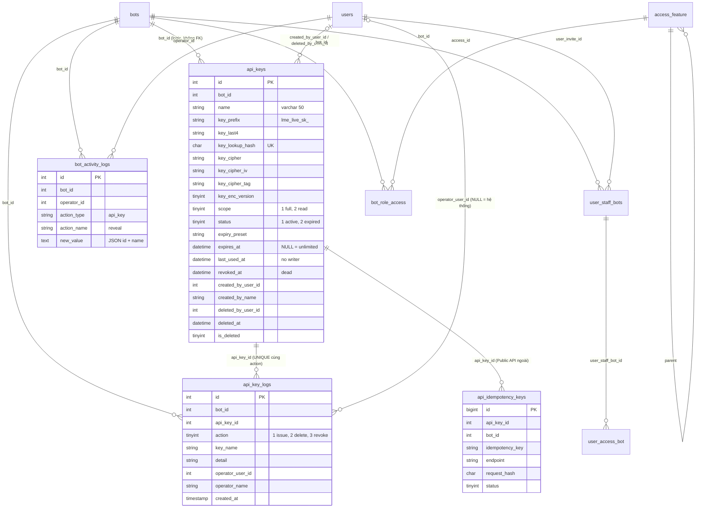

# [FA-046] Liên kết API (「API連携」) — DB Mapping

> Mapping giữa giao diện, API, logic với cơ sở dữ liệu cho tính năng `api-integration` (portal Admin).
> Nguồn: migration Laravel (3 bảng mới), DB schema (`db/schema/tables/`), sample data (`db/data/`), model/repository/service trong `src/web/sns-line`, đối chiếu với `ui/ui-spec.md`, `_internal/db-hint.md`, `web/api-spec.md`, `web/logic-spec.md`.

| Mục | Giá trị |
|-----|--------|
| Ngày tạo | 2026-10-23 |
| Repo web | `src/web/sns-line` @ nhánh **`release_step_20260930_v2`**, commit **`4d9d07d159`** (2026-10-23) |
| Repo job | `src/job/linect-service` @ nhánh **`release-t09-2026`**, commit **`be6ef546`** — grep `api_keys` / `api_key_logs` / `api_idempotency` / `ApiKeyExpire` trong toàn repo: **0 kết quả** ⇒ không có job-spec |
| Đầu vào | `_internal/db-hint.md`, `ui/ui-spec.md` (SCR-API-01…05), `web/api-spec.md` (EP-01…06), `web/logic-spec.md` (mục 13), `db/index.md`, `db/schema/tables/*.sql`, `db/data/*.sql`, 4 migration, 3 model |
| Chế độ | **Code-first** — không có quan sát runtime; 3 bảng chính **không có dữ liệu mẫu** |

---

## 1. Nguồn dữ liệu & cảnh báo

### ⚠ Cảnh báo 1 — 3 bảng của tính năng KHÔNG có trong DB dump

| Bảng | `db/schema/tables/{t}.sql` | `db/data/{t}.sql` | `db/index.md` | Nguồn schema thay thế |
|------|:---:|:---:|:---:|----------------------|
| `api_keys` | ❌ | ❌ | ❌ | `database/migrations/2026_08_24_100001_create_api_keys_table.php` |
| `api_key_logs` | ❌ | ❌ | ❌ | `database/migrations/2026_08_24_100002_create_api_key_logs_table.php` |
| `api_idempotency_keys` | ❌ | ❌ | ❌ | `database/migrations/2026_08_24_100003_create_api_idempotency_keys_table.php` |

Hệ quả:
- **Cấu trúc cột / kiểu / nullable / default / index**: **Cao** — đọc trực tiếp Blueprint (Laravel **5.5**, `composer.json:17`); kiểu MySQL quy đổi theo grammar chuẩn của Laravel 5.5 (vd `increments` → `int(10) unsigned AUTO_INCREMENT`, `timestamps()` → 2 cột `timestamp NULL`).
- **Charset / collation thực tế của bảng**: **Trung bình** — migration không khai báo ⇒ lấy theo kết nối `utf8mb4` / `utf8mb4_unicode_ci` (`config/database.php:50-51`), giả định bảng được tạo bằng chính kết nối này.
- **KHÔNG có sample data** — mọi "bản ghi minh hoạ" trong tài liệu này được **suy ra từ code** (service/presenter), không phải dữ liệu quan sát. Quy tắc db-mapper "Cao = model khai báo rõ + sample data khớp" **không thể thoả vế sau** cho 3 bảng này; các mapping vẫn xếp **Cao** vì presenter/repository đọc–ghi đúng tên cột (CLAUDE.md §14), kèm cờ "chưa đối chiếu data".

→ **Hành động cần thiết**: export lại DB sau khi migration `2026_08_24_*` đã chạy trên môi trường đích, tách lại theo `CLAUDE.md` mục 5, rồi chạy lại `/spec-db api-integration`.

### ⚠ Cảnh báo 2 — Dump DB cũ hơn source (không có dấu vết tính năng)

| Kiểm tra | Kết quả |
|---------|--------|
| `bot_activity_logs` — `created_at` mới nhất trong dump | `2026-04-17 08:47:53` (95 bản ghi) — **trước** migration `2026_08_24` ⇒ **0 bản ghi** `action_type = 'api_key'` |
| `access_feature` — có route `apiIntegration` / URL `/basic/api-integration` / tên 「API連携」? | **KHÔNG** (669 bản ghi, id lớn nhất 809). Command `access-feature:api-integration` chưa chạy trên DB được dump |
| `bot_role_access` — có quyền nào trỏ tới màn API連携? | **KHÔNG** (27.828 bản ghi, `access_id` lớn nhất 782) |
| `bot_activity_logs` có trong dump? | **CÓ** (`db/schema/tables/bot_activity_logs.sql` + `db/data/bot_activity_logs.sql`, 9 cột, khớp migration `2026_03_18_100001`) |

### ⚠ Cảnh báo 3 — Sai tên bảng trong `logic-spec.md` / `api-spec.md`

`logic-spec.md` (mục 13, dòng 398) và `api-spec.md` (dòng 343) ghi side effect của middleware là **`user_access_bots`** (số nhiều). Thực tế:

| Nguồn | Tên |
|------|-----|
| Model `app/UserAccessBot.php:11` | `protected $table = 'user_access_bot';` |
| `db/index.md` dòng 310 | `user_access_bot` — 9 cột, 1.7MB |
| `db/schema/tables/` | `user_access_bot.sql` (không có `user_access_bots.sql`) |

→ **Tên đúng: `user_access_bot` (số ít)**. Tài liệu này dùng tên đúng. **Cao**.
>
> ✅ **Đã sửa** trong `logic-spec.md` §13 và `api-spec.md` §4 ở vòng kiểm tra 2026-10-23 (validation-report V-03).

### Ghi chú 4 — File schema đã tách không chứa PK/Index

Các file `db/schema/tables/*.sql` (vd `bot_activity_logs.sql`, `user_staff_bots.sql`) chỉ có danh sách cột, **không có `PRIMARY KEY` / `KEY`** (dump gốc khai báo khoá ở khối `ALTER TABLE` riêng, không được script tách giữ lại). ⇒ Index của bảng có sẵn chỉ xác minh được qua migration (nếu có); với `bots`, `users`, `user_staff_bots`, `access_feature`, `bot_role_access`, `user_access_bot` ghi "không xác minh được".

### Ghi chú 5 — Đường dẫn data
Data mẫu nằm phẳng ở `db/data/{table}.sql` (không có thư mục `db/data/tables/`).

---

## 2. Bảng dữ liệu liên quan

### 2.1 Bảng chính (Primary Tables)

| Bảng | Mô tả | Số dòng mẫu | Liên kết | Nguồn schema | Tin cậy |
|------|-------|-------------|---------|-------------|--------|
| **`api_keys`** | API key của 1 bot: tên, dạng che (`key_prefix` + `key_last4`), hash tra cứu, bản mã hoá AES-256-GCM, quyền, trạng thái, hạn dùng, người phát hành, cờ xoá mềm. Nguồn của SCR-API-01/03/04 | **0 — bảng mới, không có trong dump** | Model `App\Models\ApiKey`; Repository `ApiKeyRepository` | Migration `2026_08_24_100001` | Cấu trúc **Cao**; data: không có |
| **`api_key_logs`** | Lịch sử thao tác 「操作履歴」 (発行 / 削除 / 無効) — snapshot tên key, nội dung, người thao tác. Nguồn của SCR-API-05 | **0 — bảng mới** | Model `App\Models\ApiKeyLog`; Repository `ApiKeyLogRepository` | Migration `2026_08_24_100002` | Cấu trúc **Cao**; data: không có |

### 2.2 Bảng phụ (Secondary / Pivot / Log / Config)

| Bảng | Mô tả vai trò trong FA-046 | Kiểu | Liên kết chính | Thao tác của web | Nguồn schema | Tin cậy |
|------|---------------------------|------|---------------|-----------------|-------------|--------|
| `api_idempotency_keys` | Chống xử lý trùng cho Public API `/v1/*` (ngoài repo). Web **chỉ tạo bảng**, không có model/repository | Bảng kỹ thuật của service ngoài | `api_keys.id` | **Không đọc, không ghi** | Migration `2026_08_24_100003` (bảng mới, không có trong dump) | Cao (cấu trúc) / Thấp (cách dùng thực tế) |
| `bot_activity_logs` | Audit mỗi lần xem lại full key (👁 / ⧉ lần đầu) — `action_type='api_key'`, `action_name='reveal'`. Hiển thị ở màn 「接続設定」, **không** ở drawer 操作履歴 | Log (bảng có sẵn, được mở rộng giá trị enum) | `bots.id`, `users.id` | **INSERT** (EP-05) | Dump (9 cột) + migration `2026_03_18_100001` | Cao |
| `bots` | (a) Khoá hàng `SELECT … FOR UPDATE` tuần tự hoá phát hành; (b) `admin_id` để nhận ra chủ bot (vai trò 「主管理者」); (c) middleware phân quyền | Master | `api_keys.bot_id` | **Chỉ SELECT** | Dump (115 cột, 223 bản ghi) | Cao |
| `users` | `username` — tên trong 「発行者」 (join hiện tại) và snapshot `created_by_name` / `operator_name` | Master | `api_keys.created_by_user_id`, `Auth::id()` | **Chỉ SELECT** | Dump (73 cột, 202 bản ghi) | Cao |
| `user_staff_bots` | `role_id` (vai trò trong bot) với `status = 1`; guard staff của middleware | Pivot user ↔ bot | `user_invite_id` = `api_keys.created_by_user_id` / `Auth::id()` | **Chỉ SELECT** | Dump (14 cột, 612 bản ghi) | Cao |
| `access_feature` | Khai báo màn 「API連携」 + 5 route AJAX để phân quyền staff | Config phân quyền | `bot_role_access.access_id` | **SELECT** (middleware); **INSERT** (command `access-feature:api-integration`, chạy tay) | Dump (8 cột, 669 bản ghi — **chưa có** dòng API連携) | Cao |
| `bot_role_access` | Gán màn cho `role_id` của staff trong bot | Pivot role ↔ feature | `access_feature.id`, `bots.id` | **Chỉ SELECT** (middleware) | Dump (7 cột, 27.828 bản ghi) | Cao |
| `user_access_bot` | Nhật ký truy cập staff (1 bản ghi/ngày/staff) — side effect chung của middleware `basic_access`, **không riêng FA-046** | Log | `user_staff_bots.id` | **INSERT** (middleware) | Dump (9 cột, 10.873 bản ghi) | Cao |

Đã kiểm tra và **loại**: bảng `roles` (quan hệ `UserStaffBot::role()` có khai báo nhưng FA-046 dùng hàm tĩnh `UserStaffBot::getRoleName()` — không đọc bảng `roles`); `bot_slots`, `user_bot` (không có truy vấn nào trong luồng). **Cao**.

### 2.3 Ma trận CRUD theo endpoint

| Bảng | EP-01 `index` | EP-02 `getKeys` | EP-03 `issueKey` | EP-04 `deleteKey` | EP-05 `revealKey` | EP-06 `getLogs` | Middleware `basic_access` (mọi EP) | Command (chạy tay) | Hệ thống ngoài (dự kiến, không có trong source) |
|------|:---:|:---:|:---:|:---:|:---:|:---:|:---:|:---:|:---:|
| `api_keys` | – | R | R (exists, count) + **C** | R + **U** (soft delete) | R | – | – | – | R (`key_lookup_hash`), **U** (`last_used_at`, `status=2`, `revoked_at`) |
| `api_key_logs` | – | – | **C** (action 1) | **C** (action 2) | – | R (paginate) | – | **U** `detail` (`api-integration:recover-delete-detail`) | **C** (action 3) |
| `api_idempotency_keys` | – | – | – | – | – | – | – | – | C/R/U/D |
| `bot_activity_logs` | – | – | – | – | **C** | – | – | – | – |
| `bots` | – | R (join `admin_id`) | R `FOR UPDATE` + R `admin_id` | R `admin_id` | – | – | R | – | – |
| `users` | – | R (join `username`) | R (`Auth::user()`) | R (`Auth::user()`) | – | – | R | – | – |
| `user_staff_bots` | – | R (join `role_id`) | R (`role_id`) | R (`role_id`) | – | – | R | – | – |
| `access_feature` | – | – | – | – | – | – | R (staff) | **C** (`access-feature:api-integration`) | – |
| `bot_role_access` | – | – | – | – | – | – | R (staff) | – | – |
| `user_access_bot` | – | – | – | – | – | – | **C** (staff, 1 lần/ngày) | – | – |

Nguồn: `ApiKeyRepository.php:36-144`, `ApiKeyLogRepository.php:23-66`, `ApiKeyService.php:57-354`, `ApiIntegrationController.php:192-242`, `BasicAccess.php:31-75`, `functions.php:5044-5130`. **Cao**.

---

## 3. Chi tiết từng bảng

### Bảng: `api_keys`
- **Engine / Charset**: InnoDB (mặc định server — **Trung bình**) / `utf8mb4` + `utf8mb4_unicode_ci` (theo kết nối — **Trung bình**)
- **Model Laravel**: `App\Models\ApiKey` (`app/Models/ApiKey.php`) — `$table = 'api_keys'`, `$timestamps = true`, kết nối mặc định `mysql` (không khai báo `$connection`), **không** dùng trait `SoftDeletes` (xoá mềm thủ công qua `is_deleted`)
- **Casts** (`:41-47`): `bot_id`, `scope`, `status`, `key_enc_version`, `is_deleted` ⇒ integer. `expires_at`, `last_used_at` **không cast** (xử lý bằng `strtotime`)
- **Nguồn schema**: migration `2026_08_24_100001_create_api_keys_table.php` (**không có trong dump**)

#### Columns

| # | Cột | Kiểu MySQL (Laravel 5.5) | Nullable? | Default | Key | Mô tả | Ghi bởi | Đọc bởi / lên UI |
|---|-----|------|:---:|---------|-----|-------|--------|-----------------|
| 1 | `id` | int(10) unsigned AUTO_INCREMENT | Không | — | PK | Khoá chính; `row-key` của bảng SCR-API-01; tham số `{id}` của EP-04/EP-05 | DB | EP-02 (`id`), EP-03 (`id`), `ORDER BY id DESC` |
| 2 | `bot_id` | int(11) | Không | — | idx (3 index) | Bot sở hữu key (biên giới tenant) — luôn = `getBotId()` từ session | EP-03 | Mọi truy vấn (`WHERE bot_id`) |
| 3 | `name` | varchar(50) | Không | — | idx `idx_api_keys_bot_name` | 「キー名」 — đã `trim`, ≤ 50 ký tự (`mb_strlen`), không trùng trong bot (chỉ xét key chưa xoá) | EP-03 | SCR-API-01 cột 「キー名」, tìm kiếm LIKE; SCR-API-03; SCR-API-04 |
| 4 | `key_prefix` | varchar(12) | Không | — | — | Luôn `lme_live_sk_` (config `api_integration.key_prefix`) | EP-03 | Dạng che 「APIキー」 |
| 5 | `key_last4` | varchar(4) | Không | — | — | 4 ký tự hex cuối của plaintext (`substr($plain, -4)`) | EP-03 | Dạng che 「APIキー」 |
| 6 | `key_lookup_hash` | char(64) | Không | — | **UNIQUE** `uk_api_keys_lookup` | `hash_hmac('sha256', plaintext, API_KEY_PEPPER)` — 64 hex. Dùng để Public API tra key | EP-03 | **Web không đọc** |
| 7 | `key_cipher` | varchar(255) | Không | — | — | base64(ciphertext AES-256-GCM) — với key 44 byte ⇒ 60 ký tự | EP-03 | EP-05 (giải mã) |
| 8 | `key_cipher_iv` | varchar(32) | Không | — | — | base64(IV 12 byte ngẫu nhiên) ⇒ 16 ký tự | EP-03 | EP-05 |
| 9 | `key_cipher_tag` | varchar(32) | Không | — | — | base64(GCM tag 16 byte) ⇒ 24 ký tự | EP-03 | EP-05 |
| 10 | `key_enc_version` | tinyint(4) | Không | `1` | — | Phiên bản khoá mã hoá (env `API_KEY_ENC_VERSION`) | EP-03 | **Chỉ ghi vào log lỗi** khi giải mã thất bại — `decrypt()` không chọn khoá theo cột này |
| 11 | `scope` | tinyint(4) | Không | `1` | — | Quyền: 1 「全権限」 / 2 「読み取り専用」 | EP-03 | SCR-API-01 「権限」, SCR-API-03; log detail |
| 12 | `status` | tinyint(4) | Không | `1` | idx `idx_api_keys_expire_scan` | 1 「有効」 / 2 「無効」 (chỉ do hết hạn). **Web chỉ ghi 1** | EP-03 (=1); hệ thống ngoài (=2, dự kiến) | Trạng thái hiển thị + bộ lọc |
| 13 | `expiry_preset` | varchar(16) | Không | `'30'` | — | Preset gốc: `'1'` / `'7'` / `'30'` / `'unlimited'` | EP-03 | **Không lên UI** (không đọc lại) |
| 14 | `expires_at` | datetime | Có | NULL | idx `idx_api_keys_expire_scan` | Mốc hết hạn, luôn `23:59:59` giờ Asia/Tokyo; NULL = 「無期限」 | EP-03 | 「有効期限」, trạng thái hiển thị, bộ lọc |
| 15 | `last_used_at` | datetime | Có | NULL | — | Lần gọi API gần nhất; NULL ⇒ 「未使用」 | **Không có writer trong source** (Public API ngoài — dự kiến) | 「最終利用」 |
| 16 | `revoked_at` | datetime | Có | NULL | — | Thời điểm job chuyển 「無効」 (comment migration `:33`) | **Không có writer** | **Không có reader** |
| 17 | `created_by_user_id` | int(11) | Có | NULL | — | Người phát hành (`Auth::id()`) → `users.id` | EP-03 | JOIN `users` / `user_staff_bots` / so `bots.admin_id` ⇒ 「発行者」 |
| 18 | `created_by_name` | varchar(255) | Không | `''` | — | Snapshot 「<username>（<vai trò>）」 lúc phát hành, hoặc 「システム（自動）」 | EP-03 | Chỉ là **fallback** của 「発行者」 khi JOIN `users` không ra tên |
| 19 | `deleted_by_user_id` | int(11) | Có | NULL | — | Người xoá (`Auth::id()`) | EP-04 | **Không có reader** |
| 20 | `deleted_at` | datetime | Có | NULL | — | Thời điểm xoá mềm (`date('Y-m-d H:i:s')`) | EP-04 | **Không có reader** |
| 21 | `is_deleted` | tinyint(4) | Không | `0` | idx `idx_api_keys_bot_list` | Cờ xoá mềm 0/1, một chiều | EP-03 (=0), EP-04 (=1) | Mọi truy vấn `WHERE is_deleted = 0` |
| 22 | `created_at` | timestamp | Có | NULL | — | Eloquent tự set | EP-03 | **Không lên UI** |
| 23 | `updated_at` | timestamp | Có | NULL | — | Eloquent tự set; cũng được cập nhật khi soft delete (Eloquent Builder `update()` tự thêm `updated_at`) | EP-03, EP-04 | **Không lên UI** |

#### Indexes

| Tên Index | Cột | Kiểu | Phục vụ truy vấn |
|----------|-----|------|-----------------|
| PRIMARY | `id` | Primary | `findForBot`, `softDeleteForBot` (kèm `bot_id`, `is_deleted`) |
| `uk_api_keys_lookup` | `key_lookup_hash` | **Unique** | Tra key theo hash ở Public API (ngoài); đảm bảo không trùng key |
| `idx_api_keys_bot_list` | `bot_id, is_deleted, id` | Index | `getAllForBot` (`WHERE bot_id, is_deleted ORDER BY id DESC`), `countActiveRowsForBot` |
| `idx_api_keys_bot_name` | `bot_id, name` | Index (**không unique** vì soft delete — tên của key đã xoá được dùng lại) | `existsNameForBot` |
| `idx_api_keys_expire_scan` | `status, expires_at` | Index | Dành cho job quét hết hạn `ApiKeyExpireTask` (**không có trong source**) |

#### Foreign Keys
**Không có** — migration ghi rõ "KHÔNG khai báo FOREIGN KEY… toàn vẹn giữ ở tầng ứng dụng" (`:10-11`). Quan hệ logic: `bot_id → bots.id`, `created_by_user_id → users.id`, `deleted_by_user_id → users.id`. **Cao**.

#### Sample Data
**Không có — bảng mới, không có trong dump.**

Bản ghi **minh hoạ** (suy từ `ApiKeyService::issue` — KHÔNG phải dữ liệu thật):

| id | bot_id | name | key_prefix | key_last4 | key_lookup_hash | key_cipher / iv / tag | key_enc_version | scope | status | expiry_preset | expires_at | last_used_at | created_by_user_id | created_by_name | is_deleted |
|----|--------|------|-----------|-----------|----------------|----------------------|:---:|:---:|:---:|:---:|-----------|-------------|:---:|----------------|:---:|
| 3 | 541 | `予約システム連携` | `lme_live_sk_` | `a1b2` | (64 hex) | (base64 60 / 16 / 24 ký tự) | 1 | 1 | 1 | `'30'` | `2026-11-22 23:59:59` | NULL | 115 | `鈴木（主管理者）` | 0 |
| 4 | 541 | `分析ツール` | `lme_live_sk_` | `9f0e` | (64 hex) | (…) | 1 | 2 | 1 | `'unlimited'` | NULL | NULL | 513 | `田中（運用者）` | 0 |

---

### Bảng: `api_key_logs`
- **Model Laravel**: `App\Models\ApiKeyLog` (`app/Models/ApiKeyLog.php`) — `$table = 'api_key_logs'`, `$timestamps = false` (chỉ có `created_at`, code tự set), kết nối mặc định
- **Casts**: `bot_id`, `api_key_id`, `action` ⇒ integer
- **Nguồn schema**: migration `2026_08_24_100002_create_api_key_logs_table.php` (**không có trong dump**)

#### Columns

| # | Cột | Kiểu MySQL | Nullable? | Default | Key | Mô tả | Ghi bởi | Đọc bởi / lên UI |
|---|-----|------|:---:|---------|-----|-------|--------|-----------------|
| 1 | `id` | int(10) unsigned AUTO_INCREMENT | Không | — | PK | Khoá chính; thứ tự timeline `ORDER BY id DESC` | DB | EP-06 (`id`) |
| 2 | `bot_id` | int(11) | Không | — | idx `idx_api_key_logs_bot` | Bot | EP-03, EP-04 | `WHERE bot_id` |
| 3 | `api_key_id` | int(10) unsigned | Không | — | **UNIQUE** (cùng `action`) | Key liên quan — giữ cả khi key đã xoá mềm | EP-03, EP-04 | **Web không đọc** (chỉ ràng buộc unique) |
| 4 | `action` | tinyint(4) | Không | — | **UNIQUE** (cùng `api_key_id`) | 1 「発行」 / 2 「削除」 / 3 「無効」 | EP-03 (=1), EP-04 (=2); hệ thống ngoài (=3, dự kiến) | Tag loại, bộ lọc SCR-API-05 |
| 5 | `key_name` | varchar(50) | Không | — | — | **Snapshot** tên key tại thời điểm thao tác | EP-03, EP-04 | Tên key cạnh tag |
| 6 | `detail` | varchar(500) | Không | `''` | — | Nội dung: 発行 「権限：… ／ 有効期限：…」; 削除 「一覧から削除しました」 | EP-03, EP-04; command recover (UPDATE) | Dòng nội dung thẻ timeline |
| 7 | `operator_user_id` | int(11) | Có | NULL | — | Người thao tác; **NULL = hệ thống** | EP-03, EP-04 | **Web không đọc** |
| 8 | `operator_name` | varchar(255) | Không | — (không default) | — | Snapshot 「<username>（<vai trò>）」 hoặc 「システム（自動）」 | EP-03, EP-04 | 「操作者：…」 |
| 9 | `created_at` | timestamp | Không | `CURRENT_TIMESTAMP` (`useCurrent()`) | — | Thời điểm thao tác — web **luôn set tường minh** `date('Y-m-d H:i:s')` (Asia/Tokyo), không dựa vào default | EP-03, EP-04 | Thời gian thẻ (`Y/m/d H:i`) |

#### Indexes

| Tên Index | Cột | Kiểu | Phục vụ truy vấn |
|----------|-----|------|-----------------|
| PRIMARY | `id` | Primary | — |
| `idx_api_key_logs_bot` | `bot_id, id` | Index | `paginateForBot` (`WHERE bot_id [AND action] ORDER BY id DESC LIMIT/OFFSET`) |
| `uk_api_key_logs_action` | `api_key_id, action` | **Unique** | Mỗi key tối đa 1 log mỗi loại ⇒ job hết hạn idempotent "tự nhiên" (comment `:29`) |

> Command `api-integration:recover-delete-detail` lọc `WHERE action = 2 AND detail = ?` trên **toàn bảng** (không lọc `bot_id`) — không có index hỗ trợ ⇒ full scan; chấp nhận được vì chạy tay 1 lần. **Cao**.

#### Foreign Keys
**Không có.** Quan hệ logic: `bot_id → bots.id`, `api_key_id → api_keys.id`, `operator_user_id → users.id`. **Cao**.

#### Sample Data
**Không có — bảng mới, không có trong dump.**

Bản ghi **minh hoạ** (suy từ `ApiKeyService::issue` / `deleteKey`):

| id | bot_id | api_key_id | action | key_name | detail | operator_user_id | operator_name | created_at |
|----|--------|-----------|:---:|----------|--------|:---:|--------------|-----------|
| 12 | 541 | 3 | 1 | `予約システム連携` | `権限：全権限 ／ 有効期限：2026/11/22` | 115 | `鈴木（主管理者）` | `2026-10-23 10:15:00` |
| 13 | 541 | 4 | 1 | `分析ツール` | `権限：読み取り専用 ／ 有効期限：無期限` | 513 | `田中（運用者）` | `2026-10-23 11:02:41` |
| 14 | 541 | 3 | 2 | `予約システム連携` | `一覧から削除しました` | 115 | `鈴木（主管理者）` | `2026-10-24 09:30:12` |
| (dự kiến) | 541 | 5 | 3 | … | **(không rõ — do job ngoài ghi)** | NULL | `システム（自動）` | … |

---

### Bảng: `api_idempotency_keys`
- **Model Laravel**: **không có** (comment migration `:13`: "Web KHÔNG đọc/ghi bảng này ⇒ không có model/repository")
- **Nguồn schema**: migration `2026_08_24_100003_create_api_idempotency_keys_table.php` (**không có trong dump**)
- **Chủ dữ liệu**: Public API `/v1/*` + job `ApiIdempotencyCleanupTask` dọn hằng ngày — **cả hai không có trong source** (gap).

#### Columns

| # | Cột | Kiểu MySQL | Nullable? | Default | Key | Mô tả |
|---|-----|------|:---:|---------|-----|-------|
| 1 | `id` | bigint(20) unsigned AUTO_INCREMENT | Không | — | PK | Khoá chính |
| 2 | `api_key_id` | int(10) unsigned | Không | — | **UNIQUE** (cùng `idempotency_key`) | Key gọi API → `api_keys.id` |
| 3 | `bot_id` | int(11) | Không | — | — | Bot |
| 4 | `idempotency_key` | varchar(255) | Không | — | **UNIQUE** (cùng `api_key_id`) | Giá trị client gửi |
| 5 | `endpoint` | varchar(64) | Không | — | — | Tên endpoint, vd `messages.push` |
| 6 | `request_hash` | char(64) | Không | — | — | SHA-256 body đã chuẩn hoá |
| 7 | `status` | tinyint(4) | Không | `0` | — | 0 đang xử lý / 1 xong |
| 8 | `response_code` | smallint(6) | Có | NULL | — | HTTP status đã trả |
| 9 | `response_body` | mediumtext | Có | NULL | — | Body đã trả (để phát lại) |
| 10 | `created_at` | timestamp | Có | NULL | idx `idx_idem_cleanup` | Dùng để dọn |
| 11 | `updated_at` | timestamp | Có | NULL | — | — |

#### Indexes

| Tên Index | Cột | Kiểu | Mô tả |
|----------|-----|------|-------|
| PRIMARY | `id` | Primary | — |
| `uk_idem` | `api_key_id, idempotency_key` | **Unique** | "Chính cơ chế chống trùng — dựa vào lỗi trùng khoá của INSERT" (`:31`) |
| `idx_idem_cleanup` | `created_at` | Index | Job dọn theo tuổi bản ghi |

#### Foreign Keys / Sample Data
Không có FK. **Không có sample data — bảng mới.** Không có màn hình nào của FA-046 hiển thị bảng này.

---

### Bảng: `bot_activity_logs` (bảng có sẵn — FA-046 thêm giá trị enum mới)
- **Model Laravel**: `App\Models\BotActivityLog` — `$guarded = []`, timestamps mặc định (`created_at`, `updated_at`); quan hệ `operator()` belongsTo `App\User` (`operator_id`)
- **Nguồn schema**: dump `db/schema/tables/bot_activity_logs.sql` **khớp hoàn toàn** migration `2026_03_18_100001_create_bot_activity_logs_table.php` (9 cột)

#### Columns

| # | Cột | Kiểu | Nullable? | Default | Key | Mô tả | Giá trị khi reveal (FA-046) |
|---|-----|------|:---:|---------|-----|-------|---------------------------|
| 1 | `id` | int(10) unsigned AUTO_INCREMENT | Không | — | PK | Khoá chính | — |
| 2 | `bot_id` | int(10) unsigned | Không | — | idx (migration `->index()`) | Bot | `getBotId()` |
| 3 | `operator_id` | int(10) unsigned | Không | — | idx (migration `->index()`) | Người thao tác | `(int) Auth::id()` (NULL ⇒ 0) |
| 4 | `action_type` | varchar(20) | Không | — | — | Nhóm thao tác — comment migration chỉ liệt kê `change \| delete` | **`'api_key'`** (giá trị mới, `TYPE_API_KEY`) |
| 5 | `action_name` | varchar(50) | Không | — | — | Tên thao tác | **`'reveal'`** (`ACTION_REVEAL_API_KEY`) |
| 6 | `old_value` | text | Có | NULL | — | Giá trị cũ | `NULL` |
| 7 | `new_value` | text | Có | NULL | — | Giá trị mới | JSON `{"api_key_id": <id>, "name": "<キー名>"}` (`JSON_UNESCAPED_UNICODE`) — vì bảng không có cột `target_id` |
| 8 | `created_at` | timestamp | Có | NULL | — | Eloquent | now |
| 9 | `updated_at` | timestamp | Có | NULL | — | Eloquent | now |

> Index lấy từ migration (file schema đã tách không có khoá — Ghi chú 4). **Cao**.

#### Sample Data (dump — 95 bản ghi, `created_at` 2026-03-19 … 2026-04-17)

Phân bố `action_type` / `action_name` trong dump: `change`/`change_bot_name` 45 · `change`/`change_bot_image` 21 · `change`/`change_channel_secret` 14 · `delete`/`delete_bot_image` 9 · `change`/`change_login_channel_id` 3 · `change`/`change_login_channel_secret` 3 · **`api_key`/`reveal` 0** (dump trước tính năng).

| id | bot_id | operator_id | action_type | action_name | old_value | new_value | created_at |
|----|--------|-------------|-------------|-------------|-----------|-----------|-----------|
| 1 | 46612 | 115 | `change` | `change_bot_name` | `Anh 332` | `Anh 33` | 2026-03-19 03:13:38 |
| 18 | 46612 | 115 | `delete` | `delete_bot_image` | `/msg_template/media/images/…png` | NULL | 2026-03-19 04:30:30 |
| (minh hoạ FA-046) | 541 | 115 | `api_key` | `reveal` | NULL | `{"api_key_id":3,"name":"予約システム連携"}` | — |

---

### Bảng: `bots` (chỉ phần liên quan)
- **Model**: `App\Bots` (dump: 115 cột, **223 bản ghi**; `db/index.md` ghi 113 cột — lệch đã biết)

| Cột | Kiểu | Nullable? | Default | Dùng trong FA-046 |
|-----|------|:---:|---------|------------------|
| `id` | int(12) | Không | — | `lockBotRow`: `SELECT * FROM bots WHERE id = ? LIMIT 1 FOR UPDATE` (EP-03); JOIN `bots.id = api_keys.bot_id` (EP-02) |
| `admin_id` | int(12) | Không | — | Nhận ra chủ bot ⇒ vai trò 0 「主管理者」 (EP-02 presenter, `resolveOperatorName`); middleware `bots.admin_id !== Auth::id()` ⇒ coi là staff |
| `is_deleted` | tinyint(1) | Không | `0` | **Không** được lọc trong JOIN của `getAllForBot` (không ảnh hưởng vì bot hiện tại luôn tồn tại) |

Sample (dump): `(id=541, admin_id=115)`, `(id=948, admin_id=115)`, `(id=1029, admin_id=506)`.

### Bảng: `users` (chỉ phần liên quan)
- **Model**: `App\User` (dump: 73 cột, **202 bản ghi**)

| Cột | Kiểu | Nullable? | Default | Dùng trong FA-046 |
|-----|------|:---:|---------|------------------|
| `id` | int(11) | Không | — | JOIN `users.id = api_keys.created_by_user_id`; `Auth::id()` |
| `username` | varchar(255) | Không | — | Tên hiển thị trong 「発行者」 (hiện tại) và snapshot `created_by_name` / `operator_name` (đã `trim`). Bảng **không có** cột `name` |
| `role` | tinyint(1) | Không | `1` | Middleware: chỉ cho `-1, 0, 1, 2` (comment cột: `-1 admin, 0 user, 2 staff`) |
| `is_deleted` | tinyint(1) | Không | `0` | **Không** được lọc trong JOIN 「発行者」 (xem Phát hiện DB-05) |

Phân bố dump: `role` 0 → 183, -1 → 16, 2 → 3; `is_deleted` = 0 cho cả 202 bản ghi. Sample không trích dẫn email/mật khẩu.

### Bảng: `user_staff_bots` (chỉ phần liên quan)
- **Model**: `App\UserStaffBot` — `STATUS_NO_ACTION = 0`, `STATUS_ACCEPT = 1`, `STATUS_REJECT = 2`; `getRoleName()` (`app/UserStaffBot.php:30-37`)

| Cột | Kiểu | Nullable? | Default | Dùng trong FA-046 |
|-----|------|:---:|---------|------------------|
| `id` | int(10) unsigned | Không | — | `user_access_bot.user_staff_bot_id` |
| `bot_id` | int(10) unsigned | Không | — | Điều kiện JOIN `usb.bot_id = :bot` (nằm trong `ON`) |
| `role_id` | int(10) unsigned | Không | — | Vai trò ⇒ 「主管理者」/「副管理人」/「運用者」/「サポート」 |
| `user_invite_id` | int(10) unsigned | Có | NULL | = `api_keys.created_by_user_id` / `Auth::id()` |
| `status` | tinyint(4) | Không | `1` | Chỉ lấy `status = 1` (accept). Comment: `0 no action, 1 accept, 2 reject` |
| `staff_name` | varchar(255) | Có | NULL | **Không dùng** cho tên (đã đổi sang `users.username` — docblock controller `:177-178` lỗi thời); chỉ middleware chép vào `user_access_bot.staff_name` |
| `is_admin` | int(11) | Không | `0` | Không dùng trong FA-046 |

Phân bố dump (612 bản ghi): `role_id` 0 → 280 · 1 → 203 · 2 → 104 · 3 → 25; `status` 1 → 501 · 0 → 103 · 2 → 8. Hàng `role_id = 0` đều có `user_invite_id = user_id` = chủ bot (vd `(id=217, bot_id=948, role_id=0, user_invite_id=115, status=1)`). **Không có** cặp (`bot_id`, `user_invite_id`) nào có >1 hàng `status = 1` ⇒ rủi ro LEFT JOIN nhân bản dòng key (logic-spec mục 5) **không xảy ra trên dump**. **Cao** (trên dump).

### Bảng: `access_feature` (chỉ phần liên quan)

| Cột | Kiểu | Nullable? | Default | Giá trị command `access-feature:api-integration` ghi |
|-----|------|:---:|---------|---------------------------------------------------|
| `id` | int(10) unsigned | Không | — | auto |
| `name` | varchar(255) | Không | — | Cha: 「API連携」; 5 con: `''` |
| `url` | varchar(255) | Không | — | `/basic/api-integration`, `/basic/api-integration/keys` (×2), `/keys/{id}`, `/keys/{id}/reveal`, `/logs` |
| `parent` | int(11) | Không | — | Cha: 0; con: id cha |
| `route` | varchar(255) | Không | — | `apiIntegration`, `apiIntegration.keys`, `apiIntegration.keys.store`, `apiIntegration.keys.destroy`, `apiIntegration.keys.reveal`, `apiIntegration.logs` |
| `visible` | int(11) | Không | `1` | Cha: 1; con: 0 |
| `order` | int(11) | Không | `0` | 0 |
| `menu_id` | int(11) | Có | NULL | **Không set ⇒ NULL cho cả cha** (xem Phát hiện DB-02) |

Dump: 669 bản ghi, **không có** dòng nào của API連携. Trong dump, mọi dòng cha có `visible = 1` đều có `menu_id` khác NULL; 9 dòng cha `menu_id = NULL` đều `visible = 0`.

### Bảng: `bot_role_access`

| Cột | Kiểu | Nullable? | Default | Dùng trong FA-046 |
|-----|------|:---:|---------|------------------|
| `id` | int(10) unsigned | Không | — | — |
| `admin_id` | int(11) | Không | — | — |
| `bot_id` | int(11) | Không | — | `WHERE bot_id = getBotId()` |
| `role_id` | int(11) | Không | — | `WHERE role_id = user_staff_bots.role_id` |
| `access_id` | int(11) | Không | — | → `access_feature.id` (cha) ⇒ cộng thêm route con `parent = id AND menu_id IS NULL` |
| `created_at` / `updated_at` | timestamp | Không | `CURRENT_TIMESTAMP` | — |

Dump: 27.828 bản ghi; `role_id` 1 → 15.817 · 2 → 10.289 · 3 → 1.722 (không có role 0 — chủ bot không đi qua nhánh này); `access_id` lớn nhất 782 ⇒ **không có** quyền API連携.

### Bảng: `user_access_bot`

| Cột | Kiểu | Nullable? | Giá trị middleware ghi |
|-----|------|:---:|----------------------|
| `id` | int(10) unsigned | Không | auto |
| `bot_id` | bigint(20) | Không | `getBotId()` |
| `staff_id` | bigint(20) | Không | `Auth::id()` |
| `staff_name` | varchar(255) | Không | `user_staff_bots.staff_name` |
| `time_access` | timestamp | Có | now |
| `ip` | varchar(255) | Có | `$request->ip()` |
| `user_staff_bot_id` | int(11) | Có | `user_staff_bots.id` |
| `created_at` / `updated_at` | timestamp | Có | Eloquent |

Điều kiện ghi: có hàng `user_staff_bots (bot_id, user_invite_id = Auth::id())` **và** chưa có bản ghi `time_access` trong hôm nay **và** session không phải `is_login_from_admin` (`BasicAccess.php:55-75`). Dump: 10.873 bản ghi. Side effect chung — không phải logic của FA-046.

---

## 4. Mapping UI ↔ Database

Ký hiệu Mapping type: **Direct** (đọc/ghi thẳng 1 cột, có thể format) · **Computed** (suy ra từ ≥ 1 cột / logic) · **Enum** (giá trị số/chuỗi ↔ nhãn) · **FK** (qua JOIN bảng khác) · **Aggregated** (COUNT/SUM).

### Màn hình SCR-API-01: Danh sách API key 「API連携」 (EP-02, EP-05)

Điều kiện nền: `api_keys.bot_id = getBotId() AND api_keys.is_deleted = 0 ORDER BY api_keys.id DESC` — không phân trang.

| # | UI element | Label JP | Bảng | Cột | Mapping type | Transform / Response key | Confidence | Ghi chú |
|---|-----------|---------|------|-----|-------------|-------------------------|-----------|--------|
| 1 | Ô tìm kiếm | placeholder 「キー名を入力して検索」 | `api_keys` | `name` | Direct (bộ lọc) | Query `keyword` → `trim` → escape `% _ \` → `name LIKE '%kw%'` | Cao | So khớp theo collation `_ci` |
| 2 | Select trạng thái | 「すべてのステータス」/「有効」/「無効（期限切れ）」 | `api_keys` | `status`, `expires_at` | Computed (bộ lọc) | `active` ⇒ `status = 1 AND (expires_at IS NULL OR expires_at >= :now)`; `expired` ⇒ `status = 2 OR (expires_at IS NOT NULL AND expires_at < :now)`; `:now` = giờ PHP | Cao | Giá trị lạ ⇒ `all` |
| 3 | Cột trạng thái | 「ステータス」 | `api_keys` | `status`, `expires_at` | Computed + Enum | `ApiKey::displayStatus()` ⇒ response `status` = `active` / `expired` | Cao | Xem bảng chân trị §5.3 |
| 4 | Cột tên | 「キー名」 | `api_keys` | `name` | Direct | response `name` | Cao | |
| 5a | Cột key (dạng che) | 「APIキー」 | `api_keys` | `key_prefix`, `key_last4` | Computed | `key_prefix . str_repeat('•', 12) . key_last4` ⇒ response `key_masked` | Cao | Danh sách **không bao giờ** chứa full key |
| 5b | Cột key (👁 / ⧉ — full) | 「APIキー」 | `api_keys` | `key_cipher`, `key_cipher_iv`, `key_cipher_tag` | Computed | EP-05: base64 decode → `openssl_decrypt` AES-256-GCM với env `API_KEY_ENC_KEY` ⇒ response `api_key` | Cao | `key_enc_version` **không** tham gia giải mã |
| 6 | Cột quyền | 「権限」 | `api_keys` | `scope` | Enum | 1 ⇒ `scope='full'`, `scope_label`=「全権限」; 2 ⇒ `read`/「読み取り専用」 | Cao | |
| 7 | Cột người phát hành | 「発行者」 | `api_keys` → `users`, `user_staff_bots`, `bots` | `created_by_user_id` → `users.username`; `user_staff_bots.role_id` (ON `user_invite_id = created_by_user_id AND bot_id = :bot AND status = 1`); `bots.admin_id`; fallback `api_keys.created_by_name` | FK + Computed | `presentIssuer()` ⇒ response `issued_by` = 「username（vai trò）」 / tên trần / snapshot / 「システム（自動）」 | Cao | Tên + vai trò **hiện tại**, không phải snapshot. Nhánh fallback chỉ chạy khi JOIN `users` không ra hàng (xoá cứng / NULL) — xem DB-05 |
| 8 | Cột hạn dùng | 「有効期限」 | `api_keys` | `expires_at` | Direct | `date('Y/m/d')`; NULL ⇒ `null` ⇒ FE in 「無期限」 | Cao | |
| 9 | Cột lần dùng cuối | 「最終利用」 | `api_keys` | `last_used_at` | Direct | `date('Y/m/d H:i')`; NULL ⇒ 「未使用」 | **Trung bình** | Đọc: Cao. **Không có writer trong source** ⇒ với code hiện tại luôn 「未使用」 |
| 10 | Cột thao tác | 「操作」 | — | — | — | Icon 🗑 | — (N/A) | Không có dữ liệu DB |
| 11 | Bộ đếm | 「全 N 件」 | `api_keys` | (tập kết quả sau lọc) | Aggregated | `count($keys)` trong PHP ⇒ `total_items` | Cao | Không phải `SELECT COUNT` riêng |
| 12 | Badge | 「有効」 (xanh) | `api_keys` | `status`, `expires_at` | Enum | `displayStatus() = 'active'` | Cao | |
| 13 | Badge + tooltip + nền dòng `#F0F0F0` | 「無効」 + 「有効期限切れのため自動で無効になりました」 | `api_keys` | `status`, `expires_at` | Enum | `displayStatus() = 'expired'` | Cao | Thực tế chỉ kích hoạt qua `expires_at < now` (không ai ghi `status = 2`) |
| 14 | Badge | 「全権限」 (cam) | `api_keys` | `scope` | Enum | `scope = 1` | Cao | |
| 15 | Badge | 「読み取り専用」 (xám) | `api_keys` | `scope` | Enum | `scope = 2` | Cao | |
| + | `row-key` (ẩn) | — | `api_keys` | `id` | Direct | response `id` | Cao | Bổ sung, không tính coverage |

**Thao tác ↔ DB (SCR-API-01)**

| Action | Bảng | SQL / ghi nhận | Confidence |
|--------|------|---------------|-----------|
| Tải trang / tìm kiếm / lọc | `api_keys` LEFT JOIN `users`, `user_staff_bots` (alias `usb`), `bots` | `SELECT api_keys.*, users.username AS issuer_username, usb.role_id AS issuer_role_id, bots.admin_id AS bot_admin_id … WHERE api_keys.bot_id = ? AND api_keys.is_deleted = 0 [LIKE] [status] ORDER BY api_keys.id DESC` | Cao |
| 👁 lần đầu / ⧉ khi chưa cache (EP-05) | `api_keys` (R), `bot_activity_logs` (**C**) | `SELECT … WHERE id = ? AND bot_id = ? AND is_deleted = 0 LIMIT 1` → giải mã → `INSERT bot_activity_logs (bot_id, operator_id, action_type='api_key', action_name='reveal', old_value=NULL, new_value='{"api_key_id":…,"name":"…"}', created_at, updated_at)` — **ngoài transaction**; `throttle:30,1` | Cao |
| ⧉ khi đã cache | — | Không gọi server | Cao |
| 🗑 | — | Chỉ mở SCR-API-04 | Cao |

### Màn hình SCR-API-02: Modal phát hành key 「APIキーを発行」 (EP-03)

| # | UI element | Label JP | Bảng | Cột | Mapping type | Transform | Confidence | Ghi chú |
|---|-----------|---------|------|-----|-------------|----------|-----------|--------|
| 16 | Input text | 「キー名」 | `api_keys`; `api_key_logs` | `api_keys.name`; `api_key_logs.key_name` (snapshot) | Direct | `trim`; `mb_strlen ≤ 50`; không trùng `(bot_id, is_deleted=0, name)` theo collation | Cao | `varchar(50)` khớp giới hạn 50 ký tự |
| 17 | Radio | 「権限」 「全権限」/「読み取り専用」 | `api_keys` | `scope` | Enum | `full` ⇒ 1, `read` ⇒ 2 (`resolveScopeFromApiValue`) | Cao | Cũng chụp vào `api_key_logs.detail` 「権限：…」 |
| 18 | Select | 「有効期限」 「1日」/「1週間」/「30日」/「無期限」 | `api_keys` | `expiry_preset`, `expires_at` | Direct (`expiry_preset`) + Computed (`expires_at`) | `expiry_preset` = `'1'\|'7'\|'30'\|'unlimited'` nguyên văn; `expires_at` = `date('Y-m-d', +N days) . ' 23:59:59'` (Asia/Tokyo), `unlimited` ⇒ NULL | Cao | Dòng xem trước ngày trong modal tính bằng **giờ trình duyệt** — không ghi DB |

**Thao tác ↔ DB (SCR-API-02 — 「発行する」)** — 1 transaction (`ApiKeyService.php:125-182`):

| Bước | Bảng | SQL | Ghi chú |
|------|------|-----|--------|
| 1 | `bots` | `SELECT * FROM bots WHERE id = ? LIMIT 1 FOR UPDATE` | Khoá hàng bot ⇒ tuần tự hoá phát hành |
| 2 | `api_keys` | `SELECT EXISTS(… WHERE bot_id = ? AND is_deleted = 0 AND name = ?)` | Có ⇒ 409 `name_duplicated`, rollback |
| 3 | `api_keys` | `SELECT COUNT(*) … WHERE bot_id = ? AND is_deleted = 0` | ≥ 10 (env) ⇒ 409 `key_limit_reached`; **đếm cả key 無効** |
| 4 | `api_keys` | `INSERT (bot_id, name, key_prefix, key_last4, key_lookup_hash, key_cipher, key_cipher_iv, key_cipher_tag, key_enc_version, scope, status=1, expiry_preset, expires_at, created_by_user_id, created_by_name, is_deleted=0, created_at, updated_at)` | `last_used_at`, `revoked_at`, `deleted_*` để NULL |
| 5 | `api_key_logs` | `INSERT (bot_id, api_key_id, action=1, key_name, detail='権限：<label> ／ 有効期限：<Y/m/d｜無期限>', operator_user_id, operator_name, created_at)` | |
| (đọc phụ) | `user_staff_bots`, `users`, `bots` | `resolveOperatorName`: `SELECT role_id … WHERE user_invite_id = ? AND bot_id = ? AND status = 1`; `Auth::user()->username`; `SELECT admin_id FROM bots WHERE id = ?` | Ngoài transaction, trước khi gọi service |

| Kết quả khác | DB |
|-------------|----|
| Tên trùng (409) / đủ 10 key (409) | Rollback — không ghi |
| Tên rỗng / > 50 (FE chặn; server 422) | Không chạm DB (lỗi trước transaction) |

### Màn hình SCR-API-03: Modal kết quả 「APIキーを発行しました」 (response EP-03)

| # | UI element | Label JP | Bảng | Cột | Mapping type | Transform | Confidence | Ghi chú |
|---|-----------|---------|------|-----|-------------|----------|-----------|--------|
| 19 | Ô key (không nhãn) | — | `api_keys` | (plaintext **không lưu**) ↔ `key_lookup_hash`, `key_cipher*`, `key_last4` | Computed | `lme_live_sk_` + `bin2hex(random_bytes(16))` (44 ký tự) — response `api_key` | Cao | DB chỉ giữ hash + bản mã + 4 ký tự cuối |
| 20 | Dòng tóm tắt | 「キー名」 | `api_keys` | `name` | Direct | response `name` | Cao | |
| 21 | Dòng tóm tắt | 「権限」 | `api_keys` | `scope` | Enum | `SCOPE_LABELS[scope]` ⇒ `scope_label` | Cao | |
| 22 | Dòng tóm tắt | 「有効期限」 | `api_keys` | `expires_at` | Computed | `Y/m/d` hoặc `null` ⇒ 「無期限」 | Cao | Lấy từ response server, không từ form |

**Thao tác ↔ DB**: 「コピー」 (sao chép từ bộ nhớ client — **không** gọi reveal ⇒ không ghi `bot_activity_logs`), 「閉じる」 — **không chạm DB**. Cao.

### Màn hình SCR-API-04: Modal xác nhận xoá 「APIキーを削除します」 (EP-04)

| # | UI element | Label JP | Bảng | Cột | Mapping type | Transform | Confidence | Ghi chú |
|---|-----------|---------|------|-----|-------------|----------|-----------|--------|
| 23 | Ô tên key đích (không nhãn) | — | `api_keys` | `name` | Direct | Lấy từ dữ liệu dòng phía client (`deleteTarget.name`), không đọc lại DB | Cao | Tên key không sửa được sau khi phát hành (không có endpoint cập nhật) ⇒ không có rủi ro lệch với DB |

**Thao tác ↔ DB (SCR-API-04 — 「削除する」)**:

| Bước | Bảng | SQL | Ghi chú |
|------|------|-----|--------|
| 1 | `api_keys` | `SELECT … WHERE id = ? AND bot_id = ? AND is_deleted = 0 LIMIT 1` | Không có ⇒ 404 `resource_not_found` |
| 2 (transaction) | `api_keys` | `UPDATE api_keys SET is_deleted = 1, deleted_at = :now, deleted_by_user_id = ?, updated_at = :now WHERE id = ? AND bot_id = ? AND is_deleted = 0` | 0 hàng ⇒ 404, **không** ghi log |
| 3 (transaction) | `api_key_logs` | `INSERT (bot_id, api_key_id, action=2, key_name=<tên lúc xoá>, detail='一覧から削除しました', operator_user_id, operator_name, created_at)` | |
| (đọc phụ) | `user_staff_bots`, `users`, `bots` | `resolveOperatorName` như EP-03 | |

「キャンセル」 / ✕ — không chạm DB. Lưu ý: không kiểm tra trạng thái ⇒ xoá được cả key 「無効」; sau xoá key không còn tính vào ngưỡng 10 và tên được dùng lại.

### Màn hình SCR-API-05: Drawer 「操作履歴」 (EP-06)

Điều kiện nền: `api_key_logs.bot_id = getBotId() [AND action = ?] ORDER BY id DESC` + `paginate` (COUNT + LIMIT/OFFSET). Bao gồm log của key đã xoá.

| # | UI element | Label JP | Bảng | Cột | Mapping type | Transform | Confidence | Ghi chú |
|---|-----------|---------|------|-----|-------------|----------|-----------|--------|
| 24 | Select loại thao tác | 「すべての操作」/「発行」/「削除」/「無効」 | `api_key_logs` | `action` | Enum (bộ lọc) | `issue` ⇒ 1, `delete` ⇒ 2, `revoke` ⇒ 3, `all` ⇒ không lọc | Cao | |
| 25 | Phân trang ngầm / 「もっと見る」 | — | — | — | — | `page`, `per_page` ∈ {10,20,30,50,100} (mặc định 20) ⇒ `LIMIT/OFFSET` | — (N/A) | Không có cột DB |
| 26 | Tag loại | 「発行」/「削除」/「無効」 | `api_key_logs` | `action` | Enum | `action_label` + `action` (`issue`/`delete`/`revoke`) | Cao | |
| 27 | Tên key cạnh tag | — | `api_key_logs` | `key_name` | Direct | response `key_name` | Cao | Snapshot — vẫn hiện khi key đã xoá; **không** JOIN `api_keys` |
| 28 | Thời gian | — | `api_key_logs` | `created_at` | Direct | `date('Y/m/d H:i')` | Cao | |
| 29 | Nội dung | — | `api_key_logs` | `detail` | Direct | response `detail` | Cao | Nội dung log 無効 không xác định (writer ngoài) — Thấp cho riêng loại đó |
| 30 | Người thao tác | 「操作者：…」 | `api_key_logs` | `operator_name` | Direct | response `operator_name` | Cao | Snapshot (khác cột 「発行者」 SCR-API-01 vốn là tên **hiện tại**) |
| 31 | Bộ đếm | 「N 件」 | `api_key_logs` | (COUNT sau lọc) | Aggregated | `paginator->total()` ⇒ `pagination.total_items` | Cao | |
| 32 | Badge | 「発行」 (primary, `key-outlined`) | `api_key_logs` | `action` | Enum | `action = 1` | Cao | |
| 33 | Badge | 「削除」 (danger, `delete-outlined`) | `api_key_logs` | `action` | Enum | `action = 2` | Cao | |
| 34 | Badge | 「無効」 (warning, `timeout-outlined`) | `api_key_logs` | `action` | Enum | `action = 3` | **Trung bình** | Giá trị 3: Cao (hằng model). Writer `ApiKeyExpireTask` chỉ biết qua comment migration — không có trong source ⇒ hiện tại **không bao giờ xuất hiện** |

**Thao tác ↔ DB (SCR-API-05)**: mở drawer / đổi bộ lọc / 「もっと見る」 ⇒ chỉ `SELECT` `api_key_logs` (2 truy vấn: `COUNT(*)` + trang dữ liệu). Cao.

### Ngoài màn hình FA-046 — nơi dữ liệu FA-046 được hiển thị tiếp

| Màn hình | Bảng.Cột | Hiển thị | Confidence |
|---------|---------|---------|-----------|
| 「接続設定」 `/admin/setting-bot/{id}` — tab 「操作履歴」 → 「アクティビティログ」 (`SettingBotService::getBotHistoryLogs`) | `bot_activity_logs` (`action_name='reveal'`) | Tiêu đề 「APIキー表示」, tag category 「API連携」, giá trị mới = `name` decode từ JSON `new_value`, giá trị cũ = null (`BotActivityLogResource.php:50-57`); người thao tác qua `operator()` → `users` | Cao |

---

## 5. Enum / Status Values

### 5.1 `api_keys.scope`

| Giá trị DB | Hằng | Giá trị API (`scope`) | Hiển thị JP | Màu badge | Ghi chú |
|:---:|------|------|------------|----------|--------|
| 1 | `SCOPE_FULL` | `full` | 「全権限」 | warning (cam) | Mặc định cột + mặc định UI |
| 2 | `SCOPE_READ` | `read` | 「読み取り専用」 | default (xám) | |
| khác | — | `full` (fallback `apiScopeValue`) | — | — | `SCOPE_LABELS[scope]` không có khoá ⇒ PHP notice ⇒ lỗi khi trình bày (chỉ xảy ra nếu hệ thống ngoài ghi giá trị lạ) — **Thấp** |

### 5.2 `api_keys.status`

| Giá trị DB | Hằng | Nhãn | Ai ghi |
|:---:|------|------|-------|
| 1 | `STATUS_ACTIVE` | 「有効」 | Web — EP-03 |
| 2 | `STATUS_EXPIRED` | 「無効」 (chỉ do hết hạn) | **Hệ thống ngoài** (`ApiKeyExpireTask` — không có trong source) |

### 5.3 Trạng thái hiển thị (Computed — `ApiKey::isExpired()` / `displayStatus()`)

| `status` | `expires_at` | Response `status` | UI | Bộ lọc khớp |
|:---:|-------------|------------------|----|------------|
| 1 | NULL | `active` | 「有効」 | `active`, `all` |
| 1 | ≥ now | `active` | 「有効」 | `active`, `all` |
| 1 | < now | `expired` | 「無効」 + nền xám | `expired`, `all` |
| 2 | bất kỳ | `expired` | 「無効」 + nền xám | `expired`, `all` |
| khác 1/2 | NULL / ≥ now | `active` | 「有効」 | **chỉ `all`** (bộ lọc `active` đòi `status = 1`) — lệch biên, chỉ khi dữ liệu lạ — Thấp |

Ranh giới: tại đúng giây `expires_at = now`, cả presenter (`strtotime < time()`) lẫn SQL (`>= now`) đều coi là `active`. **Cao**.

### 5.4 `api_keys.expiry_preset` ↔ `expires_at`

| Giá trị request / DB | Nhãn UI | `expires_at` ghi vào DB | Ví dụ phát hành 2026-10-23 10:00 JST |
|:---:|--------|------------------------|-----------------------------------|
| `'1'` | 「1日」 | `date(today + 1) 23:59:59` | `2026-10-24 23:59:59` (thực tế ~38 giờ) |
| `'7'` | 「1週間」 | `date(today + 7) 23:59:59` | `2026-10-30 23:59:59` |
| `'30'` (mặc định cột + UI) | 「30日」 | `date(today + 30) 23:59:59` | `2026-11-22 23:59:59` |
| `'unlimited'` | 「無期限」 | `NULL` | `NULL` |

Nguồn: `config/api_integration.php:42-47`, `ApiKeyService.php:442-452`, `ApiKey::EXPIRY_PRESET_LABELS` (hằng nhãn **không được backend dùng** — nhãn do FE tự render). Cao.

### 5.5 `api_keys.is_deleted`

| Giá trị | Ý nghĩa | Chuyển trạng thái |
|:---:|--------|-----------------|
| 0 | Đang hiển thị trong danh sách, tính vào ngưỡng 10, chặn trùng tên | Mặc định khi phát hành |
| 1 | Đã xoá mềm — biến mất khỏi danh sách, reveal/xoá lại ⇒ 404 | 0 → 1 một chiều (EP-04); không có khôi phục |

### 5.6 `api_key_logs.action`

| Giá trị DB | Hằng | Giá trị API / bộ lọc | Hiển thị JP | Màu / icon | Ai ghi | `detail` | `operator_name` |
|:---:|------|------|------------|-----------|-------|---------|----------------|
| 1 | `ACTION_ISSUE` | `issue` | 「発行」 | primary / `key-outlined` | Web EP-03 | 「権限：{全権限｜読み取り専用} ／ 有効期限：{YYYY/MM/DD｜無期限}」 | Snapshot người phát hành |
| 2 | `ACTION_DELETE` | `delete` | 「削除」 | danger / `delete-outlined` | Web EP-04 | 「一覧から削除しました」 (`DETAIL_DELETE`); bản cũ 「検証完了のため削除しました」 (`DETAIL_DELETE_LEGACY`) được command recover đổi | Snapshot người xoá |
| 3 | `ACTION_REVOKE` | `revoke` | 「無効」 | warning / `timeout-outlined` | **Hệ thống ngoài** (dự kiến) | Không xác định | Dự kiến 「システム（自動）」, `operator_user_id = NULL` |

Ràng buộc: UNIQUE `(api_key_id, action)` ⇒ mỗi key ≤ 1 bản ghi mỗi loại. Cao.

### 5.7 Định dạng tên người thao tác (`api_keys.created_by_name`, `api_key_logs.operator_name`, response `issued_by`)

| Nguồn `role_id` | Giá trị | Hiển thị vai trò |
|----------------|:---:|----------------|
| `user_staff_bots.role_id` (status = 1) — hoặc `bots.admin_id = user` khi không có hàng staff | 0 | 「主管理者」 |
| `user_staff_bots.role_id` | 1 | 「副管理人」 |
| `user_staff_bots.role_id` | 2 | 「運用者」 |
| `user_staff_bots.role_id` | khác (dump: 3) | 「サポート」 |
| Không suy được vai trò | — | Tên trần (không ngoặc) |
| Không đăng nhập / `username` rỗng | — | 「システム（自動）」 (`ApiKey::OPERATOR_SYSTEM`) |

Định dạng 「<users.username>（<vai trò>）」 với ngoặc **full-width**; tên bị cắt để tổng ≤ 255 ký tự (khớp `varchar(255)`). Nguồn: `UserStaffBot.php:30-37`, `ApiIntegrationController.php:192-242`, `ApiKeyService.php:398-419`. Cao.

### 5.8 `user_staff_bots.status` (điều kiện JOIN)

| Giá trị | Ý nghĩa | Dùng |
|:---:|--------|------|
| 0 | no action | Bị loại |
| 1 | accept | **Chỉ giá trị này** được JOIN / kiểm quyền |
| 2 | reject | Bị loại |

### 5.9 `bot_activity_logs` — giá trị do FA-046 thêm

| Cột | Giá trị | Hằng | Hiển thị ở 「接続設定」 |
|-----|--------|------|----------------------|
| `action_type` | `'api_key'` | `TYPE_API_KEY` | Không có option lọc riêng — bộ lọc màn 「接続設定」 chỉ có 「全件表示」(`all`) / 「変更」(`change`) / 「削除」(`delete`) (`public/js/admin/setting-bot/setting-bot.js:57-61`) ⇒ chỉ thấy ở 「全件表示」 |
| `action_name` | `'reveal'` | `ACTION_REVEAL_API_KEY` | Tiêu đề 「APIキー表示」, category 「API連携」; màu chấm `primary` (vì `type !== 'delete'`) |

### 5.10 `api_idempotency_keys.status`

| Giá trị | Ý nghĩa |
|:---:|--------|
| 0 | Đang xử lý (mặc định) |
| 1 | Xong |

### 5.11 `access_feature.visible` (dòng do command ghi)

| Dòng | `visible` | `menu_id` | Ý nghĩa |
|------|:---:|:---:|--------|
| Cha `apiIntegration` | 1 | NULL | Theo docblock: "để hiện trong màn cấp quyền" — **nhưng màn cấp quyền lọc `menu_id = index`** (xem DB-02) |
| 5 con | 0 | NULL | Ăn theo quyền cha; `getRouterBotInvite` gom con qua `parent = id AND menu_id IS NULL` |

---

## 6. Cột không có writer / không có reader (đối chiếu logic-spec)

| Bảng.Cột | Reader (web) | Writer (web) | Writer dự kiến (ngoài) | Hệ quả hiện tại | Confidence |
|---------|-------------|-------------|----------------------|----------------|-----------|
| `api_keys.last_used_at` | ✔ presenter ⇒ 「最終利用」 | ✘ | Public API `/v1/*` | Luôn NULL ⇒ cột 「最終利用」 luôn 「未使用」 | Cao |
| `api_keys.revoked_at` | ✘ | ✘ | `ApiKeyExpireTask` | **Cột chết hoàn toàn** trong source | Cao |
| `api_keys.status = 2` | ✔ presenter + bộ lọc | ✘ (chỉ ghi 1) | `ApiKeyExpireTask` | 「無効」 chỉ đến từ `expires_at < now` | Cao |
| `api_keys.key_lookup_hash` | ✘ | ✔ EP-03 | Public API (tra key) | Chỉ có ý nghĩa với service ngoài | Cao |
| `api_keys.key_enc_version` | Chỉ trong `logError` | ✔ EP-03 | — | Không hỗ trợ xoay khoá thật sự (R-04) | Cao |
| `api_keys.expiry_preset` | ✘ | ✔ EP-03 | — | Lưu nhưng không đọc lại (không lên UI, không dùng tính toán) | Cao |
| `api_keys.created_by_name` | Chỉ fallback | ✔ EP-03 | — | Hiếm khi hiển thị (chỉ khi user bị xoá cứng / `created_by_user_id` NULL) | Cao |
| `api_keys.deleted_by_user_id` | ✘ | ✔ EP-04 | — | Chỉ phục vụ audit DB | Cao |
| `api_keys.deleted_at` | ✘ | ✔ EP-04 | — | Chỉ phục vụ audit DB | Cao |
| `api_keys.created_at` / `updated_at` | ✘ | ✔ (Eloquent) | — | Không lên UI | Cao |
| `api_key_logs.api_key_id` | ✘ | ✔ | Job (action 3) | Chỉ dùng cho UNIQUE | Cao |
| `api_key_logs.operator_user_id` | ✘ | ✔ | Job (NULL) | Không lên UI | Cao |
| `api_key_logs.action = 3` | ✔ | ✘ | `ApiKeyExpireTask` | Drawer không bao giờ có log 「無効」 | Cao |
| `api_idempotency_keys.*` (11 cột) | ✘ | ✘ | Public API + `ApiIdempotencyCleanupTask` | Bảng rỗng trong phạm vi source | Cao |

---

## 7. Unmapped Items

### 7.1 UI không có cột DB tương ứng

| Nguồn | Item | Lý do | Gợi ý |
|-------|------|------|-------|
| UI SCR-API-01 | Cột 「操作」 (icon 🗑) | Chỉ là nút thao tác | — |
| UI SCR-API-01 | Bộ đếm 「全 — 件」 khi lỗi/chậm | Trạng thái client | — |
| UI SCR-API-01 | Cache full key sau 👁 / ⧉ | Bộ nhớ Vue, không lưu | — |
| UI SCR-API-01 | Nút 「使い方を見る」 | Config `api_integration.docs_url` (env), không phải DB | — |
| UI SCR-API-01 | `maxKeysPerBot` truyền xuống view | Config env, JS không dùng | — |
| UI SCR-API-01 | Tooltip 「有効期限切れのため自動で無効になりました」, help 「このキーを発行したユーザーです」, 「このキーで最後にAPIが呼び出された日時です」 | Text tĩnh | — |
| UI SCR-API-01 | Empty state / alert / toast (message catalog) | Text tĩnh | — |
| UI SCR-API-02 | Dòng trợ giúp theo 「権限」 | Text tĩnh client theo `scope` | — |
| UI SCR-API-02 | Dòng 「YYYY/MM/DD に自動で無効になります。」 | Tính bằng **ngày trình duyệt** + N — không phải `expires_at` thật (có thể lệch múi giờ) | Giá trị chốt = `api_keys.expires_at` ở SCR-API-03 |
| UI SCR-API-02 | Lỗi inline / alert cấp modal | Response lỗi, không DB | — |
| UI SCR-API-03 | Full key plaintext | **Cố ý không lưu** — DB giữ hash + bản mã | `key_lookup_hash`, `key_cipher*` |
| UI SCR-API-03 | Alert info 「このキーは一覧の目のアイコンから…」 | Text tĩnh | — |
| UI SCR-API-04 | Cảnh báo 「削除するとこのキーを使用している連携はすぐに停止し…」 | Text tĩnh; "dừng ngay" phụ thuộc service ngoài | — |
| UI SCR-API-05 | Tham số `page` / `per_page`, nút 「もっと見る」 | Phân trang LIMIT/OFFSET | — |
| UI SCR-API-05 | Empty 「該当する履歴がありません」, toast lỗi | Text tĩnh | — |

### 7.2 Cột DB không xuất hiện trên UI của FA-046

| Nguồn | Item | Lý do | Ghi chú |
|-------|------|------|--------|
| DB | `api_keys.id` | Chỉ là `row-key` / tham số URL | Không hiển thị |
| DB | `api_keys.bot_id` | Điều kiện tenant | — |
| DB | `api_keys.key_lookup_hash` | Dành cho Public API ngoài | Không bao giờ trả ra response |
| DB | `api_keys.key_cipher`, `key_cipher_iv`, `key_cipher_tag` | Chỉ dùng để giải mã ở EP-05 | — |
| DB | `api_keys.key_enc_version` | Không dùng khi giải mã | R-04 |
| DB | `api_keys.status` (giá trị thô) | Chỉ lên UI gián tiếp qua `displayStatus` | — |
| DB | `api_keys.expiry_preset` | Không đọc lại | — |
| DB | `api_keys.revoked_at` | Không reader | Cột chết |
| DB | `api_keys.created_by_user_id` | Chỉ là khoá JOIN 「発行者」 | — |
| DB | `api_keys.created_by_name` | Chỉ fallback | — |
| DB | `api_keys.deleted_by_user_id`, `deleted_at`, `is_deleted` | Audit / điều kiện lọc | Key đã xoá không hiển thị ở đâu |
| DB | `api_keys.created_at`, `updated_at` | Không hiển thị (danh sách sắp theo `id`, không theo ngày phát hành) | Ngày phát hành chỉ thấy gián tiếp ở log 「発行」 |
| DB | `api_key_logs.id`, `bot_id` | Khoá / điều kiện | — |
| DB | `api_key_logs.api_key_id` | Chỉ dùng cho UNIQUE | Drawer không liên kết về key |
| DB | `api_key_logs.operator_user_id` | Không hiển thị | Chỉ `operator_name` snapshot |
| DB | `api_idempotency_keys.*` (11 cột) | Bảng của service ngoài | — |
| DB | `bot_activity_logs.*` (bản ghi reveal) | Hiển thị ở màn 「接続設定」, không ở FA-046 | §4 "Ngoài màn hình FA-046" |
| DB | `bots.*` (trừ `id`, `admin_id`), `users.*` (trừ `id`, `username`, `role`), `user_staff_bots.*` (trừ cột ở §3) | Không liên quan | — |
| DB | `access_feature.*`, `bot_role_access.*`, `user_access_bot.*` | Hạ tầng phân quyền / log truy cập chung | — |

---

## 8. ER Diagram (liên quan tính năng)

Quan hệ bổ sung (không biểu diễn được bằng cạnh): vai trò trong 「発行者」 = `user_staff_bots.role_id` với `user_staff_bots.bot_id = api_keys.bot_id AND user_invite_id = api_keys.created_by_user_id AND status = 1`, hoặc 0 khi `bots.admin_id = api_keys.created_by_user_id`.

---

## 9. Phát hiện bất thường

| # | Mức độ | Phát hiện | Bằng chứng | Confidence |
|---|-------|----------|-----------|-----------|
| DB-01 | **Cao** (tài liệu) | 3 bảng của tính năng **không có trong dump**; `access_feature` / `bot_role_access` / `bot_activity_logs` trong dump đều **chưa có** dấu vết FA-046 ⇒ không thể đối chiếu sample data. Cần export lại DB | §1 Cảnh báo 1–2 | Cao |
| DB-02 | **Trung bình** | **Màn cấp quyền staff không hiển thị 「API連携」** ⇒ thực tế không cấp được quyền cho staff qua UI. Command ghi dòng cha với `menu_id = NULL`, trong khi `UserController@getSettingRoleAccess` chỉ liệt kê `access_feature WHERE menu_id = :index AND parent = 0` (`:3780-3789`, index theo `config('sns-line.access_feature')`). Thêm nữa `addSettingRoleAccess` **xoá toàn bộ** `bot_role_access` của bot rồi insert lại theo form (`:3877-3926`) ⇒ nếu ai đó insert tay quyền API連携, lần lưu phân quyền kế tiếp sẽ **xoá mất**. Trái với docblock command (`AddAccessFeatureApiIntegration.php:16` "để hiện trong màn cấp quyền") và khác tiền lệ `AddAccessFeatureWebhookRelay` (set `menu_id = 10`). Hệ quả phụ: rủi ro R-02 của logic-spec (staff xem full key mọi key) hiện **khó xảy ra** vì staff gần như không thể được cấp. **Đã xác minh lại ở vòng validate 2026-10-23** (V-01): không có đường cấp quyền nào khác (auto-grant khi tạo bot ở `BotController.php:5224-5250` không có `apiIntegration`; cờ 「新機能追加時に自動でチェックを入れる」 không được đọc để cấp); dump `access_feature` có 45/45 dòng cha `visible = 1` đều có `menu_id` ⇒ API連携 sẽ là dòng cha hiển thị **đầu tiên** thiếu `menu_id`. Logic-spec ghi nhận thành **R-15** | `AddAccessFeatureApiIntegration.php:56-63`; `UserController.php:3780-3789, 3877-3926`; `AddAccessFeatureWebhookRelay.php:42, 97-104` | Trung bình (đọc code chắc chắn; chưa xác minh trên UI runtime) |
| DB-03 | **Trung bình** | 4 "điểm dữ liệu" phụ thuộc writer không tồn tại: `last_used_at` (luôn 「未使用」), `status = 2`, `revoked_at` (cột chết), `api_key_logs.action = 3` (drawer không có log 「無効」); bảng `api_idempotency_keys` rỗng | §6 | Cao |
| DB-04 | Thấp | `key_enc_version` được ghi nhưng `decrypt()` luôn dùng khoá hiện hành ⇒ cột không có tác dụng (trùng R-04) | `ApiKeyCipher.php:89-111` | Cao |
| DB-05 | Thấp | 「発行者」 fallback về snapshot `created_by_name` chỉ khi JOIN `users` không ra hàng (xoá **cứng** hoặc `created_by_user_id` NULL). Hệ thống dùng **xoá mềm** `users.is_deleted` — JOIN không lọc cột này ⇒ user bị xoá mềm vẫn hiện username hiện tại (docblock `ApiKeyService.php:386` nói "User đã bị xoá ⇒ dùng snapshot"). Dump: 0/202 user `is_deleted = 1` nên chưa quan sát được | `ApiKeyRepository.php:55`; `users.is_deleted` | Trung bình |
| DB-06 | Thấp (tài liệu) — ✅ **đã sửa** (V-03) | `logic-spec.md` + `api-spec.md` ghi `user_access_bots` — tên thật `user_access_bot` | §1 Cảnh báo 3 | Cao |
| DB-07 | Thấp (tài liệu) — ✅ **đã sửa** (V-04, cả `logic-spec.md` §3/BR-12/§13 và `api-spec.md` §6) | `logic-spec.md` (mục 3 `BotActivityLogResource`, BR-12) nói audit reveal hiện ở 「アカウント設定」 — màn thật là **「接続設定」** (`/admin/setting-bot/{id}`, `@section('title', '接続設定')`), tab 「操作履歴」 → 「アクティビティログ」 (ui-spec ghi đúng). Bộ lọc loại ở đó không có option `api_key` | `resources/views/admin/setting-bot/index.blade.php:2, 233, 269`; `setting-bot.js:57-61` | Cao |
| DB-08 | Thấp | Kiểu thời gian không đồng nhất: `api_keys` dùng `datetime` (không phụ thuộc time zone phiên MySQL), `api_key_logs.created_at` dùng `timestamp` (phụ thuộc `time_zone` phiên). `expires_at` được web tính theo giờ PHP Asia/Tokyo và so với `date()` PHP — nhất quán trong web, nhưng service/job ngoài so `expires_at` với `NOW()` của MySQL hoặc giờ JVM sẽ lệch nếu khác múi giờ | Migration `100001:31`, `100002:26`; `ApiKeyRepository.php:74`; `config/app.php:68`; `config/database.php` không đặt `timezone` | Trung bình |
| DB-09 | Thấp | Kiểm tra trùng tên dựa vào collation của bảng (kế thừa kết nối `utf8mb4_unicode_ci`) ⇒ hiragana/katakana, full/half-width, dakuten có thể coi là trùng (trùng R-09). Collation thật của bảng chưa xác minh được do không có dump | `ApiKeyRepository.php:102-111`; `config/database.php:51` | Trung bình |
| DB-10 | Thông tin | Comment migration `bot_activity_logs` (`:15`) chỉ liệt kê `action_type` `change \| delete` — giá trị `api_key` được thêm ở code, không có migration cập nhật comment; `varchar(20)` đủ chứa | Migration `2026_03_18_100001:15`; `BotActivityLog.php:17` | Cao |
| DB-11 | Thông tin | Kiểu khoá lệch dấu: `api_keys.bot_id` `int` (signed) vs `bot_activity_logs.bot_id` `int unsigned` vs `bots.id` `int(12)` signed; `created_by_user_id` signed vs `user_staff_bots.user_invite_id` unsigned — không gây lỗi JOIN, chỉ ghi nhận | §3 | Cao |
| DB-12 | Thông tin | `access_feature` dòng con có `visible = 0` — khác số đông dòng con trong dump (`visible = 1`), nhưng `getRouterBotInvite` không lọc `visible` nên không ảnh hưởng quyền | `functions.php:5087-5093`; dump 660/669 dòng `visible = 1` | Cao |

---

## 10. Coverage

### 10.1 Field mapping (dữ liệu hiển thị / nhập trong `db-hint.md`)

| Màn hình | Item trong db-hint (form fields + cột + badge) | Đã map vào DB | Không có cột DB (theo thiết kế) | Cao | Trung bình | Thấp |
|---------|:---:|:---:|:---:|:---:|:---:|:---:|
| SCR-API-01 | 15 (2 bộ lọc + 9 cột/bộ đếm + 4 badge) | 14 | 1 (「操作」) | 13 | 1 (「最終利用」) | 0 |
| SCR-API-02 | 3 | 3 | 0 | 3 | 0 | 0 |
| SCR-API-03 | 4 | 4 | 0 | 4 | 0 | 0 |
| SCR-API-04 | 1 | 1 | 0 | 1 | 0 | 0 |
| SCR-API-05 | 11 (2 bộ lọc/phân trang + 6 cột/bộ đếm + 3 badge) | 10 | 1 (phân trang) | 9 | 1 (badge 「無効」) | 0 |
| **Tổng** | **34** | **32** | **2** | **30** | **2** | **0** |

- **Coverage = 32 / 32 item có dữ liệu DB = 100%**; tính trên toàn bộ 34 item db-hint = **94,1%** (2 item còn lại không có dữ liệu DB theo thiết kế — không phải thiếu sót).
- Phân bố confidence (32 item đã map): **Cao 30 (93,8%)** · **Trung bình 2 (6,2%)** · **Thấp 0**.
- Mapping type (32 item, tính theo kiểu chính): Direct 12 · Enum 12 · Computed 5 · FK+Computed 1 · Aggregated 2 — chi tiết ở §4.
- ⚠ Toàn bộ 32 item **chưa đối chiếu sample data** (3 bảng chính không có trong dump) — xếp Cao vì đọc trực tiếp presenter/repository/migration.

### 10.2 Action outcomes (db-hint)

| Màn hình | Action trong db-hint | Có chạm DB | Đã map SQL | Không chạm DB |
|---------|:---:|:---:|:---:|:---:|
| SCR-API-01 | 5 | 3 (tải/lọc, 👁, ⧉ chưa cache) | 3 | 2 |
| SCR-API-02 | 4 | 3 (thành công, trùng tên, đủ 10 key) | 3 | 1 (rỗng/quá dài — chặn trước DB) |
| SCR-API-03 | 2 | 0 | — | 2 |
| SCR-API-04 | 3 | 2 (xoá thành công, 404) | 2 | 1 |
| SCR-API-05 | 1 | 1 | 1 | 0 |
| **Tổng** | **15** | **9** | **9 (100%)** | **6** |

### 10.3 Gợi ý bảng trong db-hint

8 / 8 gợi ý đã được xác minh (`api_keys`, `api_key_logs`, `api_idempotency_keys`, `users`, `user_staff_bots` + `bots` (vai trò), `bot_activity_logs`, `access_feature` + `bot_role_access`, `bots` (khoá)). Bổ sung 1 bảng db-hint không nêu: `user_access_bot` (side effect middleware).

### 10.4 Tổng hợp bảng

| Loại | Số bảng | Danh sách |
|------|:---:|----------|
| Primary | 2 | `api_keys`, `api_key_logs` |
| Secondary | 8 | `api_idempotency_keys`, `bot_activity_logs`, `bots`, `users`, `user_staff_bots`, `access_feature`, `bot_role_access`, `user_access_bot` |
| Có trong dump | 7 / 10 | Trừ 3 bảng mới |
| Có sample data liên quan FA-046 | 0 / 10 | Dump trước tính năng |
