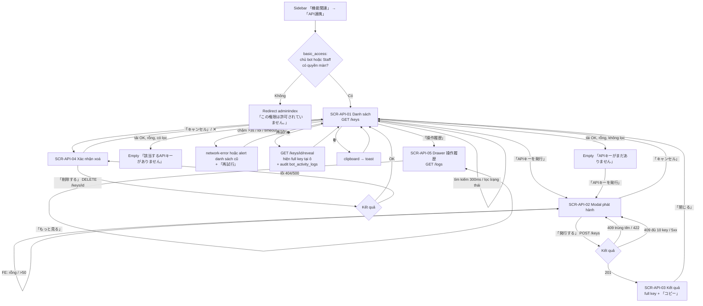

# UI Spec — FA-046: Liên kết API (「API連携」)

| Thuộc tính | Giá trị |
|-----------|---------|
| Mã tính năng | **FA-046** |
| Tên JP | 「API連携」 (tiêu đề trang + mục sidebar) |
| Portal | Admin (LINE OA) — dùng chung cho Staff (phân quyền theo màn) |
| Viết tắt màn hình | `API` |
| URL chính | `GET /basic/api-integration` — route name `apiIntegration` (`routes/web.php:1021`) |
| Controller | `Basic\ApiIntegrationController@index` (`app/Http/Controllers/Basic/ApiIntegrationController.php:52-60`) |
| View | `resources/views/basic/api_integration/index.blade.php` (376 dòng) + 4 partial trong `components/` (`issue_modal` 61, `issued_modal` 48, `delete_modal` 41, `history_drawer` 76 dòng) |
| JS | `public/_assets/modules/api_integration/js/index.js` (803 dòng, Vue 2.6.12, `el: '#api-integration-page'`) |
| CSS | `public/_assets/modules/api_integration/css/index.css` (383 dòng) + bộ CSS `lme-ui` |
| Thư viện UI | `lme-ui` (Vue 2 component library — `lme-table`, `lme-modal`, `lme-drawer`, `lme-history-card`, `lme-empty-view`, `lme-input-search`, `lme-select`, `lme-radio-group`, `lme-tag`, `lme-tooltip`, `lme-alert`, `lme-toast`, `lme-button-*`, `lme-title`, `lme-icon`) — nạp tại `index.blade.php:14-31` (CSS) và `:339-359` (JS) |
| Layout kế thừa | `layout.v2.admin.main` (`index.blade.php:7`) — sidebar Admin v2 |
| Task nội bộ | `#40041` (tính năng mới); các ticket sửa lỗi UI được nhắc trong comment: `#40296`, `#40298`, `#40302`, `#40303`, `#40304`, `#40306`, `#40333`, `#40338`, `#40546`, `#40548`, `NEW-282`, `NEW-697`, `NEW-698`, `NEW-699` |
| Background job | **Có liên quan** — job Spring Boot `ApiKeyExpireTask` (chuyển key hết hạn sang 「無効」 + ghi lịch sử loại 「無効」) và API công khai `/v1/*` (cập nhật 「最終利用」). Cả hai **không nằm trong repo web**; xem §"Điểm bất thường" B-12 |

---

## Nguồn dữ liệu spec — CHẾ ĐỘ CODE-FIRST

> | Mục | Giá trị |
> |-----|--------|
> | Ngày lập | **2026-10-23** |
> | Repo web | `src/web/sns-line` @ nhánh **`release_step_20260930_v2`**, commit **`4d9d07d159`** |
> | Repo job | `src/job/linect-service` @ nhánh **`release-t09-2026`** — **không tìm thấy** class nào liên quan `api_key` / `ApiKeyExpireTask` (grep toàn bộ `*.java`) |
> | Phương pháp | **Code-first hoàn toàn.** Session Playwright đã hết hạn ⇒ **KHÔNG có raw data, KHÔNG có screenshot, KHÔNG có snapshot DOM/network**. Toàn bộ spec dựng từ Blade + JS + CSS + Controller/Service/Model/Request/Migration/Config |
> | Submodule `lme-ui` | `public/lme-ui/` **chưa được checkout** trong repo đã clone ⇒ không đọc được docs/props nội bộ của component `lme-*` (ví dụ `lme-input :max-count` có chặn gõ hay chỉ đếm; `lme-modal` có nút X/đóng khi click overlay hay không). Các hành vi phụ thuộc component được đánh **Trung bình** |
>
> **Quy ước mức tin cậy trong tài liệu này:**
> - Cấu trúc DOM, nhãn tiếng Nhật, điều kiện `v-if`, tên hàm JS, endpoint, giá trị option, thông báo lỗi → **Cao** (đọc trực tiếp source) — nhưng **chưa quan sát runtime**.
> - Hình dạng hiển thị thực tế (màu, vị trí, khoảng cách) và hành vi nội tại của component `lme-*` → **Trung bình**.
> - Mọi giá trị mẫu (ví dụ `lme_live_sk_••••••••••••a1b2`, `2026/11/22`) là **giá trị minh hoạ suy ra từ code định dạng**, KHÔNG phải dữ liệu thật quan sát được.
> - Bảng `api_keys`, `api_key_logs`, `api_idempotency_keys` là bảng mới (migration `2026_08_24_10000{1,2,3}`) — **chưa có trong DB dump** của dự án.

---

## Tổng quan

- **Mã tính năng**: FA-046
- **Tên**: Liên kết API — quản lý API key của LINE Official Account
- **Tên JP**: 「API連携」
- **Portal**: Admin (Staff dùng chung giao diện, phân quyền theo màn)
- **URL pattern**: `/basic/api-integration` (1 route duy nhất; mọi màn con là modal/drawer chồng lên trang chính — comment `index.blade.php:1-6`)
- **Mô tả**: Cho phép Admin/Staff **phát hành API key** để hệ thống bên ngoài thao tác dữ liệu エルメ qua API công khai (do phía Java triển khai), **xem lại / sao chép** key, **xoá** key và xem **lịch sử thao tác** (発行 / 削除 / 無効). Văn bản giới thiệu trên trang (`index.blade.php:73-76`):
  > 「発行したAPIキーで外部システムからエルメのデータを操作できます。」
  > 「キーは第三者に共有しないでください。漏洩した場合はすぐに削除して再発行してください。」

**Quy tắc nghiệp vụ hiển thị trên UI (tóm tắt — chi tiết logic thuộc web-analyzer):**

| # | Quy tắc | Nguồn | Tin cậy |
|---|--------|------|--------|
| 1 | Mỗi bot tối đa **10 key** (cấu hình `API_INTEGRATION_MAX_KEYS_PER_BOT`, mặc định 10); đếm **mọi key chưa xoá, kể cả key 「無効」** | `config/api_integration.php:17`, `ApiKeyRepository.php:93-100` | Cao |
| 2 | Quyền key: 2 mức 「全権限」 / 「読み取り専用」 | `index.js:124-127`, `ApiKey.php:62-65` | Cao |
| 3 | Hạn dùng: 4 mức tương đối 「1日」/「1週間」/「30日」/「無期限」 — **không có date picker**; hết hạn lúc **23:59:59** của ngày (hôm nay + N) theo giờ server | `index.js:128-133`, `ApiKeyService.php:442-452` | Cao |
| 4 | Định dạng key: `lme_live_sk_` + 32 ký tự hex (tổng 44 ký tự); hiển thị che: `lme_live_sk_` + 12 dấu `•` + 4 ký tự cuối | `ApiKeyCipher.php:30-35`, `ApiKey.php:124-126` | Cao |
| 5 | Full key xem lại được bất kỳ lúc nào bằng icon 👁 (key lưu mã hoá AES-256-GCM, không phải hash một chiều) | `issued_modal.blade.php:2-3, 12`; `ApiKeyService.php:278-308` | Cao |
| 6 | Tên key: bắt buộc, ≤ 50 ký tự, **không trùng** trong cùng bot (so sánh không phân biệt hoa/thường theo collation; chỉ tính key chưa xoá) | `index.js:582-591`, `ApiKeyService.php:104-139`, `ApiKeyRepository.php:102-111` | Cao (trùng không phân biệt hoa/thường: Trung bình — phụ thuộc collation thực tế) |
| 7 | Xoá key là **soft delete**, có hiệu lực ngay, không hoàn tác | `delete_modal.blade.php:24`, `ApiKeyRepository.php:127-139` | Cao |

---

## Đối tượng sử dụng (Actors)

| Actor | Vai trò | Quyền truy cập | Cơ sở |
|-------|---------|----------------|-------|
| **Admin (chủ bot — `bots.admin_id = Auth::id()`)** | Quản lý API key của LINE OA | **Toàn quyền**: xem danh sách, phát hành, xem/sao chép full key, xoá, xem lịch sử | `BasicAccess.php:44-53` (chủ bot không bị kiểm `routeList`) — **Cao** |
| **Staff (`user_staff_bots.status = 1`, phiên `is_bot_invite`)** | Nhân viên được mời vào bot | **Theo thiết kế**: chỉ vào được nếu role của Staff được cấp màn 「API連携」 (bảng `bot_role_access` ↔ `access_feature.route = 'apiIntegration'`); đã vào được thì **có đủ mọi thao tác như Admin** — phân quyền ở mức MÀN HÌNH, không tách quyền theo thao tác (comment `IssueApiKeyRequest.php:17-19` "R-003"). **⚠ Thực tế với code hiện tại: KHÔNG cấp được quyền này qua màn phân quyền** (FA-035 「スタッフ管理」) — dòng cha do command ghi có `menu_id = NULL` nên `UserController@getSettingRoleAccess` (`:3783`, lọc `menu_id = index`) không liệt kê; cấp tay vào DB sẽ bị `addSettingRoleAccess` (`:3881`, xoá-insert lại toàn bộ `bot_role_access` của bot) xoá ở lần lưu phân quyền kế tiếp ⇒ **hiện chỉ chủ bot dùng được tính năng** (db-mapping DB-02, logic-spec R-15) | `BasicAccess.php:38-51`, `functions.php:5044-5130` (`getRouterBotInvite`), `AddAccessFeatureApiIntegration.php:11-17, 32-63` — **Cao** (code) |
| **Staff không được cấp quyền** (hiện tại = **mọi** Staff, xem dòng trên) | — | Vẫn **thấy** mục menu 「API連携」 (sidebar không kiểm quyền); bấm vào ⇒ redirect `adminIndex` kèm lỗi 「この権限は許可されていません。」 | `sidebar.blade.php:194-207` (không có `@if` quyền), `BasicAccess.php:41-42, 49-50` — **Cao** |
| **LINE User** | Không liên quan | — | — |
| **Hệ thống bên ngoài** | Gọi API công khai `/v1/*` bằng key | Ngoài phạm vi UI; chỉ thể hiện gián tiếp qua cột 「最終利用」 | `config/api_integration.php:7-8` (comment) — **Trung bình** |

Ghi chú quyền:
- Nhóm route nằm trong `Route::group(['prefix' => 'basic', 'middleware' => ['basic_access', 'https_protocol', 'is_expire', 'check_remember_token']])` (`routes/web.php:964`), group con `prefix => 'api-integration'` (`:1020-1030`). **Cao**.
- Lệnh `php artisan access-feature:api-integration` tạo 1 dòng cha `visible = 1` + 5 dòng con AJAX `visible = 0` trong `access_feature`, **nhưng không đặt `menu_id`** (`AddAccessFeatureApiIntegration.php:56-63`) — khác tiền lệ `AddAccessFeatureWebhookRelay` (đặt `menu_id` nhóm 「システム設定」). Màn cấp quyền chỉ liệt kê dòng cha có `menu_id` thuộc nhóm menu (`UserController.php:3780-3783`) ⇒ **dù đã chạy lệnh, mục 「API連携」 vẫn không xuất hiện** để tick ⇒ **không Staff nào** vào được màn (route không có trong `routeList`). Docblock command (`:16`) ghi "để hiện trong màn cấp quyền" — trái với hành vi thực. **Cao** (code), triển khai thực tế **chưa xác minh** runtime.
- Bot scope luôn lấy từ session (`getBotId()`), KHÔNG nhận `bot_id` từ request (`ApiIntegrationController.php:20`). **Cao**.

---

## Đường vào tính năng

| Mục | Nội dung | Tin cậy |
|-----|---------|--------|
| Điểm vào | Sidebar Admin v2 (`layout/v2/admin/sidebar.blade.php`) → section 「機能関連」 (`:65-79`, chỉ render khi `@if($bot)`) → mục **「API連携」** nằm **ngay dưới 「接続設定」** và **ngay trên 「Webhook転送」** (`:189-207`) | Cao |
| Icon | SVG inline vẽ lại icon `rectangle-api` (khung chữ nhật bo góc + chữ "API"), kích thước 20×20 (các mục khác 16×16), path dạng fill để đổi màu xanh `#08BF5A` khi active (comment `:189-193`) | Cao |
| Trạng thái active | Class `active` khi `$routeCurrent == 'apiIntegration'` | Cao |
| Sidebar thu gọn | Bọc `lme-tooltip` 「API連携」 hướng `right` khi `isCollapsed` | Cao |
| Feature flag | `config('api_integration.enabled')` (env `API_INTEGRATION_ENABLED`, mặc định `false`) — comment ghi "tắt thì màn ẩn khỏi menu", **nhưng không được tham chiếu ở bất kỳ đâu** ⇒ mục menu luôn hiển thị và route luôn truy cập được (xem B-01) | Cao |

---

## Bảng tổng hợp màn hình

| Mã | Tên màn hình | Loại | Điều kiện hiển thị | Mã tham chiếu trong comment code | File |
|----|-------------|------|-------------------|-------------------------------|------|
| **SCR-API-01** | Danh sách API key 「API連携」 | Trang | Truy cập `GET /basic/api-integration` | `SCR-01` | `index.blade.php` |
| **SCR-API-02** | Modal phát hành key 「APIキーを発行」 | Modal (560px) | `showIssueModal === true` | `SCR-02` | `components/issue_modal.blade.php` |
| **SCR-API-03** | Modal kết quả 「APIキーを発行しました」 | Modal (560px) | `showIssuedModal === true` (sau phát hành thành công) | `SCR-03` | `components/issued_modal.blade.php` |
| **SCR-API-04** | Modal xác nhận xoá 「APIキーを削除します」 | Modal (480px, không header chuẩn) | `showDeleteModal === true` | `SCR-04` | `components/delete_modal.blade.php` |
| **SCR-API-05** | Drawer 「操作履歴」 | Drawer phải (520px) | `showHistoryDrawer === true` | `SCR-05` | `components/history_drawer.blade.php` |

Toàn bộ 4 màn con được `@include` ở cuối `index.blade.php:328-331`, cùng một Vue instance.

---

## Các màn hình

### SCR-API-01: Danh sách API key 「API連携」

- **URL**: `GET /basic/api-integration`
- **Tiêu đề trang**: 「API連携」 (`@section('title')` — `index.blade.php:9-11`; `<h1 class="api-page-title">` — `:41`)
- **Screenshot**: _không có (code-first)_
- **Dữ liệu khởi tạo từ server** (`index.blade.php:361-374`, `ApiIntegrationController.php:52-60`):

| Biến JS `window.API_INTEGRATION_CONFIG` | Giá trị | Ghi chú |
|----------------------------------------|--------|---------|
| `urls.keys` | `route('apiIntegration.keys')` → `/basic/api-integration/keys` | Danh sách |
| `urls.issue` | `route('apiIntegration.keys.store')` | Phát hành (POST) |
| `urls.logs` | `route('apiIntegration.logs')` | Lịch sử |
| `urls.destroy`, `urls.reveal` | `url('/basic/api-integration/keys')` — JS nối `/{id}` hoặc `/{id}/reveal` | |
| `maxKeysPerBot` | `config('api_integration.max_keys_per_bot', 10)` | **Không được JS sử dụng** (B-02) |
| `docsUrl` | `config('api_integration.docs_url', '')` (env `API_INTEGRATION_DOCS_URL`) | Rỗng ⇒ ẩn nút 「使い方を見る」 |

Danh sách key **không render server-side**; tải bằng AJAX ngay khi `mounted` (`index.js:220-225`).

#### Layout tổng thể
```
┌ Sidebar Admin v2 ┐┌──────────────────────────────────────────────────────────────────┐
│ 機能関連          ││ API連携  [📖 使い方を見る]*          [🕘 操作履歴] [＋ APIキーを発行] │  ← header (:39-62)
│  …               ││ ┌──────────────────────────────────────────────────────────────┐ │
│  接続設定         ││ │ APIキー  (lme-title, nền xám)                                  │ │  ← card head (:66-77)
│ ▶API連携         ││ │ 発行したAPIキーで外部システムから…<br>キーは第三者に共有…       │ │
│  Webhook転送      ││ │ [🔍 キー名を入力して検索 ] [すべてのステータス ▾]      全 N 件  │ │  ← toolbar (:80-105)
│                  ││ │ (⚠ cảnh báo danh sách cũ + 再試行 — chỉ khi lỗi & còn dữ liệu)   │ │  ← (:110-123)
│                  ││ │ ┌ステータス┬キー名┬APIキー┬権限┬発行者?┬有効期限┬最終利用?┬操作┐  │ │  ← lme-table (:137-309)
│                  ││ │ │ 有効      │ …    │ lme_live_sk_••…a1b2 👁 ⧉ │ … │   … │ 🗑 │  │ │
│                  ││ │ └──────────┴──────┴─────────────┴────┴──────┴───────┴────────┴───┘  │ │
│                  ││ └──────────────────────────────────────────────────────────────┘ │
└──────────────────┘└──────────────────────────────────────────────────────────────────┘
* chỉ hiện khi docsUrl khác rỗng
```
- Padding trang `20px 24px 32px` (`index.css:4-6`). Bảng có chiều cao tối đa `calc(100vh - 340px)`, cuộn dọc bên trong, header cột dính (sticky) (`index.blade.php:149`, comment `:129-136`). **Cao** (code) / **Trung bình** (hiển thị).
- **Không có phân trang** — đã bỏ ở `#40333` vì mỗi bot tối đa 10 key nên API luôn trả hết (`index.blade.php:320-324`). Đây là quyết định dev/BA ngày 2026-09-05, **lệch so với design SRC-009 + spec E-035** (comment ghi rõ "spec cần cập nhật theo"). **Cao**.

#### Thanh công cụ / Header actions

| Vị trí | Element | Text JP | Loại | Hành vi | Nguồn |
|--------|---------|---------|------|---------|-------|
| Header trái | Tiêu đề | 「API連携」 | `h1` | — | `:41` |
| Header trái | Nút xem hướng dẫn | 「使い方を見る」 + icon `book1` | `lme-button-flat` primary md | `window.open(docsUrl, '_blank')`. **Chỉ hiện khi `docsUrl` khác rỗng** (D-06: URL khách cấp sau) | `:43-50`, `index.js:553-557` |
| Header phải | Nút lịch sử | 「操作履歴」 + icon `reloadtime-outlined` | `lme-button-flat` primary lg | Mở SCR-API-05 | `:53-56`, `index.js:721-727` |
| Header phải | Nút phát hành | 「APIキーを発行」 + icon `plus-outlined` | `lme-button-default` primary lg | Mở SCR-API-02 (reset form). **Luôn enable**, kể cả khi bot đã đủ 10 key (B-02) | `:57-60`, `index.js:560-567` |
| Card | Tiêu đề section | 「APIキー」 | `lme-title element="h1" color="gray"` (weight 600 + nền xám) | — | `:69` |
| Card | Mô tả | 2 dòng như §Tổng quan, cùng màu phụ `#878A92`, ngắt bằng `<br>` (`#40302`) | `p.api-card__desc` | — | `:73-76` |

#### Bộ lọc / Tìm kiếm (toolbar)

| # | Label / Placeholder JP | Loại input | Mặc định | Hành vi | Nguồn |
|---|-----------------------|-----------|---------|---------|-------|
| 1 | placeholder 「キー名を入力して検索」 | `lme-input-search` (280px, lg) | rỗng | Gõ ⇒ debounce **300ms** rồi tải lại; Enter (`@search`) hoặc nút xoá (`@clear`) ⇒ tải lại ngay và huỷ debounce đang chờ. Tìm **phía server**, khớp một phần `name` (server `trim` + escape ký tự LIKE) | `:82-90`, `index.js:14, 434-452`; `ApiKeyRepository.php:65-70` |
| 2 | (không có label) | `lme-select` (200px, lg) | `all` 「すべてのステータス」 | Đổi ⇒ tải lại ngay. Options: 「すべてのステータス」(`all`) / 「有効」(`active`) / 「無効（期限切れ）」(`expired`) | `:91-97`, `index.js:96-100, 454-456` |
| — | Bộ đếm | 「全 N 件」 (N = số bản ghi **sau lọc**); nếu tải lỗi/chậm mà chưa có dữ liệu ⇒ 「全 — 件」 (không in 0) | Text phải toolbar | — | `:103`, `index.js:175-179` |

- Mỗi lần đổi điều kiện là 1 request riêng; có **token tăng dần `fetchSeq`** để bỏ response cũ về muộn + abort request đang bay (`NEW-697`, `index.js:331-345, 391-392`). **Cao**.
- Không có bộ lọc nào được lưu (URL/storage) — tải lại trang về mặc định. **Cao**.

#### Bảng dữ liệu (`lme-table`, `row-key="id"`, cột cuối ghim phải `:fixed-right-count="1"`)

Thứ tự cột theo `columns` (`index.js:106-115`; `#40548` đưa 発行者 lên ngay sau 権限):

| # | key | Text JP header | Width | Kiểu hiển thị | Sortable? | Ghi chú | Nguồn |
|---|-----|---------------|------|--------------|----------|---------|-------|
| 1 | `status` | 「ステータス」 | 120 | Badge | Không | `active` ⇒ `lme-tag` success 「有効」; ngược lại ⇒ `lme-tag` default 「無効」 bọc tooltip 「有効期限切れのため自動で無効になりました」 (hướng top) + `role="img"` `aria-label="無効：有効期限切れのため自動で無効になりました"` (`NEW-699`) | `index.blade.php:152-168` |
| 2 | `name` | 「キー名」 | 180 | Text | Không | Render mặc định của `lme-table` (không có slot) | `index.js:108` |
| 3 | `key` | 「APIキー」 | 320 | Text (che) + 2 nút icon | Không | Mặc định hiện `key_masked` (vd `lme_live_sk_••••••••••••a1b2`); 👁 hiện full key tại chỗ; ⧉ sao chép. Nút ghost màu xanh, bo tròn (`#40296`) | `:171-199` |
| 4 | `scope` | 「権限」 | 130 | Badge | Không | `scope === 'full'` ⇒ `lme-tag` **warning** (cam) 「全権限」; `read` ⇒ `lme-tag` default 「読み取り専用」. Text lấy từ `scope_label` của server | `:202-208` |
| 5 | `issued_by` | 「発行者」 + icon 「?」 (helpText 「このキーを発行したユーザーです」) | 150 | Text cắt 1 dòng + tooltip tên đầy đủ | Không | Định dạng 「<username>（<vai trò>）」, vd 「鈴木（主管理者）」; vai trò ∈ 「主管理者」/「副管理人」/「運用者」/「サポート」; fallback 「システム（自動）」. `max-width: 130px` + `.lme-truncate` | `:229-233`, `index.css:150-162`, `ApiKeyService.php:398-419`, `UserStaffBot.php:30-37` |
| 6 | `expires_at` | 「有効期限」 | 130 | Date `Y/m/d` | Không | `null` ⇒ chữ mờ 「無期限」 (`#9A9EAD`) | `:211-214`, `ApiKeyService.php:371` |
| 7 | `last_used_at` | 「最終利用」 + icon 「?」 (helpText 「このキーで最後にAPIが呼び出された日時です」) | 160 | DateTime `Y/m/d H:i` | Không | `null` ⇒ chữ mờ 「未使用」 | `:223-226`, `ApiKeyService.php:372` |
| 8 | `actions` | 「操作」 | 80 | Nút icon | Không | Nút xoá trên **mọi dòng**, kể cả dòng 「無効」 | `:236-251` |

- **Thứ tự dòng**: key mới nhất ở trên (`ORDER BY api_keys.id DESC` — `ApiKeyRepository.php:89`). **Cao**.
- **Dòng 「無効」**: nền xám `#F0F0F0` (giữ khi hover) qua `rowClassName` → `.api-row-expired` (`#40298`, `index.js:460-462`, `index.css:146-149`). **Cao**.
- **Tooltip icon 「?」 ở header**: có workaround `MutationObserver` kéo tooltip vào trong viewport khi tràn mép phải (lỗi gốc của `lme-table`; `index.js:235-317`). **Cao** (code).

#### Actions trên mỗi dòng

| Action | Text/Icon JP | Hành vi | Xác nhận? | Nguồn |
|--------|-------------|---------|----------|-------|
| Hiện / che key | Icon `eye-outlined` ↔ `eye-close-outlined`; tooltip 「表示する」 / 「マスクする」; aria-label 「APIキーを表示する：{キー名}」 / 「APIキーをマスクする：{キー名}」 | Lần đầu: gọi `GET /keys/{id}/reveal` rồi hiện full key tại ô; các lần sau dùng cache trong bộ nhớ Vue (không localStorage). Che lại ⇒ hiện `key_masked`. Tải lại danh sách ⇒ mọi dòng về dạng che + xoá cache. Lỗi ⇒ toast 「APIキーの表示に失敗しました」 (hoặc `message` server) | Không | `:182-189`, `index.js:403-405, 464-496` |
| Sao chép key | Icon `file-copy-outlined`; tooltip 「コピー」; aria-label 「APIキーをコピー：{キー名}」 | Có cache ⇒ ghi clipboard ngay; chưa có ⇒ gọi reveal rồi ghi clipboard (key được cache nhưng **ô vẫn ở dạng che**). Thành công ⇒ toast 「コピーしました」; thất bại ⇒ 「コピーに失敗しました」. Fallback `document.execCommand('copy')` khi không có Clipboard API | Không | `:190-197`, `index.js:499-551` |
| Xoá | Icon `delete-outlined` (ghost đỏ); tooltip 「削除」 hướng **left**; aria-label 「APIキーを削除：{キー名}」 | Mở SCR-API-04 | **Có** — SCR-API-04 | `:242-249`, `index.js:664-669` |

> Mỗi lần reveal (kể cả reveal ngầm khi bấm sao chép lần đầu) server ghi audit vào `bot_activity_logs` (`action_type = 'api_key'`, `action_name = 'reveal'`) — bản ghi này hiển thị ở **timeline 「アクティビティログ」 của màn 「接続設定」** với tiêu đề 「APIキー表示」 và tag 「API連携」 (`BotActivityLog.php:15-46`, `SettingBotService.php:16-23`). **Không** xuất hiện trong drawer 操作履歴 của FA-046. **Cao** (code) / hiển thị ở 接続設定: **Trung bình**.
>
> Endpoint reveal bị giới hạn **30 lần/phút** (`throttle:30,1` — `routes/web.php:1026-1028`).

#### Trạng thái của vùng danh sách

| # | Trạng thái | Điều kiện | Hiển thị | Nguồn |
|---|-----------|----------|---------|-------|
| 1 | Đang tải | `loading = true` (khởi tạo `true` để frame đầu không báo nhầm 「APIキーがまだありません」) | Overlay toàn màn `$.LoadingOverlay('show')` (spinner chung hệ thống — `NEW-282`); bảng nhận `:loading` để chặn empty text mặc định 「データがありません」 | `index.js:63-67, 319-328, 347-352`; `index.blade.php:144-148` |
| 2 | Tải chậm (> **3 giây** chưa phản hồi), chưa có dữ liệu | `loadSlow && keys.length === 0` | Nhả overlay; trong bảng: `lme-empty-view type="network-error"` — 「APIキーの取得に時間がかかっています」 / 「通信エラーの可能性があります。再試行するか、しばらくお待ちください。」 + nút 「再試行」. Bộ đếm 「全 — 件」. Request **vẫn chạy**, thành công muộn vẫn hiện bình thường | `index.js:36, 365-380`; `index.blade.php:279-288` |
| 3 | Tải lỗi (timeout **10 giây** / HTTP lỗi / `success=false`), chưa có dữ liệu | `loadError !== '' && keys.length === 0` | `lme-empty-view type="network-error"`: tiêu đề = thông báo lỗi (「APIキーの取得がタイムアウトしました」 hoặc `message` server hoặc 「APIキーの取得に失敗しました」); mô tả 「時間をおいて再試行してください。改善しない場合はサポートへお問い合わせください。」; nút 「再試行」. Kèm toast lỗi. Bộ đếm 「全 — 件」 | `index.js:25, 393-415, 795-800`; `index.blade.php:265-274` |
| 4 | Lỗi/chậm nhưng **còn dữ liệu cũ** | `hasStaleList` | Trên bảng: `lme-alert type="error"` (đóng được) — 「{lỗi}（表示中の一覧は最新ではない可能性があります）」 hoặc 「APIキーの取得に時間がかかっています（表示中の一覧は最新ではない可能性があります）」 + nút flat 「再試行」 (icon `reload-outlined`, disable khi đang tải). Bảng giữ dữ liệu cũ + bộ lọc (FN-08) | `index.blade.php:110-123`; `index.js:185-194` |
| 5 | Rỗng — bot chưa có key | Thành công, `keys = []`, **không** có bộ lọc (`keyword.trim()` rỗng và `status = all`) | `lme-empty-view type="empty"`: 「APIキーがまだありません」 / 「APIキーを発行すると外部システムと連携できます」 + nút primary 「APIキーを発行」 (mở SCR-API-02) | `index.blade.php:289-299`; `index.js:166-168` |
| 6 | Rỗng — lọc không ra kết quả | Thành công, `keys = []`, có bộ lọc | `lme-empty-view type="no-results"`: 「該当するAPIキーがありません」 / 「絞り込み条件を変えてお試しください」 (không nút) | `index.blade.php:300-306` |
| 7 | Có dữ liệu | — | Bảng 8 cột như trên. Header cột luôn hiển thị kể cả khi rỗng (empty nằm trong `slot="empty"` — `#40306`, `#40546`) | `index.blade.php:125-136` |

#### Observations (SCR-API-01)
- Toàn bộ text tĩnh, nhãn cột, option, tooltip, aria-label → **Cao** (chưa quan sát runtime).
- Danh sách **không bao giờ chứa full key**; full key chỉ lấy qua endpoint reveal (`ApiKeyService.php:356-375`). **Cao**.
- Cột 「発行者」 hiển thị **tên + vai trò HIỆN TẠI** của người phát hành (join `users.username` + `user_staff_bots.role_id` / `bots.admin_id`), chỉ dùng snapshot `created_by_name` khi user không còn (`ApiKeyService.php:377-419`, đổi ngày 2026-09-10). Comment Blade `:228` vẫn ghi "snapshot tên lúc phát hành" — **lỗi thời** (B-09). **Cao**.
- Nhãn vai trò dùng bộ nhãn thật của hệ thống, **khác prototype design** (「管理者」/「運用担当」) — cố ý (`ApiIntegrationController.php:183-186`). **Cao**.

---

### SCR-API-02: Modal phát hành key 「APIキーを発行」

- **Kích hoạt**: nút 「APIキーを発行」 ở header SCR-API-01 hoặc nút trong empty state #5.
- **Component**: `lme-modal v-model="showIssueModal" title="APIキーを発行" :width="560"` (`issue_modal.blade.php:5`).
- **Khi mở**: luôn reset form về mặc định (キー名 rỗng, 全権限, 30日) và xoá mọi lỗi cũ (FN-01 — `index.js:560-567`). **Cao**.

#### Form fields

| # | Label JP | Loại input | Bắt buộc? | Giá trị mặc định | Placeholder | Validation phía FE | Validation phía server | Ghi chú | Nguồn |
|---|---------|-----------|----------|-----------------|------------|-------------------|----------------------|---------|-------|
| 1 | 「キー名」 | `lme-input` text (lg, 475px, label dọc) | **Có** (dấu bắt buộc qua prop `required`) | rỗng | 「例）予約システム連携」 | `trim` rỗng ⇒ 「キー名を入力してください。」; `trim().length > 50` ⇒ 「キー名は50文字以内で入力してください。」 | Rỗng ⇒ thực tế **FormRequest `string` fail trước** (global `ConvertEmptyStringsToNull` đổi `""` thành `null`) — `name_required` của service **không chạm được qua HTTP** (api-spec EP-03 ⚠, logic-spec R-07); > 50 (`mb_strlen`) ⇒ 422 `name_too_long`; trùng tên trong bot (key chưa xoá) ⇒ **409 `name_duplicated`** 「同じキー名が既に存在します。別の名前を入力してください。」 | Bộ đếm `:max-count="50"` (hiển thị n/50 — E-036). Giá trị gửi lên đã `trim`. Có chặn gõ quá 50 hay không phụ thuộc `lme-input` — **Trung bình** | `issue_modal.blade.php:8-18`; `index.js:582-591`; `ApiIntegrationException.php:60-73` |
| 2 | 「権限」 * | `lme-radio-group type="button" size="large"` (2 nút dạng segmented), `name="api-key-scope"` | **Có** (dấu `*` tự vẽ `.api-form-required`) | `full` 「全権限」 | — | Không (luôn có giá trị) | `required|in:full,read` ⇒ 「権限を選択してください。」/「権限の値が不正です。」 | Options: 「全権限」(`full`) / 「読み取り専用」(`read`). Dòng trợ giúp đổi theo lựa chọn (bảng dưới) | `issue_modal.blade.php:21-31`; `index.js:124-127, 196-200`; `IssueApiKeyRequest.php:26, 35-36` |
| 3 | 「有効期限」 | `lme-select` (240px, lg, label dọc) | **Có** (prop `required`) | `30` 「30日」 | — | Không | `required|in:1,7,30,unlimited` ⇒ 「有効期限を選択してください。」/「有効期限の値が不正です。」 | Options: 「1日」(`1`) / 「1週間」(`7`) / 「30日」(`30`) / 「無期限」(`unlimited`). **Không có date picker** (BR-07 / D-02). Dòng trợ giúp xem trước ngày hết hạn | `issue_modal.blade.php:34-45`; `index.js:128-133, 203-217`; `IssueApiKeyRequest.php:27, 37-38` |

**Dòng trợ giúp động (`p.api-form-help`):**

| Field | Điều kiện | Text JP | Nguồn |
|-------|----------|---------|-------|
| 権限 | `full` | 「友だち情報・配信・タグなどの参照に加えて、作成・更新・削除も行えます。」 | `index.js:199` |
| 権限 | `read` | 「友だち情報や配信実績などの参照のみ行えます。データの更新はできません。」 | `index.js:198` |
| 有効期限 | `1` / `7` / `30` | 「YYYY/MM/DD に自動で無効になります。」 — ngày = **ngày trình duyệt hôm nay + N** (chỉ xem trước; giá trị chốt lấy từ response server) | `index.js:202-216` |
| 有効期限 | `unlimited` | 「失効日を設定しません。長期運用する連携以外では期限の設定を推奨します。」 | `index.js:204-206` |

#### Khu vực lỗi cấp modal
- `lme-alert type="error"` (đóng được) — hiện khi `issueGlobalError` khác rỗng (`issue_modal.blade.php:48-53`). Dùng cho: đạt ngưỡng 10 key (**409 `key_limit_reached`** — 「発行できるAPIキーは10件までです。不要なキーを削除してから発行してください。」, số 10 theo cấu hình), `success=false`, lỗi hệ thống/mạng (fallback 「APIキーの発行に失敗しました」 hoặc `message` server). **Cao**.

#### Nút footer

| Nút | Text JP | Loại | Hành vi | Nguồn |
|-----|---------|------|---------|-------|
| Huỷ | 「キャンセル」 | `lme-button-flat` primary md | Đóng modal (không reset — reset xảy ra lúc mở lần sau) | `:56`, `index.js:569-571` |
| Phát hành | 「発行する」 | `lme-button-default` primary md | **Luôn enable kể cả form trống** (E-042); chỉ disable khi đang gửi (`submitting`) để chống double submit. Validate FE → `POST /basic/api-integration/keys` `{name, scope, expiry_preset}` | `:58`, `index.js:573-651` |

#### Kết quả submit

| Kết quả | Hiển thị | Modal | Nguồn |
|--------|---------|------|-------|
| Thành công (HTTP 201, `success: true`) | Đóng SCR-API-02 → mở **SCR-API-03** (bật lại alert info) → toast success 「APIキーを発行しました」 → tải lại danh sách (key mới lên đầu — FN-03) | Đóng | `index.js:612-619` |
| `name_duplicated` / `name_required` / `name_too_long` | Lỗi inline dưới ô 「キー名」 = `message` server | **Giữ mở, giữ dữ liệu** | `index.js:624-628` |
| `key_limit_reached` | Alert lỗi cấp modal | Giữ mở | `index.js:630-634` |
| HTTP 422 dạng Form Request (`{field: [msg]}`) — **chỉ khi `APP_DEBUG=true`** | Lấy **thông báo đầu tiên của field đầu tiên** gán vào ô 「キー名」 (B-06). Production (`APP_DEBUG=false`): Handler đổi thành HTTP 404/401 body `{"status":false,"error":{…}}` (không có `message` cấp 1) ⇒ rơi xuống nhánh "Lỗi khác" — alert fallback 「APIキーの発行に失敗しました」 | Giữ mở | `index.js:636-647`; `Handler.php:128-170` |
| HTTP 200 nhưng `success: false` | Alert cấp modal (`message` hoặc 「APIキーの発行に失敗しました」) | Giữ mở | `index.js:604-610` |
| Lỗi khác (500, mạng, …) | Alert cấp modal (`message` hoặc fallback) | Giữ mở | `index.js:646-647` |

> Request POST **cố ý không đặt timeout** (không idempotent — tránh báo thất bại khi key thực ra đã được tạo) (`index.js:21-24, 50`). **Cao**.

---

### SCR-API-03: Modal kết quả 「APIキーを発行しました」

- **Kích hoạt**: tự động sau khi phát hành thành công.
- **Component**: `lme-modal v-model="showIssuedModal" title="APIキーを発行しました" :width="560"` (`issued_modal.blade.php:5`).
- **Dữ liệu**: lấy **nguyên từ response server** (`res.data` — `id`, `api_key`, `name`, `scope`, `scope_label`, `expires_at`), không dựng lại từ form (tránh lệch múi giờ) (`:24`, `index.js:612`, `ApiKeyService.php:200-207`).

#### Bố cục

| # | Thành phần | Text JP / Nội dung | Loại | Nguồn |
|---|-----------|-------------------|------|-------|
| 1 | Alert info (đóng được trong phiên; bật lại mỗi lần phát hành — E-044) | 「このキーは一覧の目のアイコンからいつでも再表示できます。第三者への共有は行わないでください。」 | `lme-alert type="info"` width 100% | `:8-13`, `index.js:614` |
| 2 | Ô key | **Full key plaintext, không che** (font monospace 13px, nền `#F8F9FB`, viền `#E9EBF0`) — vd `lme_live_sk_0123456789abcdef0123456789abcdef` | `span.api-issued-key__value` | `:16-17`, `index.css:222-238` |
| 3 | Nút sao chép | 「コピー」 + icon `file-copy-outlined` | `lme-button-flat` md | `:18-21`, `index.js:654-656` → toast 「コピーしました」/「コピーに失敗しました」 |
| 4 | Bảng tóm tắt 3 dòng (`lme-table-representation`) | 「キー名」 → `issued.name`; 「権限」 → `issued.scope_label`; 「有効期限」 → `issued.expires_at` (`Y/m/d`) hoặc 「無期限」 | `table` | `:25-42` |
| 5 | Nút đóng | 「閉じる」 | `lme-button-default` primary md | `:44-46`, `index.js:658-661` (đóng + xoá `issued` khỏi bộ nhớ) |

Observations:
- Đây **không phải** lần duy nhất xem được full key: có thể xem lại ở SCR-API-01 bằng 👁 (BR-14 / D-05 = A). **Cao**.
- Đóng modal bằng cơ chế mặc định của `lme-modal` (nếu có nút X / click overlay) không đi qua `closeIssuedModal()` ⇒ full key còn trong `data.issued` tới lần phát hành sau (B-07). **Trung bình** (phụ thuộc `lme-modal`).

---

### SCR-API-04: Modal xác nhận xoá 「APIキーを削除します」

- **Kích hoạt**: icon 🗑 cột 「操作」 ở SCR-API-01.
- **Component**: `lme-modal v-model="showDeleteModal" :header="false" :width="480"` — **không dùng header chuẩn** (E-046) (`delete_modal.blade.php:6`).
- **Khi mở**: lưu `deleteTarget = {id, name}`, xoá lỗi cũ (`index.js:664-669`).

#### Bố cục

| # | Thành phần | Text JP / Nội dung | Loại | Nguồn |
|---|-----------|-------------------|------|-------|
| 1 | Header tuỳ biến trái | Icon `warning-circle-filled` 24px màu **danger `#FF4D4F`** (`#40338`) + tiêu đề 「APIキーを削除します」 (16px, bold) | div | `:8-12`, `index.css:258-272` |
| 2 | Header tuỳ biến phải | Nút đóng icon `close-outlined`, aria-label 「閉じる」 (cũng là nơi focus khi modal mở — NEW-316) | `lme-button-ghost` secondary sm | `:16-18` |
| 3 | Ô tên key đích | `deleteTarget.name` trên nền xám `#F8F9FB` (E-046, E-061) | div | `:22`, `index.css:274-282` |
| 4 | Cảnh báo | 「削除するとこのキーを使用している連携はすぐに停止し、元に戻すことはできません。本当に削除しますか？」 | `p` | `:24` |
| 5 | Lỗi xoá (chỉ khi có) | `deleteError` | `lme-alert type="error"` (đóng được) | `:29-34` |
| 6 | Footer | 「キャンセル」 (`lme-button-flat` primary) / 「削除する」 (`lme-button-risk` primary — đỏ, disable khi `deleting`) | buttons | `:36-39` |

- **Không** yêu cầu gõ lại tên key để xác nhận; nút 「削除する」 enable ngay (E-047). **Cao**.

#### Kết quả

| Kết quả | Hiển thị | Nguồn |
|--------|---------|-------|
| Thành công (`success: true`) | Đóng modal → toast success 「APIキーを削除しました」 → tải lại danh sách | `index.js:687-694` |
| `success: false` / HTTP lỗi (404 `resource_not_found` 「対象のAPIキーが見つかりません。」, 500, mạng …) | **Modal giữ mở**, alert lỗi trong modal + toast lỗi (fallback 「APIキーの削除に失敗しました」). **Không** tải lại danh sách (tránh overlay đè lên modal) | `index.js:688-718` |

> Request DELETE cũng không đặt timeout (không idempotent). **Cao**.

---

### SCR-API-05: Drawer 「操作履歴」

- **Kích hoạt**: nút 「操作履歴」 ở header SCR-API-01.
- **Component**: `lme-drawer v-model="showHistoryDrawer" width="520px" title="操作履歴"` (`history_drawer.blade.php:12`). Nội dung bọc `.lme-drawer-content` (padding 16px, font 14px/400).
- **Khi mở**: reset bộ lọc về 「すべての操作」, trang 1, xoá danh sách → gọi `GET /basic/api-integration/logs?action=all&page=1&per_page=20` (`index.js:721-727, 739-749`).

#### Bộ lọc

| # | Label | Loại | Mặc định | Options | Hành vi | Nguồn |
|---|------|------|---------|--------|---------|-------|
| 1 | (không label) | `lme-select` 200px md | `all` | 「すべての操作」(`all`) / 「発行」(`issue`) / 「削除」(`delete`) / 「無効」(`revoke`) | Đổi ⇒ về trang 1, tải lại (thay thế danh sách) | `:16-22`, `index.js:156-161, 729-732` |
| — | Bộ đếm | 「N 件」 — `logPagination.total_items` (tổng sau lọc) | | | | `:23` |

#### Timeline (`lme-history-card`, mới nhất ở trên — `ORDER BY id DESC`)

Mỗi bản ghi (`:40-68`):

| Thành phần | Nội dung | Nguồn |
|-----------|---------|-------|
| Chấm/icon trạng thái (`:status`, slot `#icon`) | 発行 ⇒ status `primary` + icon `key-outlined`; 削除 ⇒ `danger` + `delete-outlined`; 無効 ⇒ `warning` + `timeout-outlined`; icon trắng | `index.js:764-774` |
| Thời gian (`:time`) | `created_at` định dạng `Y/m/d H:i` | `ApiKeyService.php:339` |
| Đường nối | Hiện giữa các thẻ, trừ thẻ cuối (`:show-line`) | `:45` |
| Tiêu đề (slot `#title`) | `lme-tag` size sm (màu: 発行 primary / 削除 danger / 無効 warning) với text `action_label` + tên key `key_name` (snapshot lúc thao tác) cắt 1 dòng 「…」, tooltip tên đầy đủ | `:50-61`, `index.js:776-780` |
| Nội dung (slot `#content`) | Dòng 1: `detail`; dòng 2: 「操作者：{operator_name}」 | `:62-67` |

**Giá trị `detail` / `operator_name` theo loại:**

| Loại | `action_label` | `detail` | `operator_name` | Nguồn |
|------|---------------|---------|----------------|-------|
| 発行 | 「発行」 | 「権限：{全権限｜読み取り専用} ／ 有効期限：{YYYY/MM/DD｜無期限}」 | 「<username>（<vai trò>）」 snapshot lúc thao tác, hoặc 「システム（自動）」 | `ApiKeyService.php:166-176`, `ApiIntegrationController.php:192-242` |
| 削除 | 「削除」 | 「一覧から削除しました」 (trước 2026-09-10 là 「検証完了のため削除しました」 — đã có lệnh `api-integration:recover-delete-detail` sửa dữ liệu cũ) | như trên | `ApiKeyLog.php:48-54`, `ApiKeyService.php:244-255` |
| 無効 | 「無効」 | **Do job Spring Boot `ApiKeyExpireTask` ghi — nội dung không có trong repo web** | dự kiến 「システム（自動）」 (comment migration) | `create_api_key_logs_table.php:11, 25` — **Thấp** |

- Bản ghi của key đã xoá vẫn hiển thị (BR-12). **Cao**.
- Lịch sử **không** chứa sự kiện 「表示」 (reveal) — chỉ 3 loại 発行/削除/無効 (BR-19). **Cao**.

#### Phân trang
- Không có thanh phân trang; nút 「もっと見る」 (`lme-button-flat` primary md, disable khi đang tải) ở cuối danh sách khi `has_next` — tải trang kế tiếp (20 bản ghi/trang) và **nối thêm** vào danh sách (`:71-73`, `index.js:734-737, 755`). **Cao**.

#### Trạng thái

| Trạng thái | Hiển thị | Nguồn |
|-----------|---------|-------|
| Rỗng (sau tải, `logs.length === 0`) | `lme-empty-view type="no-results"`: 「該当する履歴がありません」 / 「絞り込み条件を変えてお試しください」 — **dùng cho cả trường hợp không lọc** (B-04) | `:31-36` |
| Đang tải | **Không có chỉ báo riêng** trong drawer (không overlay, không skeleton) | `index.js:739-762` |
| Lỗi | Chỉ toast 「操作履歴の取得に失敗しました」; danh sách/bộ đếm giữ nguyên giá trị trước đó | `index.js:751-759` |

---

## Danh mục thông báo (Message catalog)

| # | Loại | Text JP | Xuất hiện tại | Nguồn |
|---|------|---------|--------------|-------|
| 1 | Toast success | 「APIキーを発行しました」 | Sau phát hành | `index.js:616` |
| 2 | Toast success | 「APIキーを削除しました」 | Sau xoá (cũng là `message` server) | `index.js:693`, `ApiIntegrationController.php:128` |
| 3 | Toast success | 「コピーしました」 | Sao chép key (SCR-API-01, 03) | `index.js:527, 550` |
| 4 | Toast error | 「コピーに失敗しました」 | Sao chép lỗi | `index.js:512, 518, 529, 550` |
| 5 | Toast error | 「APIキーの表示に失敗しました」 | Reveal lỗi | `index.js:488, 494` |
| 6 | Toast + empty/alert | 「APIキーの取得に失敗しました」 | Tải danh sách lỗi | `index.js:396, 414` |
| 7 | Toast + empty/alert | 「APIキーの取得がタイムアウトしました」 | Timeout 10s | `index.js:413` |
| 8 | Empty/alert | 「APIキーの取得に時間がかかっています」 (+「（表示中の一覧は最新ではない可能性があります）」) | Chậm > 3s | `index.blade.php:283`, `index.js:193` |
| 9 | Toast error | 「操作履歴の取得に失敗しました」 | Drawer tải lỗi | `index.js:752, 758` |
| 10 | Inline error | 「キー名を入力してください。」 | SCR-API-02 (FE + server) | `index.js:585`, `ApiIntegrationException.php:62`, `IssueApiKeyRequest.php:34` |
| 11 | Inline error | 「キー名は50文字以内で入力してください。」 | SCR-API-02 | `index.js:589`, `ApiIntegrationException.php:67` |
| 12 | Inline error | 「同じキー名が既に存在します。別の名前を入力してください。」 | SCR-API-02 (409) | `ApiIntegrationException.php:72` |
| 13 | Alert modal | 「発行できるAPIキーは{10}件までです。不要なキーを削除してから発行してください。」 | SCR-API-02 (409) | `ApiIntegrationException.php:75-82` |
| 14 | Alert modal | 「APIキーの発行に失敗しました」 | SCR-API-02 fallback | `index.js:605, 646` |
| 15 | Alert/inline | 「権限を選択してください。」/「権限の値が不正です。」/「有効期限を選択してください。」/「有効期限の値が不正です。」/「パラメータが不正です。」 | SCR-API-02 (chỉ khi request bị sửa tay) | `IssueApiKeyRequest.php:35-38`, `ApiKeyService.php:113-118`, `ApiIntegrationException.php:84-87` |
| 16 | Alert + toast | 「APIキーの削除に失敗しました」 | SCR-API-04 fallback | `index.js:689, 696` |
| 17 | Alert/toast | 「対象のAPIキーが見つかりません。」 | Xoá/reveal key không tồn tại (404) | `ApiIntegrationException.php:89-92` |
| 18 | Toast | 「APIキーを復号できませんでした。」 | Reveal khi giải mã lỗi (503) | `ApiIntegrationException.php:94-97` |
| 19 | Redirect error | 「この権限は許可されていません。」 | Staff không có quyền | `BasicAccess.php:42, 50` |
| 20 | Tooltip | 「有効期限切れのため自動で無効になりました」 | Badge 無効 | `index.blade.php:160` |
| 21 | Tooltip | 「表示する」/「マスクする」/「コピー」/「削除」 | Nút icon dòng | `index.blade.php:182, 190, 242` |
| 22 | Help icon | 「このキーを発行したユーザーです」 / 「このキーで最後にAPIが呼び出された日時です」 | Header cột 発行者 / 最終利用 | `index.js:111, 113` |

---

## Luồng người dùng (User Flows)

### Luồng 1: Xem danh sách, tìm kiếm và lọc
1. Sidebar → 「機能関連」 → 「API連携」 → `GET /basic/api-integration` (SCR-API-01).
2. Overlay tải → `GET /keys?keyword=&status=all` → bảng 8 cột, key mới nhất ở trên, bộ đếm 「全 N 件」.
3. Gõ tên vào ô tìm kiếm → sau 300ms (hoặc Enter) tải lại với `keyword`; chọn 「有効」/「無効（期限切れ）」 → tải lại với `status`.
4. Không có kết quả → empty 「該当するAPIキーがありません」.

### Luồng 2: Phát hành key (happy path)
1. SCR-API-01 → 「APIキーを発行」 → SCR-API-02 (form mặc định).
2. Nhập 「キー名」, chọn 「権限」, chọn 「有効期限」 (đọc dòng trợ giúp ngày hết hạn) → 「発行する」.
3. `POST /keys` → 201 → SCR-API-02 đóng, SCR-API-03 mở với full key + bảng tóm tắt; toast 「APIキーを発行しました」; danh sách tải lại nền.
4. 「コピー」 → toast 「コピーしました」 → 「閉じる」.

### Luồng 3: Phát hành key — lỗi
- **3a. Tên rỗng / > 50 ký tự**: chặn ở FE, lỗi inline dưới 「キー名」, không gửi request.
- **3b. Tên trùng**: server 409 → lỗi inline 「同じキー名が既に存在します。…」, modal giữ dữ liệu.
- **3c. Đã đủ 10 key (kể cả key 無効)**: server 409 → alert đỏ trong modal 「発行できるAPIキーは10件までです。…」 → người dùng phải đóng modal, xoá key không cần (SCR-API-04), rồi phát hành lại.
- **3d. Lỗi hệ thống/mạng**: alert đỏ trong modal 「APIキーの発行に失敗しました」 (hoặc `message` server); nút 「発行する」 bật lại để thử.

### Luồng 4: Xem lại / sao chép key ở danh sách
1. Bấm 👁 trên dòng → `GET /keys/{id}/reveal` → ô hiện full key; tooltip đổi 「マスクする」. (Server ghi audit 「APIキー表示」 sang timeline của màn 「接続設定」.)
2. Bấm 👁 lần nữa → che lại (không gọi server).
3. Bấm ⧉ → (nếu chưa có cache thì gọi reveal) → ghi clipboard → toast 「コピーしました」.
4. Vượt 30 lần reveal/phút → `throttle` ném HTTP 429 → production (`APP_DEBUG=false`) Handler đổi thành 404/401 body chung không có `message` cấp 1 ⇒ toast fallback 「APIキーの表示に失敗しました」 (👁) hoặc 「コピーに失敗しました」 (⧉); môi trường debug ⇒ toast 「Too Many Attempts.」 (xem điểm chưa rõ #4).

### Luồng 5: Xoá key
1. Bấm 🗑 → SCR-API-04 hiển thị tên key + cảnh báo không hoàn tác.
2. 「削除する」 → `DELETE /keys/{id}` → thành công: đóng modal, toast 「APIキーを削除しました」, danh sách tải lại; drawer 操作履歴 có thêm bản ghi 「削除」.
3. Lỗi (404 do đã bị xoá ở tab khác / 500 / mạng): modal giữ mở với alert đỏ + toast; người dùng 「キャンセル」 hoặc thử lại.

### Luồng 6: Xem lịch sử thao tác
1. 「操作履歴」 → SCR-API-05 trượt từ phải, tải trang 1 (20 bản ghi).
2. Chọn bộ lọc 「発行」/「削除」/「無効」 → tải lại trang 1.
3. Cuộn xuống → 「もっと見る」 → nối thêm 20 bản ghi.

### Luồng 7: Tải danh sách lỗi / chậm
1. Endpoint chậm > 3s → nhả overlay, hiện 「APIキーの取得に時間がかかっています」 + 「再試行」 (request cũ vẫn chạy).
2. Lỗi/timeout 10s → toast + empty state network-error (nếu chưa có dữ liệu) hoặc alert 「…（表示中の一覧は最新ではない可能性があります）」 (nếu còn dữ liệu cũ).
3. 「再試行」 → huỷ request đang treo, gửi đúng 1 request mới.

### Luồng 8: Staff không có quyền (với code hiện tại: **mọi** Staff — xem §Actors)
1. Staff thấy mục 「API連携」 trong sidebar → bấm.
2. Middleware `basic_access` không tìm thấy `apiIntegration` trong `routeList` → redirect `adminIndex` + lỗi 「この権限は許可されていません。」.

---

## Flow Diagram



---

## Điểm bất thường / Bug UI phát hiện từ code

| # | Vấn đề | Vị trí | Mức độ | Tin cậy |
|---|-------|-------|-------|--------|
| **B-01** | **Feature flag `api_integration.enabled` không được dùng ở đâu.** Config ghi "tắt thì màn ẩn khỏi menu (§7.3 bước 2)" và mặc định `false`, nhưng grep toàn repo chỉ thấy dòng định nghĩa ⇒ mục menu luôn hiện và route luôn truy cập được dù môi trường chưa bật tính năng | `config/api_integration.php:13-14`; `sidebar.blade.php:194-207`; `routes/web.php:1020-1030` | **Cao** (rủi ro rollout) | Cao |
| **B-02** | `maxKeysPerBot` được truyền xuống JS nhưng `index.js` không dùng ⇒ không có hiển thị "đã dùng N/10", nút 「APIキーを発行」 luôn enable; người dùng chỉ biết đã đủ hạn mức **sau khi** điền form và submit | `index.blade.php:371`; `index.js` (không tham chiếu `CONFIG.maxKeysPerBot`) | Trung bình (UX) | Cao |
| **B-03** | Drawer 操作履歴: `fetchLogs` **không có token chống race** (khác `fetchKeys` có `fetchSeq`) ⇒ đổi bộ lọc nhanh có thể hiện kết quả của bộ lọc cũ; `loadMoreLogs` tăng `logPage` **trước** khi gọi và không lùi lại khi lỗi ⇒ lần bấm 「もっと見る」 sau bỏ qua 1 trang; đổi bộ lọc khi 「もっと見る」 đang chạy có thể nối lẫn dữ liệu 2 bộ lọc | `index.js:729-762` | Trung bình | Cao |
| **B-04** | Drawer không có trạng thái lỗi/đang tải: tải lỗi khi danh sách rỗng ⇒ hiện 「該当する履歴がありません／絞り込み条件を変えてお試しください」 (khẳng định sai — đúng loại lỗi mà SCR-API-01 đã cố tránh); bot chưa có lịch sử với bộ lọc 「すべての操作」 cũng nhận thông điệp "đổi điều kiện lọc"; lúc đang tải lần đầu drawer trống trơn | `history_drawer.blade.php:31-36, 39`; `index.js:739-762` | Trung bình | Cao |
| **B-05** | Bộ đếm drawer `logPagination.total_items` **không reset** khi mở drawer ⇒ trong lúc tải hiện số của lần mở trước; lỗi thì giữ số cũ. Định dạng 「N 件」 khác 「全 N 件」 ở SCR-API-01 | `index.js:721-727`; `history_drawer.blade.php:23` | Thấp | Cao |
| **B-06** | Lỗi 422 Form Request của `scope`/`expiry_preset` bị gán vào ô 「キー名」 (JS lấy field đầu tiên của bag bất kể tên field). Chỉ xảy ra khi `APP_DEBUG=true`; production nhận 404/401 nên nhánh `xhr.status === 422` không bao giờ chạy (api-spec EP-03, logic-spec R-03) | `index.js:636-644` | Thấp (chỉ khi request bị sửa tay) | Cao |
| **B-07** | Đóng SCR-API-03 bằng nút X/overlay của `lme-modal` không gọi `closeIssuedModal()` ⇒ full key plaintext còn trong `data.issued` tới lần phát hành sau | `issued_modal.blade.php:5`; `index.js:658-661` | Thấp (bảo mật phía client) | Trung bình (phụ thuộc `lme-modal`) |
| **B-08** | Sao chép key chưa reveal: `navigator.clipboard.writeText` chạy trong callback AJAX (mất user-activation trên một số trình duyệt, vd Safari) ⇒ có thể luôn 「コピーに失敗しました」; đồng thời mỗi lần sao chép lần đầu tạo audit 「APIキー表示」 ở màn 接続設定 dù người dùng không "hiển thị" | `index.js:499-520` | Thấp–Trung bình | Trung bình |
| **B-09** | Comment Blade cột 発行者 ghi "BR-21 snapshot tên lúc phát hành" nhưng presenter hiện đọc tên/vai trò **hiện tại**; trong khi 「操作者」 ở drawer vẫn là snapshot ⇒ cùng một người có thể hiện khác nhau giữa cột 発行者 và bản ghi 発行 trong drawer (nếu đổi username/vai trò) | `index.blade.php:228`; `ApiKeyService.php:377-419`; `ApiIntegrationController.php:188-190` | Thấp (không nhất quán) | Cao |
| **B-10** | Nhãn vai trò khác prototype design (「主管理者/副管理人/運用者/サポート」 thay vì 「管理者/運用担当」) — cố ý | `ApiIntegrationController.php:183-186` | Ghi nhận | Cao |
| **B-11** | Bỏ phân trang SCR-01 (`#40333`) — lệch design SRC-009 + spec E-035 | `index.blade.php:320-324` | Ghi nhận | Cao |
| **B-12** | Repo job (`linect-service` @ `release-t09-2026`) **không có** `ApiKeyExpireTask` ⇒ không có tiến trình nào ghi bản ghi 「無効」 vào `api_key_logs` hay chuyển `api_keys.status = 2`. Danh sách SCR-API-01 vẫn hiện 「無効」 đúng nhờ so `expires_at` lúc đọc, nhưng bộ lọc 「無効」 của drawer sẽ luôn rỗng | `ApiKey.php:104-111`; `ApiKeyRepository.php:72-87`; `create_api_key_logs_table.php:11` | Trung bình | Trung bình (job có thể ở nhánh/repo khác) |
| **B-13** | FE kiểm độ dài bằng `String.length` (UTF-16) còn server dùng `mb_strlen` ⇒ tên chứa emoji/ký tự ngoài BMP bị FE chặn 「50文字以内」 sớm hơn server | `index.js:588`; `ApiKeyService.php:110` | Thấp | Cao |
| **B-14** | Staff không có quyền vẫn thấy mục 「API連携」 (sidebar không kiểm quyền — biến `$routeListAccess` được tính ở `:14-27` nhưng không dùng cho các mục section 「機能関連」), bấm vào mới bị chặn. Kết hợp với lỗi không cấp được quyền (§Actors, logic-spec R-15) ⇒ **mọi** Staff đều thấy menu nhưng đều bị chặn | `sidebar.blade.php:14-27, 194-207` | Thấp (giống các mục khác trong section) | Cao |
| **B-15** | Xoá thất bại 404 (key đã bị xoá ở tab khác) ⇒ modal giữ lỗi, danh sách **không tự làm mới** ⇒ dòng đã xoá vẫn hiện tới lần tải sau | `index.js:695-718` | Thấp | Cao |
| **B-16** | Dòng trợ giúp 「YYYY/MM/DD に自動で無効になります。」 tính theo **ngày trình duyệt**, server tính theo ngày server ⇒ có thể lệch 1 ngày nếu múi giờ máy người dùng khác server (code đã thừa nhận; SCR-API-03 dùng giá trị server) | `index.js:202-216`; `ApiKeyService.php:451` | Thấp | Cao |

---

## Điểm chưa rõ / Cần xác minh

| # | Nội dung | Mức độ | Ghi chú |
|---|---------|--------|---------|
| 1 | Hình ảnh thực tế của toàn bộ 5 màn (màu badge, vị trí, khoảng cách) | Trung bình | Code-first, chưa có screenshot. Cần quét live khi session còn hạn |
| 2 | `lme-input :max-count="50"` có chặn gõ quá 50 ký tự hay chỉ hiển thị bộ đếm | Thấp | Submodule `lme-ui` chưa checkout — không đọc được docs component |
| 3 | `lme-modal` có nút ✕ / đóng khi click overlay / phím Esc mặc định hay không (ảnh hưởng B-07 và cách đóng SCR-API-02/04) | Trung bình | Như trên |
| 4 | Nội dung thông báo khi reveal vượt `throttle:30,1` (HTTP 429) | ~~Trung bình~~ → **Đã làm rõ (validate 2026-10-23)** | `Handler.php` không xử lý riêng 429. Production (`APP_DEBUG=false`): nhánh AJAX chung `:152-170` trả 404/401 body `{"status":false,"error":{"code":429,"message":"Too Many Attempts."}}` — FE chỉ đọc `body.message` (`index.js:782-789`) nên hiện fallback 「APIキーの表示に失敗しました」/「コピーに失敗しました」. Debug: `parent::render` trả `{"message":"Too Many Attempts."}` ⇒ toast tiếng Anh. Tin cậy **Trung bình** (vendor Laravel không có trong repo) |
| 5 | Nội dung `detail` và `operator_name` của bản ghi 「無効」 | Trung bình | Do job Java ghi; không có trong repo job hiện tại (B-12) |
| 6 | Tính năng đã được bật trên production chưa (env `API_INTEGRATION_ENABLED`, `API_INTEGRATION_DOCS_URL`, đã chạy `access-feature:api-integration` chưa) | Cao | Ảnh hưởng: nút 「使い方を見る」 có hiện không. Flag hiện không có tác dụng (B-01). Riêng câu "Staff có cấp quyền được không": theo code là **không** kể cả khi đã chạy lệnh (§Actors) — cần xác nhận runtime trên màn 「スタッフ管理」→ phân quyền |
| 7 | API công khai `/v1/*` (endpoint nào, scope 「読み取り専用」 chặn những gì) | Trung bình | Ngoài repo web; dòng trợ giúp chỉ mô tả chung 「友だち情報・配信・タグ…」 |
| 8 | So sánh trùng tên có thực sự không phân biệt hoa/thường | Thấp | Phụ thuộc collation thực tế của bảng `api_keys` (migration không chỉ định) |
| 9 | Hiển thị bản ghi 「APIキー表示」 trong timeline màn 「接続設定」 | Thấp | Thuộc tính năng 接続設定 (chưa có FA); chỉ xác nhận ở mức code |

---

## Phụ lục — Mã tham chiếu nội bộ xuất hiện trong comment code

Các mã dưới đây là **mã tham chiếu trong comment code của team dev** (tài liệu Technical Spec / Common Spec nội bộ không có trong repo). Spec này dùng hệ ID của dự án (`SCR-API-xx`), bảng dưới chỉ để tra chéo.

| Mã nội bộ | Ý nghĩa suy ra từ comment | Tương ứng trong spec này |
|----------|--------------------------|------------------------|
| `SCR-01`…`SCR-05` | 5 màn của tính năng | `SCR-API-01`…`SCR-API-05` |
| `EP-S01`…`EP-S05` | 5 endpoint web: danh sách / phát hành / xoá / reveal / lịch sử | api-spec: `EP-02` (S01) · `EP-03` (S02) · `EP-04` (S03) · `EP-05` (S04) · `EP-06` (S05); `EP-01` = render trang |
| `BR-01`, `BR-03`, `BR-04`, `BR-07`, `BR-08`, `BR-10`…`BR-15`, `BR-17`…`BR-21` | Business rule (tên key, ngưỡng 10, scope, preset hạn dùng, 23:59:59, trạng thái, soft delete, giữ log của key đã xoá, che key, reveal, copy, đếm sau lọc, last_used, 3 loại log, snapshot phát hành, 発行者) | §Tổng quan, các màn |
| `D-02`, `D-04`, `D-05`, `D-06`, `D-11`, `D-13` | Quyết định thiết kế (không date picker; trùng tên chỉ server biết; full key xem lại được; docs URL cấp sau; đếm cả key 無効; trùng tên chỉ tính key chưa xoá) | §Tổng quan |
| `E-015`…`E-062` | Mã element trong design | Các bảng element |
| `FN-01`, `FN-03`, `FN-04`, `FN-08` | Hành vi FE (reset form; key mới lên đầu; reload ⇒ che lại; lỗi giữ bảng cũ) | SCR-API-01/02 |
| `R-003`, `R-005` | Phân quyền theo màn; chuẩn hoá tham số status | Actors |
| `T-04`, `T-07` | Soft delete; không ALTER bảng `bot_activity_logs` | db-hint |
| `QA-004`, `QA-018`, `QĐ-02` | Định dạng key; audit reveal; trạng thái suy từ status + expires_at | §Tổng quan, SCR-API-01 |
| `SRC-009` | Nguồn design (Figma/prototype) | — |
