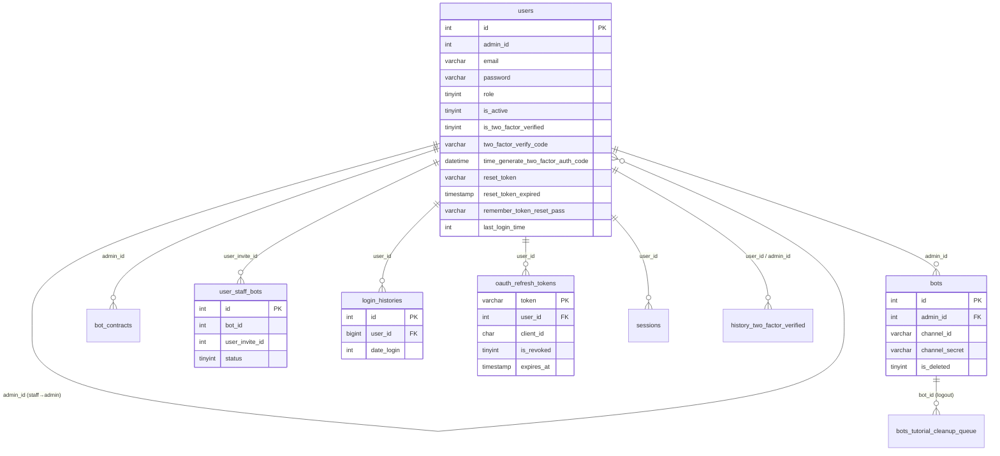

# DB Mapping — FA-040 Đăng nhập LME

> Ngày spec: 2026-11-20 · Branch `release_step_20261106`.
> Nguồn: `_internal/db-hint.md`, `web/api-spec.md`, `web/logic-spec.md`, `db/index.md`, `db/schema/tables/*.sql`, `db/data/*.sql` (DB dump không đổi so với lần trước).

## Lịch sử cập nhật

| Ngày | Nội dung |
|------|----------|
| 2026-11-20 | Re-spec theo branch `release_step_20261106`. DB dump không đổi; code branch mới **không thêm/bỏ cột** trong luồng FA-040. Cập nhật: (1) thêm `oauth_refresh_tokens` vào primary tables (`confirmPassword` revoke token); (2) thêm secondary `bot_contracts`, `user_staff_bots` (logic redirect), `bots_tutorial_cleanup_queue` (logout — **chưa có trong dump**); (3) `sessions`: config mặc định `SESSION_DRIVER=file` → bảng chỉ dùng khi env đặt `database`; payload vẫn `serialize()` PHP (`serialization = php`); (4) mapping SCR-LGN-01/02 bỏ dòng checkbox remember (UI auth-v3 không có), thêm SCR-LGN-09 (V3 reset); (5) `reset_token` V3 lookup theo token + kiểm hạn 24h; (6) `admin_login_history`/`admin_login_favorite` xác định thuộc tính năng System Admin "đăng nhập vào user" — giữ ở mục ngoài phạm vi; (7) JSON ngày giờ model giữ định dạng `Y-m-d H:i:s` (trait `LegacyDateSerialization`). |
| (bản trước) | Bản đầu tiên. |

---

## 1. Tổng quan DB

| Mục | Giá trị |
|-----|---------|
| Primary tables (ghi trong luồng) | **4** — `users`, `login_histories`, `oauth_refresh_tokens`, `sessions` (điều kiện) |
| Secondary tables (đọc / ghi phụ) | **5** — `bots`, `bot_contracts`, `user_staff_bots`, `history_two_factor_verified` (cài đặt 2FA), `bots_tutorial_cleanup_queue` (logout, chưa có trong dump) |
| Ngoài phạm vi (ghi chú) | `admin_login_history`, `admin_login_favorite`, `staff_bot_login`, `affiliaters`, `password_resets` (không tồn tại trong dump, không dùng) |
| UI fields được map | 11/11 input (100%) |
| Confidence | Cao: 10 · Trung bình: 1 (reCAPTCHA không lưu) · Thấp: 0 |

> Hệ thống **không dùng** `password_resets` (Laravel broker) và **không có** bảng mã 2FA riêng — mọi trạng thái nằm trong `users`.

---

## 2. Primary Tables

### 2.1 `users`

Tài khoản chung cho Admin LINE OA (`role` 0/1), Staff (`role` 2), Super Admin (`role` -1). 73 cột, ~135KB dump.

| Column | Kiểu | Null | Default | Mô tả / dùng trong FA-040 |
|--------|------|------|---------|---------------------------|
| `id` | int(11) | NO | — | PK; `session('user_id')` khi chờ 2FA; Hashids `url_code` ở EP-21..24 |
| `admin_id` | int(12) | NO | — | Self-ref staff → admin; dùng đếm `bot_contracts`, bật/tắt 2FA hàng loạt |
| `email` | varchar(255) | NO | — | Lookup đăng nhập / reset (`exists:users,email`) |
| `password` | varchar(255) | NO | — | bcrypt |
| `role` | tinyint(1) | NO | 1 | `-1` super admin, `0` user, `2` staff (comment DB `-1: admin, 0: user, 2: staff`) |
| `is_active` | tinyint(4) | NO | 1 | `0` → redirect `/account/resend-email/{email}`; đặt `1` khi đổi mật khẩu |
| `is_deleted` | tinyint(1) | NO | 0 | **Không kiểm tra** khi đăng nhập |
| `last_login_time` | int(11) | YES | NULL | Unix time; cập nhật ở EP-03, EP-07, `checkLogin*`, `CheckLogin` (khi rỗng); **không** ở EP-05 nhánh không 2FA |
| `is_two_factor_verified` | tinyint(1) | NO | 0 | Cờ bật 2FA cho role ≠ -1 |
| `two_factor_verify_code` | varchar(255) | NO | — | Mã 10 ký tự plain text |
| `time_generate_two_factor_auth_code` | datetime | NO | — | Mốc tính hạn (24h EP-07 / 10 phút EP-24) |
| `reset_token` | varchar(255) | YES | NULL | `RandomString(80).timestamp.user_id` plain text; xoá NULL ở EP-12, giữ nguyên ở EP-16 |
| `reset_token_expired` | timestamp | YES | NULL | Thực chất là **thời điểm phát hành** (EP-11 set `now()`); EP-10 không set |
| `remember_token` | varchar(255) | YES | NULL | Laravel remember-me (chỉ EP-03 V1) |
| `remember_token_reset_pass` | varchar(64) | YES | NULL | Token vô hiệu phiên; `Str::random(20)` khi đổi mật khẩu |
| `message_intro` | longtext | YES | NULL | Lấy từ `id=1`, truyền vào view login (view v3 không hiển thị) |
| `key_login`, `expired_key_login`, `channel_id`, `channel_secret`, `ip`… | — | — | — | Không dùng trong luồng, nhưng **bị lộ** qua `json_encode($user)` ở trang reset (S-03) |

Quan hệ: `users.id` ← `bots.admin_id`, `login_histories.user_id`, `oauth_refresh_tokens.user_id`, `user_staff_bots.user_invite_id`, `bot_contracts.admin_id`, `sessions.user_id`.

Sample (id=1): `role=-1`, `is_two_factor_verified=1`, `two_factor_verify_code='0HmOb025kE'`, `time_generate_two_factor_auth_code='2026-04-20 12:47:50'`, `remember_token_reset_pass=NULL`, `reset_token=NULL`.

### 2.2 `login_histories`

| Column | Kiểu | Null | Mô tả |
|--------|------|------|------|
| `id` | int(10) UNSIGNED | NO | PK |
| `user_id` | bigint(20) UNSIGNED | NO | FK → `users.id` |
| `date_login` | int(11) | NO | `YYYYMMDD` |
| `created_at`, `updated_at` | timestamp | YES | |

Ghi tại EP-05 (không 2FA) và EP-07; không ghi tại EP-03, EP-24. Sample: `user_id=115, date_login=20240822`.

### 2.3 `oauth_refresh_tokens` (mới trong mapping)

| Column | Kiểu | Null | Default | Mô tả |
|--------|------|------|---------|------|
| `token` | varchar(256) | NO | — | PK (string) |
| `user_id` | int(10) UNSIGNED | NO | — | FK → `users.id` |
| `client_id` | char(36) | NO | — | `oauth_clients.id` |
| `scope` | text | YES | — | vd `files:read` |
| `is_revoked` | tinyint(1) | NO | 0 | EP-12 đặt `1` cho mọi token còn hiệu lực của user |
| `expires_at` | timestamp | NO | CURRENT_TIMESTAMP ON UPDATE | ⚠ `ON UPDATE CURRENT_TIMESTAMP` → khi EP-12 UPDATE `is_revoked`, MySQL tự đổi `expires_at` thành thời điểm revoke (không ảnh hưởng vì token đã revoke) |
| `created_at`, `updated_at` | timestamp | YES | — | |

Sample: 6 bản ghi, `user_id=115`, `client_id='1f075e12-…'`. Bảng thuộc luồng MCP OAuth; FA-040 chỉ ghi `is_revoked`. **Cao**.

### 2.4 `sessions` (điều kiện)

Chỉ dùng khi `SESSION_DRIVER=database` (mặc định code là `file`, `config/session.php:19`). Cột: `id`, `user_id`, `ip_address`, `user_agent`, `payload` (PHP `serialize`, base64), `last_activity`. Dump có dữ liệu mẫu (`user_id=115`) → môi trường dump từng dùng driver database. Key session dùng trong FA-040: `login_web_{sha1}`, `remember_token`, `user_id` (chờ 2FA), `showPopup`, `current_bot_id`, `user_access_link_invite`, `user_access_link_edit_owner_bot`, `code_invite`. **Trung bình** (driver production chưa xác nhận).

---

## 3. Secondary Tables

### 3.1 `bots`
`id`, `admin_id` (FK users), `channel_id` varchar(128), `channel_secret` varchar(500) plain text, `is_deleted`, `view_name`, `bot_image`, `created_at`. EP-19 lookup; `getListBotIdStaffManagement` đếm bot `is_deleted=0` theo `admin_id` cho redirect EP-01/02. Sample `id=300` có `channel_id=NULL`, `channel_secret=''` → không khớp tra cứu.

### 3.2 `bot_contracts`
`id`, `admin_id`, `bot_id`, … (52 cột). Đếm `WHERE admin_id = user.id OR admin_id = user.admin_id` trong EP-03 & EP-04 → `botAdd` nếu 0.

### 3.3 `user_staff_bots`
`bot_id`, `user_invite_id`, `role_id`, `status` (`0` chưa phản hồi, `1` chấp nhận, `2` từ chối)… — `getListBotIdStaffManagement` lấy bot được mời (`user_invite_id = user.id`, **không lọc `status`**) để quyết định `botAddV2` / `preSelectBot`.

### 3.4 `history_two_factor_verified`
`admin_id`, `user_id`, `status_old`, `status_new` (varchar '0'/'1'). Chỉ ghi khi bật/tắt 2FA trong portal (ngoài màn đăng nhập).

### 3.5 `bots_tutorial_cleanup_queue` (chưa có trong dump)
Model `App\Models\BotsTutorialCleanupQueue`. Logout INSERT 1 dòng/bot có dữ liệu tutorial seed, reason `logout`, ref `ts_logout_{botId}_{timestamp}` (unique). Cần dump schema mới để mapping cột. **Trung bình**.

---

## 4. UI ↔ DB Mapping theo màn hình

### SCR-LGN-01 / SCR-LGN-02 — Đăng nhập (`POST /login-v2`)

| UI Element | Label JP | Table | Column | Mapping | Confidence |
|-----------|---------|-------|--------|---------|-----------|
| Email | メールアドレス | `users` | `email` | WHERE lookup | Cao |
| Mật khẩu | パスワード | `users` | `password` | `Hash::check` | Cao |
| reCAPTCHA | 私はロボットではありません | — | — | Không lưu | Trung bình |

Mutations (không 2FA): INSERT `login_histories`; session `remember_token` ← `users.remember_token_reset_pass`.
Mutations (2FA / role -1): UPDATE `users.two_factor_verify_code`, `time_generate_two_factor_auth_code`; session `user_id`.

### SCR-LGN-03 — Mã 2FA (`POST /auth-code-login`)

| UI Element | Label JP | Table | Column | Mapping | Confidence |
|-----------|---------|-------|--------|---------|-----------|
| Mã | 認証コード / メール記載の認証コード | `users` | `two_factor_verify_code` | So sánh `==` | Cao |
| (hạn) | — | `users` | `time_generate_two_factor_auth_code` | +24h | Cao |

Mutations: INSERT `login_histories`; UPDATE `users.last_login_time`; session đăng nhập; forget `user_id`.

### SCR-LGN-04 / SCR-LGN-09 step 1 — Gửi mail (`POST /post_reset_v2`)

| UI Element | Label JP | Table | Column | Mapping | Confidence |
|-----------|---------|-------|--------|---------|-----------|
| Email | 登録メールアドレス / (email) | `users` | `email` | `exists` + WHERE | Cao |

Mutations: UPDATE `users.reset_token`, `users.reset_token_expired = now()`.

### SCR-LGN-09 step 3 / SCR-LGN-04 (có token) — Mật khẩu mới (`POST /confirm_password`)

| UI Element | Label JP | Table | Column | Mapping | Confidence |
|-----------|---------|-------|--------|---------|-----------|
| (ẩn) token | — | `users` | `reset_token` | `exists` + WHERE; hạn theo `reset_token_expired` | Cao |
| Hiển thị email | 登録アドレス | `users` | `email` | Đọc | Cao |
| Mật khẩu | パスワード | `users` | `password` | Ghi bcrypt | Cao |
| Xác nhận | パスワード確認用 | — | — | Không lưu | Cao |

Mutations: UPDATE `users` (`password`, `is_active=1`, `reset_token=NULL`, `remember_token_reset_pass`); UPDATE `oauth_refresh_tokens.is_revoked=1`.

### SCR-LGN-06 — Mật khẩu mới V1 (`POST /change_password`)

| UI Element | Label JP | Table | Column | Mapping | Confidence |
|-----------|---------|-------|--------|---------|-----------|
| 新しいパスワード | 新しいパスワード | `users` | `password` | Ghi bcrypt | Cao |
| 新しいパスワード（確認） | — | — | — | Không lưu | Cao |
| (ẩn) token | — | `users` | `reset_token` | `exists` + WHERE (không kiểm hạn) | Cao |

Mutations: UPDATE `users` (`password`, `is_active=1`, `remember_token_reset_pass`) — `reset_token` giữ nguyên; auto-login.

### SCR-LGN-08 — Check-user (`POST /check-user`)

| UI Element | Label JP | Table | Column | Mapping | Confidence |
|-----------|---------|-------|--------|---------|-----------|
| Channel ID | Channel ID | `bots` | `channel_id` | WHERE (trim) | Cao |
| Channel secret | Channel secret | `bots` | `channel_secret` | WHERE (trim) + `is_deleted=0` | Cao |

Output: `bots.id`, `view_name`, `bot_image`, `created_at` (2 định dạng), `users.email` qua `bots.admin_id`. Chỉ SELECT.

### Logout
INSERT `bots_tutorial_cleanup_queue`; xoá session (row `sessions` nếu driver database).

---

## 5. Enum / Status

| Cột | Giá trị |
|-----|---------|
| `users.role` | `-1` super admin (luôn 2FA, đích `adminTop`), `0`/`1` user, `2` staff |
| `users.is_active` | `0` chưa kích hoạt (`config('sns-line.is_active.no')`), `1` đã kích hoạt |
| `users.is_two_factor_verified` | `0` tắt, `1` bật (role ≠ -1) |
| `oauth_refresh_tokens.is_revoked` | `0` còn hiệu lực, `1` đã thu hồi |
| `user_staff_bots.status` | `0` chưa phản hồi, `1` chấp nhận, `2` từ chối |
| `bots.is_deleted` | `0` / `1` |

---

## 6. Unmapped Items

| Mục | Lý do |
|-----|------|
| reCAPTCHA token, `repeat_password`, `re-password`, CSRF `_token` | Không lưu cột riêng |
| Link「新規アカウント作成」, banner エルサイト/エルグラム | Điều hướng |
| Cookie `path_intro_lme` (ghi bằng JS ở SCR-LGN-01) | Lưu cookie trình duyệt; được FA-039 đọc khi đăng ký |
| `users.account_deletion_auth_code`, `change_email_auth_code`, `key_login`… | Không dùng trong FA-040 |
| `admin_login_history`, `admin_login_favorite` | Tính năng System Admin "đăng nhập vào user" (`UserController.php:10371-10421`) |
| `staff_bot_login` | Dùng ở `ConnectionRateService`, không ghi khi đăng nhập |

### Câu hỏi còn treo
1. Schema `bots_tutorial_cleanup_queue` (cần dump mới).
2. `SESSION_DRIVER` production.
3. Có bản ghi `users.reset_token` khác NULL mà `reset_token_expired` NULL không (token V1 không hết hạn khi đi qua EP-12/EP-28)?
4. Index UNIQUE trên `users.email` (dump đã strip index).
5. `users.is_deleted` không được kiểm tra khi đăng nhập — có chủ ý không?

---

## 7. Entity Relationships

---

## 8. Session & Authentication State

- Guard `web` (session, provider `App\User`). Session driver mặc định `file`, lifetime mặc định ~20 năm, `serialization = php`.
- **Remember-me Laravel** (`users.remember_token`): chỉ EP-03 V1 (`Auth::attempt(..., true)`); EP-05 không.
- **Vô hiệu phiên** (`users.remember_token_reset_pass`): đăng nhập V2/2FA lưu giá trị vào session; đổi mật khẩu (EP-12, EP-16) sinh giá trị mới → `CheckRememberToken` logout các phiên khác ở request kế tiếp. Nếu cột NULL và session không có key → so sánh `NULL !== NULL` = false → **không** logout (liên quan S-09).
- **Đặt lại mật khẩu**: token trong `users.reset_token`, 1 token/user, ghi đè mỗi lần yêu cầu; hạn 24h tính từ `reset_token_expired`. EP-12 còn thu hồi refresh token OAuth (MCP).

---

## Phụ lục — File đã đọc
- `db/index.md` (grep), `db/schema/tables/{users,login_histories,oauth_refresh_tokens,user_staff_bots,bot_contracts,bots,sessions,history_two_factor_verified,admin_login_history}.sql`
- `db/data/oauth_refresh_tokens.sql` (đầu file), dữ liệu mẫu `users`, `login_histories`, `bots`, `sessions` (kế thừa từ lần spec trước — dump không đổi)
- Source: `AuthController.php`, `TwoFactorVerifyController.php`, `User.php`, `LoginHistory.php`, `OAuthRefreshToken.php`, `CheckRememberToken.php`, `config/session.php`, `functions.php:5045`, `TutorialInitDataCleanupService.php:144`, `Models/BotsTutorialCleanupQueue.php`
