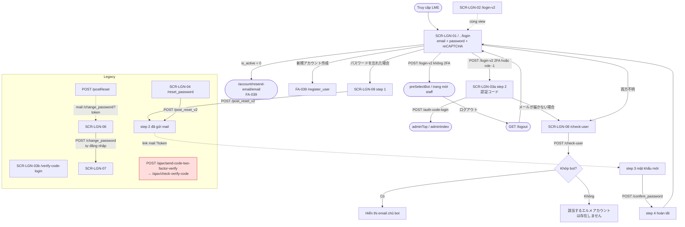
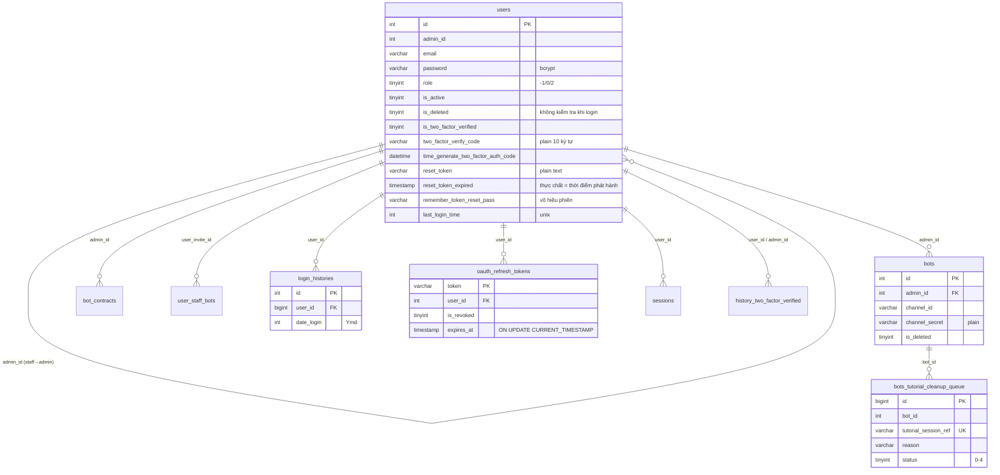

# FA-040 — Đăng nhập LME 「ログイン」

> **Feature Spec tổng hợp** — tài liệu chính cho PM / tester / dev. Tổng hợp từ UI, API, Business Logic, DB mapping và Validation report.
>
> **Ngày spec**: 2026-11-20 · **Branch source**: `release_step_20261106` (Laravel `^13.0`, PHP `^8.3`) · **Raw data**: `raw/features/login-account/`
>
> **File chi tiết**: [UI spec](ui/ui-spec.md) (9 màn hình) · [API spec](web/api-spec.md) (29 endpoints) · [Logic spec](web/logic-spec.md) (controllers, BR-01…20, S-01…11) · [DB mapping](db/db-mapping.md) · [Validation report](_internal/validation-report.md)

## Lịch sử cập nhật

| Ngày | Nội dung |
|------|----------|
| 2026-11-20 | **Re-spec theo branch `release_step_20261106`** (nâng cấp Laravel 5.5 → 13 / PHP 8.3). **UI**: trang `/`, `/login`, `/login-v2` chuyển sang giao diện **auth-v3** (1 card, lme-ui), submit AJAX `POST /login-v2` (không còn `POST /login`, bỏ checkbox remember, bỏ cột「はじめての方はこちら」, thêm link「新規アカウント作成」+ banner エルサイト/エルグラム); 2FA hiển thị **inline step 2**; thêm màn **SCR-LGN-09** `/reset-password` (V3, 4 bước); `/check-user` đổi sang `check-user-v3` hiển thị kết quả inline. **API**: 27 → **29 endpoints** (thêm EP-28 `/reset-password`, EP-29 `/account/resend-email/{email}`); `email` → `email:filter`; `(int) diffInHours(…, true)`; `catch (\Throwable)` + `reportCaughtError`. **Đính chính bản cũ**: `loginV2` thành công → `preSelectBot` (không phải `adminIndex`); super admin V2 → step 2 `verifyCode` (không phải `viewEnterVerifyCode`); `authCodeLogin` role -1 → `adminTop`; `confirmPassword` xác định user theo **token** (không nhận `id`), kiểm hạn 24h, revoke `oauth_refresh_tokens`; logout xoá 16 cookie (không phải 13) + enqueue dọn dữ liệu tutorial. **DB**: thêm `oauth_refresh_tokens` (primary), `bot_contracts`, `user_staff_bots`, `bots_tutorial_cleanup_queue` (secondary); `affiliaters`, `admin_login_history` chuyển ra ngoài phạm vi. **Bảo mật**: thêm **S-02** (chiếm tài khoản qua `/ajax/send-code-two-factor-verify` — đã xác nhận bằng code, không cần đăng nhập lẫn CSRF) và **S-03** (lộ toàn bộ bản ghi `users` trên trang reset — đã xác nhận); 2 cảnh báo cũ đã hết (`confirmPassword` nhận `id` client; `CheckLogin` không trả response). Đánh số S-xx thay đổi so với bản cũ (xem §9.4). |
| 2026-04-21 | Bản đầu tiên (giao diện loginv2 2 cột, 8 màn hình, 27 endpoints, code Laravel 5.5). |

---

## 1. Tổng quan

| Hạng mục | Giá trị |
|----------|---------|
| **Mã tính năng** | **FA-040** |
| **Tên tiếng Việt / JP** | Đăng nhập LME / 「ログイン」 |
| **Phân loại** | Quản lý hệ thống / Xác thực |
| **Domain quan sát** | `form.watermeru.com` |
| **Portal** | Công khai (không cần đăng nhập) — dùng chung cho Admin LINE OA, Staff, Super Admin |
| **Background job** | Không có job riêng (logout dispatch 1 job của tính năng tutorial — §7) |

### 1.1 Mục đích
Điểm xác thực chung cho mọi actor dùng bảng `users`: đăng nhập email/mật khẩu (reCAPTCHA v2), xác thực 2 bước qua email, đặt lại mật khẩu, tra cứu email đăng ký bằng Channel ID / Channel secret của LINE OA, đăng xuất.

### 1.2 Actors

| Actor | `users.role` | Vai trò |
|-------|-------------|---------|
| Admin LINE OA | `0` (UI ghi cả `1`) | Đăng nhập portal; 2FA nếu `is_two_factor_verified = 1` |
| Super Admin / System Admin | `-1` | Cùng form; **luôn** qua 2FA; sau 2FA → `adminTop` |
| Staff | `2` | Đăng nhập bằng tài khoản do Admin cấp; có thể vào thẳng trang nhận lời mời (`code_invite`) |
| Khách chưa có tài khoản | — | Link「新規アカウント作成」→ FA-039 |
| Người quên mật khẩu / quên cả email | — | `/reset-password` / `/check-user` |

Không có bảng riêng cho Staff/System Admin — phân biệt bằng `role` và `admin_id`.

### 1.3 Phạm vi
**Trong phạm vi**: SCR-LGN-01…09, logout, các endpoint 2FA V1 (EP-21…24), LINE OAuth callback (EP-25…27 — ghi nhận, không phải đăng nhập portal).
**Ngoài phạm vi**: đăng ký tài khoản (FA-039), cài đặt bật/tắt 2FA (FA-037), đăng nhập affiliate, đăng nhập OAuth cho MCP (`Auth\McpAuthController`), System Admin "đăng nhập vào user" (`admin_login_history`).

---

## 2. Các màn hình + Luồng xử lý end-to-end

### 2.1 Danh sách màn hình

| Mã | Màn hình | Tên JP | URL | View | Submit | Trạng thái |
|----|---------|--------|-----|------|--------|-----------|
| SCR-LGN-01 | Đăng nhập chính (auth-v3) | 「ログイン」 | `/`, `/login` | `auth.auth-v3.login-v3` | `POST /login-v2` (EP-05) | Đổi giao diện |
| SCR-LGN-02 | Đăng nhập V2 | 「ログイン」 | `/login-v2` | cùng view | EP-05 | Giống SCR-LGN-01 |
| SCR-LGN-03a | 2FA inline (step 2) | 「２段階認証」 | (cùng URL login) | `login-v3` step 2 | `POST /auth-code-login` (EP-07) | Mới |
| SCR-LGN-03b | 2FA legacy | 「メール記載の認証コードをご入力ください」 | `/verify-code-login` | `auth.verify` | EP-07 | Không đổi |
| SCR-LGN-04 | Gửi mail đặt lại (legacy) | 「パスワード再設定用メール送信」 | `/reset_password` | `auth.reset_password_v2` | `POST /post_reset_v2` (EP-11); có token → EP-12 | Không đổi, không còn link từ login |
| SCR-LGN-05 | Đã gửi mail (legacy) | — | `/reset-password-success` | `auth.reset_password_success` | — | Không đổi |
| SCR-LGN-06 | Mật khẩu mới V1 | 「パスワード再設定」 | `/change_password?token=` | `auth.change_password` | `POST /change_password` (EP-16) | Không đổi |
| SCR-LGN-07 | Đổi mật khẩu xong V1 | — | `/change_password_success` | `auth.change_pass_success` | — | Không đổi |
| SCR-LGN-08 | Tra cứu qua Channel ID/secret | 「メールアドレス・パスワードが両方不明な場合」 | `/check-user` | `auth.auth-v3.check-user-v3` | `POST /check-user` (EP-19) | Đổi giao diện |
| SCR-LGN-09 | Đặt lại mật khẩu V3 (4 bước) | 「パスワード再設定」 | `/reset-password` | `auth.auth-v3.reset-password-v3` | EP-11 (step 1), EP-12 (step 3) | Mới |

### 2.2 Sơ đồ tổng quan

### 2.3 Luồng 1 — Đăng nhập không 2FA (SCR-LGN-01/02)

| Bước | Chi tiết |
|------|---------|
| User action | Nhập「メールアドレス」「パスワード」, tick reCAPTCHA (bị khoá tới khi nhập đủ 2 ô), click「ログイン」 |
| UI | Nút disabled khi thiếu field / đang loading; overlay spinner |
| API | `POST /login-v2` JSON `{email, password, captcha}` (axios, header `X-XSRF-TOKEN`) — EP-05 |
| Logic | `AuthController@loginV2` (`:173-276`): validate `email required\|email:filter`, `password required`, `captcha required\|recaptcha` → `User::where('email')` → **`is_active = 0` kiểm tra trước mật khẩu** → role ≠ -1: `Hash::check` → `is_two_factor_verified = 0` → `Auth::attempt` (không remember) |
| DB | SELECT `users`; INSERT `login_histories` (user_id, `date_login = Ymd`) nếu chưa có hôm nay; session `remember_token` ← `users.remember_token_reset_pass`, `showPopup = true`; forget cờ mời staff. **Không** cập nhật `last_login_time` |
| Response | 200 `{redirect: route('preSelectBot', params)}` hoặc `{redirect: staff-management.userAccessLinkInviteStaff}` nếu session có `code_invite`; lỗi 422 `{errors:{field|notice}}` |
| UI update | `window.location.href = redirect`; lỗi 422 → hiển thị theo field, lỗi chung「メールアドレス・パスワードに誤りがあります。」, reset reCAPTCHA |

### 2.4 Luồng 2 — Đăng nhập có 2FA (SCR-LGN-01 → SCR-LGN-03a)

| Bước | Chi tiết |
|------|---------|
| Kích hoạt | role ≠ -1 và `is_two_factor_verified = 1`, hoặc role = -1 (luôn) — sau khi mật khẩu đúng |
| Logic EP-05 | `session(['user_id'])`; `Str::random(10)` → UPDATE `users.two_factor_verify_code`, `time_generate_two_factor_auth_code = now()`; mail: user thường `ActiveAccount::sendMailCodeVerify` (API mail, tiêu đề「【L Message】ログイン認証コードのご連絡」), super admin `sendMailCodeVerifyAdmin` (SMTP `ADMIN_MAIL_*`, tiêu đề「エルメの認証コード」) — gửi tới email của chính user |
| Response | 200 `{redirect: /verify-code-login}` → frontend **không điều hướng**, chuyển step 2 tại chỗ (tag「２段階認証」) |
| User action | Nhập「認証コード」→「ログイン」→ `POST /auth-code-login {code}` (EP-07) |
| Logic EP-07 | `AuthController@authCodeLogin` (`:345-379`): `User::find(session('user_id'))`, so `==` mã, hạn `+24h` → INSERT `login_histories`, `Auth::loginUsingId`, UPDATE `last_login_time`, session `remember_token`, forget `user_id` |
| Response | 200 `{redirect: role == -1 ? adminTop : adminIndex}`; 422「認証コードが間違っています。」/「認証コード期限が切れました。再度発行をしてください」 |
| Lưu ý | Mã không bị xoá sau khi dùng; không giới hạn số lần nhập sai; không có nút gửi lại mã (link「認証コードのメールが届かない場合」→ `/check-user`) |

### 2.5 Luồng 3 — Đặt lại mật khẩu V3 (SCR-LGN-09, luồng chính)

| Bước | Chi tiết |
|------|---------|
| Step 1 | `GET /reset-password` (EP-28) không token → nhập「登録メールアドレス」(kiểm tra định dạng client) →「送信」→ `POST /post_reset_v2 {email}` (EP-11) |
| Logic EP-11 | `resetFormV2` (`:479-523`): `required\|email:filter\|exists:users,email` (lộ email tồn tại) → UPDATE `users.reset_token = RandomString(80).timestamp.user_id` (plain text), `reset_token_expired = now()` → mail link `/reset-password?token=…` (đã có token cũ → `reSendMailResetPass` qua SMTP `RESEND_MAIL_*`; chưa có → `ResetPassword::resetPassword` qua API mail) → 302 `/reset-password-success` |
| Step 2 | UI hiển thị「パスワード再設定用のメールを送信しました」; modal「メールが届かない場合」 |
| Step 3 | Mở link → EP-28: token không khớp/quá 24h → `reset-password-error`; còn hạn → step 3, hiển thị「登録アドレス」. ⚠ **View nhúng toàn bộ model User** (S-03) |
| Submit | 「パスワードを再設定」→ `POST /confirm_password {token, password, repeat_password}` (EP-12) |
| Logic EP-12 | `confirmPassword` (`:525-604`): token `exists`, regex 6–12 đủ hoa/thường/số/ký hiệu, `same:password`, kiểm hạn 24h, không trùng mật khẩu hiện tại → UPDATE `users` (`password` bcrypt, `is_active=1`, `reset_token=NULL`, `remember_token_reset_pass=Str::random(20)`) + UPDATE `oauth_refresh_tokens.is_revoked=1` |
| Step 4 | 200 `{redirect_url}` → UI tự chuyển「パスワード再設定完了」; **không** tự đăng nhập. Mọi phiên khác bị logout ở request kế tiếp qua `CheckRememberToken` |

### 2.6 Luồng 4 — Đặt lại mật khẩu legacy

- `/reset_password` (SCR-LGN-04) → cùng `POST /post_reset_v2` → mail cũng trỏ `/reset-password?token=` (V3).
- Luồng V1: `POST /postReset` (EP-10, không set `reset_token_expired`) → mail `/change_password?token=` → SCR-LGN-06 → `POST /change_password` (EP-16: `between:6,13`, **không** xoá token, **không** kiểm hạn, **không** revoke OAuth, **tự đăng nhập**) → SCR-LGN-07.

### 2.7 Luồng 5 — Tra cứu tài khoản (SCR-LGN-08)

User nhập「Channel ID」「Channel secret」→「登録を確認する」→ `POST /check-user` (EP-19, chỉ `trim`, không validate server, không throttle) → `Bots::where(channel_id, channel_secret, is_deleted=0)` → `{status:true, data:{id, view_name, bot_image, created_at, created_at_display, mail_admin_creator}}` → UI hiển thị「3. エルメ登録アカウントの確認」với email chủ bot, hoặc「該当するエルメアカウントは存在しません」. Chỉ SELECT, không gửi mail.

### 2.8 Luồng 6 — Đăng xuất

`GET /logout` (EP-20, `:388-430`): (1) nếu đã đăng nhập → `TutorialInitDataCleanupService::enqueueCleanupOnLogout` — INSERT `bots_tutorial_cleanup_queue` (reason `logout`) cho mỗi bot có dữ liệu tutorial seed + `dispatch(TutorialInitDataCleanupJob)` (best-effort, nuốt lỗi); (2) forget `current_bot_id`, xoá 16 cookie `folder_*`; (3) `Auth::logout()`, `Session::flush()`, giữ lại cờ mời staff; (4) 302 `login`.

### 2.9 Luồng phụ — 2FA V1 super admin (EP-21…24) ⚠

Chỉ được dẫn tới từ `POST /login` V1 (UI không còn gọi). `POST /ajax/send-code-two-factor-verify {id, email}` sinh mã 10 phút gửi tới **email bất kỳ**; `POST /ajax/check-verify-code {id(Hashids), code}` → `Auth::loginUsingId`. Hai route **không cần đăng nhập và miễn CSRF** (`/ajax/*` trong `VerifyCsrfToken::$except`) → **S-02**.

### 2.10 Error cases

| Tình huống | Phản hồi |
|-----------|---------|
| Email không tồn tại / sai mật khẩu | 422「メールアドレス・パスワードに誤りがあります。」 |
| `is_active = 0` (không cần mật khẩu đúng) | 200 redirect `/account/resend-email/{email}` |
| Mã 2FA sai / hết hạn | 422 (xem §2.4) |
| Email reset không tồn tại | 422「メールアドレスが登録されていません。」 |
| Token reset hết hạn | EP-28: view lỗi; EP-12: 422「リンクの有効期限が切れました。…」 |
| Lỗi hệ thống ở reset | `reportCaughtError` + 302 `404` (AJAX EP-12: 500 `{error}`) |

---

## 3. Data Model

| Entity (Model) | Table | Loại | Vai trò |
|----------------|-------|------|---------|
| `App\User` | `users` | Primary | Tài khoản mọi actor (73 cột); toàn bộ trạng thái 2FA + reset token nằm ở đây |
| `App\LoginHistory` | `login_histories` | Primary | 1 dòng/user/ngày |
| `App\OAuthRefreshToken` | `oauth_refresh_tokens` | Primary | Revoke khi đổi mật khẩu V3 |
| (Laravel) | `sessions` | Primary (điều kiện) | Chỉ khi `SESSION_DRIVER=database` (mặc định `file`) |
| `App\Bots` | `bots` | Secondary | Check-user; redirect |
| `App\BotContracts` | `bot_contracts` | Secondary | Redirect `checkLoginV2` / login V1 |
| (helper) | `user_staff_bots` | Secondary | `getListBotIdStaffManagement` (redirect) |
| `App\HistoryTwoFactorVerified` | `history_two_factor_verified` | Secondary | Ghi khi bật/tắt 2FA (FA-037) |
| `App\Models\BotsTutorialCleanupQueue` | `bots_tutorial_cleanup_queue` | Secondary | Logout enqueue (chưa có trong dump; schema ở migration `2026_09_09_000000`) |
| (Laravel queue) | `jobs` | Gián tiếp | Payload `TutorialInitDataCleanupJob` (connection `database`) |

Không dùng `password_resets`; không có bảng mã 2FA riêng.

---

## 4. Field Traceability Matrix

| # | UI Element | Màn hình | DB Table.Column | Hướng | Validation | Business Rule | Tin cậy |
|---|-----------|----------|----------------|-------|-----------|--------------|--------|
| 1 | 「メールアドレス」 | SCR-LGN-01/02 | `users.email` | Đọc (lookup) | `required\|email:filter` | BR-02 kiểm `is_active` trước mật khẩu | Cao |
| 2 | 「パスワード」 | SCR-LGN-01/02 | `users.password` | Đọc (verify) | `required` | BR-01 bcrypt `Hash::check` | Cao |
| 3 | reCAPTCHA「私はロボットではありません」 | SCR-LGN-01/02 | — | Không lưu | `required\|recaptcha` (field `captcha`) | Chỉ EP-03, EP-05 | Trung bình |
| 4 | 「認証コード」 | SCR-LGN-03a/b | `users.two_factor_verify_code` | Đọc (so `==`) | — | BR-04 hạn 24h theo `time_generate_two_factor_auth_code` | Cao |
| 5 | (ẩn) session `user_id` | SCR-LGN-03 | session | Ghi/đọc | — | Set EP-05, forget EP-07 | Cao |
| 6 | 「登録メールアドレス」/ email | SCR-LGN-09 step 1, SCR-LGN-04 | `users.email` → ghi `reset_token`, `reset_token_expired` | Đọc + Ghi | `required\|email:filter\|exists:users,email` | BR-11 token plain text | Cao |
| 7 | (ẩn) `token` | SCR-LGN-09 step 3 | `users.reset_token` | Đọc → NULL | `required\|exists:users,reset_token` + 24h | BR-12, BR-15 | Cao |
| 8 | 「登録アドレス」(hiển thị) | SCR-LGN-09 step 3 | `users.email` | Đọc | — | S-03: kèm toàn bộ bản ghi | Cao |
| 9 | Mật khẩu mới「パスワード」 | SCR-LGN-09 step 3 | `users.password` | Ghi bcrypt | regex 6–12 hoa/thường/số/ký hiệu, ≠ mật khẩu cũ | BR-14; side effect `is_active=1`, `remember_token_reset_pass`, revoke OAuth | Cao |
| 10 | 「パスワード確認用」 | SCR-LGN-09 step 3 | — | Không lưu | `required\|same:password` | — | Cao |
| 11 | 「新しいパスワード」 | SCR-LGN-06 | `users.password` | Ghi bcrypt | `required\|between:6,13` | BR-16 không xoá token, auto-login | Cao |
| 12 | 「新しいパスワード（確認）」 | SCR-LGN-06 | — | Không lưu | `same:password` | — | Cao |
| 13 | (ẩn) `token` V1 | SCR-LGN-06 | `users.reset_token` | Đọc | `exists`, không kiểm hạn | S-05 | Cao |
| 14 | 「Channel ID」 | SCR-LGN-08 | `bots.channel_id` | Đọc | client only, `trim` | BR-17 | Cao |
| 15 | 「Channel secret」 | SCR-LGN-08 | `bots.channel_secret` | Đọc | client only, `trim`; `is_deleted=0` | BR-17 | Cao |
| 16 | Tên bot / avatar / ngày kết nối | SCR-LGN-08 (output) | `bots.view_name`, `bot_image`, `created_at` | Đọc | — | Ảnh lỗi → `/images/8.png` | Cao |
| 17 | Email chủ bot | SCR-LGN-08 (output) | `users.email` qua `bots.admin_id` | Đọc | — | S-07 | Cao |
| 18 | (tự động) lịch sử đăng nhập | sau EP-05/EP-07 | `login_histories.user_id, date_login` | Ghi | — | BR-08 (V1, EP-24 không ghi) | Cao |
| 19 | (tự động) lần đăng nhập cuối | sau EP-07, `checkLogin*` | `users.last_login_time` | Ghi | — | Không ghi ở EP-05 nhánh không 2FA | Cao |
| 20 | (tự động) refresh token MCP | sau EP-12 | `oauth_refresh_tokens.is_revoked` | Ghi | — | BR-15 | Cao |
| 21 | (tự động) logout | EP-20 | `bots_tutorial_cleanup_queue`, `jobs` | Ghi | — | BR-18 | Trung bình |
| 22 | Cookie `path_intro_lme` | SCR-LGN-01 (JS) | cookie trình duyệt → FA-039 | Ghi | — | Tracking nguồn đăng ký | Cao |

Không map DB: CSRF token, link điều hướng, banner エルサイト/エルグラム.

---

## 5. Business Rules

| # | Quy tắc | Nguồn | Tin cậy |
|---|---------|-------|---------|
| BR-01 | Mật khẩu bcrypt; verify `Hash::check` (V2) / `Auth::attempt` (V1) | `AuthController.php:153,213,266` | Cao |
| BR-02 | `is_active = 0` kiểm tra **trước** mật khẩu → redirect trang gửi lại mail kích hoạt | `:207-209` | Cao |
| BR-03 | 2FA: role ≠ -1 khi `is_two_factor_verified = 1`; role -1 luôn luôn | `:212-274` | Cao |
| BR-04 | Mã 2FA `Str::random(10)` plain text; hạn 24h (EP-07) / 10 phút (EP-24); không xoá sau dùng; không giới hạn lần thử | `:255,279,353`; `TwoFactorVerifyController.php:93` | Cao |
| BR-05 | Mail mã: user thường qua API mail, super admin qua SMTP `ADMIN_MAIL_*` | `:262,284` | Cao |
| BR-06 | Sau 2FA: role -1 → `adminTop`, còn lại → `adminIndex` | `:377` | Cao |
| BR-07 | Login V2 không 2FA → `preSelectBot` hoặc trang nhận lời mời staff | `:230-249` | Cao |
| BR-08 | `login_histories` 1 dòng/user/ngày (EP-05, EP-07) | `:218-227,361-370` | Cao |
| BR-09 | Session `remember_token` = `remember_token_reset_pass`; đổi mật khẩu sinh giá trị mới → `CheckRememberToken` logout mọi phiên khác | `:228,373,580,686` | Cao |
| BR-10 | V1 luôn remember-me; V2 không | `:153,217` | Cao |
| BR-11 | Token reset `RandomString(80).timestamp.user_id`, plain text, 1 token/user | `:501,628` | Cao |
| BR-12 | Hạn token 24h từ `reset_token_expired` (`(int) diffInHours(…, true) >= 24`) | `:440,468,564` | Cao |
| BR-13 | Token V1 không set `reset_token_expired` → `Carbon::parse(null)` = now → luôn "còn hạn" nếu cột NULL | `:630` | Trung bình |
| BR-14 | Mật khẩu V3: 6–12, đủ 4 loại ký tự, ≠ mật khẩu hiện tại; V1: 6–13 không yêu cầu độ phức tạp. Client tự xoá khoảng trắng | `:537-546,570-574,669` | Cao |
| BR-15 | `confirmPassword` xác định user theo token, xoá token, `is_active=1`, revoke OAuth, không auto-login | `:559-591` | Cao |
| BR-16 | V1 `change`: không xoá token, không kiểm hạn, auto-login | `:685-688` | Cao |
| BR-17 | Check-user trả email chủ bot khi khớp cả `channel_id` + `channel_secret`, bot chưa xoá | `:1688-1713` | Cao |
| BR-18 | Logout: enqueue + dispatch job dọn tutorial (trước `Auth::logout`), xoá 16 cookie `folder_*`, flush session, giữ cờ mời staff | `:388-430`; `TutorialInitDataCleanupService.php:120,144` | Cao |
| BR-19 | Lỗi `\Throwable` ở reset/đổi mật khẩu → `reportCaughtError` + 404 (AJAX EP-12: 500) | `:517-522,593-603` | Cao |
| BR-20 | Không giới hạn số lần đăng nhập sai / nhập mã / gửi mail reset / check-user | routes `web.php:2374-2577` | Cao |
| BR-21 | `users.is_deleted` không được kiểm tra khi đăng nhập | db-mapping | Cao (code) / chưa rõ chủ ý |
| BR-22 | CSRF bắt buộc cho mọi POST auth **trừ** `/ajax/*` (EP-23, EP-24) | `VerifyCsrfToken.php:16,64-66` | Cao |

---

## 6. API Endpoints

Tất cả route nằm trong `routes/web.php:2374-2577`, middleware group `web` + `NotifyChatworkRequestTimeSlow`; **không** có `auth`, `guest`, `throttle`.

| ID | Method | URL | Controller@Method | Màn hình / ghi chú |
|----|--------|-----|-------------------|-------------------|
| EP-01 | GET | `/` | `AuthController@checkLogin` | SCR-LGN-01 (đã đăng nhập → redirect theo role) |
| EP-02 | GET | `/login` | `AuthController@checkLogin` | SCR-LGN-01 |
| EP-03 | POST | `/login` | `AuthController@login` | V1 legacy — UI không gọi; còn backdoor S-01 |
| EP-04 | GET | `/login-v2` | `AuthController@checkLoginV2` | SCR-LGN-02 |
| EP-05 | POST | `/login-v2` | `AuthController@loginV2` | **Luồng chính** (JSON) |
| EP-06 | GET | `/verify-code-login` | `AuthController@verifyCodeLogin` | SCR-LGN-03b |
| EP-07 | POST | `/auth-code-login` | `AuthController@authCodeLogin` | SCR-LGN-03a/b |
| EP-08 | GET | `/reset_password` | `AuthController@resetPassword` | SCR-LGN-04 (dual-purpose) |
| EP-09 | GET | `/reset_password_v2` | `AuthController@resetPasswordV2` | Không kiểm hạn token; lộ dữ liệu S-03 |
| EP-10 | POST | `/postReset` | `AuthController@resetForm` | V1 legacy |
| EP-11 | POST | `/post_reset_v2` | `AuthController@resetFormV2` | SCR-LGN-04, SCR-LGN-09 step 1 |
| EP-12 | POST | `/confirm_password` | `AuthController@confirmPassword` | SCR-LGN-09 step 3 |
| EP-13 | GET | `/reset-password-success` | `AuthController@resetPasswordSuccess` | SCR-LGN-05 |
| EP-14 | GET | `/change_password` | `AuthController@changePassword` | SCR-LGN-06 |
| EP-15 | GET | `/change_password_v2` | `AuthController@changePasswordV2` | **Dead route** (method không tồn tại) |
| EP-16 | POST | `/change_password` | `AuthController@change` | SCR-LGN-06 (auto-login) |
| EP-17 | GET | `/change_password_success` | `AuthController@changePasswordSuccess` | SCR-LGN-07 |
| EP-18 | GET | `/check-user` | `AuthController@checkUser` | SCR-LGN-08 |
| EP-19 | POST | `/check-user` | `AuthController@postCheckUser` | SCR-LGN-08 (JSON) |
| EP-20 | GET | `/logout` | `AuthController@logout` | — |
| EP-21 | GET | `/view-send-code-two-factor-verify/{id}` | `Admin\TwoFactorVerifyController@viewSendCodeTwoFactoryVerify` | 2FA V1 |
| EP-22 | GET | `/enter-verify-code/{id}` | `…@viewEnterVerifyCode` | 2FA V1 |
| EP-23 | POST | `/ajax/send-code-two-factor-verify` | `…@sendCode` | ⚠ S-02 — không auth, miễn CSRF |
| EP-24 | POST | `/ajax/check-verify-code` | `…@checkVerifyCode` | ⚠ S-02 — không auth, miễn CSRF |
| EP-25 | GET | `/line/callback/redirect-login` | `Admin\UserController@loginLine` | LINE OAuth QR (ngoài luồng portal) |
| EP-26 | GET | `/line/callback/callback-login` | `Admin\UserController@callbackLoginLine` | như trên |
| EP-27 | GET | `/line/callback/callback-login-error` | `Admin\UserController@callbackLoginLineError` | như trên |
| EP-28 | GET | `/reset-password` | `AuthController@resetPasswordV3` | **SCR-LGN-09 (mới)** |
| EP-29 | GET | `/account/resend-email/{email}` | `AuthController@accountNotActive` | Đích khi `is_active = 0` |

reCAPTCHA chỉ áp dụng EP-03 (`g-recaptcha-response`) và EP-05 (`captcha`) — rule `recaptcha` (`AppServiceProvider.php:77` → `App\Validators\ReCaptcha`). Chi tiết request/response: [api-spec.md](web/api-spec.md).

---

## 7. Background Jobs

**FA-040 không có background job riêng** → không tạo `job/job-spec.md`. Mail 2FA / reset gửi **đồng bộ** (API mail `EMAIL_API_URL` hoặc SMTP qua `App\Mail\SmtpMailer`).

Ngoại lệ ghi nhận: **logout** (EP-20) gọi `TutorialInitDataCleanupService::enqueueCleanupOnLogout` → mỗi bot có dữ liệu tutorial seed: INSERT `bots_tutorial_cleanup_queue` (reason `logout`, ref `ts_logout_{botId}_{timestamp}`) rồi `dispatch(new App\Jobs\TutorialInitDataCleanupJob($id))->onConnection('database')->onQueue('default')`. Job là **Laravel queue job** (không phải Spring Boot) của tính năng tutorial (task #40153) — xử lý bằng `TutorialInitDataPurgeService`, trạng thái `0 PENDING … 4 FAILED`, tối đa 3 lần thử. Best-effort: lỗi bị nuốt, không ảnh hưởng đăng xuất. **Cao** (đọc code).

---

## 8. Phụ thuộc chéo (Cross-references)

### 8.1 Tính năng liên quan

| Mã | Tên | Quan hệ |
|----|-----|---------|
| FA-039 | 「公開新規アカウント登録」 | Link「新規アカウント作成」; trang `/account/resend-email/{email}` (EP-29); cookie `path_intro_lme` ghi ở SCR-LGN-01 được FA-039 đọc |
| FA-037 | 「ログイン時の二段階認証」 | Bật/tắt `users.is_two_factor_verified` (áp cả admin + staff cùng `admin_id`), ghi `history_two_factor_verified` |
| (Tutorial / 体験) | Dọn dữ liệu tutorial | Logout enqueue `bots_tutorial_cleanup_queue` + `TutorialInitDataCleanupJob` |
| (MCP OAuth) | `Auth\McpAuthController` | Dùng chung `users` + `oauth_refresh_tokens`; EP-12 revoke refresh token |
| (System Admin) | Đăng nhập vào user | `admin_login_history`, `admin_login_favorite` — ngoài FA-040 |

### 8.2 Shared Components
Không dùng SC nào trong `features/shared/registry.md`. Các view auth-v3 dùng **lme-ui** (`lme-input`, `lme-button-default`, `lme-button-flat`, `lme-tag`, `lme-modal`) — gom vào đề xuất 「lme-ui Design System」 trong `pending-refs.md`. Ứng viên chờ xác nhận: Help modal「メールが届かない場合」(SCR-LGN-09, có thể trùng FA-039).

### 8.3 External dependencies

| Dịch vụ | Dùng bởi |
|--------|---------|
| Google reCAPTCHA v2 (`GOOGLE_RECAPTCHA_KEY/SECRET`) | EP-03, EP-05 |
| API mail `EMAIL_API_URL` (token fallback hardcode) | Mã 2FA user, mail reset lần đầu |
| SMTP `ADMIN_MAIL_*` / `RESEND_MAIL_*` (`SmtpMailer`) | Mã 2FA super admin / mail reset lần 2 |
| LINE Login channel (credentials hardcode) | EP-25 |
| Banner ngoài `lsite.jp`, `lgram.jp` | SCR-LGN-01 |

---

## 9. Gaps và Unknowns

### 9.1 Từ validation report (CẦN SỬA — 0 Nghiêm trọng · 2 Trung bình · 6 Nhẹ)

| ID | Mức độ | Vấn đề | Đã phản ánh trong file này? |
|----|--------|-------|-----------------------------|
| V-01 | Trung bình | api-spec/logic-spec ghi mọi POST cần CSRF; thực tế `/ajax/*` miễn CSRF (EP-23, EP-24) | Có (BR-22, §2.9, S-02) — cần sửa api-spec §CSRF, logic-spec §6.4 |
| V-02 | Trung bình | logic-spec §5 ghi "không dispatch"; thực tế logout dispatch `TutorialInitDataCleanupJob` (Laravel queue) | Có (§7) — cần sửa logic-spec §5 |
| V-03 | Nhẹ | db-mapping chưa map cột `bots_tutorial_cleanup_queue` (có trong migration), thiếu `jobs` | Có (§3) |
| V-04 | Nhẹ | S-03 chưa nêu EP-09 không kiểm hạn token và danh sách cột lộ | Có (S-03) |
| V-05 | Nhẹ | EP-23 với `id` không tồn tại → 500; ghi đè mã 2FA của nạn nhân | Có (S-02) |
| V-06 | Nhẹ | Regex mật khẩu không cờ `u` → ký tự ngoài ASCII tính là "ký hiệu"; lệch danh sách ký hiệu trên UI | Có (dưới đây) |
| V-07 | Nhẹ | Chưa có screenshot SCR-LGN-03a, SCR-LGN-09 step 2–4, kết quả SCR-LGN-08 | Có |
| V-08 | Nhẹ | `users.role = 1` chưa xác nhận bằng data | Có |

### 9.2 Câu hỏi mở

| # | Câu hỏi | Nguồn | Ưu tiên |
|---|--------|------|--------|
| 1 | Xác nhận S-02 với team dev (không thử trên production); hướng sửa: bắt buộc session `user_id` đã qua mật khẩu, bỏ tham số `email` tự do, bỏ `/ajax/*` khỏi `$except` cho 2 route này | logic-spec | **Cao** |
| 2 | Env `PASS_LOGIN` có được set trên production không (S-01) | logic-spec | **Cao** |
| 3 | Production `form.watermeru.com` đang chạy branch nào (UI auth-v3 có từ branch trước) | ui-spec | Trung bình |
| 4 | `SESSION_DRIVER`, `SESSION_LIFETIME`, `SESSION_SECURE_COOKIE` thực tế | logic, db | Trung bình |
| 5 | Có bản ghi `reset_token` khác NULL mà `reset_token_expired` NULL không (BR-13) | db-mapping | Trung bình |
| 6 | `users.is_deleted` không kiểm tra khi đăng nhập — có chủ ý? | db-mapping | Trung bình |
| 7 | Regex mật khẩu chấp nhận ký tự ngoài ASCII làm ký hiệu (V-06) — cần test | validation | Thấp |
| 8 | Màn legacy `/verify-code-login`, `/reset_password`, `/change_password`, `POST /login` còn được dùng thực tế? | ui-spec | Thấp |
| 9 | EP-15 dead route — phản hồi thực tế trên Laravel 13 | api-spec | Thấp |
| 10 | Thiếu `GOOGLE_RECAPTCHA_KEY` → widget không render nhưng server vẫn bắt `captcha` → không đăng nhập được | ui-spec | Thấp |
| 11 | Index UNIQUE trên `users.email` (dump đã strip index) | db-mapping | Thấp |

### 9.3 Cảnh báo bảo mật (cần escalate)

| Mã | Mức | Cảnh báo | Nguồn |
|----|-----|---------|------|
| **S-02** | 🔴 Nghiêm trọng | **Chiếm tài khoản bất kỳ qua 2FA V1** — `POST /ajax/send-code-two-factor-verify {id, email}` không cần đăng nhập, **miễn CSRF**, sinh mã cho user `id` (số tuần tự, kể cả `id=1` super admin) và gửi tới email kẻ tấn công, trả `user_id` Hashids → `POST /ajax/check-verify-code` → `Auth::loginUsingId` + `remember_token` hợp lệ. Phụ: `id` không tồn tại → 500; mỗi lần gọi ghi đè mã 2FA của nạn nhân. **Đã xác nhận bằng code** (chưa thử thực tế) | `TwoFactorVerifyController.php:48-117`; `web.php:2390,2405`; `VerifyCsrfToken.php:16`; `ActiveAccount.php:343-356` |
| **S-01** | 🔴 Nghiêm trọng (nếu env set) | Backdoor `env('PASS_LOGIN')` trong `POST /login` V1 — route vẫn mở | `AuthController.php:145-151` |
| **S-03** | 🟠 Cao | **Lộ toàn bộ bản ghi `users`** trên trang reset: `{!! json_encode($user_id) !!}` (chỉ ẩn `password`, `remember_token`) → lộ `two_factor_verify_code`, `account_deletion_auth_code`, `change_email_auth_code`, `remember_token_reset_pass`, `key_login`, `user_token`, `access_token_gmail`, `channel_secret`, `phone_number`, `ip`, `number_bank_transfer`… EP-09 `/reset_password_v2` không kiểm hạn → token V1 chưa xoá mở được vô thời hạn. **Đã xác nhận bằng code** | `reset-password-v3.blade.php:262`; `reset_password_v2.blade.php:215`; `User.php:34-36`; `AuthController.php:432-477` |
| S-09 | 🟠 Cao | Bỏ qua 2FA super admin qua V1 (`Auth::attempt` trước trang 2FA; `SupperAdmin` không kiểm tra 2FA) | `:153,160-161` — Trung bình |
| S-04 | 🟠 Cao | Không throttle/lockout cho login, 2FA, reset, check-user | `web.php` |
| S-07 | 🟡 Trung bình | Check-user lộ email chủ bot khi biết channel_id + secret | `:1688-1713` |
| S-06 | 🟡 Trung bình | Liệt kê email qua `exists:users,email` và nhánh `is_active=0` | `:484-489,207-209` |
| S-05 | 🟡 Trung bình | Token reset plain text; V1 không hạn, không xoá sau dùng | `:628-630,686` |
| S-08 | 🟡 Trung bình | Mã 2FA plain text, 24h vs 10 phút, không xoá, không giới hạn thử | `:353`; `TwoFactorVerifyController.php:93` |
| S-10 | 🟡 Trung bình | LINE OAuth `client_id/secret` và `EMAIL_API_TOKEN` fallback hardcode | `UserController.php:2928-2929`; `ActiveAccount.php:470` |
| S-11 | 🟢 Thấp | Session lifetime mặc định ~20 năm, cookie `secure` mặc định false | `config/session.php` |

### 9.4 Đối chiếu mã S-xx với bản 2026-04-21

| Bản cũ | Bản mới |
|--------|--------|
| S-01 backdoor | S-01 |
| S-02 hardcode LINE OAuth, S-11 email token | S-10 |
| S-03 không rate limit | S-04 |
| S-04 reset_token plain, S-10 V1 không xoá token | S-05 |
| S-05 2FA expiry | S-08 |
| S-06 / S-07 enumeration | S-06 / S-07 |
| S-08 V1 bypass 2FA user thường | Gộp ý vào S-09 (V1 bỏ qua 2FA) |
| S-09 `is_deleted` | BR-21 / câu hỏi mở #6 |
| S-12 dead route, S-13 V1 không ghi history, S-14 mail đồng bộ | EP-15, BR-08, §7 |
| — | **S-02 (mới)**, **S-03 (mới)**, S-11 (mới) |

---

## 10. Chất lượng Spec

### 10.1 Metrics

| Hạng mục | Giá trị |
|---------|--------|
| Màn hình documented | 9/9 (100%) |
| Màn hình có screenshot | 7/9 (8 file; thiếu SCR-LGN-03a, SCR-LGN-09 step 2–4) |
| Endpoints documented + controller xác nhận | 29/29 (100%) — 1 dead route |
| UI input → DB mapping | 11/11 (100%) |
| Controllers | 3/3 (`AuthController`, `Admin\TwoFactorVerifyController`, `Admin\UserController`) |
| Bảng DB | 4 primary + 5 secondary + 1 gián tiếp (`jobs`) |
| Business rules | 22 (Cao 21 · Trung bình 1) |
| Cảnh báo bảo mật | 11 (2 Nghiêm trọng · 3 Cao · 5 Trung bình · 1 Thấp); S-02, S-03 xác nhận bằng code |
| Traceability matrix | 22 dòng |

### 10.2 Confidence distribution

| Mức | Phạm vi |
|-----|--------|
| **Cao** | Gần như toàn bộ endpoint, validation, BR, mapping (đọc trực tiếp source branch `release_step_20261106` + schema) |
| **Trung bình** | reCAPTCHA (không lưu), BR-13 (token V1 NULL), S-09, `sessions` (driver production), `bots_tutorial_cleanup_queue` (chưa có trong dump), phản hồi EP-15, cơ chế CSRF của axios (`X-XSRF-TOKEN`) |
| **Thấp** | Giá trị env production (`PASS_LOGIN`, session) |

### 10.3 Kết luận
Validation: **CẦN SỬA** (0 Nghiêm trọng · 2 Trung bình · 6 Nhẹ) — các sai sót spec đã được hiệu chỉnh trong file tổng hợp này; nên sửa lại nguồn (api-spec §CSRF, logic-spec §5/§6.4/S-02/S-03, db-mapping §3.5) ở lần cập nhật sau. Câu hỏi mở: 11. **Ưu tiên escalate**: S-02 (chiếm tài khoản không cần xác thực) và S-01 (`PASS_LOGIN`), sau đó S-03.

---

## Phụ lục — Nguồn

- Spec: `ui/ui-spec.md`, `web/api-spec.md`, `web/logic-spec.md`, `db/db-mapping.md`, `_internal/db-hint.md`, `_internal/validation-report.md` (2026-11-20)
- Code (`src/web/sns-line`, branch `release_step_20261106`): `app/Http/Controllers/AuthController.php` (1714 dòng), `app/Http/Controllers/Admin/TwoFactorVerifyController.php` (291 dòng), `app/Http/Controllers/Admin/UserController.php:2903-3038`, `app/Http/Middleware/VerifyCsrfToken.php`, `app/Mail/ActiveAccount.php`, `app/User.php`, `app/Services/Tutorial/TutorialInitDataCleanupService.php`, `database/migrations/2026_09_09_000000_create_bots_tutorial_cleanup_queue_table.php`, `resources/views/auth/auth-v3/{login-v3,reset-password-v3,check-user-v3}.blade.php`, `resources/views/auth/reset_password_v2.blade.php`, `routes/web.php:2370-2577`
