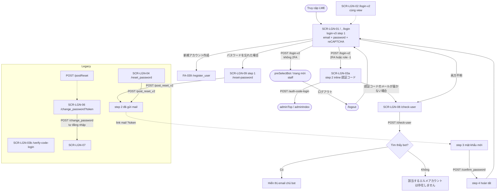

# FA-040: Đăng nhập LME 「ログイン」

> **Ngày spec**: 2026-11-20 · **Branch source**: `release_step_20261106` (Laravel 13 / PHP ^8.3) · **Raw data**: `raw/features/login-account/` (chụp 2026-11-20, session chưa đăng nhập)

## Lịch sử cập nhật

| Ngày | Nội dung |
|------|----------|
| 2026-11-20 | Re-spec theo branch `release_step_20261106`. Thay đổi chính: (1) Trang `/`, `/login`, `/login-v2` đã chuyển sang giao diện **auth-v3** (`auth.auth-v3.login-v3`) — 1 card giữa màn hình, bỏ cột giới thiệu「はじめての方はこちら」/ nút「新規登録」, thay bằng link「新規アカウント作成」và 2 banner エルサイト / エルグラム; form gửi AJAX `POST /login-v2` (không còn `POST /login`); xác thực 2 bước hiển thị **ngay trong cùng trang** (step 2, tag「２段階認証」). (2) Bổ sung màn hình mới **SCR-LGN-09** `/reset-password` (V3 — 4 step trong 1 trang: nhập email → đã gửi → đặt mật khẩu mới → hoàn tất, có modal「メールが届かない場合」). Link「パスワードを忘れた場合は こちら」nay trỏ `/reset-password`. (3) `/check-user` đổi giao diện (`check-user-v3`): tiêu đề「メールアドレス・パスワードが両方不明な場合」, nút「登録を確認する」, hiển thị kết quả inline (tìm thấy / không tìm thấy). (4) Các màn legacy `/verify-code-login`, `/reset_password`, `/change_password`, `/reset-password-success`, `/change_password_success` không đổi giao diện. (5) Nâng cấp Laravel 13 không làm đổi UI quan sát được. |
| (bản trước) | Spec ban đầu (giao diện loginv2 2 cột). |

## Tổng quan tính năng

Tính năng đăng nhập công khai của hệ thống LME (L Message / エルメ) — điểm truy cập chung cho **tất cả actor dùng bảng `users`** (Admin LINE OA, Super Admin/System Admin, Staff). Bao gồm:

- **Đăng nhập email/password** có Google reCAPTCHA v2 (checkbox) — giao diện auth-v3, submit AJAX
- **Xác thực 2 bước (2FA) qua email** — hiển thị inline ở step 2 của cùng trang đăng nhập (màn legacy `/verify-code-login` vẫn tồn tại)
- **Đặt lại mật khẩu** — luồng mới V3 `/reset-password` (4 bước trong 1 trang) + luồng legacy `/reset_password`, `/change_password`
- **Tra cứu email đăng ký** bằng Channel ID / Channel secret của LINE OA (`/check-user`) khi quên cả email lẫn mật khẩu
- **Đăng xuất** `/logout`
- Link「新規アカウント作成」dẫn sang luồng đăng ký FA-039 (`/register_user`)

Domain quan sát: `form.watermeru.com`. Sau đăng nhập, người dùng được chuyển hướng tuỳ vai trò (chọn bot `preSelectBot`, `adminTop` cho super admin...).

## Actors liên quan

| Actor | Vai trò trong tính năng |
|-------|------------------------|
| Admin LINE OA (`role` 0/1) | Đăng nhập portal quản lý LINE OA |
| Super Admin / System Admin (`role` -1) | Đăng nhập cùng form, **luôn** phải qua 2FA |
| Staff (`role` 2) | Đăng nhập bằng email/password do Admin cấp |
| Người chưa có tài khoản | Click「新規アカウント作成」→ FA-039 |
| Người quên mật khẩu | Luồng「パスワードを忘れた場合は こちら」→ `/reset-password` |
| Người quên cả email & mật khẩu | Luồng `/check-user` (Channel ID/secret) |

## Danh sách màn hình

| Mã | Tên màn hình | Tên JP | URL | View | Trạng thái |
|----|-------------|--------|-----|------|-----------|
| SCR-LGN-01 | Trang đăng nhập chính (auth-v3) | 「ログイン」 | `/`, `/login` | `auth.auth-v3.login-v3` | **Đổi giao diện** |
| SCR-LGN-02 | Trang đăng nhập V2 | 「ログイン」 | `/login-v2` | `auth.auth-v3.login-v3` (cùng view) | **Đổi giao diện** — nay giống hệt SCR-LGN-01 |
| SCR-LGN-03 | Xác thực mã 2FA | 「ログイン」+「２段階認証」 | (a) step 2 inline trong SCR-LGN-01; (b) legacy `/verify-code-login` | (a) `login-v3` step 2; (b) `auth.verify` | (a) **Mới**; (b) không đổi |
| SCR-LGN-04 | Gửi mail đặt lại mật khẩu (legacy) | 「パスワード再設定用メール送信」 | `/reset_password` | `auth.reset_password_v2` | Không đổi (không còn được link từ trang login) |
| SCR-LGN-05 | Đã gửi mail (legacy) | — | `/reset-password-success` | `auth.reset_password_success` | Không đổi |
| SCR-LGN-06 | Nhập mật khẩu mới (legacy V1) | 「パスワード再設定」 | `/change_password` | `auth.change_password` | Không đổi |
| SCR-LGN-07 | Đổi mật khẩu thành công (legacy V1) | — | `/change_password_success` | `auth.change_pass_success` | Không đổi |
| SCR-LGN-08 | Tra cứu tài khoản qua Channel ID/secret | 「メールアドレス・パスワードが両方不明な場合」 | `/check-user` | `auth.auth-v3.check-user-v3` | **Đổi giao diện** |
| SCR-LGN-09 | Đặt lại mật khẩu V3 (4 bước) | 「パスワード再設定」 | `/reset-password` | `auth.auth-v3.reset-password-v3` (+ `reset-password-error`) | **Mới** |

---

## Chi tiết từng màn hình

### SCR-LGN-01 — Trang đăng nhập chính 「ログイン」 (auth-v3)

**URL**: `/` hoặc `/login` · **Route**: `GET /` (`login`), `GET /login` (`getLogin`) → `AuthController@checkLogin`
**Submit**: AJAX `POST /login-v2` (`postLoginV2`) → `AuthController@loginV2` (body JSON `email`, `password`, `captcha`)
**Screenshot**: `screenshots/01-login-main.png` · **Snapshot**: `raw/features/login-account/snapshots/01-login-main.yml`
**View**: `resources/views/auth/auth-v3/login-v3.blade.php` (Vue 2 + axios + lme-ui)

#### Layout

Layout 1 cột, card trắng (max 520px) giữa màn hình trên nền hình khối xám:

- Logo「L Message」góc trên trái (chỉ ở step 1)
- **Card — step 1**:
  - Tiêu đề「ログイン」
  - Vùng lỗi chung (đỏ, căn giữa) — hiển thị `errors.notice[0]` (vd「メールアドレス・パスワードに誤りがあります。」)
  - Ô「メールアドレス」(label trên, placeholder `example@mail.com`)
  - Ô「パスワード」(placeholder「パスワードを入力」, icon mắt bật/tắt hiện mật khẩu; chặn nhập phím Space)
  - Dòng「メールアドレス・パスワード両方不明な場合は こちら」→ `/check-user`
  - reCAPTCHA「私はロボットではありません」(chỉ render khi cấu hình `services.recaptcha.key` có giá trị; bị khoá thao tác `pointer-events:none` cho tới khi nhập đủ email + mật khẩu)
  - Nút「ログイン」(lme-button-default primary, full width)
  - 「パスワードを忘れた場合は こちら」→ `/reset-password` (V3 — **đổi** từ `/reset_password`)
  - 「アカウントをお持ちでない場合、新規アカウント作成」→ `/register_user` (FA-039)
- **Dưới card**: 2 banner liên kết ngoài — 「エルサイト」(`https://lsite.jp/?lmessage_system_registration_screen`) và「エルグラム」(`https://lgram.jp/?lmessage_system_registration_screen`)
- Overlay spinner khi đang gọi API

#### Action Buttons

| Label JP | Type | Hành vi |
|---------|------|--------|
| ログイン | `lme-button-default` primary | Disabled khi email hoặc mật khẩu trống, hoặc đang loading. Click → `POST /login-v2`. Nếu response `redirect` chứa `verify-code-login` → chuyển sang step 2 (2FA) **không đổi trang**; ngược lại `window.location.href = redirect`. Lỗi 422 → hiển thị lỗi theo field + reset reCAPTCHA |
| こちら (両方不明) | link | → `/check-user` |
| こちら (パスワードを忘れた) | link | → `/reset-password` |
| 新規アカウント作成 | link | → `/register_user` (FA-039) |
| Banner エルサイト / エルグラム | link (tab mới) | Cross-sell sản phẩm khác |

#### Form Fields

| Label JP | Input type | Required | Placeholder | Validation |
|---------|-----------|---------|-------------|-----------|
| メールアドレス | `lme-input type=email` | Có | `example@mail.com` | Server: `required\|email:filter` — lỗi「メールアドレスを入力してください。」/「メールアドレスに誤りがあります。」 |
| パスワード | `lme-input` password (toggle hiện) | Có | パスワードを入力 | Server: `required` —「パスワードに誤りがあります。」 |
| 私はロボットではありません | reCAPTCHA v2 | Có | — | Server: `required\|recaptcha` (field `captcha`) —「reCAPTCHAをチェックしてください。」 / `Captcha verification failed` |

#### Observations

- Không còn checkbox「ログイン状態を保持」— `remember_me` không được gửi (V2 không dùng remember cookie).
- Khi mount: ghi cookie `path_intro_lme` = `document.referrer` (1 ngày, domain cấp 2) nếu chưa có và referrer không phải `step.lme.jp` — dùng cho tracking nguồn đăng ký FA-039. **Cao** (đọc view).
- Flash session `success` → alert「ユーザーを登録しました。」; `reset-success` → alert「パスワードの再設定で、パスワードの再設定のメールをお送りしました。」.
- Không thấy thẻ `<meta name="csrf-token">`; axios tự gửi header `X-XSRF-TOKEN` từ cookie `XSRF-TOKEN` của Laravel → qua được CSRF. **Trung bình**.
- Bỏ hoàn toàn cột「はじめての方はこちら」, nút「新規登録」, 4 box giới thiệu tính năng, banner「インスタグラムを活用して集客効率UP！」so với bản cũ.

---

### SCR-LGN-02 — Trang đăng nhập V2 「ログイン」

**URL**: `/login-v2` · **Route**: `GET /login-v2` (`getLoginV2`) → `AuthController@checkLoginV2` · **Submit**: `POST /login-v2`
**Screenshot**: `screenshots/05-login-v2.png`

Render **cùng view** `auth.auth-v3.login-v3` → giao diện, field, hành vi **giống hệt SCR-LGN-01** (snapshot `05-login-v2.yml` trùng cấu trúc `01-login-main.yml`). Khác biệt duy nhất nằm ở logic redirect khi người dùng **đã đăng nhập** (xem api-spec EP-04). Không mô tả lặp lại.

---

### SCR-LGN-03 — Xác thực mã 2FA

#### (a) Step 2 inline trong SCR-LGN-01 (luồng chính — MỚI)

**Kích hoạt**: sau `POST /login-v2` trả `{"redirect": ".../verify-code-login"}` (user bật 2FA hoặc super admin)
**Submit**: AJAX `POST /auth-code-login` (`authCode`) body `{code}`
**Screenshot**: chưa chụp được (cần tài khoản thật bật 2FA) — mô tả từ view `login-v3.blade.php:109-148`

Layout trong cùng card:
- Logo「L Message」+ tag「２段階認証」
- Tiêu đề 2 dòng「ご登録のメールアドレスに」/「認証コードが送信されました」
- Mô tả「認証コードを入力してログインしてください。」
- Vùng lỗi chung (`codeErrors.notice[0]`)
- Ô「認証コード」(placeholder「認証コードを入力」)
- Nút「ログイン」(disabled khi chưa nhập mã)
- Link「認証コードのメールが届かない場合」→ `/check-user`

| Label JP | Input | Required | Validation (server) |
|---------|-------|---------|--------------------|
| 認証コード | text | Có | So khớp `users.two_factor_verify_code` (chuỗi random 10 ký tự), hạn 24 giờ. Lỗi「認証コードが間違っています。」/「認証コード期限が切れました。再度発行をしてください」 |

Thành công → `window.location.href = redirect` (`adminTop` nếu super admin, `adminIndex` nếu user thường).

#### (b) Màn legacy `/verify-code-login`

**Route**: `GET /verify-code-login` (`verifyCode`) → `AuthController@verifyCodeLogin` · view `auth.verify`
**Screenshot**: `screenshots/04-verify-code-login.png` — **giao diện cũ, không đổi** (2 cột: form「メール記載の認証コードをご入力ください」+ nút「ログイン」, link `/reset_password` & `/check-user`; cột phải「はじめての方はこちら」+「新規登録」+ 4 box tính năng + banner「インスタグラムを活用して集客効率UP！」). Truy cập trực tiếp URL vẫn hiển thị trang này; luồng chính không còn redirect tới đây (frontend chặn redirect và chuyển step 2).

---

### SCR-LGN-04 — Gửi mail đặt lại mật khẩu (legacy) 「パスワード再設定用メール送信」

**URL**: `/reset_password` · **Route**: `GET /reset_password` (`reset_password`) → `AuthController@resetPassword` · view `auth.reset_password_v2`
**Screenshot**: `screenshots/02-reset-password.png` — **không đổi so với bản trước**

- Logo, tiêu đề「パスワード再設定用メール送信」, hướng dẫn 3 dòng (「パスワード再設定用メールを送信します。」「ご登録いただいているメールアドレスを入力し。」「「送信する」ボタンをクリックしてください。」)
- Ô email (placeholder `example@mail.com`), nút「送信する」(disabled khi trống), link「ログイン画面に戻る」
- Submit AJAX → `POST /post_reset_v2`. Nếu URL có `?token=` hợp lệ, cùng view hiển thị form mật khẩu mới (dual-purpose).
- **Không còn được link** từ trang đăng nhập mới (đã chuyển sang SCR-LGN-09); chỉ còn link từ màn legacy `/verify-code-login`.

---

### SCR-LGN-05 — Đã gửi mail đặt lại (legacy)

**URL**: `/reset-password-success` · **Route** `resetPasswordSuccess` → `AuthController@resetPasswordSuccess` · **Screenshot**: `screenshots/07-reset-password-success.png` — không đổi.
Nội dung「ご入力いただいたメールアドレスにパスワード再設定用 URLを送信しました。メールに記載されたURLよりパスワード再設定のお手続きをお願いいたします。」+ link「ログインページ」→ `/login`.

---

### SCR-LGN-06 — Nhập mật khẩu mới (legacy V1) 「パスワード再設定」

**URL**: `/change_password?token=...` · **Route** `change_password` → `AuthController@changePassword` · **Submit**: form `POST /change_password` (`postChange`) → `AuthController@change`
**Screenshot**: `screenshots/06-change-password.png` — không đổi (chụp không có token).
Field「新しいパスワード」,「新しいパスワード（確認）」, nút「再設定」(luôn enabled). Server: `password required|between:6,13`, `re-password same:password`, `token exists:users,reset_token`. Thành công → **tự đăng nhập** và chuyển `/change_password_success`. Chỉ được dùng bởi link mail của luồng V1 `POST /postReset`.

---

### SCR-LGN-07 — Đổi mật khẩu thành công (legacy V1)

**URL**: `/change_password_success` · **Screenshot**: `screenshots/08-change-password-success.png` — không đổi.
「パスワードの再設定が完了しました。 再設定いただいたパスワードでログインして下さい。」+ link「ログインページ」.

---

### SCR-LGN-08 — Tra cứu tài khoản qua Channel ID/secret (check-user-v3)

**URL**: `/check-user` · **Route**: `GET /check-user` (`checkUser`) → `AuthController@checkUser` · **Submit**: AJAX `POST /check-user` (`postCheckUser`)
**Screenshot**: `screenshots/03-check-user.png` · **View**: `resources/views/auth/auth-v3/check-user-v3.blade.php`

#### Layout (đã đổi)

- Logo góc trên trái; nút quay lại「< ログイン画面」
- Tiêu đề「メールアドレス・パスワードが両方不明な場合」+ mô tả「LINE公式アカウント(Messaging API)のChannel ID・Channel secretを入力して、主管理者の登録メールアドレスを確認することができます。」
- Card 2 cột:
  - **Trái「1. 確認の手順」** (cố định): bước 1「LINE公式アカウント管理画面に ログイン」(link ngoài `account.line.biz`), bước 2「設定 > Messaging API を表示」, bước 3「Channel ID・Channel secretを入力する」, ảnh minh hoạ「Messaging API example」
  - **Phải (động, 3 trạng thái)**:
    1. **Form「2. 情報の入力」**: mô tả「1で表示された情報を入力してください。」, ô「Channel ID *」(placeholder「Channel IDを入力」), ô「Channel secret *」(placeholder「Channel secretを入力」), nút「登録を確認する」(disabled khi thiếu field)
    2. **Tìm thấy「3. エルメ登録アカウントの確認」**: avatar + tên bot (`view_name`), câu「…が接続されているエルメアカウントの登録アドレスは [email] です。」, ghi chú「※ {created_at_display} に接続操作が行われました。」,「上記のメールアドレスでエルメにログインしてください。」, nút「ログイン画面に戻る」, link「「2.情報の入力」に戻る」
    3. **Không tìm thấy「3. 検索結果」**: icon lỗi đỏ +「該当するエルメアカウントは存在しません」,「入力した情報が間違っているか、該当のLINE公式アカウントがエルメに接続されていない可能性があります。」, nút「ログイン画面に戻る」, link「「2.情報の入力」に戻る」

#### Form Fields

| Label JP | Input | Required | Placeholder | Validation |
|---------|-------|---------|-------------|-----------|
| Channel ID | `lme-input` text | Có (dấu `*` đỏ — thay badge「必須」cũ) | Channel IDを入力 | Chỉ client-side; server chỉ `trim` |
| Channel secret | `lme-input` text | Có (`*`) | Channel secretを入力 | Chỉ client-side; server chỉ `trim` |

#### Observations

- Đổi tên nút「確認する」→「登録を確認する」; bỏ badge「必須」, dùng dấu `*` của lme-input.
- Kết quả hiển thị **email của chủ bot** (主管理者) ngay trên trang — không gửi mail. Ảnh bot lỗi → fallback `/images/8.png` (`@error="onBotImageError"`; branch mới sửa escape Blade `@@error`).

---

### SCR-LGN-09 — Đặt lại mật khẩu V3 「パスワード再設定」 (MỚI)

**URL**: `/reset-password` (token tuỳ chọn `?token=...`, `?success=1`) · **Route**: `GET /reset-password` (`reset-password`) → `AuthController@resetPasswordV3`
**Screenshot**: `screenshots/02b-reset-password-v3.png` (step 1) · **View**: `resources/views/auth/auth-v3/reset-password-v3.blade.php`; lỗi token → `auth.auth-v3.reset-password-error`

Card giữa màn hình: logo + tag「パスワード再設定」; nội dung theo `step`:

| Step | Điều kiện | Nội dung |
|------|-----------|----------|
| 1 — Nhập email | Mặc định (không token) | Tiêu đề「パスワード再設定用メールを送信します」, mô tả「アカウント登録時に設定したメールアドレスを入力してください。」, ô「登録メールアドレス」(placeholder「メールアドレスを入力」, kiểm tra định dạng client → lỗi「メールアドレスに誤りがあります。」), nút「送信」(disabled khi email trống/sai), link「ログイン画面に戻る」. Submit AJAX `POST /post_reset_v2` |
| 2 — Đã gửi mail | Sau khi `post_reset_v2` thành công | Hình minh hoạ + tiêu đề「パスワード再設定用のメールを送信しました」,「メールに記載されたURLより パスワード再設定のお手続きをお願いいたします。」, link「メールが届かない場合」(mở modal), nút「ログイン画面へ」 |
| 3 — Đặt mật khẩu mới | URL có `token` hợp lệ, còn hạn 24h | Tiêu đề「新しいパスワードを設定してください」, tag「登録アドレス」+ email, hộp quy tắc「・英大文字・英小文字・数字・記号それぞれを最低1文字ずつ含む 6~12文字」「・使用可能な記号 ! @ # & ( ) – [ { } ] : ; ', ? / * ~ $ ^ + = < > . _ -」, ô mật khẩu (placeholder「パスワード」, mặc định hiện chữ) và ô xác nhận (placeholder「パスワード確認用」), tự xoá khoảng trắng; nút「パスワードを再設定」. Submit AJAX `POST /confirm_password` với `token` |
| 4 — Hoàn tất | Sau `confirm_password` thành công, hoặc URL `?success=1` | Hình minh hoạ + tiêu đề「パスワード再設定完了」,「パスワードの再設定が完了しました。」「再度ログインを行ってください。」, nút「ログイン画面へ」 |
| Lỗi token | Token không tồn tại hoặc quá 24h | View `reset-password-error` (có/không kèm email) + link về `login` |

**Modal「メールが届かない場合」** (`lme-modal`): 「メールアドレスをご確認のうえ再度入力しなおすか、迷惑メールフォルダをご確認ください。」「また、独自ドメインを利用したアドレスでメールが届かない場合は、フリーメールアドレスでご登録ください。」; nút「閉じる」(lme-button-flat) và「メールアドレス入力画面へ」(quay lại step 1).

Validation client step 3: trống →「パスワードを入力してください。」; sai quy tắc →「英大文字・英小文字・数字・記号それぞれを最低1文字ずつ含む6~12文字のパスワードを入力してください」; xác nhận trống →「パスワードの確認を入力してください。」; không khớp →「入力されたパスワードが異なっています。」. Lỗi server (422) hiển thị theo field (gồm `token`:「リンクの有効期限が切れました。…」).

**Observations**:
- Không đăng nhập tự động sau khi đổi mật khẩu (khác SCR-LGN-06).
- Trang nhúng `userTemp: {!! json_encode($user_id) !!}` — **toàn bộ bản ghi `users`** (trừ `password`, `remember_token`) được in ra HTML cho người mở link (xem cảnh báo trong logic-spec). **Cao** (đọc view + model).
- Không có reCAPTCHA ở bất kỳ step nào.

---

## User Flows

### Flow 1: Đăng nhập không 2FA (happy path)
1. Mở `/` (SCR-LGN-01) → nhập email + mật khẩu → tick reCAPTCHA → click「ログイン」
2. `POST /login-v2` → 200 `{redirect}` → chuyển tới `preSelectBot` (hoặc trang nhận lời mời staff nếu session có `code_invite`)

### Flow 2: Đăng nhập có 2FA (user bật 2FA hoặc super admin)
1. Như Flow 1 bước 1 → `POST /login-v2` trả `{redirect: /verify-code-login}`, server đã gửi mã qua email
2. Trang chuyển **step 2** cùng URL → nhập「認証コード」→ `POST /auth-code-login`
3. 200 `{redirect}` → `adminTop` (super admin) / `adminIndex` (user)

### Flow 3: Quên mật khẩu (V3 — luồng chính)
1. SCR-LGN-01 click「パスワードを忘れた場合は こちら」→ `/reset-password` step 1
2. Nhập email → `POST /post_reset_v2` → step 2 (mail chứa link `/reset-password?token=…`)
3. Mở link → step 3 → nhập mật khẩu mới ×2 → `POST /confirm_password`
4. Step 4「パスワード再設定完了」→「ログイン画面へ」

### Flow 4: Quên mật khẩu (legacy)
`/reset_password` → `POST /post_reset_v2` (mail cũng trỏ `/reset-password?token=`) — hoặc luồng V1 `POST /postReset` → mail `/change_password?token=` → `POST /change_password` → tự đăng nhập → `/change_password_success`.

### Flow 5: Quên cả email & mật khẩu
`/check-user` → nhập Channel ID + secret →「登録を確認する」→ `POST /check-user` → hiển thị email chủ bot hoặc「該当するエルメアカウントは存在しません」.

### Flow 6: Đăng xuất
`GET /logout` → xoá cookie folder, enqueue dọn dữ liệu tutorial, `Auth::logout()`, `Session::flush()` → redirect `/`.

### Error cases
- Email/mật khẩu sai hoặc email không tồn tại → 422「メールアドレス・パスワードに誤りがあります。」(lỗi chung, reCAPTCHA bị reset)
- Tài khoản chưa kích hoạt (`is_active = 0`) → redirect `/account/resend-email/{email}` (không cần mật khẩu đúng)
- Mã 2FA sai / hết hạn → 422 lỗi tương ứng tại step 2
- Email không tồn tại ở reset → 422「メールアドレスが登録されていません。」

---

## Flow Diagram

---

## Điểm chưa rõ / cần điều tra

| Vấn đề | Ưu tiên | Gợi ý điều tra |
|-------|---------|----------------|
| Production `form.watermeru.com` đã chạy branch nào? UI quan sát (auth-v3) khớp code `release_step_20261106`, nhưng code cũ (`release_step_20260930_v2`) cũng đã có auth-v3 → không phân biệt được bằng UI | Trung bình | Kiểm tra version asset `?v=` / header |
| Chưa chụp được step 2 (2FA inline), step 3/4 của SCR-LGN-09, trạng thái kết quả của SCR-LGN-08 | Trung bình | Cần tài khoản test + mail thật; không submit trên production |
| Màn legacy `/verify-code-login`, `/reset_password`, `/change_password` còn được dùng thực tế không | Thấp | Xem access log |
| reCAPTCHA chỉ render khi có `GOOGLE_RECAPTCHA_KEY`; nếu thiếu key, server vẫn bắt buộc `captcha` → không đăng nhập được | Thấp | Xác nhận cấu hình môi trường |

---

## Shared Components được sử dụng

Không dùng shared component nào trong registry (SC-001…SC-007).

Thành phần **lme-ui** (design system) dùng trong các view auth-v3: `lme-input`, `lme-button-default`, `lme-button-flat`, `lme-tag`, `lme-modal`. Ghi nhận vào `features/shared/pending-refs.md` (gom vào đề xuất 「lme-ui Design System」, không tạo SC riêng). Ứng viên nhỏ: **Help modal「メールが届かない場合」** (SCR-LGN-09) — có thể trùng nội dung với luồng gửi mail của FA-039; chờ xác nhận.
