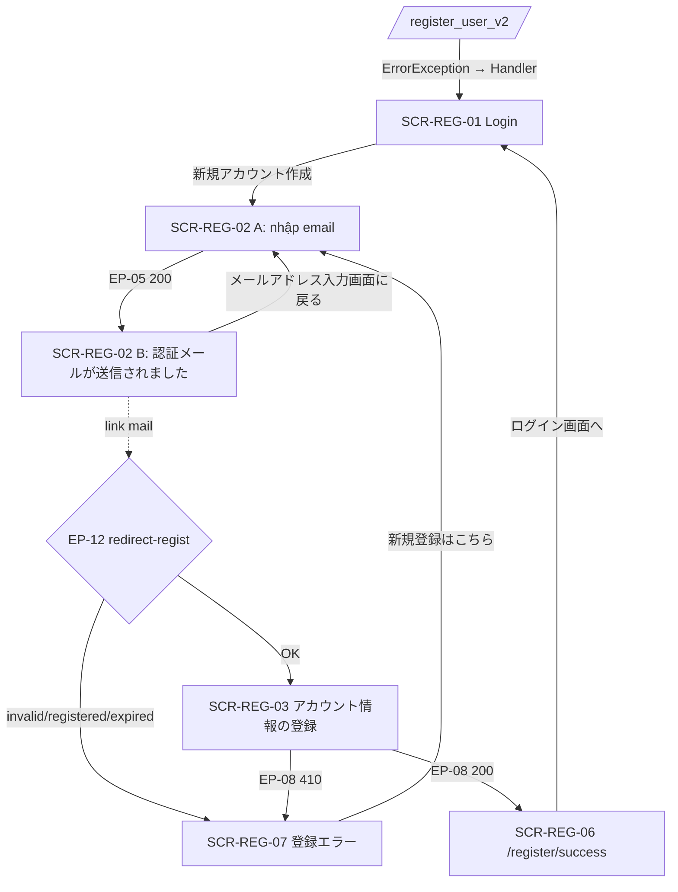
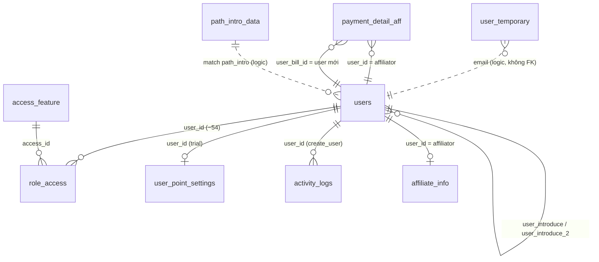

# [FA-039] Đăng ký tài khoản LME 「公開新規アカウント登録」 — Feature Spec

> **Spec tổng hợp cuối cùng** cho PM / tester / dev. Chi tiết kỹ thuật: `ui/ui-spec.md`, `web/api-spec.md`, `web/logic-spec.md`, `db/db-mapping.md`, `_internal/validation-report.md`.
>
> **Ngày spec**: 2026-11-20 · **Nguồn code**: `src/web/sns-line` branch `release_step_20261106` (commit `ae06fb4c54`, Laravel 13 / PHP ^8.3) · **Raw**: chụp 2026-11-20 (chưa đăng nhập).

## Lịch sử cập nhật

| Ngày | Nội dung |
|------|----------|
| 2026-11-20 | **Re-spec toàn bộ theo branch `release_step_20261106`.** Thay đổi so với bản trước: (1) UI đăng ký nay là view **`auth.auth-v3.register-v3`** (lme-ui + Tailwind) thay cho `register_user_v2`; step label 「認証メール送信」「アカウント登録」「ログイン」; (2) **Bước 2 gộp** thông tin + mật khẩu vào 1 form 「アカウント情報の登録」, **bỏ** màn nhập mật khẩu & màn xác nhận (SCR-REG-04/05), UI gọi thẳng EP-08 — EP-06/07 không còn dùng, bỏ `localStorage`; (3) thêm **SCR-REG-07** 「登録エラー」 (`invalid`/`registered`/`expired`) và **SCR-REG-08** (`/register_user_v2` hỏng → redirect `/`); (4) entry từ login là link 「新規アカウント作成」; (5) API **12 → 16 endpoints** (thêm EP-13…EP-16 luồng kích hoạt legacy); rule email → `email:filter`; `catch \Throwable`; (6) **sửa sai bản cũ**: `activity_logs` (`create_user`) **đang ghi** ⇒ DB **8 → 9 bảng**; route mặc định **35** (không phải 34), thực tế **54** `role_access`/user (không phải 58–61); **4** mail sau đăng ký (không phải 3); `users.path_intro` fallback `APP_URL`; `UserTemporary::$fillable` có `path_intro`; `saveRegisterUserAff` có cập nhật `affiliate_info`; (7) mail: `SmtpMailer` (Symfony Mailer) thay Swift Mailer; Hotmail/Outlook đi thẳng SMTP Gmail; (8) GAP: 2 GAP cũ (không transaction, không cleanup `user_temporary`) **vẫn còn**; **mới**: BR-21 token không gắn email ⇒ 1 token tạo được nhiều tài khoản, EP-14 khoá tài khoản bất kỳ, BR-27 lộ `getMessage()`, `/register` không CSRF. Validation: **ĐẠT** (0 lỗi spec Nghiêm trọng), 3 GAP hệ thống Nghiêm trọng. |
| (trước) | Bản gốc — view `register_user_v2` (wizard 3 bước, bước 2 có 3 sub-screen), 12 endpoints, 8 bảng. Validation: CẦN SỬA (2 GAP code). |

---

## 1. Tổng quan

| Thuộc tính | Giá trị |
|-----------|---------|
| **Mã tính năng** | `FA-039` |
| **Tên** | Đăng ký tài khoản LME |
| **Tên JP** | 「公開新規アカウント登録」 — tiêu đề màn hình 「新規アカウント登録」 |
| **Portal** | Admin — trang **public** (trước khi đăng nhập) |
| **Entry** | `/register_user` (route `register`); link 「新規アカウント作成」 trên `/` (login); link affiliate `/register_user/{hash}` |
| **Actor** | User mới (public). Sau khi hoàn thành trở thành Admin LINE OA (`users.role = 0`) |
| **Phạm vi** | Gửi mail xác thực → nhập thông tin + mật khẩu → tạo `users` (active ngay) + 54 `role_access` + trial 30 ngày + log + tracking affiliate/nguồn giới thiệu + 4 mail thông báo |
| **Ngoài phạm vi** | `/check-user`, login, reset password (FA-040); đăng ký mobile `/register-mobile` |
| **Background job** | **Không có** — mail gửi đồng bộ trong request |
| **Độ tin cậy tổng thể** | **Cao** (~85% thông tin xác nhận trực tiếp từ code/schema) |

### Mô tả nghiệp vụ

1. **Bước 1 — 「認証メール送信」**: nhập email (+ 「招待コード」 khi môi trường non-production), đồng ý 「利用規約」「プライバシーポリシー」 → hệ thống lưu `user_temporary` (token 60 ký tự) và gửi mail 「【重要】L Message本登録のお願い」. Link hiệu lực **24h**.
2. **Bước 2 — 「アカウント登録」**: bấm link trong mail → form 「アカウント情報の登録」: 「名前・担当者名」, 「会社名・屋号」, 「電話番号」, 「パスワード」, 「パスワード(確認用)」 → 「この内容で登録」 → tạo tài khoản **active ngay**.
3. **Bước 3 — 「ログイン」**: trang 「アカウント登録完了」 → 「ログイン画面へ」.

Luồng legacy (`/register`, `/register_user/{id}` POST — tạo user inactive + mail kích hoạt `/active-ccount/{token}`) vẫn còn route nhưng không có UI hiện hành trỏ tới.

---

## 2. Các màn hình + Luồng xử lý end-to-end

### 2.1. Danh sách màn hình

| Mã | Tên | URL | Endpoint | Tin cậy |
|----|-----|-----|----------|---------|
| SCR-REG-01 | Login — entry 「新規アカウント作成」 | `/` | (link → EP-01) | Cao |
| SCR-REG-02 | Bước 1 — nhập email (state A) / 「認証メールが送信されました」 (state B) + modal 「メールが届かない場合」 | `/register_user` | EP-01/02/04, EP-05 | Cao |
| SCR-REG-03 | Bước 2 — 「アカウント情報の登録」 | `/redirect-regist/{token}` | EP-12, EP-08 | Trung bình (chỉ từ blade) |
| ~~SCR-REG-04/05~~ | Đã bỏ — gộp vào SCR-REG-03 | — | — | — |
| SCR-REG-06 | Bước 3 — 「アカウント登録完了」 | `/register/success` | EP-11 | Cao |
| SCR-REG-07 | Lỗi 「登録エラー」 | `/redirect-regist/{token}` hoặc EP-08 trả 410 | EP-12, EP-08 | Trung bình |
| SCR-REG-08 | `/register_user_v2` (legacy) → redirect `/` | `/register_user_v2` | EP-03 | Trung bình–Cao |

### 2.2. Luồng end-to-end

#### SCR-REG-02 — Bước 1: 「認証メールを送信」

| Bước | Nội dung |
|------|----------|
| User action | Nhập 「メールアドレス」 (+ 「招待コード」 non-prod), tick đồng ý, bấm 「認証メールを送信」 (disabled tới khi email hợp lệ + đã tick) |
| UI | Validate client (rỗng → 「メールアドレスを入力してください。」, sai định dạng → 「メールの形で入力してください。」); overlay spinner |
| API | **EP-05** `POST /send_mail_register` `{email, code, is_mobile:'', pathIntro, hashUserId}` |
| Logic | `AuthController@sendMail` (730-803): validate `email: required\|email:filter\|unique:users,email`, (non-prod) `code: required\|exists:users,invite_code`; `token = Str::random(60)`; upsert `user_temporary` theo email (`created_at = now`); gửi mail — lần đầu / gửi lại ≤ 1 phút qua `MailApiService`, gửi lại > 1 phút qua SMTP Gmail dự phòng (BR-04) |
| DB | SELECT `users` (unique, invite_code); SELECT + INSERT/UPDATE `user_temporary` |
| Response | 200 `{message:'認証メールが送信されました', sendMail:true}` (kể cả gửi mail lỗi — BR-26); 422 `{errors:[{field:[msg]}]}` |
| UI update | State B: 「認証メールが送信されました」, ghi chú hiệu lực 24h, link 「メールアドレス入力画面に戻る」, 「メールが届かない場合」 (modal), 「ログイン画面に戻る」. 422 → lỗi dưới field (vd 「このメールアドレスはすでにエルメに登録済みです。」) |

#### Cầu nối — link mail → EP-12 `GET /redirect-regist/{token}?uCode=&pathIntro=`

| Điều kiện (`AuthController@redirectRegist` 1371-1390) | Kết quả |
|-----------|---------|
| Không có `user_temporary.code = token` | SCR-REG-07 (`invalid`) |
| `users.email = user_temporary.email` và `is_active = 1` | SCR-REG-07 (`registered`) |
| `created_at` ≥ 24h | SCR-REG-07 (`expired`) |
| Hợp lệ | SCR-REG-03 (view nhận `userTemp`, `uCode`, `pathIntro`) |

#### SCR-REG-03 — Bước 2: 「この内容で登録」 (**ghi DB chính**)

| Bước | Nội dung |
|------|----------|
| User action | Nhập 「名前・担当者名」, 「会社名・屋号」 (tuỳ chọn), 「電話番号」, 「パスワード」, 「パスワード(確認用)」 → 「この内容で登録」 |
| UI | Validate client (BR-05): tên bắt buộc; điện thoại số 10–11 chữ số; mật khẩu 6–12 ký tự gồm đủ hoa/thường/số/ký hiệu; xác nhận trùng khớp |
| API | **EP-08** `POST /register_v2` `{email: userTemp.email, username, company_name, phone_number, password, hashUserId, pathIntro, isMobile:'', token: userTemp.code}` |
| Logic | `AuthController@validateRegisterV2` (880-1115): kiểm tra token (tồn tại / chưa active / < 24h, sai → 410) → validate `username max:50`, `password between:6,13`, `email email:filter\|unique` (**email lấy từ request** — BR-21) → INSERT `users` (`role=0`, `is_active=1`, `path_intro` resolve/fallback `APP_URL`, `ip`) → `activity_logs` → (affiliate) `payment_detail_aff` → `role_access` (35 route × role 1/2/3, chỉ `visible=1`) → (affiliate) `affiliate_info.count_user_intro+1` + mail notify → `user_point_settings` (trial 30 ngày) → 4 mail → `countPathIntro` → logout nếu đang login |
| DB | Xem mục 3 |
| Response | 200 `{currentStep:3}`; 410 `{errors:'token expired'}`; 422 validator `{errors:{field:[...]}}`; 422 exception `{errors:'<getMessage()>'}` (BR-27) |
| UI update | 200 → `/register/success`; 410 → SCR-REG-07; 422 → lỗi dưới field (lỗi `email` và 422 dạng chuỗi **không hiển thị** — GAP-09) |

#### SCR-REG-06 — Hoàn thành

EP-11 `GET /register/success` → view `auth.register_user_success_v3` (tĩnh, không đọc DB, truy cập trực tiếp được). Nút 「ログイン画面へ」 → `/`.

#### SCR-REG-07 — 「登録エラー」

Thông điệp chung 「すでにアカウント登録が完了している」「または無効なリンクです。」 cho cả 3 lý do; nút 「ログイン画面へ」, link 「新規登録はこちら」 → `/register_user`.

### 2.3. Sơ đồ

---

## 3. Data Model

### 3.1. Entities (9 bảng)

| Bảng | Loại | Thao tác trong FA-039 | Ghi chú |
|------|------|----------------------|---------|
| `users` | Primary | INSERT 1 (EP-08) | `role=0`, `is_active=1`, `path_intro`, `ip`, `user_introduce`/`user_introduce_2` |
| `user_temporary` | Primary | INSERT/UPDATE (EP-05), SELECT (EP-12, EP-08) | Token plaintext; **không bao giờ xoá** |
| `activity_logs` | Primary | INSERT 1 (`create`/`create_user`, `new_value`=email) | **Mới trong spec** |
| `role_access` | Primary | INSERT ≤ 63, thực tế **54** (30 role 1 + 21 role 2 + 3 role 3) | Phụ thuộc `access_feature.visible` |
| `user_point_settings` | Primary | INSERT 1 (`is_trial=1`, `m_bot=1`, `require_paypal=1`, `expire_date` = 23:59:59 hôm nay + 30 ngày) | |
| `payment_detail_aff` | Primary (có điều kiện) | INSERT 0–1 (`type_bill=-1`, `bot_name`=email user mới) | Magic value |
| `access_feature` | Secondary | SELECT 35 lần theo `route` + `visible=1` | |
| `affiliate_info` | Secondary | SELECT + UPDATE `count_user_intro+1` (có điều kiện) | |
| `path_intro_data` | Secondary | SELECT toàn bảng (chưa soft-delete) + UPDATE `count_user+1` các bản ghi khớp | |

### 3.2. ER Diagram

- Tất cả quan hệ là **FK logic** (không có constraint). Schema tách không có index nào ⇒ `users.email` unique chỉ ở tầng validator (Trung bình).
- Tên bảng số ít (`user_temporary`, `role_access`, `access_feature`) — model override `$table`.

---

## 4. Field Traceability Matrix

| # | UI Element | Màn hình | DB Table.Column | Hướng | Validation | Business Rule |
|---|-----------|----------|-----------------|-------|-----------|---------------|
| 1 | 「メールアドレス」 | SCR-REG-02 | `user_temporary.email` | Ghi | Client: bắt buộc + regex; Server: `required\|email:filter\|unique:users,email` | BR-01 |
| 2 | 「招待コード」 | SCR-REG-02 | `users.invite_code` | Đọc (exists) | `required\|exists:users,invite_code` (non-prod) | BR-02 |
| 3 | Checkbox đồng ý 「利用規約」「プライバシーポリシー」 | SCR-REG-02 | — (không lưu) | — | Client bắt buộc | — |
| 4 | (ẩn) token | SCR-REG-02 → mail | `user_temporary.code` | Ghi | `Str::random(60)` | BR-03 |
| 5 | (ẩn) `is_mobile` | SCR-REG-02 | `user_temporary.is_mobile` → `users.is_mobile` | Ghi | — (UI v3 luôn NULL) | BR-11 |
| 6 | (ẩn) `pathIntro` | SCR-REG-02/03 | `user_temporary.path_intro` → `users.path_intro` | Ghi | `resolvePathIntro`, fallback `APP_URL` | BR-10, BR-22 |
| 7 | (ẩn) `hashUserId` | SCR-REG-02/03 | `users.user_introduce`/`user_introduce_2`, `payment_detail_aff.user_id`, `affiliate_info.count_user_intro` | Ghi | `Hashids::decode` | BR-08, BR-12, BR-13, BR-23 |
| 8 | Email readonly (`lme-tag`) | SCR-REG-03 | `users.email` | Ghi | `email:filter\|unique` — **không đối chiếu token** | BR-21 |
| 9 | 「名前・担当者名」 | SCR-REG-03 | `users.username` | Ghi | Client bắt buộc; server `required\|max:50` | — |
| 10 | 「会社名・屋号」 | SCR-REG-03 | `users.company_name` | Ghi | Không | — |
| 11 | 「電話番号」 | SCR-REG-03 | `users.phone_number` | Ghi | Client số 10–11; **server không validate** | — |
| 12 | 「パスワード」 | SCR-REG-03 | `users.password` (bcrypt) | Ghi | Client 6–12 + 4 nhóm; server `between:6,13` | BR-05 |
| 13 | 「パスワード(確認用)」 | SCR-REG-03 | — | — | Client so khớp | BR-05 |
| 14 | (server) | EP-08 | `users.role=0`, `is_active=1`, `admin_id`, `max_bot`, `ip`, `created_at` | Ghi | — | BR-07, BR-09, BR-14 |
| 15 | (server) | EP-08 | `activity_logs.*` | Ghi | — | BR-24 |
| 16 | (server) | EP-08 | `role_access.*` (lookup `access_feature.route`, `visible`) | Ghi/Đọc | — | BR-09 |
| 17 | (server) | EP-08 | `user_point_settings.*` | Ghi | — | BR-06 |
| 18 | (server) | EP-08 | `path_intro_data.count_user` | Ghi | Khớp `url_type` 1/2 | BR-10 |
| 19 | `errorState` | SCR-REG-07 | `user_temporary.code`, `.created_at`, `users.is_active` | Đọc | — | BR-03 |

---

## 5. Business Rules

| ID | Rule | Nguồn | Tin cậy |
|----|------|-------|---------|
| BR-01 | Email unique trong `users` (EP-05, EP-08), rule `email:filter` | `AuthController.php:735, 923` | Cao |
| BR-02 | Chỉ non-production bắt 「招待コード」 (`exists:users,invite_code`); field ẩn ở production | `:737-739`; `register-v3.blade.php:139-149` | Cao |
| BR-03 | Link mail hiệu lực 24h (`created_at`); gửi lại reset `created_at` | `:768, 898, 1381` | Cao |
| BR-04 | Gửi lại > 1 phút → SMTP Gmail dự phòng; còn lại → `MailApiService`. Không giới hạn số lần | `:757-796` | Cao |
| BR-05 | Mật khẩu: client 6–12 + 4 nhóm ký tự; server chỉ `between:6,13` | blade 543-553; `:922` | Cao |
| BR-06 | Trial 30 ngày: `expire_date` = 23:59:59 hôm nay + 30 ngày (timezone app) | `:1082-1088` | Cao |
| BR-07 | `max_bot = env('MAX_BOT', 1)` | `:963` | Cao |
| BR-08 | Affiliate: `user_introduce` nếu affiliator `allow_accept_aff = 1`, ngược lại `user_introduce_2` | `:950-954` | Cao |
| BR-09 | `users.role = 0`; `role_access` cho 35 route mặc định — role 1 tất cả, role 2 trừ 10 route quản trị, role 3 chỉ `chatBasic`/`index.talk`/`adminSetting`; bỏ route `visible=0` ⇒ 54 bản ghi | `:960, 993-1056` | Cao (54: Trung bình) |
| BR-10 | Đếm nguồn `path_intro_data.count_user` (PARTIAL `contains` / CORRECT `==`) — chỉ EP-08 | `:1097, 1117-1142` | Cao |
| BR-11 | Mobile: `https://lme.jp` → `https://lme.jp/sp.html` khi `is_mobile=1` — thực tế không xảy ra (UI v3 gửi rỗng) | `:957-959` | Cao |
| BR-12 | Affiliate: `count_user_intro + 1` + mail 「【L Message】ご紹介による新規アカウント登録がありました。」 tới `emails_receive_notify` | `:1057-1081` | Cao |
| BR-13 | `payment_detail_aff`: `type_bill=-1`, `remain_day=0`, `bot_name`=email user mới | `:981-991` | Cao |
| BR-14 | EP-08 tạo user active ngay | `:971-973` | Cao |
| BR-15 | Luồng legacy tạo user inactive + link kích hoạt 24h | `:1215-1217, 1399` | Cao |
| BR-16 | Đang login khi đăng ký → logout | `:1098-1100` | Cao |
| BR-17 | **Không DB transaction** (GAP-02) | `:880-1115` | Cao |
| BR-18 | INSERT `users` bằng query builder — bỏ qua model events | `:976` | Cao |
| BR-19 | 3 mail nội bộ 「自動登録」 qua `SmtpMailer::admin()` | `ActiveAccount.php:171-258` | Cao |
| BR-20 | Mail 「L Message本登録完了のお知らせ」 cho user | `ActiveAccount.php:122-133` | Cao |
| BR-21 | **Email tạo user lấy từ request, không gắn với token**; token vẫn hợp lệ sau khi dùng ⇒ 1 token tạo được nhiều tài khoản/email chưa xác thực trong 24h (GAP-01) | `:888-923` | Cao |
| BR-22 | `users.path_intro` = payload → `user_temporary.path_intro` → `APP_URL`; `countPathIntro` dùng giá trị resolve (null nếu trực tiếp) | `:863-878, 955-967` | Cao |
| BR-23 | `/register_user_v2/{user_id}` mất hash affiliate (view đọc `$uCode`, controller truyền `hashUserId`) | `:1417-1421`; blade 418 | Cao |
| BR-24 | Ghi `activity_logs` `create_user` ở cả 3 luồng tạo user | `:979, 1224, 1517` | Cao |
| BR-25 | `user_temporary` không bao giờ xoá | grep `app/` | Cao |
| BR-26 | EP-05 trả 200 kể cả gửi mail lỗi | `:784-802` | Cao |
| BR-27 | Exception ở EP-08 trả `getMessage()` (422) | `:1106-1114` | Cao |

---

## 6. API Endpoints

Tất cả **public**, middleware group `web` + `NotifyChatworkRequestTimeSlow`; không throttle. CSRF bắt buộc (`hasValidOrigin()` = false) **trừ `/register`**.

| Mã | Method | URL | Controller@Method (`AuthController.php`) | UI dùng | Response chính |
|----|--------|-----|------------------------------------------|---------|----------------|
| EP-01 | GET | `/register_user` | `registerUserV3` (713-721) | SCR-REG-02 | HTML `register-v3` |
| EP-02 | GET | `/register_user/{user_id}` | `registerUserAff` (1423-1439) | Link affiliate | HTML `register-v3` (+ cookie `u_code`) |
| EP-03 | GET | `/register_user_v2` | `registerUserV2` (723-728) | Không (hỏng) | 302 `/` |
| EP-04 | GET | `/register_user_v2/{user_id}` | `registerUserAffV2` (1417-1421) | Có (mất hash — BR-23) | HTML |
| EP-05 | POST | `/send_mail_register` | `sendMail` (730-803) | SCR-REG-02 | 200 / 422 |
| EP-06 | POST | `/type_information` | `typeInformation` (805-829) | Không | 200 / 422 |
| EP-07 | POST | `/confirm_information` | `confirmInformation` (831-851) | Không (trả password plaintext) | 200 / 422 |
| EP-08 | POST | `/register_v2` | `validateRegisterV2` (880-1115) | SCR-REG-03 | 200 / 410 / 422 |
| EP-09 | POST | `/register` | `validateRegister` (1144-1326) | Không (legacy, **không CSRF**) | 302 |
| EP-10 | POST | `/register_user/{user_id}` | `saveRegisterUserAff` (1441-1627) | Không (legacy) | 302 |
| EP-11 | GET | `/register/success` | `registerUserSuccess` (1328-1331) | SCR-REG-06 | HTML |
| EP-12 | GET | `/redirect-regist/{token}` | `redirectRegist` (1371-1390) | Link mail | HTML (SCR-REG-03 / 07) |
| EP-13 | GET | `/active-ccount/{token}` | `activeAccount` (1392-1415) | Legacy | HTML / 400 |
| EP-14 | POST | `/account/resend-email` | `resendMailActiveUser` (1344-1369) | Legacy (**đặt `is_active=0` user bất kỳ** — GAP-03) | 200 luôn / 400 |
| EP-15 | GET | `/account/resend-email/{email}` | `accountNotActive` (1338-1342) | Legacy | HTML |
| EP-16 | GET | `/account/resend-email-user/success` | `resendMailSuccess` (1333-1336) | Legacy | HTML |

Mã lỗi: 401 `SESSION_EXPIRED` khi thiếu/hết hạn CSRF trên AJAX; 410 token không hợp lệ/đã đăng ký/hết hạn; 422 validator hoặc exception (EP-08). Chi tiết request/response: `web/api-spec.md`.

---

## 7. Background Jobs

**Không có.** Không dùng Job/Queue/Event Laravel, không có Spring Boot job. Mail gửi **đồng bộ** trong request: EP-05 1 mail; EP-08 tối đa 1 (user) + 3 (nội bộ 「自動登録」) + N (affiliate). Kênh: `MailApiService` (SMTP mặc định timeout 2s / HTTP API theo `TYPE_SEND_MAIL`; Hotmail/Outlook/Live/MSN → SMTP Gmail), `SmtpMailer::admin()`/`resend()`.

---

## 8. Phụ thuộc chéo (Cross-references)

### 8.1. Shared Components

| Component | Trạng thái | Ghi chú |
|-----------|-----------|---------|
| Step Indicator / Progress Wizard | Pending (`features/shared/pending-refs.md`) — đã xác nhận ở FA-042, FA-044, FA-045, FA-017 | FA-039 dùng stepper ngang **tự viết** (`stepLabels`/`stepStatus`), **không** dùng `<lme-steps>` ⇒ ứng viên chuyển đổi khi tạo SC |
| Public Auth Card Layout v3 | Pending (mới) | Khung card 520px + `bg-shape`, chung với các trang auth-v3 của FA-040 |
| Help modal 「メールが届かない場合」 | Pending (ghi nhận từ FA-040) | Trùng nội dung modal của SCR-REG-02 |
| lme-ui Design System | Tham chiếu | `lme-input`, `lme-checkbox`, `lme-tag`, `lme-button-default`, `lme-button-flat`, `lme-modal` |

Không sử dụng SC-001…SC-007 đã đăng ký.

### 8.2. Tính năng liên quan

| Mã | Quan hệ |
|----|---------|
| FA-040 Đăng nhập LME | Màn login `/` chứa entry 「新規アカウント作成」; sau đăng ký user đăng nhập tại đây; login chặn user `is_active=0` (liên quan GAP-03) |
| Quản lý nhân viên (`employeesManagement`) | Staff cũng là `users` nhưng `role=2`; quyền role 1/2/3 do FA-039 khởi tạo |
| Thêm LOA (`botAdd`) | Bước tiếp theo sau khi có tài khoản — `max_bot`, trial `user_point_settings` |
| Affiliate (`affSetting`, `affResult`, `affMemberList`) | Nhận `count_user_intro`, `payment_detail_aff` từ đăng ký qua link giới thiệu |
| Quản lý nguồn giới thiệu (`path_intro_data`) | Đếm `count_user` |

### 8.3. Phụ thuộc ngoài

Mail API / SMTP (`TYPE_SEND_MAIL`, `TYPE_RESEND_TIMEOUT`, `RESEND_MAIL_*`, `ADMIN_MAIL_*`, `MAIL_ADDRESS_CONFIRM_ADMIN`, `MAIL_ADDRESS_CONFIRM_ADMIN_MASP`, `MAIL_ADDRESS_CONFIRM_REGISTER_USER_ADMIN_MASP`), `vinkla/hashids`, env `APP_ENV`, `APP_URL`, `MAX_BOT`.

---

## 9. Gaps và Unknowns

### 9.1. GAP hệ thống — Nghiêm trọng (phải xử lý khi tái triển khai)

| ID | Mô tả | Nguồn | Đề xuất |
|----|-------|-------|---------|
| GAP-01 | **Token không gắn email (BR-21 + BR-25)**: EP-08 tạo user bằng `$request->email`; kiểm tra "đã đăng ký" dùng `userTemp.email`; token không bị huỷ ⇒ có 1 token hợp lệ là tạo được **nhiều tài khoản với email tuỳ ý chưa xác thực** trong 24h, đồng thời chiếm chỗ email của người khác | `AuthController.php:888-923` | Dùng `userTemp->email`, huỷ token sau khi dùng (trong transaction) |
| GAP-02 | **Không DB transaction (BR-17)**: lỗi giữa chừng để lại user thiếu `role_access`/trial; email bị khoá bởi `unique` khi thử lại | `:976-1097` | `DB::transaction`; gửi mail sau commit |
| GAP-03 | **EP-14 khoá tài khoản bất kỳ**: `POST /account/resend-email` (public, không throttle) đặt `is_active=0` cho user theo email ⇒ user bị chặn đăng nhập tới khi bấm link kích hoạt | `:1344-1369`; login `:141-143, 207-209` | Chỉ áp dụng cho user đang inactive; throttle |

### 9.2. GAP hệ thống — Trung bình

| ID | Mô tả | Nguồn |
|----|-------|-------|
| GAP-04 | BR-27: 422 trả `getMessage()` (có thể lộ SQL/đường dẫn) | `:1106-1114` |
| GAP-05 | `/register` (EP-09 legacy) nằm trong CSRF `$except`, không throttle/captcha — tạo user inactive giữ chỗ email bất kỳ | `VerifyCsrfToken.php:39` |
| GAP-06 | BR-25: `user_temporary` lưu token plaintext vĩnh viễn (197 dòng, có bản ghi từ 2024) | data mẫu |
| GAP-07 | Không throttle/captcha EP-05 (spam mail tới địa chỉ bất kỳ) và EP-08 | api-spec |

### 9.3. GAP hệ thống — Nhẹ

- GAP-08: EP-05 trả 200 kể cả gửi mail lỗi (BR-26).
- GAP-09: Bước 2 không hiển thị lỗi 422 của `email` và lỗi 422 dạng chuỗi — user không nhận phản hồi.
- GAP-10: `/register_user_v2` hỏng (thiếu `$referer` → redirect `/`), `/register_user_v2/{id}` mất hash affiliate (BR-23); `register()`, `registerUser()`, EP-06/07 là code chết.
- GAP-11: Lệch validate client/server (password 4 nhóm, phone chỉ client); `users.path_intro` (255) < `user_temporary.path_intro` (500); `users.email` không có unique index vật lý (theo schema tách) ⇒ race condition 2 request đồng thời.
- SCR-REG-07 dùng 1 thông điệp cho 3 lý do (bỏ qua `expiredEmail`).

### 9.4. Vấn đề spec còn tồn (từ validation-report, không chặn)

| ID | Mức | Nội dung |
|----|-----|----------|
| A-1 | Trung bình | logic-spec/api-spec/db-mapping chưa ghi hệ quả "dùng lặp token" của BR-21 (đã tổng hợp ở GAP-01 tại đây) |
| A-2 | Nhẹ | api-spec EP-14 chưa nêu hệ quả chặn login và yêu cầu CSRF token |
| A-3 | Nhẹ | db-mapping 5.2: `user_point_settings.created_at` thực tế được set (model `$timestamps = true`) |
| A-4 | Nhẹ | db-mapping 2.2: mô tả `user_temporary.is_mobile` "từ User-Agent" — thực tế từ payload FE (NULL) |
| A-5 | Nhẹ | db-mapping 2.1: `users.email` UNIQUE chỉ ở validator, chưa xác nhận index |

### 9.5. Câu hỏi mở

| Câu hỏi | Ưu tiên |
|---------|---------|
| Giao diện thực tế SCR-REG-03 / SCR-REG-07 (cần token mail thật để chụp) | Trung bình |
| `users.email` có UNIQUE index trên DB thật không? | Trung bình |
| Kênh mail thực tế trên production (`TYPE_SEND_MAIL`, `TYPE_RESEND_TIMEOUT`) | Thấp |
| Môi trường quan sát (có 「招待コード」) có phải staging? | Thấp |
| Có kế hoạch gỡ luồng legacy (EP-03, EP-06/07, EP-09/10, EP-13…16)? | Thấp |

---

## 10. Chất lượng Spec

### 10.1. Coverage

| Hạng mục | Giá trị |
|----------|---------|
| Màn hình | 6 hiện hành + 2 đã bỏ (đánh dấu) |
| Endpoints | 16/16 có controller + `file:line` |
| Business rules | 27 |
| Bảng DB | 9/9 có schema + data mẫu |
| UI field → DB | 100% (0 field mồ côi; field chỉ client đã đánh dấu) |
| `file:line` kiểm tra lại bằng code | 25+ điểm — 100% khớp |

### 10.2. Phân bố độ tin cậy

| Mức | Tỷ lệ (ước tính) | Nội dung chính |
|-----|------------------|----------------|
| **Cao** | ~85% | Route, controller, validation, response, BR, schema, mapping — đọc trực tiếp code/schema |
| **Trung bình** | ~13% | SCR-REG-03/07 (chỉ từ blade), CSRF qua cookie `XSRF-TOKEN`, số 54 `role_access` (data mẫu 04/2026), kênh mail theo `.env`, EP-03 redirect |
| **Thấp** | ~2% | Môi trường quan sát là staging |

### 10.3. Validation

- **Kết luận**: **ĐẠT** — 0 lỗi spec Nghiêm trọng, 1 Trung bình, 5 Nhẹ.
- **GAP hệ thống**: 3 Nghiêm trọng, 4 Trung bình, 4 Nhẹ (mục 9).
- Phát hiện đã xác minh bằng code: BR-21 (xác nhận + mở rộng), EP-14 (xác nhận), BR-27 (xác nhận), `/register` CSRF `$except` (xác nhận), `/register_user_v2` thiếu `$referer` (xác nhận), BR-17 & BR-25 (xác nhận vẫn còn). Không phát hiện nào bị bác bỏ.

### 10.4. Files tham chiếu

| File | Nội dung |
|------|---------|
| `ui/ui-spec.md` | Màn hình, field, flow, screenshot |
| `web/api-spec.md` | 16 endpoints |
| `web/logic-spec.md` | Controller, model, mailer, BR-01…BR-27 |
| `db/db-mapping.md` | 9 bảng, mapping, enum |
| `_internal/db-hint.md` | Cầu nối UI ↔ DB |
| `_internal/validation-report.md` | Báo cáo kiểm tra 2026-11-20 |
