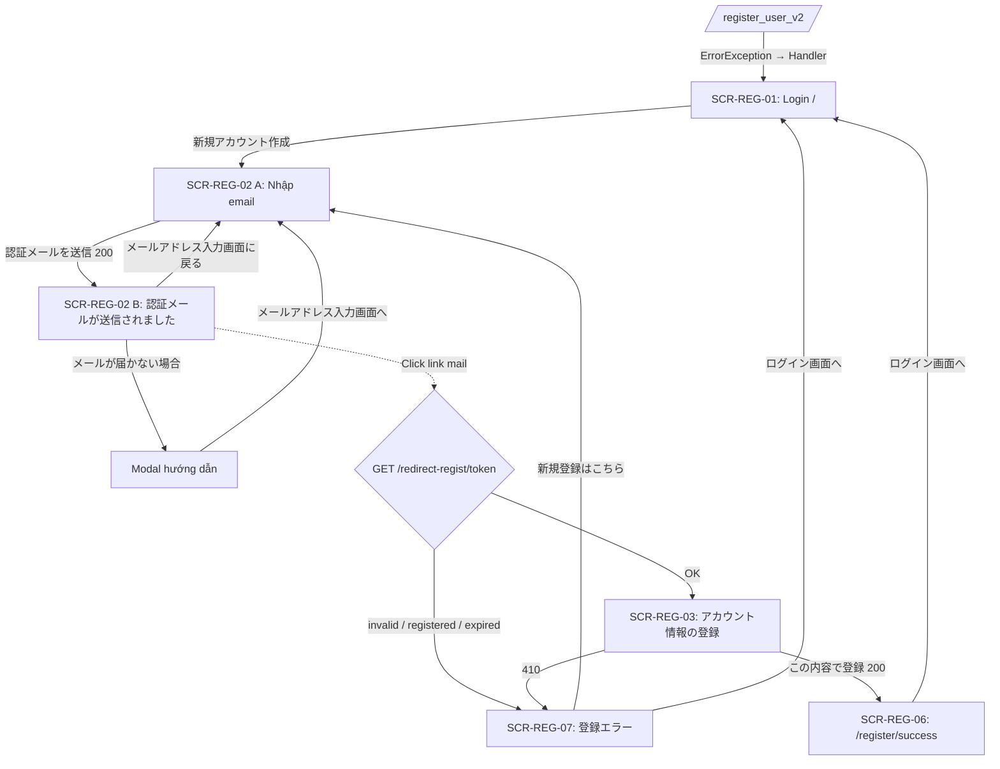
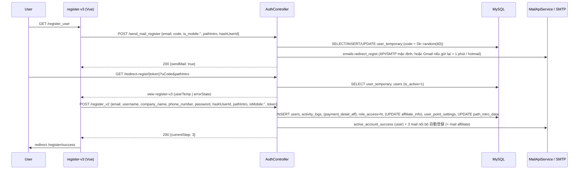

# [FA-039] Đăng ký tài khoản LME — UI Spec

## Lịch sử cập nhật

| Ngày | Nội dung |
|------|----------|
| 2026-11-20 | **Re-spec theo branch `release_step_20261106`** (Laravel 13 / PHP ^8.3). Raw mới chụp 2026-11-20 (chưa đăng nhập): `raw/features/register-account/screenshots/01..03` + `snapshots/01..03`. Thay đổi chính so với spec cũ: (1) `/register_user` nay render view **`auth.auth-v3.register-v3`** (UI kit `lme-ui`, Tailwind) thay cho `auth.register_user_v2` — tiêu đề 「新規アカウント登録」, step label đổi thành 「認証メール送信」「アカウント登録」「ログイン」; (2) **Bước 2 gộp** thông tin user + mật khẩu vào 1 form 「アカウント情報の登録」, **bỏ** màn xác nhận (cũ SCR-REG-04/05 bị loại bỏ, không còn gọi `/type_information`, `/confirm_information`); (3) thêm **màn lỗi 「登録エラー」** (SCR-REG-07) cho link mail không hợp lệ / đã đăng ký / hết hạn; (4) state 「認証メールが送信されました」 mới có link 「メールアドレス入力画面に戻る」, 「メールが届かない場合」 (modal) và ghi chú hiệu lực 24h; (5) `/register/success` render `auth.register_user_success_v3`, nút 「ログイン画面へ」; (6) `/register_user_v2` nay **redirect về `/`** (view cũ lỗi biến `$referer`); (7) màn login mới: entry là link 「新規アカウント作成」 (không còn button 「新規登録」 ở banner phải). |
| (trước) | Bản gốc — dựa trên view `auth.register_user_v2` (wizard 3 bước, bước 2 có 3 sub-screen). |

## Tổng quan

- **Mã tính năng**: FA-039
- **Tên**: Đăng ký tài khoản LME
- **Tên JP**: 「公開新規アカウント登録」 / tiêu đề màn hình 「新規アカウント登録」
- **Mô tả**: Màn hình đăng ký **public** (không cần đăng nhập) để tạo tài khoản Admin LME mới. Luồng 3 bước: (1) nhập email (+ mã mời ở môi trường non-production) + đồng ý điều khoản → nhận mail xác thực; (2) click link trong mail (`/redirect-regist/{token}`) → nhập thông tin user + đặt mật khẩu trên **một form** → submit; (3) chuyển sang trang hoàn thành `/register/success` → về màn login.
- **Portal**: Admin (truy cập trước khi đăng nhập)
- **View chính**: `resources/views/auth/auth-v3/register-v3.blade.php` (606 dòng, Vue 2 inline + `lme-ui`: `lme-tag`, `lme-input`, `lme-checkbox`, `lme-button-default`, `lme-button-flat`, `lme-modal`)
- **URL pattern**:
  - `/register_user` — Bước 1 (route name `register`)
  - `/register_user/{user_id}`, `/register_user_v2/{user_id}` — Bước 1 qua link affiliate
  - `/redirect-regist/{token}?uCode=&pathIntro=` — link trong mail → Bước 2 hoặc màn lỗi
  - `/register/success` — Bước 3 hoàn thành
  - `/register_user_v2` — legacy, hiện **redirect về `/`** (xem SCR-REG-08)
  - `/` (login) — link 「新規アカウント作成」 → `/register_user`

## Đối tượng sử dụng (Actors)

| Actor | Vai trò | Quyền truy cập |
|-------|---------|----------------|
| User mới (public) | Người chưa có tài khoản LME | Không cần đăng nhập. Sau khi hoàn thành trở thành Admin (`users.role = 0`) của 1 tài khoản LME mới |

---

## Các màn hình

| Mã | Tên | Trạng thái | Entry | Nguồn |
|----|-----|-----------|-------|-------|
| SCR-REG-01 | Màn login — entry 「新規アカウント作成」 | Cập nhật | `/` | Raw `02-register-user-v2.png` (redirect) + `login-account/01-login-main.png` |
| SCR-REG-02 | Bước 1 — Nhập email (state A) / 「認証メールが送信されました」 (state B) + modal 「メールが届かない場合」 | Cập nhật | `/register_user` | Raw `01-register-user.*` + blade 125-217, 351-384 |
| SCR-REG-03 | Bước 2 — 「アカウント情報の登録」 (thông tin + mật khẩu) | **Viết lại** (gộp cũ 03/04/05) | `/redirect-regist/{token}` | Blade 219-308, 535-594 (không chụp được — cần token) |
| ~~SCR-REG-04~~ | ~~Bước 2b — Nhập mật khẩu~~ | **Đã bỏ** — gộp vào SCR-REG-03 | — | — |
| ~~SCR-REG-05~~ | ~~Bước 2c — Xác nhận thông tin~~ | **Đã bỏ** — không còn màn xác nhận | — | — |
| SCR-REG-06 | Bước 3 — Hoàn thành 「アカウント登録完了」 | Cập nhật | `/register/success` | Raw `03-register-success.*` + `register_user_success_v3.blade.php` |
| SCR-REG-07 | Màn lỗi 「登録エラー」 | **Mới** | `/redirect-regist/{token}` (token sai/đã đăng ký/hết hạn) hoặc HTTP 410 khi submit | Blade 48-88 |
| SCR-REG-08 | `/register_user_v2` (legacy) → redirect `/` | **Mới (ghi nhận)** | `/register_user_v2` | Raw `02-register-user-v2.*` |

Ngoài ra **SCR-CHK-01** (`/check-user`, recover qua Channel ID/Secret) vẫn được link từ màn login nhưng **không thuộc luồng đăng ký** — thuộc phạm vi FA-040 (login-account), chỉ tham chiếu.

---

### SCR-REG-01: Màn login — entry 「新規アカウント作成」

- **URL**: `/` (view `auth.auth-v3.login-v3` — chi tiết thuộc FA-040)
- **Screenshot**: `screenshots/00-login-main.png`, `screenshots/02-register-user-v2.png`
- **Mức độ tin cậy**: **Cao** (snapshot `02-register-user-v2.yml`)

#### Layout
- Logo L Message góc trên trái; card trung tâm 「ログイン」: 「メールアドレス」 (placeholder `example@mail.com`), 「パスワード」 (placeholder 「パスワードを入力」, icon mắt), link 「メールアドレス・パスワード両方不明な場合は こちら」 → `/check-user`, reCAPTCHA, button 「ログイン」 (disabled mặc định), 「パスワードを忘れた場合は こちら」 → `/reset-password`.
- Dòng cuối card: 「アカウントをお持ちでない場合、**新規アカウント作成**」 → `/register_user`.
- Dưới card: 2 banner quảng cáo 「エルサイト」 (`https://lsite.jp/?lmessage_system_registration_screen`) và 「エルグラム」 (`https://lgram.jp/?lmessage_system_registration_screen`).

#### Action liên quan đăng ký

| Element | Text JP | Loại | Hành vi |
|---------|---------|------|---------|
| Link 「新規アカウント作成」 | 「アカウントをお持ちでない場合、新規アカウント作成」 | Link | → `/register_user` (SCR-REG-02) |

> Thay đổi: spec cũ mô tả button 「新規登録」 ở banner phải + 「はじめての方はこちら」 — **không còn** trên UI hiện tại.

---

### SCR-REG-02: Bước 1 — Nhập email / Đã gửi mail

- **URL**: `/register_user` (route `register` → `AuthController@registerUserV3`)
- **Tiêu đề**: 「新規アカウント登録」
- **Screenshot**: `screenshots/01-register-user.png`
- **Mức độ tin cậy**: **Cao** (snapshot `01-register-user.yml` + blade `register-v3.blade.php:125-217`)

#### Layout tổng thể
- Nền trắng với 2 hình khối xám (`bg-shape-left/right`), card trắng `max-w-[520px]` ở giữa.
- Logo `images/logo_mobile_l.jpg` → tiêu đề 「新規アカウント登録」 → **Step indicator ngang 3 bước** (blade 99-123): 「認証メール送信」, 「アカウント登録」, 「ログイン」. Trạng thái mỗi bước (`stepStatus`, blade 453-460): `done` (vòng `#91caff` + icon check), `processing` (vòng `#1677ff`, số trắng), `waiting` (vòng `#f7f7f7`, số xám). Bước 1 chuyển `done` ngay khi `sendMail = true`. Label của bước hiện tại tô xanh đậm.
- Footer ngoài card: 「利用規約」｜「プライバシーポリシー」｜「特定商取引法に基づく表記」(`https://lme.jp/about/`)｜「カスタマーハラスメント対策」(`https://lme.jp/customer-harassment/`).

#### State A — Nhập email (`currentStep === 1 && !sendMail`)

**Form Fields**

| Label JP | Loại input | Required | Placeholder | Validation client | Điều kiện hiện | Ghi chú |
|---------|-----------|----------|-------------|-------------------|----------------|---------|
| 「メールアドレス」 | `lme-input type=email` | có | 「メールアドレスを入力」 | Rỗng → 「メールアドレスを入力してください。」; sai format (regex `validateEmail`, blade 392-396, kiểm tra realtime qua `watch.email`) → 「メールの形で入力してください。」 | Luôn | Lỗi server hiển thị qua `errMsg('email')` |
| 「招待コード」 | `lme-input` | có (server) khi hiện | 「招待コードを入力してください。」 | — | Chỉ khi `env('APP_ENV') !== 'production'` (blade 139-149) | Lỗi server `errMsg('code')`. **Raw 2026-11-20 có field này** ⇒ môi trường quan sát (`form.watermeru.com`) không phải production |
| Checkbox 「「利用規約」および「プライバシーポリシー」に同意する」 | `lme-checkbox` | có | — | Chưa tick → 「利用規約に同意してください。」 | Luôn | Link `https://lme.jp/terms/`, `https://lme.jp/privacy-policy/` (target blank). **Không còn ẩn khi có lỗi email** (khác bản cũ) |

**Action Buttons**

| Element | Text JP | Loại | Disabled | Hành vi |
|---------|---------|------|----------|---------|
| Button 「認証メールを送信」 | 「認証メールを送信」 | `lme-button-default` primary lg | `!isStep1Enabled \|\| isLoading` — cần email không rỗng + đúng format + đã tick đồng ý | `sendEmail()` (blade 497-526): POST `sendMailRegister` `{email, code, is_mobile: '', pathIntro, hashUserId}` → `sendMail = true` (sang state B). Lỗi 422: `errors` = phần tử đầu mảng `errors` server trả |
| Link 「こちら」 | 「すでにアカウントをお持ちの方はこちら」 | Link | — | → `route('login')` = `/` |

Text tĩnh dưới form: 「独自ドメインを利用したアドレスでメールが届かない場合」「フリーメールアドレスでご登録ください。」

#### State B — Đã gửi mail (`currentStep === 1 && sendMail`, blade 176-217)

| Element | Text JP | Hành vi |
|---------|---------|---------|
| Icon | SVG phong bì + check xanh | — |
| Tiêu đề | 「認証メールが送信されました」 | — |
| Mô tả | 「メール内のリンクからアカウント登録へお進みください。」 | — |
| Ghi chú hiệu lực | 「送信から24時間を経過するとリンクは無効になります。」「経過した場合は再度メールアドレスを入力してください。」 | — |
| Link | 「メールアドレス入力画面に戻る」 | `backToEmailForm()`: `sendMail = false`, xoá lỗi → state A (giữ nguyên email đã nhập) |
| Link | 「メールが届かない場合」 | Mở modal 「メールが届かない場合」 |
| Link (phân cách bằng border-top) | 「ログイン画面に戻る」 | → `/` |

#### Modal 「メールが届かない場合」 (blade 351-384)

- `lme-modal` không header mặc định, width 560, click mask để đóng.
- Nội dung: 「メールアドレスをご確認のうえ再度入力しなおすか、迷惑メールフォルダをご確認ください。」「また、独自ドメインを利用したアドレスでメールが届かない場合は、フリーメールアドレスでご登録ください。」
- Nút: 「閉じる」 (`lme-button-flat`) đóng modal; 「メールアドレス入力画面へ」 (`lme-button-default`) → đóng modal + về state A. Icon × góc phải (aria-label 「閉じる」).

#### Tracking ẩn (không hiển thị)
- `hashUserId` = `$uCode` từ server, nếu rỗng lấy cookie `u_code` (blade 483-493).
- `pathIntro` = `$pathIntro` (query `path_intro`) → nếu rỗng lấy cookie `path_intro_lme` / `path_intro` → nếu vẫn rỗng lấy `$referer` (header Referer).
- Khi server truyền `$uCode` → set cookie `u_code` 1 ngày, domain `.{domain gốc}`.
- `is_mobile` luôn gửi chuỗi rỗng `''` (không còn đọc cookie `is_mobile` như bản cũ).
- **Không còn dùng `localStorage`** (bản cũ lưu formData/hashUserId/pathIntro).

#### Observations
- Overlay spinner toàn màn hình khi `isLoading` (blade 386-388).
- Nếu email đã tồn tại (`unique`), lỗi 「このメールアドレスはすでにエルメに登録済みです。」 hiện dưới field email; field mã mời và checkbox **vẫn hiện**.

---

### SCR-REG-03: Bước 2 — 「アカウント情報の登録」

- **URL**: `/redirect-regist/{token}?uCode={hash}&pathIntro={url}` (link trong mail `emails.redirect_regist`) → server render `register-v3` kèm `$userTemp` → `mounted()` set `email = userTemp.email`, `currentStep = 2` (blade 437-441).
- **Điều kiện hiện**: `currentStep === 2` và `errorState` rỗng.
- **Mức độ tin cậy**: **Trung bình** (đọc từ blade 219-308, 535-594 — không chụp được vì cần token mail)

#### Layout tổng thể
- Logo + 「新規アカウント登録」 + step indicator (bước 1 done, bước 2 processing, bước 3 waiting).
- Tiêu đề 「アカウント情報の登録」.
- Dòng hiển thị email: `lme-tag` 「メールアドレス」 + email (readonly, không sửa được).
- Form gồm 2 phần: thông tin user, rồi tiêu đề 「パスワードを設定」 + hộp hướng dẫn + 2 field mật khẩu + nút submit.

#### Form Fields

| Label JP | Loại input | Required | Placeholder | Validation client (khi bấm submit) | Ghi chú |
|---------|-----------|----------|-------------|-------------------------------------|---------|
| 「名前・担当者名」 (`username`) | `lme-input` | có | 「エルグラム太郎」 | Rỗng → 「名前・担当者名を入力してください。」 | Chặn phím Space (`preventSpace`). Không giới hạn độ dài client; server `max:50` |
| 「会社名・屋号」 (`company_name`) | `lme-input` | không | 「株式会社エルグラム」 | — | Không chặn space |
| 「電話番号」 (`phone_number`) | `lme-input type=text` | có | 「09012345678」 | Rỗng → 「電話番号を入力してください。」; không phải toàn số → 「電話番号は数値のみ入力してください。」; độ dài ≠ 10–11 → 「電話番号は10もしくは11桁で入力してください」 | Label đổi từ 「電話番号（ハイフンなし）」 thành 「電話番号」; không còn chặn ký tự lúc gõ, chỉ kiểm tra khi submit |
| Hộp hướng dẫn mật khẩu | (text) | — | — | 「・英大文字・英小文字・数字・記号それぞれを最低1文字ずつ含む 6~12文字」「・使用可能な記号　! @ # & ( ) – [ { } ] : ; ', ? / * ~ $ ^ + = < > . _ -」 | Nền `#f7f7f7` |
| 「パスワード」 (`password`) | `lme-input` password/text + icon mắt (`suffix`) | có | 「上記条件を満たす6~12文字」 | Rỗng → 「パスワードを入力してください。」; thiếu 1 trong 4 nhóm (hoa / thường / số / ký tự đặc biệt `[!@#&()\[\]{}:;'",.?/*~$^+=<>._\-–]`) hoặc độ dài ngoài 6–12 → 「英大文字・英小文字・数字・記号それぞれを最低1文字ずつ含む6~12文字のパスワードを入力してください」 | Chặn Space. Toggle `showPassword`. `autocomplete="new-password"` |
| 「パスワード(確認用)」 (`repeat_password`) | `lme-input` password/text + icon mắt | có | 「パスワードを再入力」 | Rỗng → 「パスワードの確認を入力してください。」; khác password → 「パスワードの確認が違います。」 | Chặn Space. Toggle `showRepeatPassword` riêng |

#### Action Buttons

| Element | Text JP | Loại | Disabled | Hành vi |
|---------|---------|------|----------|---------|
| Button 「この内容で登録」 | 「この内容で登録」 | `lme-button-default` primary lg | `isLoading` | `register()` (blade 535-594): validate client → POST `registerUserV2` (`/register_v2`) `{email: userTemp.email, username, company_name, phone_number, password, hashUserId, pathIntro, isMobile: '', token: userTemp.code}`. 200 và `currentStep == 3` (hoặc không có `currentStep`) → `window.location.href = '/register/success'`. 422 → gán `errors` (hiện dưới từng field). 410 → `errorState = 'expired'` → SCR-REG-07 |

> **Không còn**: nút 「次に進む」, 「登録内容の確認」, 「アカウント登録」, link 「前ページに戻る」/「最初のページに戻る」; không gọi `/type_information`, `/confirm_information`; không lưu `localStorage`; không còn kiểm tra hết hạn 24h phía client (`moment(...)`).

#### Observations
- Lỗi 422 của field `email` (vd 「このメールアドレスは既に登録されてます。」) **không có chỗ hiển thị** trên màn này (không có input email) → user không thấy lỗi.
- Nếu server trả 422 dạng chuỗi (`{"errors": "<exception message>"}` khi exception) thì `errMsg()` đọc `errors[field]` của chuỗi → không hiện gì → user không nhận được phản hồi.
- Mật khẩu server chấp nhận 6–13 ký tự, không kiểm tra 4 nhóm ký tự — rule mạnh chỉ ở client.

---

### SCR-REG-06: Bước 3 — Hoàn thành

- **URL**: `/register/success` (view `auth.register_user_success_v3`)
- **Screenshot**: `screenshots/03-register-success.png`
- **Mức độ tin cậy**: **Cao** (snapshot `03-register-success.yml`)

#### Layout / nội dung
- Nền xanh nhạt; card: logo, 「新規アカウント登録」, step indicator (bước 1 & 2 done – icon check, bước 3 「ログイン」 processing).
- Icon thư mục + người + check; tiêu đề 「アカウント登録完了」; 「アカウント登録が完了しました。」「ログインページよりログインしてください。」
- Footer 4 link như SCR-REG-02.

#### Action Buttons

| Element | Text JP | Hành vi |
|---------|---------|---------|
| Button 「ログイン画面へ」 | 「ログイン画面へ」 | `goToLogin()` → `/` |

#### Observations
- Trang tĩnh, truy cập trực tiếp được mà không cần đăng ký (không kiểm tra session).
- Trong `register-v3` vẫn có block `currentStep === 3` (blade 310-334) giống hệt trang này, nhưng luồng thực tế luôn redirect sang `/register/success`.

---

### SCR-REG-07: Màn lỗi 「登録エラー」 (MỚI)

- **Điều kiện hiện**: `errorState` khác null (blade 48-88). Server set `errorState` ở `redirectRegist`: `'invalid'` (token không tồn tại), `'registered'` (email đã có user active), `'expired'` (quá 24h). Client set `errorState = 'expired'` khi submit Bước 2 nhận HTTP 410.
- **Mức độ tin cậy**: **Trung bình** (blade; không chụp được)

| Element | Text JP | Hành vi |
|---------|---------|---------|
| Logo + `lme-tag` | 「新規アカウント登録」 | — |
| Icon | Người xám + badge đỏ 「!」 | — |
| Tiêu đề | 「登録エラー」 | — |
| Mô tả | 「すでにアカウント登録が完了している」「または無効なリンクです。」 | Cùng 1 thông điệp cho cả 3 lý do |
| Button | 「ログイン画面へ」 | → `/` |
| Link | 「新規登録はこちら」 | → `route('register')` = `/register_user` |

#### Observations
- Server có truyền `expiredEmail` khi hết hạn nhưng view **không dùng** → không phân biệt được lý do lỗi trên UI.

---

### SCR-REG-08: `/register_user_v2` (legacy) — redirect về login

- **Screenshot**: `screenshots/02-register-user-v2.png` (kết quả: màn login)
- **Mức độ tin cậy**: **Trung bình–Cao** (suy luận từ code, khớp quan sát)
- **Nguyên nhân**: route `/register_user_v2` → `AuthController@registerUserV2` render view cũ `auth.register_user_v2` **không truyền biến `$referer`**, trong khi view có `path_intro = '<?= $referer ?>'` (dòng 1443, PHP thuần, luôn thực thi) ⇒ lỗi "Undefined variable $referer" (`ErrorException`) ⇒ `App\Exceptions\Handler::render` (khi `app.debug = false`) nhánh `\ErrorException || \Error` với khách chưa đăng nhập → `redirect('/')`. Ngay cả khi render được, JS `mounted()` của view cũ cũng redirect về `route('register')` nếu không có `localStorage.formData`.
- Kết luận: view `register_user_v2` và luồng wizard cũ là **code chết** trên UI.

---

## Shared Components (nghi ngờ)

| Component nghi ngờ | Tên JP | Phát hiện tại | Mô tả |
|--------------------|--------|---------------|-------|
| Step Indicator / Progress Wizard (biến thể ngang tự viết) | 「認証メール送信」「アカウント登録」「ログイン」 | SCR-REG-02, 03, 06 | Stepper ngang 3 bước tự dựng bằng Tailwind (`stepLabels`, `stepStatus`, `stepCircleClass`), **không dùng `<lme-steps>`** dù trang đã import lme-ui; có khai báo hằng `STATUS = {WAITING, PROCESSING, DONE, ERROR}` giống FA-045 nhưng không dùng. Đã có trong `pending-refs.md` — cập nhật ghi chú biến thể. |
| Auth Card Layout (v3) | — | SCR-REG-02/03/06/07 (+ màn login/reset/check-user v3 của FA-040) | Khung public chung: nền 2 hình khối (`bg-shape`), card trắng `reset-card` 520px, logo L Message. Lặp ở `register-v3`, `register_user_success_v3`, `login-v3`, `reset-password-v3`, `reset-password-error`, `check-user-v3`; footer 4 link (利用規約/プライバシーポリシー/特定商取引法に基づく表記/カスタマーハラスメント対策) chỉ có ở 2 trang đăng ký. Ghi vào `pending-refs.md`. |

---

## User Flows

### Happy Path

```
1. Truy cập / (login) → click 「新規アカウント作成」 → /register_user (SCR-REG-02 state A)
2. Nhập email (+ 招待コード nếu non-production) + tick đồng ý → 「認証メールを送信」
   → POST /send_mail_register → tạo/cập nhật user_temporary, gửi mail 「【重要】L Message本登録のお願い」
   → state B 「認証メールが送信されました」
3. Mở mail → click 「ユーザー登録へ進む」 → GET /redirect-regist/{token}?uCode=&pathIntro=
   → token hợp lệ, chưa đăng ký, < 24h → SCR-REG-03
4. Nhập 名前・担当者名, (会社名・屋号), 電話番号, パスワード, パスワード(確認用) → 「この内容で登録」
   → POST /register_v2 → tạo users + role_access + user_point_settings (trial 30 ngày) + activity_logs ...
   → redirect /register/success (SCR-REG-06)
5. 「ログイン画面へ」 → / → đăng nhập bằng email + mật khẩu vừa tạo
```

### Error Flows

| Tình huống | Hành vi | Khôi phục |
|-----------|---------|-----------|
| Email rỗng / sai format | Lỗi dưới field, nút gửi disabled | Sửa email |
| Chưa tick đồng ý | Nút disabled (nếu submit bằng Enter → 「利用規約に同意してください。」) | Tick checkbox |
| Email đã đăng ký (422) | 「このメールアドレスはすでにエルメに登録済みです。」 dưới field email | Dùng email khác / login |
| Mã mời sai / thiếu (422, non-production) | 「招待コードをもらった方にご確認ください。」 / 「招待コードを入力してください。」 | Nhập đúng mã |
| Không nhận được mail | State B → 「メールが届かない場合」 (modal hướng dẫn) hoặc 「メールアドレス入力画面に戻る」 | Gửi lại (gửi lại sau > 1 phút đi qua SMTP Gmail dự phòng) |
| Link mail sai token | SCR-REG-07 (`invalid`) | 「新規登録はこちら」 |
| Email của token đã có user active | SCR-REG-07 (`registered`) | 「ログイン画面へ」 |
| Link quá 24h | SCR-REG-07 (`expired`) | Đăng ký lại từ đầu |
| Thiếu / sai thông tin Bước 2 | Lỗi client dưới từng field, không gọi API | Sửa |
| Submit Bước 2 nhận 410 (token hết hạn / đã đăng ký) | Chuyển SCR-REG-07 | Đăng ký lại |
| Submit Bước 2 nhận 422 validator | Lỗi dưới field tương ứng (trừ `email` — không có chỗ hiển thị) | Sửa |
| Submit Bước 2 nhận 422 do exception | Không hiển thị gì (errors là chuỗi) | — |
| Truy cập `/register_user_v2` | Redirect `/` | Dùng `/register_user` |

---

## Flow Diagram





---

## Điểm chưa rõ / Cần điều tra

| Câu hỏi | Ưu tiên | Ghi chú |
|---------|---------|---------|
| Giao diện thực tế SCR-REG-03 / SCR-REG-07 | Trung bình | Cần mail token thật để chụp — hiện chỉ đọc từ blade |
| Môi trường `form.watermeru.com` có phải staging? | Thấp | Field 招待コード hiển thị ⇒ `APP_ENV !== 'production'` |
| Có nên hiển thị lý do lỗi khác nhau (invalid/registered/expired) | Thấp | View hiện dùng chung 1 thông điệp, bỏ qua `expiredEmail` |
| Lỗi `email` ở Bước 2 không hiển thị | Trung bình | Xem Observations SCR-REG-03 |
| Luồng đăng ký mobile `/register-mobile` (`Mobile\LoginMobileController`) | Thấp | Ngoài phạm vi spec này (spec cũ cũng không bao gồm); chỉ đổi nhẹ: `email:filter`, giữ lại `old('username')` |
