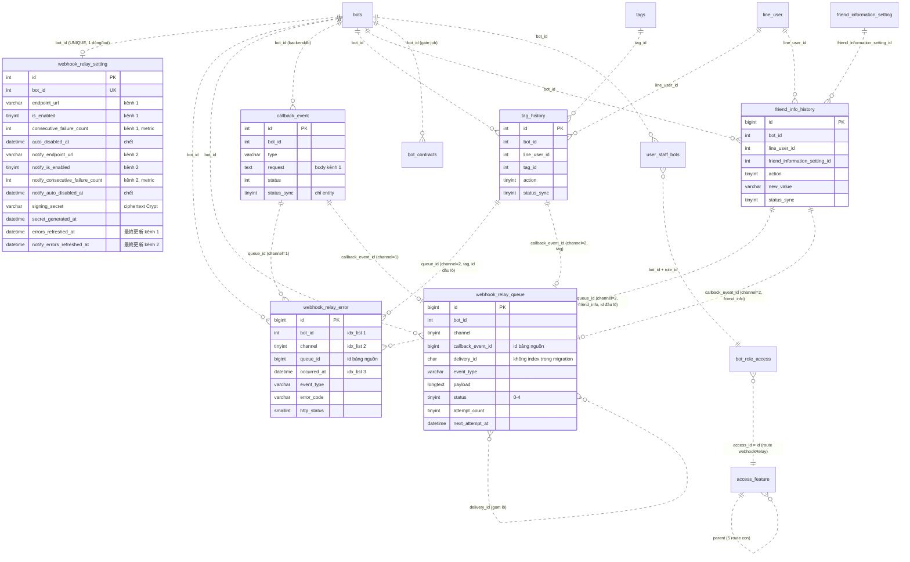

# [FA-047] Webhook転送 — DB Mapping

> Ánh xạ giao diện 「Webhook転送」 (SCR-WHR-01…04) ↔ API ↔ logic ↔ cơ sở dữ liệu, gồm cả các bảng nguồn mà job Spring Boot quét để chuyển tiếp.
> Nguồn: migration Laravel, model Eloquent, entity JPA (job), `db/index.md`, `db/schema/tables/*.sql`, `db/data/*.sql`; đối chiếu với `ui/ui-spec.md`, `_internal/db-hint.md`, `web/api-spec.md`, `web/logic-spec.md`, `job/job-spec.md`.

| Mục | Giá trị |
|-----|--------|
| Mã tính năng | **FA-047** — 「Webhook転送」 (task web #40044, task job #40475) |
| Ngày dựng | 2026-10-23 |
| Repo web | `src/web/sns-line` @ `release_step_20260930_v2`, commit `4d9d07d159` |
| Repo job | `src/job/linect-service` @ `release-t09-2026`, commit `be6ef546` |
| Chế độ | **CODE-FIRST** — không có dữ liệu runtime. 5/6 bảng cốt lõi **không có trong DB dump** ⇒ schema dựng từ migration + entity JPA; sample data chỉ có cho `callback_event` và các bảng phân quyền |
| Database | `linedb` (kết nối Laravel `mysql`, utf8mb4 / utf8mb4_unicode_ci, `strict = false`) cho mọi bảng trừ `callback_event` ở **`backenddb`** (kết nối `mysql_callback`) — `config/database.php`; `app/CallbackEvent.php:10-11` |
| Khoá ngoại | **Không có FK nào** (cả migration lẫn dump). Mọi quan hệ là logic, giữ bằng code |

Đường dẫn file trong tài liệu: `src/web/sns-line/` viết tắt là *web*, `src/job/linect-service/src/main/java/sns/line/` viết tắt là *job* (trừ khi ghi đầy đủ).

---

## 1. Nguồn dữ liệu & cảnh báo

### C-01 — 5 bảng KHÔNG có trong DB dump (đã xác minh lại)

| Kiểm tra | Kết quả |
|---------|---------|
| Grep `webhook_relay\|tag_history\|friend_info_history` trong `db/index.md` | **0 kết quả** |
| File tương ứng trong `db/schema/tables/` (310 file) và `db/data/` (292 file) | **0 file** |

Nguồn thay thế (đối chiếu chéo 2 phía):

| Bảng | Migration web (`web/database/migrations/`) | Entity JPA (job) |
|------|-------------------------------------------|------------------|
| `webhook_relay_setting` | `2026_09_03_100000_create_webhook_relay_setting_table.php`, `2026_09_16_000000_add_errors_refreshed_at_…`, `2026_09_16_000200_add_notify_errors_refreshed_at_…` | `models/linedb/entities/WebhookRelaySetting.java` |
| `webhook_relay_queue` | `2026_09_03_100100_create_webhook_relay_queue_table.php`, `2026_09_16_000100_widen_callback_event_id_on_webhook_relay_queue.php` | `models/linedb/entities/WebhookRelayQueue.java` |
| `webhook_relay_error` | `2026_09_03_100200_create_webhook_relay_error_table.php`, `2026_09_09_000000_fix_queue_id_comment_on_webhook_relay_error.php` | `models/linedb/entities/WebhookRelayError.java` |
| `tag_history` | `2026_04_22_100000_create_tag_history_table.php`, `2026_05_22_000001_add_name_columns_to_history_tables.php`, `2026_09_10_000000_add_status_sync_to_history_tables.php` | `models/linedb/entities/TagHistory.java` |
| `friend_info_history` | `2026_04_28_100000_create_friend_info_history_table.php`, `2026_05_05_160354_…`, `2026_05_06_100000_…`, `2026_05_06_120000_…`, `2026_05_22_000001_…`, `2026_05_22_000002_…`, `2026_09_10_000000_…` | `models/linedb/entities/FriendInfoHistory.java` |

Hệ quả độ tin cậy: tên cột / kiểu / nullable / default / index khai báo trong migration → **Cao** (2 nguồn code độc lập khớp); trạng thái DDL thực tế trên production → **chưa xác minh** (xem C-03). **Không có sample data** cho 5 bảng này.

### C-02 — `callback_event` có trong dump nhưng THIẾU 2 cột job dùng

| Cột | Dump (`db/schema/tables/callback_event.sql`) | Migration web (`2021_02_19_124207_create_table_callback_events.php`) | Entity `CallbackEvent.java` | Nguồn DDL duy nhất tìm được |
|-----|:---:|:---:|:---:|------------------------------|
| `status_sync` | ❌ | ❌ | ✅ `:64-65` (read-only) | Kế hoạch job `ai-plan_mode/task_40475.md:131-133` (`ALTER … ADD status_sync tinyint DEFAULT NULL, ADD KEY idx_status_sync (status_sync, id)`) → script thật `data/task_40475/migration_40475.sql` **bị gitignore** (`.gitignore:38` `/data`) |
| `webhook_event_id` | ❌ | ❌ | ✅ `:50-51` | Kế hoạch job #38380 `ai-plan_mode/history/task_38380-20260701143113.md:17-18` (`VARCHAR(128) NULL AFTER type` + `ADD INDEX`) — web ghi cột này từ #40888 (`web/app/Http/Controllers/Admin/BotController.php:2140-2147`) |
| `line_id` | ✅ `varchar(255) NULL` | ❌ | ✅ | Có trong dump nhưng **không có migration** — thêm ngoài luồng migration |

⇒ Với `status_sync` và `webhook_event_id`, **nguồn có thể kiểm chứng duy nhất là entity JPA** (+ tài liệu kế hoạch của job). Đây là GAP-01 / G-02 đã ghi nhận ở logic-spec / job-spec. **Tin cậy: Trung bình** cho sự tồn tại cột trên production; **Thấp** cho index `(status_sync, id)` và index `webhook_event_id`.

### C-03 — HAI nguồn DDL khác nhau cho `webhook_relay_queue` (phát hiện mới)

`ai-plan_mode/task_40475_retry_queue.md:81-90` (repo job) ghi: bảng dùng thật được tạo bằng `data/task_40475/migration_40475.sql` (gitignored) với **3 điều chỉnh so với file team web cấp**:

| Điểm | Migration Laravel | DDL của job (theo kế hoạch) | Hệ quả |
|------|-------------------|-----------------------------|--------|
| `callback_event_id` | `bigint unsigned` (sau migration widen) | `bigint(20) unsigned` | Đã khớp |
| Index `delivery_id` | **KHÔNG CÓ** | `idx_webhook_relay_queue_delivery (delivery_id)` | Nếu production dùng DDL Laravel: 4 câu `WHERE delivery_id = ?` của job (`claimByDeliveryId`, `findAllByDeliveryIdAndStatusOrderByIdAsc`, `finishByDeliveryId`, `scheduleNextAttemptByDeliveryId` — `models/linedb/repository/WebhookRelayQueueRepository.java:36-77`) **full scan** trên bảng không bao giờ được dọn (R-19) |
| `locked_by`, `locked_at` | Có | **Bỏ** | Lệch số cột giữa môi trường; entity không map nên job chạy được với cả 2 |

Ngoài ra entity `WebhookRelayError.java:10` và `WebhookRelayQueue.java:11` ghi "Schema theo file `data/task_40475/webhook_relay_*.sql`" ⇒ job phát triển trên DDL **không phải** migration Laravel. Môi trường nào tạo bảng bằng script job trước rồi mới chạy `php artisan migrate` sẽ lỗi `Schema::create` (bảng đã tồn tại) nếu bảng `migrations` chưa có dòng tương ứng. **Tin cậy: Cao** (code/tài liệu) / **Trung bình** (DDL nào đang chạy trên production).

### C-04 — Dump cũ hơn tính năng; lệch chỉ dẫn trong `db/index.md`

- Dump `callback_event`: 41.056 dòng, `created_at` 2021-05-25 → 2026-04-18 (trước #40044/#40475/#40888).
- `db/index.md` ghi data ở `db/data/tables/` — **sai**, thực tế là `db/data/{table}.sql` (đã ghi nhận ở FA-044).
- `db/index.md` liệt kê 308 bảng nhưng `db/schema/tables/` có 310 file — ví dụ `user_selected_bot` có schema + data nhưng **không có trong index**.
- File schema đã tách **không chứa index/khoá** (grep `PRIMARY KEY|KEY` trong 310 file = 0) ⇒ index của các bảng có trong dump **không xác định được** từ dump đã tách (không đọc `all-tables.sql` theo CLAUDE.md §5).

### C-05 — Dữ liệu phân quyền trong dump chưa có tính năng

`db/data/access_feature.sql` (669 dòng, `id` lớn nhất 809): **không có** `route = 'webhookRelay'` / `webhookRelay.*`, cũng **không có** mục 「LINE公式アカウント入れ替え」 (mốc neo của command). Nếu chạy `php artisan access-feature:webhook-relay` trên DB tương đương dump ⇒ rơi vào nhánh dự phòng: `menu_id = 10`, `order = MAX(order nhóm 10) + 1 = 41 + 1 = 42` (sau 「ログイン時の二段階認証」 order 41) — `web/app/Console/Commands/AddAccessFeatureWebhookRelay.php:79-87`.

---

## 2. Phân xử các điểm lệch giữa các file đầu vào

| # | Điểm lệch | Các phía nói gì | Code thực tế (kết luận) | Tin cậy |
|---|----------|-----------------|-------------------------|--------|
| X-01 | **Timeout gọi URL đích: 10s hay 15s** | ui-spec (UI-14, 「thật là 15s」), logic-spec (BUG-06), db-hint dòng 63, api-spec EP-04 nói **15 giây**; job-spec nói **10 giây** | **10 giây cho MỖI pha** connect / write / read: `job/values/Constants.java:239` `TIMEOUT_SECONDS = 10` → `job/threads/webhook/WebhookRelayApiClient.java:63-68` (`connectTimeout`/`readTimeout`/`writeTimeout`). **Không có** `callTimeout` ⇒ tổng thời gian chờ một request có thể vượt 10s. `ConfigFile.java` không có khoá timeout nào. Con số "15 giây" chỉ tồn tại trong **tài liệu** `web/docs/api/webhook-relay-outbound-contract.md:231` (QA-004) và comment TODO `web/app/Models/WebhookRelayError.php:35-38` — **không có dòng code nào dùng 15s**. ⇒ Chuỗi 「タイムアウト（10秒）」 (`WebhookRelayError.php:45`) **khớp hành vi thật**; TODO C-05 dựa trên tài liệu lỗi thời. **job-spec đúng; ui-spec / logic-spec / db-hint / api-spec đã được sửa theo kết luận này** (validation-report V-03) | Cao |
| X-02 | **`TIMEOUT` → `http_status = 408` "do job tự điền"** | Comment migration `create_webhook_relay_error_table.php:31-34`, contract `:254, 264, 269`, db-hint dòng 48/63, ui-spec, api-spec EP-04 (mẫu `"http_status": "408"`) | Timeout phía LME (`SocketTimeoutException`/`InterruptedIOException`) ⇒ `WebhookRelayResult.fail(null, …)` ⇒ **`http_status = NULL`** ⇒ UI 「—」 (`WebhookRelayApiClient.java:128-136, 175-181`). Chỉ khi **bên nhận trả về** 408/504 mới có `http_status = 408/504` cùng `error_code = TIMEOUT` (`:159-160`). (= D-03 của job-spec) | Cao |
| X-03 | Tên bảng staff | logic-spec §13 ghi `user_staff_bot` | Model `App\UserStaffBot` → **`user_staff_bots`** (`web/app/UserStaffBot.php:10`); dump `db/schema/tables/user_staff_bots.sql` | Cao |
| X-04 | Mã `OTHER` | ui-spec / db-hint: 「その他のエラー」 ↔ `error_code = 'OTHER'` | Job **không bao giờ ghi `OTHER`**; job ghi `HTTP_ERROR`, `UNKNOWN`, `INVALID_PAYLOAD` (`Constants.java:285-290`) — web rơi về `OTHER` nhờ `reasonText()` (`WebhookRelayError.php:55-62`). Khoá `OTHER` trong `ERROR_MESSAGES` là **giá trị không có writer** | Cao |
| X-05 | `webhook_relay_queue` "không còn dùng" | Comment migration `fix_queue_id_comment_on_webhook_relay_error.php:12-14` | Bảng **đang được job dùng làm retry queue** (INSERT/UPDATE) — logic-spec/job-spec đúng | Cao |
| X-06 | `tag_history.id` là bigint | Kế hoạch job `task_40475_retry_queue.md:85` | Migration `create_tag_history_table.php` dùng `increments('id')` ⇒ **INT UNSIGNED**; chỉ `friend_info_history.id` là BIGINT UNSIGNED (`bigIncrements`) | Cao |
| X-07 | Lỗi ghi khi "hết 3 lượt" | Migration error `:10-11`, entity `WebhookRelayError.java:12`, blade 「3回とも失敗したものだけ」 | Lỗi **không-retry** (`CONNECT_FAILED`, 4xx, `HTTP_ERROR`, `INVALID_PAYLOAD`) được ghi **ngay sau lần 1** (job-spec §4.4) | Cao |

---

## 3. Primary Tables

| Bảng | DB | Vai trò trong FA-047 | Thao tác | Nguồn schema | Số dòng mẫu | Model / Entity | Tin cậy |
|------|----|---------------------|----------|--------------|:-----------:|----------------|--------|
| **`webhook_relay_setting`** | linedb | Cấu hình 2 kênh (1 dòng/bot) + secret kênh 2 + 2 mốc 「最終更新」 | Web: SELECT, SELECT FOR UPDATE, INSERT, UPDATE (EP-01…05, EP-07 SELECT toàn bảng). Job: `findAll` mỗi 60s; UPDATE 2 bộ đếm lỗi | Migration + entity | 0 (bảng mới) | `App\Models\WebhookRelaySetting`; `WebhookRelaySetting.java` | Cao |
| **`webhook_relay_error`** | linedb | Nguồn dữ liệu card 「転送エラー」 (mỗi kênh tối đa 100 dòng mới nhất) | Job: **chỉ INSERT**. Web: **chỉ SELECT** (EP-04) | Migration + entity | 0 (bảng mới) | `App\Models\WebhookRelayError`; `WebhookRelayError.java` | Cao |
| **`webhook_relay_queue`** | linedb | Hàng đợi **thử lại** của job (chỉ chứa sự kiện gửi hỏng lần 1) — **không có trên UI** | Job: INSERT, UPDATE. Web: **không đụng** (không có model) | Migration + entity (⚠ C-03: có 2 DDL) | 0 (bảng mới) | — ; `WebhookRelayQueue.java` | Cao (cấu trúc) / Trung bình (DDL production) |

---

## 4. Secondary Tables

| Bảng | DB | Trong `db/index.md` | Kiểu | Liên quan như thế nào | Thao tác trong FA-047 | Tin cậy |
|------|----|:---:|------|----------------------|----------------------|--------|
| `callback_event` | **backenddb** | ✅ 10 cột, 21.2MB | Nguồn sự kiện kênh 1 | Web INSERT body webhook LINE (`BotController@storeCallbackEventRaw`, `UserController@storeFakeCallbackEvent`); job quét `status_sync IS NULL`, đọc `request`/`type`/`bot_id`/`status`, ghi `status_sync`. `webhook_relay_error.queue_id` / `webhook_relay_queue.callback_event_id` = `callback_event.id` khi `channel = 1` | Web INSERT (ngoài màn); Job SELECT + UPDATE `status_sync` | Cao (cột có trong dump) / Trung bình (`status_sync`, `webhook_event_id`) |
| `tag_history` | linedb | ❌ | Nguồn sự kiện kênh 2 (`type = tag`) | Mọi luồng gắn/gỡ tag INSERT; job quét `status_sync IS NULL`, dựng `{"type":"tag","action","tag_id",…}` | Web/Job INSERT (ngoài màn); Job SELECT + UPDATE `status_sync` | Cao |
| `friend_info_history` | linedb | ❌ | Nguồn sự kiện kênh 2 (`type = friend_info`) | Thay đổi 友だち情報 INSERT; job dựng `{"type":"friend_info","action","field_id","value"}` | như trên | Cao |
| `bots` | linedb | ✅ 113 cột, 223 dòng | Quyền + gate job | Web `canAccess`: `id`, `admin_id`. Job `isBotForwardable`: `is_deleted`, `plan_type`, `expired_date`, `status_bill_fail` (cache 2 phút) | SELECT | Cao |
| `user_staff_bots` | linedb | ✅ 14 cột, 612 dòng | Quyền Staff | `bot_id`, `user_invite_id`, `status = 1`, `is_admin`, `role_id` | SELECT | Cao |
| `access_feature` | linedb | ✅ 8 cột, 669 dòng | Danh mục quyền | 1 dòng cha `route='webhookRelay'` + 5 dòng con (command) | Web SELECT; command INSERT/UPDATE `order` | Cao (cơ chế) / Trung bình (dữ liệu — chưa có trong dump) |
| `bot_role_access` | linedb | ✅ 7 cột, 27.828 dòng | Cấp quyền theo role | `bot_id`, `role_id`, `access_id` = id dòng cha | SELECT (tạo ở màn phân quyền Staff, không phải ở FA-047) | Cao |
| `user_access_bot` | linedb | ✅ 9 cột, 10.873 dòng | Log truy cập Staff | Middleware `AdminAccess` INSERT 1 dòng/Staff/ngày — hành vi chung portal | INSERT | Cao |
| `user_selected_bot` | linedb | ❌ (có file schema/data, 8 dòng) | Bot đang chọn | `getRouterBotInvite()` DELETE khi Staff không còn hợp lệ — hành vi chung | DELETE | Trung bình |
| `users` | linedb | ✅ 73 cột, 202 dòng | Đăng nhập | `role ∈ {0,1,2,-1}` (`AdminAccess`), `remember_token_reset_pass` (`CheckRememberToken`) | SELECT | Cao |
| `line_user` | linedb | ✅ 18 cột, 139.1MB | Tra cứu job kênh 2 | `line_user.id = *_history.line_user_id` → lấy `line_id` cho `line_friend_id` | Job SELECT `findAllByIdIn` | Cao |
| `bot_contracts` | linedb | ✅ 52 cột | Gate job | `status = 3` (đã huỷ HĐ) ⇒ dừng forward (`Bot.isExpiredOver7Day`, #41139) | Job SELECT (cache 1 phút) | Cao |

Bảng **chỉ tham chiếu logic qua ID trong payload, không bị truy vấn**: `tags` (`tag_history.tag_id` → `events[].tag_id`), `friend_information_setting` (`friend_info_history.friend_information_setting_id` → `events[].field_id`).

---

## 5. Chi tiết từng bảng

Quy ước cột "Nguồn": **M** = migration Laravel, **E** = entity JPA, **D** = DB dump, **P** = tài liệu kế hoạch job (DDL gitignored).

### 5.1 `webhook_relay_setting` (linedb) — PRIMARY

- **Engine / Charset**: mặc định server (Laravel `engine = null`) / utf8mb4_unicode_ci
- **Model Laravel**: `App\Models\WebhookRelaySetting` (`$fillable` 13 cột — `web/app/Models/WebhookRelaySetting.php:24-40`; không `$casts`, không `$hidden`)
- **Entity JPA**: `models/linedb/entities/WebhookRelaySetting.java`
- **Quy tắc**: 1 dòng / bot; cột theo kênh ánh xạ ở `COLUMNS_BY_CHANNEL` (`WebhookRelaySetting.php:58-74`): không tiền tố = kênh 1, tiền tố `notify_` = kênh 2.

#### Columns

| # | Cột | Kiểu (M) | Null | Default | Key | Mô tả | Entity JPA (E) | Ai ghi / ai đọc | Nguồn |
|---|-----|---------|:----:|---------|-----|-------|----------------|-----------------|------|
| 1 | `id` | int unsigned AI (`increments`) | Không | AUTO_INCREMENT | PK | Khoá chính | `Long id` IDENTITY | — / EP-07 | M, E |
| 2 | `bot_id` | int (signed) | Không | — | **UNIQUE** `uk_webhook_relay_setting_bot` | `bots.id` — luôn lấy từ session | `Long botId` | Web INSERT / mọi truy vấn web (`WHERE bot_id`), job key cache | M, E |
| 3 | `endpoint_url` | varchar(1024) | Có | NULL | — | 「転送先URL」 kênh 1 (đã `trim`, rỗng → NULL) | `String` | Web EP-02 / Web EP-01, job | M, E |
| 4 | `is_enabled` | tinyint | Không | 0 | — | 「転送の状態」 kênh 1: 0 停止中 / 1 転送中 | `Integer` | Web EP-02 / Web EP-01, job gate | M, E |
| 5 | `consecutive_failure_count` | int | Không | 0 | — | Số lần bỏ cuộc liên tiếp kênh 1 (metric) | `Integer` | Job +1 / reset 0 (`job/models/linedb/repository/WebhookRelaySettingRepository.java:21, 27`); web reset 0 khi TẮT→BẬT / **không ai đọc** | M, E |
| 6 | `auto_disabled_at` | datetime | Có | NULL | — | Mốc tự tắt kênh 1 — **không dùng Phase 1** | `LocalDateTime` read-only (`:44`) | Web chỉ ghi NULL / không ai đọc | M, E |
| 7 | `notify_endpoint_url` | varchar(1024) | Có | NULL | — | 「転送先URL」 kênh 2 | `String` | Web EP-02 / Web EP-01, job | M, E |
| 8 | `notify_is_enabled` | tinyint | Không | 0 | — | 「転送の状態」 kênh 2 | `Integer` | Web EP-02 / Web EP-01, job gate | M, E |
| 9 | `notify_consecutive_failure_count` | int | Không | 0 | — | Metric kênh 2 | `Integer` | Job +1 / reset (`:32, 37`); web reset / **không ai đọc** | M, E |
| 10 | `notify_auto_disabled_at` | datetime | Có | NULL | — | Không dùng Phase 1 | read-only (`:57`) | Web chỉ ghi NULL / không ai đọc | M, E |
| 11 | `signing_secret` | varchar(1024) | Có | NULL | — | 「署名シークレット」 — ciphertext `Crypt::encrypt('whsec_'+32 base62)` (~244 ký tự), **không plaintext, không hash** | `String` (comment `:60` lỗi thời — D-04) | Web EP-01/02/03 / Web EP-01/02/03/05/07, job giải mã (`WebhookSignatureHelper`) | M, E |
| 12 | `secret_generated_at` | datetime | Có | NULL | — | Lần sinh/tái tạo secret gần nhất | read-only (`:64`), **không dùng** | Web / **chỉ EP-07 debug** đọc | M, E |
| 13 | `errors_refreshed_at` | datetime | Có | NULL | — | 「最終更新」 card 転送エラー kênh 1 (#41030) | **KHÔNG map** | Web EP-01, EP-04 `refresh=1` / Web EP-01, EP-04 | M |
| 14 | `notify_errors_refreshed_at` | datetime | Có | NULL | — | 「最終更新」 kênh 2 | **KHÔNG map** | như trên | M |
| 15 | `created_at` | timestamp | Có | NULL | — | Laravel timestamps | read-only (`:67`) | Web INSERT / không ai đọc | M, E |
| 16 | `updated_at` | timestamp | Có | NULL | — | Laravel timestamps — ⚠ đổi ở **mọi lần mở màn** (đóng mốc 最終更新) | read-only (`:70`) | Web mọi UPDATE (`updateForBot` set tay — `web/app/Repositories/Eloquents/WebhookRelaySettingRepository.php:43-48`); job UPDATE native **không** đổi cột này | M, E |

#### Indexes

| Tên Index | Cột | Kiểu | Phục vụ | Nguồn |
|----------|-----|------|---------|-------|
| PRIMARY | `id` | Primary | — | M |
| `uk_webhook_relay_setting_bot` | `bot_id` | Unique | 1 dòng/bot; gap-lock cho `lockByBot` (`SELECT … FOR UPDATE`); bắt lỗi 1062 để chạy lại transaction | M `:54` |

**Foreign Keys**: không có.

#### Sample Data

**Không có — bảng mới** (tạo sau thời điểm dump). Dòng minh hoạ **suy từ code** (KHÔNG phải dữ liệu thật) — trạng thái sau lần mở màn đầu tiên của bot 123:

| id | bot_id | endpoint_url | is_enabled | notify_endpoint_url | notify_is_enabled | signing_secret | secret_generated_at | errors_refreshed_at | notify_errors_refreshed_at |
|----|--------|-------------|:---:|--------------------|:---:|----------------|--------------------|--------------------|---------------------------|
| (AI) | 123 | NULL | 0 | NULL | 0 | `eyJpdiI6…` (ciphertext) | now | now | now |

### 5.2 `webhook_relay_error` (linedb) — PRIMARY

- **Model Laravel**: `App\Models\WebhookRelayError` (`$timestamps = false`, `DISPLAY_LIMIT = 100`, `ERROR_MESSAGES` 7 mã — `web/app/Models/WebhookRelayError.php:15-49`); web **không ghi**.
- **Entity JPA**: `WebhookRelayError.java` — constructor đặt `occurred_at = created_at = LocalDateTime.now()` (giờ JVM) (`:61-72`).
- **Resource**: `WebhookRelayErrorResource` trả `id, occurred_at, event_type, reason, http_status` (`web/app/Http/Resources/WebhookRelayErrorResource.php:17-31`).

#### Columns

| # | Cột | Kiểu (M) | Null | Default | Key | Mô tả | Entity (E) | Ai ghi / ai đọc | Nguồn |
|---|-----|---------|:----:|---------|-----|-------|-----------|-----------------|------|
| 1 | `id` | bigint unsigned AI | Không | AI | PK | row-key bảng lỗi | `Long` | Job / EP-04 | M, E |
| 2 | `bot_id` | int | Không | — | idx (1) | Bot | `Long` | Job / EP-04 (`WHERE`) | M, E |
| 3 | `channel` | tinyint | Không | **1** | idx (2) | 1 kênh LINE / 2 kênh LME — điều kiện lọc theo tab | `Integer` | Job / EP-04 (`WHERE`) | M, E |
| 4 | `queue_id` | bigint unsigned | Có | NULL | — | **Id bản ghi bảng nguồn** (tên cột gây hiểu nhầm): `callback_event.id` (ch.1) / `tag_history.id` hoặc `friend_info_history.id` (ch.2 — id sự kiện **đầu lô**) | `Long queueId` | Job / **không ai đọc** | M (comment sửa ở `2026_09_09`), E |
| 5 | `occurred_at` | datetime | **Không** | — | idx (3) | 「発生日時」 = lúc job **bỏ cuộc** (không phải lúc sự kiện phát sinh) | `LocalDateTime` | Job / EP-04 (sort DESC) | M, E |
| 6 | `event_type` | varchar(255) | Không | — | — | 「イベント種別」: ch.1 `callback_event.type` (null → `unknown`); ch.2 `tag`/`friend_info` | `String` | Job / EP-04 | M, E |
| 7 | `error_code` | varchar(64) | Không | — | — | Mã nội bộ → 「エラー内容」 (§9.5) | `String` | Job / EP-04 → `reasonText()` | M, E |
| 8 | `http_status` | smallint | Có | NULL | — | 「エラーコード」; NULL = không có response → 「—」 (⚠ comment M `:31-34` sai — X-02) | `Integer` | Job / EP-04 | M, E |
| 9 | `created_at` | datetime | Có | NULL | — | = `occurred_at` (cùng 1 biến `now`) — trùng lặp | `LocalDateTime` insertable | Job / không ai đọc | M, E |

#### Indexes

| Tên Index | Cột | Kiểu | Phục vụ |
|----------|-----|------|---------|
| PRIMARY | `id` | Primary | — |
| `idx_webhook_relay_error_list` | `bot_id, channel, occurred_at` | Index | Đúng câu EP-04 `WHERE bot_id=? AND channel=? ORDER BY occurred_at DESC, id DESC LIMIT 100` (`web/app/Repositories/Eloquents/WebhookRelayErrorRepository.php:21-29`) — InnoDB tự nối PK `id` vào index phụ nên cả `id DESC` cũng đi theo index, không filesort |

**Foreign Keys**: không có. `queue_id` là **khoá đa hình logic** (bảng đích suy theo `channel` + `event_type`).

#### Sample Data

**Không có — bảng mới.** Minh hoạ suy từ code:

| id | bot_id | channel | queue_id | occurred_at | event_type | error_code | http_status |
|----|--------|:------:|---------|-------------|-----------|-----------|:-----------:|
| (AI) | 123 | 1 | (callback_event.id) | giờ JVM lúc bỏ cuộc | `message` | `TIMEOUT` | NULL |
| (AI) | 123 | 2 | (tag_history.id đầu lô) | … | `tag` | `NOT_FOUND` | 404 |

### 5.3 `webhook_relay_queue` (linedb) — PRIMARY (chỉ job)

- **Model Laravel**: không có (đã xoá ở #40763). **Entity JPA**: `WebhookRelayQueue.java` — không map `locked_by`, `locked_at` (`:30-31`).
- `delivery_id` là **khoá gom lô**: mọi dòng của 1 request mang cùng giá trị (kênh 1: 1 dòng; kênh 2: tới 500 dòng).

#### Columns

| # | Cột | Kiểu (M) | Null | Default | Key | Mô tả thực tế (theo job) | Entity | Ai ghi / ai đọc | Nguồn |
|---|-----|---------|:----:|---------|-----|---------------------------|--------|-----------------|------|
| 1 | `id` | bigint unsigned AI | Không | AI | PK, idx_poll (3) | Thứ tự dựng lại `events[]` | `Long` | Job | M, E |
| 2 | `bot_id` | int | Không | — | idx_bot (1) | Bot | `Long` | Job | M, E |
| 3 | `channel` | tinyint | Không | **1** | — | 1 LINE / 2 LME | `Integer` | Job | M, E |
| 4 | `callback_event_id` | bigint unsigned | Có | NULL | — | **Id bảng nguồn cho cả 3 bảng** (tên cột lỗi thời): ch.1 `callback_event.id`; ch.2 `tag_history.id` / `friend_info_history.id` | `Long callbackEventId` | Job / Job (đánh `status_sync` nguồn) | M (+widen), E |
| 5 | `delivery_id` | char(36) | Không | — | **(không index trong M)** | UUID header `X-Lme-Delivery-Id`, giữ nguyên qua 3 lần thử | `String` | Job / Job (`WHERE delivery_id`) | M, E |
| 6 | `event_type` | varchar(255) | Không | — | — | ch.1 `callback_event.type` (null → `unknown`); ch.2 `tag`/`friend_info` (suy ra bảng nguồn) | `String` | Job | M, E |
| 7 | `payload` | longtext | Có | NULL | — | ch.1: **nguyên body đã gửi**; ch.2: JSON **1 phần tử** `events[]` | `String` | Job / Job retry | M, E |
| 8 | `status` | tinyint | Không | 0 | idx_poll (1) | 0 WAITING · 1 SENDING · 2 DONE · 3 FAILED · **4 IGNORE** | `Integer` | Job | M, E |
| 9 | `attempt_count` | tinyint | Không | 0 | — | Số lần **đã** gửi (dòng mới = 1; tối đa 3) | `Integer` | Job | M, E |
| 10 | `next_attempt_at` | datetime | Có | NULL | idx_poll (2) | Lần 1: giờ JVM + 1 phút; lần sau: `DATE_ADD(NOW(), INTERVAL 1 MINUTE)` giờ DB | `LocalDateTime` | Job | M, E |
| 11 | `locked_by` | varchar(64) | Có | NULL | — | Thiết kế chống trùng đa instance — **không dùng** | **không map** | **Không ai** | M (DDL job bỏ cột) |
| 12 | `locked_at` | datetime | Có | NULL | — | như trên | **không map** | **Không ai** | M (DDL job bỏ cột) |
| 13 | `created_at` | datetime | Có | NULL | idx_bot (2) | Giờ JVM lúc INSERT | `LocalDateTime` insertable | Job / không ai đọc | M, E |
| 14 | `processed_at` | datetime | Có | NULL | — | `NOW()` khi DONE/FAILED/IGNORE | `LocalDateTime` | Job / không ai đọc | M, E |

#### Indexes

| Tên Index | Cột | Kiểu | Nguồn | Ghi chú |
|----------|-----|------|-------|--------|
| PRIMARY | `id` | Primary | M | |
| `idx_webhook_relay_queue_poll` | `status, next_attempt_at, id` | Index | M `:60` | Phục vụ `findDeliveryIdReadyToRetry` (`WHERE status=0 AND next_attempt_at<=NOW() GROUP BY delivery_id ORDER BY MIN(id)` — vẫn cần bảng tạm cho GROUP BY) và `resetSendingToWaiting` (`WHERE status=1`) |
| `idx_webhook_relay_queue_bot` | `bot_id, created_at` | Index | M `:62` | "Phục vụ purge Phase sau" — **chưa có job purge** ⇒ index chưa có người dùng |
| `idx_webhook_relay_queue_delivery` | `delivery_id` | Index | **chỉ P** (`task_40475_retry_queue.md:86`) | ⚠ **Không có trong migration Laravel** — xem C-03 |

**Sample Data**: **không có — bảng mới**. Bảng chỉ có dòng khi gửi lần 1 thất bại do timeout / HTTP ≥ 500.

### 5.4 `callback_event` (backenddb) — SECONDARY (nguồn kênh 1)

- **Model Laravel**: `App\CallbackEvent` (`$connection = 'mysql_callback'`, `$guarded = []`, timestamps). **Entity JPA**: `models/backenddb/entities/CallbackEvent.java`.

#### Columns

| # | Cột | Kiểu (D) | Null | Default | Mô tả | Entity | Vai trò với relay | Nguồn |
|---|-----|---------|:----:|---------|-------|--------|-------------------|------|
| 1 | `id` | int(10) unsigned | Không | (AI theo M) | PK | `long` | = `webhook_relay_error.queue_id` / `webhook_relay_queue.callback_event_id` (ch.1) | D, M, E |
| 2 | `user_id` | int(11) | Không | — | `bots.admin_id` | `long` | — | D, M, E |
| 3 | `bot_id` | int(11) | Không | — | Bot nhận webhook | `long` | Gate `isCallbackChannelReady(botId)` | D, M, E |
| 4 | `line_id` | varchar(255) | Có | NULL | `source.userId` sự kiện đầu | `String` | — | D, E (**không có M**) |
| 5 | `type` | varchar(255) | Có | `'follow'` | Type sự kiện đầu tiên ≠ `delivery` | `String` | → `event_type` của queue/error (null → `unknown`) → 「イベント種別」 | D, M, E |
| 6 | `webhook_event_id` | varchar(128)? | Có? | NULL? | `webhookEventId` sự kiện đầu | `String` | Không dùng cho relay (dùng chống trùng #38380 ở `HandlePostbackTask`) | **E + P** (không có trong D/M) |
| 7 | `request` | text | Có | NULL | **Body thô** LINE (từ #40888); > 65.535 byte bị cắt (strict=false) | `String` | **Payload kênh 1** gửi nguyên văn | D, M, E |
| 8 | `status` | int(11) | Có | 0 | Trạng thái xử lý nghiệp vụ (comment `0..3` lỗi thời — §9.7) | `Integer` | Scanner loại `0, 1, 100, 101`; `11/111` → IGNORE | D, M, E |
| 9 | `error_message` | text | Có | NULL | | `String` | — | D, M, E |
| 10 | `created_at` | timestamp | Có | NULL | | `String` | — | D, M, E |
| 11 | `updated_at` | timestamp | Có | CURRENT_TIMESTAMP ON UPDATE | | **không map** | — | D, M |
| 12 | `status_sync` | tinyint? | Có | NULL | Cờ chuyển tiếp (§9.3) | `Integer` read-only `:64-65` | Job ghi qua native UPDATE | **E + P** (không có trong D/M) |

#### Indexes

| Index | Cột | Nguồn | Tin cậy |
|-------|-----|-------|--------|
| PRIMARY | `id` | M (`increments`) | Cao |
| (không tên) | `webhook_event_id` | P #38380 | Thấp |
| `idx_status_sync` | `status_sync, id` | P #40475 (`task_40475.md:133`); repository phụ thuộc (`CallbackEventRepository.java:36-40`) | **Thấp** — không kiểm chứng được; thiếu thì câu quét full scan + filesort trên bảng nóng |

#### Sample Data (dump — `db/data/callback_event.sql`, 41.056 dòng, 510 bot)

| id | user_id | bot_id | line_id | type | request (rút gọn) | status | created_at |
|----|--------|--------|---------|------|-------------------|:------:|-----------|
| 1001 | 115 | 333 | `U73ad42b1…` | `message` | `[{"type":"message","message":{…},"source":{…},…}]` | 3 | 2021-05-25 05:04:13 |
| 1002 | 115 | 333 | `U73ad42b1…` | `message` | `[{"type":"message",…}]` | 2 | 2021-05-25 05:06:36 |
| 9754 | 115 | 542 | `U66fb2f12…` | `unfollow` | `{"destination":"U340d…","events":[{"type":"unfollow","webhookEventId":…}]}` | — | — |

Phân bố hình dạng `request` trong dump: **41.046 dòng (99,98%) dạng mảng `[…]`** (định dạng cũ trước #40888 — không phải body gốc LINE); 7 dòng dạng object (2 dòng body LINE `{"destination",…}`, 4 dòng payload **Zalo** `{"oa_id"/"app_id",…}` của bot 774, 1 dòng payload **Meta** `{"entry":[…]}` của bot 698); 3 dòng chuỗi `'123'`. Xem DBM-03.

### 5.5 `tag_history` (linedb) — SECONDARY (nguồn kênh 2)

- **Model Laravel**: `App\Models\TagHistory` (`$timestamps = false`, không có `status_sync` trong `$fillable`). **Entity**: `TagHistory.java` (`ACTION_ADD = 1`, `ACTION_REMOVE = 2`).

| # | Cột | Kiểu (M) | Null | Default | Mô tả | Entity | Dùng trong payload kênh 2 | Nguồn |
|---|-----|---------|:----:|---------|-------|--------|---------------------------|------|
| 1 | `id` | int unsigned AI (`increments`) | Không | AI | PK | `long` | → `webhook_relay_error.queue_id`, `webhook_relay_queue.callback_event_id`; thứ tự quét | M, E |
| 2 | `bot_id` | int | Không | — | | `long` | gom lô theo bot | M, E |
| 3 | `line_user_id` | int | Không | — | `line_user.id` | `long` | `lmessage_friend_id`; tra `line_user.line_id` → `line_friend_id` | M, E |
| 4 | `tag_id` | int | Không | — | `tags.id` | `long` | `tag_id` | M, E |
| 5 | `trigger_from_name` | varchar(256) | Có | NULL | | `String` | — | M (`2026_05_22_000001`), E |
| 6 | `tag_name` | varchar(256) | Có | NULL | | `String` | — (QA-014 loại) | M, E |
| 7 | `action` | tinyint | Không | — | `1=add, 2=remove` | `int` | `action` (`2` → `remove`, khác → `add`) | M, E |
| 8 | `trigger_type_start` | **text** | Có | NULL | ⚠ `text('trigger_type_start', 100)` — Laravel bỏ qua tham số 100 ⇒ TEXT (khác `friend_info_history` là varchar(100)) | `String` | — | M, E |
| 9 | `trigger_from_id` | int | Có | NULL | | `Long` | — | M, E |
| 10 | `action_multi_capture_id` | int | Có | NULL | | `Long` | — | M, E |
| 11 | `created_at` | timestamp | Không | CURRENT_TIMESTAMP | | read-only | — (không gửi) | M, E |
| 12 | `status_sync` | tinyint | Có | NULL | `#40475 forward webhook` | `Integer` read-only `:52-53` | Cờ chuyển tiếp (§9.3) | M (`2026_09_10`), E |

**Indexes**: PRIMARY `id`; `idx_tagh_bot_user (bot_id, line_user_id, created_at)`; `idx_tagh_tag (tag_id, created_at)`; **`idx_status_sync (status_sync, id)`** (online DDL `ALGORITHM=INPLACE, LOCK=NONE`). **Sample data**: không có trong dump.

### 5.6 `friend_info_history` (linedb) — SECONDARY (nguồn kênh 2)

- **Model Laravel**: `App\Models\FriendInformationHistory` (`$table = 'friend_info_history'`, `$timestamps = false`). **Entity**: `FriendInfoHistory.java` (`ACTION_CREATE = 1`, `ACTION_UPDATE = 2`, `ACTION_CLEAR = 3`).

| # | Cột | Kiểu (M, trạng thái cuối) | Null | Default | Mô tả | Entity | Dùng trong payload | Nguồn |
|---|-----|--------------------------|:----:|---------|-------|--------|--------------------|------|
| 1 | `id` | bigint unsigned AI | Không | AI | PK | `long` | → `queue_id` / `callback_event_id` | M, E |
| 2 | `bot_id` | int unsigned | Không | — | | `long` | gom lô | M, E |
| 3 | `line_user_id` | int unsigned | Không | — | `line_user.id` | `long` | `lmessage_friend_id`, `line_friend_id` | M, E |
| 4 | `friend_information_setting_id` | int | Không | — | `friend_information_setting.id` | `long friendInfoSettingId` | `field_id` | M, E |
| 5 | `action` | tinyint | Không | — | `1=create, 2=update, 3=clear` | `int` | `1,2` → `set`; `3` → `clear` | M, E |
| 6 | `old_value` | varchar(500) | Có | NULL | | `String` | — (QA-014) | M, E |
| 7 | `new_value` | varchar(500) | Có | NULL | | `String` | `value` (bỏ khi `clear`) | M, E |
| 8 | `trigger_type_start` | varchar(100) | Có | NULL | | `String` | — | M (`2026_05_06_100000`), E |
| 9 | `trigger_from_id` | int | Có | NULL | | `Long` | — | M, E |
| 10 | `created_at` | timestamp | Không | CURRENT_TIMESTAMP (`useCurrent`) | | read-only | — | M, E |
| 11 | `action_multi_capture_id` | int | Có | NULL | | `Long` | — | M (`2026_05_05_160354`), E |
| 12 | `friend_info_name` | varchar(256) | Có | NULL | | `String` (`length = 256`) | — | M (`2026_05_22_000001`), E |
| 13 | `trigger_from_name` | varchar(256) | Có | NULL | | `String` | — | M, E |
| 14 | `folder_name` | varchar(256) | Có | NULL | | `String` | — | M (`2026_05_22_000002`), E |
| 15 | `status_sync` | tinyint | Có | NULL | `#40475 forward webhook` | `Integer` read-only `:62-63` | Cờ chuyển tiếp | M (`2026_09_10`), E |

Cột đã bị xoá bởi migration: `data` (`2026_05_05_160354`), `operator_type` (`2026_05_06_100000`), `operator_staff_id` (`2026_05_06_120000`) — entity cũng không có ⇒ khớp.
**Indexes**: PRIMARY `id`; `idx_fih_bot_user (bot_id, line_user_id, created_at)`; `idx_fih_setting (friend_information_setting_id, created_at)`; `idx_status_sync (status_sync, id)`. **Sample data**: không có trong dump.

### 5.7 Bảng phân quyền / truy cập (SECONDARY — chỉ cột liên quan, schema từ dump)

| Bảng | Cột liên quan (kiểu dump) | Giá trị / điều kiện trong FA-047 | Sample data (dump) |
|------|--------------------------|----------------------------------|-------------------|
| `bots` | `id` int(12), `admin_id` int(12), `is_deleted` tinyint(1) default 0, `plan_type` int default 1 (`1: standard 2: free`), `expired_date` datetime, `status_bill_fail` tinyint (`0..5`, 5 = 7day_fail) | Web owner = `admin_id = Auth::id()`; job gate: `is_deleted == 0` và `!isExpiredOver7Day()` (`job/models/linedb/entities/Bot.java:288-300`) | 223 dòng |
| `user_staff_bots` | `bot_id` int unsigned, `user_invite_id` int unsigned, `role_id` int unsigned, `is_admin` int default 0, `status` tinyint default 1 (`0: no action, 1: accept, 2: reject`) | Staff hợp lệ: `status = 1`; `is_admin = 1` ⇒ bỏ qua kiểm `bot_role_access` (`web/app/Helpers/functions.php:198-227`). ⚠ `checkBotHasPermission` **không lọc `status`** (chỉ `canAccess` lọc) | 612 dòng: `status` 1 = 501, 0 = 103, 2 = 8; `is_admin` 1 = 283, 0 = 329 |
| `access_feature` | `id` int unsigned, `name` varchar(255), `url` varchar(255), `parent` int, `route` varchar(255), `visible` int default 1, `order` int default 0, `menu_id` int NULL | Cha: `name='Webhook転送'`, `route='webhookRelay'`, `parent=0`, `visible=1`, `menu_id` (10), `order`; 5 con: `route='webhookRelay.{config,save,regenerateSecret,errors,secret}'`, `parent=id cha`, `visible=0`, `order=0`, `menu_id=NULL`, `name=''` | 669 dòng — **chưa có** dòng nào của FA-047 (C-05) |
| `bot_role_access` | `admin_id`, `bot_id`, `role_id`, `access_id` int | `access_id` = `access_feature.id` dòng cha; **command không tạo** | 27.828 dòng — không dòng nào trỏ tới FA-047 |
| `user_access_bot` | `bot_id` bigint, `staff_id` bigint, `staff_name`, `time_access`, `ip`, `user_staff_bot_id` | INSERT 1 dòng/Staff/ngày (middleware chung) | 10.873 dòng |
| `user_selected_bot` | `user_id`, `bot_id` int | DELETE khi Staff mất hiệu lực (`getRouterBotInvite`) | 8 dòng |
| `users` | `id` int, `role` tinyint(1) default 1 (`-1: admin, 0: user, 2: staff`), `remember_token_reset_pass` varchar(64) | Middleware `admin_access`, `check_remember_token` | 202 dòng |
| `line_user` | `id` int(12), `line_id` varchar(128) NOT NULL | Job kênh 2: `line_id` → `line_friend_id` | 139.1MB |
| `bot_contracts` | `bot_id` int, `status` tinyint (`0..3`, 3 = đã huỷ HĐ) | Job gate (#41139) | 52 cột |

---

## 6. Đối chiếu migration ↔ entity JPA (lệch)

| # | Bảng.Cột | Migration Laravel | Entity JPA | Lệch / hệ quả | Mức |
|---|----------|------------------|-----------|---------------|-----|
| ME-01 | `webhook_relay_setting.errors_refreshed_at`, `notify_errors_refreshed_at` | Có | **Không map** | Không ảnh hưởng (job không cần). Cho thấy entity viết trước #41030 | Thấp |
| ME-02 | `webhook_relay_setting.auto_disabled_at`, `notify_auto_disabled_at`, `secret_generated_at`, `created_at`, `updated_at` | Có | Map `insertable=false, updatable=false` | Đúng ý đồ "job chỉ đọc" | — |
| ME-03 | `webhook_relay_setting.id` / `bot_id` | int unsigned / int | `Long` / `Long` | Tương thích (Long rộng hơn) | — |
| ME-04 | `webhook_relay_setting.signing_secret` | comment "KHÔNG plaintext, KHÔNG hash" | comment `:60` "job chưa giải mã được" | Comment entity **lỗi thời** — job đã giải mã (`WebhookSignatureHelper.decryptLaravel`) (D-04) | Thấp |
| ME-05 | `webhook_relay_queue.locked_by`, `locked_at` | Có | **Không map** (`:30-31`) | Cột chết; DDL của job **bỏ** 2 cột này (C-03) ⇒ số cột khác nhau giữa môi trường | Trung bình |
| ME-06 | `webhook_relay_queue.delivery_id` (index) | Không index | (entity không khai báo index) | DDL job có `idx_webhook_relay_queue_delivery`, migration không có (C-03) | **Cao** (hiệu năng) |
| ME-07 | `webhook_relay_queue.callback_event_id` | comment "channel=1 BẮT BUỘC… NULL với channel=2" (`:47`, lặp lại ở widen migration `:25`) | Javadoc `:22-28`: id bảng nguồn cho **cả 3 bảng** | Comment DB **sai** (D-02) — kênh 2 luôn có giá trị | Trung bình |
| ME-08 | `webhook_relay_queue.payload` | comment "channel=1: NULL (đọc từ callback_event)" (`:50`) | Javadoc `:62-69`: kênh 1 = nguyên body | Comment DB **sai** (D-01) | Trung bình |
| ME-09 | `webhook_relay_queue.status` | comment `0..3` (`:51`) | `Constants.java:165-173` có thêm **4 IGNORE** | Comment DB thiếu giá trị (D-01) | Thấp |
| ME-10 | `webhook_relay_queue.created_at` | datetime NULL, không default | set tay `LocalDateTime.now()` | Khớp ("bảng không có DEFAULT CURRENT_TIMESTAMP") | — |
| ME-11 | `webhook_relay_error.http_status` | comment "TIMEOUT = 408 do job tự điền" (`:31-34`) | comment `:14-17` "NULL nghĩa là không có response (timeout…)" + code ghi NULL | Hai phía **mâu thuẫn**; code theo entity (X-02, D-03) | Trung bình |
| ME-12 | `webhook_relay_error` — điều kiện ghi | comment `:10-11` "sau khi hết 3 lượt retry" | Javadoc `:12` cùng ý, nhưng code ghi cả lỗi không-retry sau 1 lần | Cả 2 comment lệch hành vi (X-07) | Thấp |
| ME-13 | `tag_history.id` | int unsigned (`increments`) | `long` | Tương thích; kế hoạch job ghi nhầm là bigint (X-06) | Thấp |
| ME-14 | `tag_history.trigger_type_start` | **TEXT** (tham số 100 bị bỏ qua) | `String` | Lệch kiểu với `friend_info_history.trigger_type_start` varchar(100); không ảnh hưởng relay | Thấp |
| ME-15 | `tag_history.status_sync`, `friend_info_history.status_sync` | tinyint NULL + `idx_status_sync` | `Integer` read-only | Khớp | — |
| ME-16 | `callback_event.status_sync`, `webhook_event_id` | **Không có migration** | Có | Nguồn duy nhất là entity (+ kế hoạch job) — GAP-01 / G-02 | **Cao** (rủi ro triển khai) |
| ME-17 | `callback_event.line_id` | **Không có migration** | Có | Có trong dump ⇒ thêm tay ngoài migration | Thấp |
| ME-18 | `callback_event.updated_at` | Có (timestamps) | **Không map** | Không ảnh hưởng | — |

---

## 7. Mapping UI ↔ Database theo từng màn hình

Cột **Hint** = mã mục trong `_internal/db-hint.md` (dùng để tính coverage — §13). Mapping type: **Direct** / **Computed** / **Enum** / **FK** / **N/A** (xác nhận không chạm DB).

### 7.0 Khung chung — mở trang (áp dụng SCR-WHR-01/02)

| Hint | UI element | Label JP | Bảng | Cột | Mapping type | Confidence | Ghi chú |
|------|-----------|----------|------|-----|-------------|-----------|--------|
| G-1 | Mở `/admin/webhook-relay` → EP-01 (GET có ghi) | — | `webhook_relay_setting` | INSERT `bot_id`, `signing_secret` (= `Crypt::encrypt(whsec_…)`), `secret_generated_at`, `created_at`/`updated_at` nếu chưa có dòng; UPDATE `signing_secret`, `secret_generated_at` nếu thiếu secret; **mọi lần**: UPDATE `errors_refreshed_at`, `notify_errors_refreshed_at`, `updated_at` = now | Computed (sinh secret, `now()`) | Cao | `WebhookRelayService.php:83-108, 293-339, 435-494`. Các cột kênh giữ default (`is_enabled=0`, `notify_is_enabled=0`, URL NULL). ⚠ `updated_at` vì vậy không phản ánh lần đổi cấu hình (DBM-05) |
| G-2 | Kiểm quyền khi mở trang / mọi AJAX | — | `bots`; `user_staff_bots`; `access_feature`; `bot_role_access`; `user_access_bot`; `users` | `bots.id/admin_id`; `user_staff_bots.bot_id/user_invite_id/status=1/is_admin/role_id`; `access_feature.route='webhookRelay'→id`; `bot_role_access(bot_id, role_id, access_id)`; INSERT `user_access_bot` (Staff, 1 lần/ngày); `users.role`, `remember_token_reset_pass` | FK (logic) | Cao | `WebhookRelayController.php:242-257`; `functions.php:198-227`; `AdminAccess.php:35-73` |

### 7.1 SCR-WHR-01 — Tab 「LINE公式アカウントデータ転送」 (kênh 1)

| Hint | UI element | Label JP | Bảng | Cột | Mapping type | Confidence | Ghi chú |
|------|-----------|----------|------|-----|-------------|-----------|--------|
| 01-F1 | Switch | 「転送の状態」 | `webhook_relay_setting` | `is_enabled` | Enum (0/1 ↔ bool) | Cao | EP-01 `channels[1].is_enabled` (bool); EP-02 `is_enabled` → `!empty()` → 0/1 (`WebhookRelayService.php:122, 143`). Job chỉ coi "sẵn sàng" khi `= 1` **và** `endpoint_url` không rỗng (`WebhookRelaySetting.java:143-145`) |
| 01-F2 | Ô nhập | 「転送先URL」 | `webhook_relay_setting` | `endpoint_url` | Direct (`trim`, `''` → NULL) | Cao | varchar(1024) khớp `URL_MAX_LENGTH = 1024` (validator đếm `mb_strlen`, cột utf8mb4 tính theo ký tự ⇒ luôn vừa). Job đọc qua cache 60s |
| 01-F3 | (ẩn) `channel: 1` | — | `webhook_relay_setting` | (chọn bộ cột không tiền tố) | Computed (`COLUMNS_BY_CHANNEL[1]`) | Cao | Setting **không có cột `channel`**; `columnsFor()` kênh lạ → kênh 1 (`WebhookRelaySetting.php:77-84`) |
| 01-T1 | Cột bảng lỗi | 「発生日時」 | `webhook_relay_error` | `occurred_at` | Computed (`Y/m/d H:i:s`) | Cao | = thời điểm job **bỏ cuộc** (giờ JVM), không phải lúc LINE gửi sự kiện. Sắp xếp `occurred_at DESC, id DESC`, lọc `channel = 1` |
| 01-T2 | Cột bảng lỗi | 「イベント種別」 | `webhook_relay_error` | `event_type` (← `callback_event.type`) | Direct (string) | Cao | Type của sự kiện **đầu tiên ≠ delivery** trong lần gọi; `type` NULL → `unknown`. Giá trị thực tế xem §9.6 (dump: `message` 60%, `postback` 22%…) |
| 01-T3 | Badge đỏ | 「エラー内容」 | `webhook_relay_error` | `error_code` | Enum (mã → chuỗi JP, server-side) | Cao | `WebhookRelayError::reasonText()`; FE không tự map. Client không nhận `error_code` |
| 01-T4 | Cột bảng lỗi | 「エラーコード」 | `webhook_relay_error` | `http_status` | Direct (string; NULL → 「—」) | Cao | ⚠ Timeout phía LME ghi **NULL** (không phải 408 — X-02) |
| 01-T5 | `row-key` (ẩn) | — | `webhook_relay_error` | `id` | Direct | Cao | |
| 01-T6 | Mốc | 「最終更新: …」 | `webhook_relay_setting` | `errors_refreshed_at` | Computed (`Y/m/d H:i`; NULL → `''` → 「—」) | Cao | Đóng mốc khi mở trang và 「最新に更新」 tab 1. Entity JPA không map cột này |
| 01-B1 | Badge xanh | 「転送中」 | `webhook_relay_setting` | `is_enabled = 1` | Enum | Cao | Badge theo **switch chưa lưu** (UI-05) |
| 01-B2 | Badge xám | 「停止中」 | `webhook_relay_setting` | `is_enabled = 0` (default) | Enum | Cao | |
| 01-B3 | Badge đỏ | 「接続できませんでした」 | `webhook_relay_error` | `error_code = 'CONNECT_FAILED'`, `http_status` NULL | Enum | Cao | `UnknownHost`/`Connect`/`NoRouteToHost`/`SSL`/`IOException` khác — **không retry** |
| 01-B4 | Badge đỏ | 「転送先が見つかりません」 | `webhook_relay_error` | `'NOT_FOUND'`, 404 | Enum | Cao | Không retry |
| 01-B5 | Badge đỏ | 「認証エラー」 | `webhook_relay_error` | `'UNAUTHORIZED'`, 401/403 | Enum | Cao | Không retry |
| 01-B6 | Badge đỏ | 「タイムアウト（10秒）」 | `webhook_relay_error` | `'TIMEOUT'`, `http_status` NULL (timeout phía LME) hoặc 408/504 (bên nhận trả) | Enum | Cao | Chuỗi **khớp** timeout thật 10s/pha (X-01). Có retry |
| 01-B7 | Badge đỏ | 「転送先でエラーが発生しました」 | `webhook_relay_error` | `'SERVER_ERROR'`, 5xx trừ 503/504 | Enum | Cao | Có retry |
| 01-B8 | Badge đỏ | 「転送先が一時的に応答できません」 | `webhook_relay_error` | `'UNAVAILABLE'`, 503 | Enum | Cao | Có retry |
| 01-B9 | Badge đỏ | 「その他のエラー」 | `webhook_relay_error` | `'HTTP_ERROR'` (3xx/4xx khác, có `http_status`), `'UNKNOWN'` (NULL), `'INVALID_PAYLOAD'` (NULL); `'OTHER'` (web-only, **không writer**) | Enum (fallback) | Cao | X-04 |
| 01-A1 | 「保存する」 (tab 1) thành công | 「保存する」 / toast 「保存しました」 | `webhook_relay_setting` | UPDATE `endpoint_url`, `is_enabled`, `updated_at`; TẮT→BẬT thêm `consecutive_failure_count = 0`, `auto_disabled_at = NULL`; chưa có dòng ⇒ INSERT kèm `bot_id`, `signing_secret`, `secret_generated_at` | Direct (ghi) | Cao | Transaction + `lockByBot` (`FOR UPDATE`), 1062 ⇒ chạy lại 1 lần (`WebhookRelayService.php:118-211`). **Không đụng** cột `notify_*` |
| 01-A2 | 「保存する」 lỗi validate | lỗi inline 「転送先URL」 | — | — | N/A | Cao | 422, không ghi DB |
| 01-A3 | Bấm tab | — | `webhook_relay_error`; `webhook_relay_setting` | SELECT lỗi kênh mới (lần đầu); đọc `*_errors_refreshed_at` | Direct (đọc) | Cao | **Không** đóng mốc |
| 01-A4 | 「最新に更新」 (tab 1) | 「最新に更新」 | `webhook_relay_setting`; `webhook_relay_error` | UPDATE `errors_refreshed_at = now`, `updated_at` (INSERT dòng chỉ có mốc nếu chưa có) + SELECT `channel = 1` | Computed | Cao | `WebhookRelayService.php:263-339` |
| 01-A5 | Sort 「発生日時」 | 「発生日時」 | — | — | N/A | Cao | Client-side trên ≤100 dòng đã tải |

### 7.2 SCR-WHR-02 — Tab 「L Messageデータ転送」 (kênh 2)

| Hint | UI element | Label JP | Bảng | Cột | Mapping type | Confidence | Ghi chú |
|------|-----------|----------|------|-----|-------------|-----------|--------|
| 02-F1 | Switch | 「転送の状態」 | `webhook_relay_setting` | `notify_is_enabled` | Enum (0/1 ↔ bool) | Cao | Switch riêng kênh 2; job gate `isLmeChannelReady` (`WebhookRelaySetting.java:150-152`) |
| 02-F2 | Ô nhập | 「転送先URL」 | `webhook_relay_setting` | `notify_endpoint_url` | Direct (`trim`, `''` → NULL) | Cao | Cho phép trùng `endpoint_url` (không unique) |
| 02-F3 | Ô read-only + 👁/⧉/「再生成」 | 「署名シークレット」 | `webhook_relay_setting` | `signing_secret` | Computed (giải mã → mask 6 ký tự + `•`; plaintext qua EP-05) | Cao | Ciphertext Laravel (~244 ký tự, vừa varchar(1024)). Job gửi **chính plaintext `whsec_…`** ở header `X-Lme-Signature` (không HMAC — job-spec §5.3). `has_secret = !empty(signing_secret)`; giải mã lỗi ⇒ mask NULL (BUG-01) |
| 02-F4 | (ẩn) thời điểm sinh secret | — | `webhook_relay_setting` | `secret_generated_at` | Direct | Cao | Không hiển thị; chỉ EP-07 (debug) đọc |
| 02-F5 | (ẩn) `channel: 2` | — | `webhook_relay_setting` | (chọn bộ cột `notify_*`) | Computed (`COLUMNS_BY_CHANNEL[2]`) | Cao | |
| 02-T1 | Cột bảng lỗi | 「発生日時」 | `webhook_relay_error` | `occurred_at` (`channel = 2`) | Computed (`Y/m/d H:i:s`) | Cao | |
| 02-T2 | Cột bảng lỗi | 「イベント種別」 | `webhook_relay_error` | `event_type` ∈ {`tag`, `friend_info`} | Enum (string) | Cao | 1 dòng lỗi = **cả lô ≤500 sự kiện**, `event_type` của sự kiện đầu (một lô luôn chỉ 1 bảng nguồn) |
| 02-T3 | Badge đỏ | 「エラー内容」 | `webhook_relay_error` | `error_code` | Enum | Cao | Như 01-B3…B9 |
| 02-T4 | Cột bảng lỗi | 「エラーコード」 | `webhook_relay_error` | `http_status` | Direct (NULL → 「—」) | Cao | |
| 02-T5 | Mốc | 「最終更新: …」 | `webhook_relay_setting` | `notify_errors_refreshed_at` | Computed (`Y/m/d H:i`) | Cao | |
| 02-N1 | (không hiển thị) truy vết nguồn | — | `webhook_relay_error` → `callback_event` / `tag_history` / `friend_info_history` | `queue_id` → `*.id` | FK (đa hình, logic) | Cao | Bảng đích suy từ `channel` + `event_type`; kênh 2 chỉ lưu id sự kiện **đầu lô** ⇒ không truy được các sự kiện còn lại của lô từ bảng lỗi |
| 02-B1 | Badge | 「転送中」 | `webhook_relay_setting` | `notify_is_enabled = 1` | Enum | Cao | |
| 02-B2 | Badge | 「停止中」 | `webhook_relay_setting` | `notify_is_enabled = 0` | Enum | Cao | |
| 02-A1 | 「保存する」 (tab 2) thành công | 「保存する」 | `webhook_relay_setting` | UPDATE `notify_endpoint_url`, `notify_is_enabled`, `updated_at`; TẮT→BẬT: `notify_consecutive_failure_count = 0`, `notify_auto_disabled_at = NULL`; INSERT kèm secret nếu chưa có dòng | Direct (ghi) | Cao | **Không đụng** `endpoint_url`/`is_enabled` |
| 02-A2 | 👁 / ⧉ | toast 「コピーしました」 | `webhook_relay_setting` | SELECT + giải mã `signing_secret` | Computed (đọc) | Cao | **Không ghi DB**; audit `[action=view-secret]` ghi **file log**, không phải bảng |
| 02-A3 | 「再生成」 → OK | — | `webhook_relay_setting` | UPDATE `signing_secret` (ciphertext mới), `secret_generated_at = now`, `updated_at` | Direct (ghi) | Cao | Không transaction/khoá (BUG-03). Job cache 60s ⇒ còn gửi secret cũ tới 60s (R-06) |
| 02-A4 | 「再生成」 → Cancel | — | — | — | N/A | Cao | |
| 02-A5 | 「最新に更新」 (tab 2) | 「最新に更新」 | `webhook_relay_setting`; `webhook_relay_error` | UPDATE `notify_errors_refreshed_at` + SELECT `channel = 2` | Computed | Cao | |

### 7.3 SCR-WHR-03 — Hộp xác nhận tái tạo secret

| Hint | UI element | Label JP | Bảng | Cột | Mapping type | Confidence | Ghi chú |
|------|-----------|----------|------|-----|-------------|-----------|--------|
| 03-A1 | OK | (confirm native) 「署名シークレットを再生成します。…」 | `webhook_relay_setting` | `signing_secret`, `secret_generated_at`, `updated_at` | Direct (ghi) | Cao | = 02-A3 |
| 03-A2 | Cancel | — | — | — | N/A | Cao | |

### 7.4 SCR-WHR-04 — Hộp xác nhận rời tab khi chưa lưu

| Hint | UI element | Label JP | Bảng | Cột | Mapping type | Confidence | Ghi chú |
|------|-----------|----------|------|-----|-------------|-----------|--------|
| 04-A1 | OK | 「保存していない変更があります。…」 | `webhook_relay_error` | SELECT lỗi kênh mới (chỉ lần đầu mở tab) | Direct (đọc) | Cao | Không ghi; giá trị chưa lưu bị bỏ ở client |
| 04-A2 | Cancel | — | — | — | N/A | Cao | |

### 7.5 Phân quyền (dữ liệu liên quan)

| Hint | UI element | Label JP | Bảng | Cột | Mapping type | Confidence | Ghi chú |
|------|-----------|----------|------|-----|-------------|-----------|--------|
| P-1 | Mục tick quyền ở màn phân quyền Staff | 「Webhook転送」 (nhóm 「システム設定」) | `access_feature` (cha) | `name='Webhook転送'`, `url='/admin/webhook-relay'`, `route='webhookRelay'`, `parent=0`, `visible=1`, `menu_id`, `order` | Direct (command INSERT) | **Trung bình** | Cơ chế đọc từ code (Cao); giá trị `menu_id`/`order` phụ thuộc môi trường, dump chưa có dòng (C-05) |
| P-2 | (ẩn) 5 route AJAX | — | `access_feature` (con) | `route='webhookRelay.*'`, `parent=id cha`, `visible=0`, `order=0`, `menu_id=NULL`, `name=''` | Direct | **Trung bình** | Bắt buộc cho whitelist Staff `is_bot_invite`; không có trong dump |
| P-3 | Staff được tick quyền | — | `bot_role_access` | `bot_id`, `role_id`, `access_id` | FK (logic) | Cao | Command **không** tạo sẵn ⇒ mặc định chỉ owner / Staff `is_admin=1` |
| P-4 | Owner / Staff | — | `bots`, `user_staff_bots` | `bots.admin_id`; `user_staff_bots.status = 1`, `is_admin`, `role_id` | FK / Enum | Cao | Dump: 501/612 dòng `status = 1` |

### 7.6 Gợi ý bảng của db-hint — kết luận

| Hint | Keyword UI | Bảng | Kết luận | Mapping type | Confidence |
|------|-----------|------|---------|-------------|-----------|
| S-1 | 「転送先設定」「転送の状態」「転送先URL」「署名シークレット」「最終更新」 | `webhook_relay_setting` | Xác nhận (§5.1) | Direct | Cao |
| S-2 | 「転送エラー」 | `webhook_relay_error` | Xác nhận (§5.2) | Direct | Cao |
| S-3 | (không hiển thị) hàng đợi | `webhook_relay_queue` | Xác nhận là **retry queue của job**; web không ghi. ⚠ 2 DDL (C-03) | Direct | **Trung bình** |
| S-4 | Nguồn kênh 1 | `callback_event` | Xác nhận; `status_sync`/`webhook_event_id` chỉ có ở entity (C-02) | FK | **Trung bình** |
| S-5 | Nguồn kênh 2 | `tag_history`, `friend_info_history` | Xác nhận tên bảng (migration + entity + model web); không có trong dump | FK | Cao |
| S-6 | Mục quyền | `access_feature`, `bot_role_access`, `user_staff_bots`, `bots` | Xác nhận (tên đúng `user_staff_bots` — X-03) | FK | Cao |

---

## 8. Ma trận đọc/ghi (CRUD) theo tác nhân

| Tác nhân | `webhook_relay_setting` | `webhook_relay_error` | `webhook_relay_queue` | `callback_event` | `tag_history` / `friend_info_history` |
|---------|------------------------|----------------------|----------------------|------------------|--------------------------------------|
| EP-06 `GET /admin/webhook-relay` | — | — | — | — | — |
| EP-01 `GET …/config` | R + **C/U** (secret, 2 mốc, `updated_at`) | — | — | — | — |
| EP-02 `POST …/save` | R (FOR UPDATE) + C/U (cột 1 kênh) | — | — | — | — |
| EP-03 `POST …/regenerate-secret` | R + U (`signing_secret`, `secret_generated_at`) | — | — | — | — |
| EP-04 `GET …/errors` | R (mốc) / **C/U** khi `refresh=1` | R (100 dòng) | — | — | — |
| EP-05 `GET …/secret` | R | — | — | — | — |
| EP-07 `GET /api/webhook-decode/{secret}` | R **toàn bảng** (`id, bot_id, signing_secret, secret_generated_at`) | — | — | — | — |
| Web `callbackWebHook` / `storeFakeCallbackEvent` | — | — | — | **C** | — |
| Web/Job các luồng tag, 友だち情報 | — | — | — | — | **C** |
| `WebhookRelaySettingManager` (60s) | R toàn bảng | — | — | — | — |
| `HandleForwardCallbackEventManager/Task` | U (bộ đếm kênh 1) | C | C | R + U `status_sync` | — |
| `HandleForwardLmeEventManager/Task` | U (bộ đếm kênh 2) | C | C | — | R + U `status_sync` (+ R `line_user`) |
| `HandleRetryWebhookRelayManager/Task` | U (bộ đếm) | C | R + U | U `status_sync` | U `status_sync` |
| `HandlePostbackTask` (ngoài tính năng) | — | — | — | U `status` | — |

---

## 9. Enum / Status Values

### 9.1 Kênh (`channel`)

| Giá trị | Hằng số | Ý nghĩa | Hiển thị JP | Dùng ở |
|:------:|---------|---------|------------|--------|
| 1 | `WebhookRelaySetting::CHANNEL_LINE` (`WebhookRelaySetting.php:43`); `Constants.WebhookRelay.CHANNEL_LINE` | Webhook LINE nguyên trạng, không ký | Tab 「LINE公式アカウントデータ転送」 | `webhook_relay_error.channel`, `webhook_relay_queue.channel` (default **1**), tham số EP-02/EP-04; setting: bộ cột không tiền tố |
| 2 | `CHANNEL_LME` (`:46`) | Sự kiện LME (tag, friend_info), có `X-Lme-Signature` | Tab 「L Messageデータ転送」 | như trên; setting: bộ cột `notify_*` + `signing_secret` |

Lưu ý: default DB = 1 ở cả 2 bảng ⇒ INSERT thiếu `channel` sẽ âm thầm thành kênh 1 (job luôn set — Thấp).

### 9.2 `is_enabled` / `notify_is_enabled`

| Giá trị DB | Ý nghĩa | Hiển thị JP | Màu | Job |
|:---------:|---------|------------|-----|-----|
| 0 (default) | Tắt | 「停止中」 | `#D9D9D9` | Kênh không sẵn sàng ⇒ sự kiện → `status_sync = 4` |
| 1 | Bật | 「転送中」 | `#52C41A` | Sẵn sàng nếu URL không rỗng **và** bot `is_deleted = 0`, không hết hạn > 7 ngày, HĐ chưa huỷ |

### 9.3 `status_sync` (`callback_event`, `tag_history`, `friend_info_history`) — không hiển thị trên UI

| Giá trị | Hằng số (`job/values/Constants.java`) | Ý nghĩa | Ai đặt |
|:------:|--------------------------------------|---------|--------|
| NULL | (không có) | Chưa xử lý — mặc định khi INSERT; dòng **lịch sử trước tính năng cũng là NULL** | Laravel / `HistoryHelper` INSERT; job reset `1 → NULL` khi khởi động |
| 1 | `STATUS_SYNC_RUNNING` `:141` | Đã nạp queue in-memory / đang gửi | Scanner |
| 2 | `STATUS_SYNC_DONE` `:143` | Bên nhận trả 2xx | Worker / retry |
| 3 | `STATUS_SYNC_ERROR` `:145` | Bỏ cuộc, đã ghi `webhook_relay_error` | Worker / retry |
| 4 | `STATUS_SYNC_IGNORE` `:148` | Không chuyển tiếp (kênh tắt, bot hết hạn/xoá, webhook trùng 11/111) | Scanner / worker / retry |
| 5 | `STATUS_SYNC_RETRY` `:158` | Đang chờ trong `webhook_relay_queue` | Worker |

Comment cột DB: `tag_history`/`friend_info_history` = `'#40475 forward webhook'` (M `2026_09_10:38`); `callback_event` (theo P) = `'#40475 NULL=new,1=running,2=done,3=error,4=ignore'` — thiếu 5 (kế hoạch retry đề xuất sửa — `task_40475_retry_queue.md:89`).

### 9.4 `webhook_relay_queue.status` — không hiển thị trên UI

| Giá trị | Hằng số (`Constants.java`) | Ý nghĩa | Ai đặt | Có trong comment migration? |
|:------:|---------------------------|---------|--------|:---:|
| 0 (default) | `QUEUE_STATUS_WAITING` `:165` | Chờ tới `next_attempt_at` | Worker INSERT; retry hẹn lại; khởi động `1 → 0` | ✅ |
| 1 | `QUEUE_STATUS_SENDING` `:167` | Đã giành (`claimByDeliveryId`) | Retry scanner | ✅ |
| 2 | `QUEUE_STATUS_DONE` `:169` | Gửi lại thành công | Retry worker | ✅ |
| 3 | `QUEUE_STATUS_FAILED` `:171` | Bỏ cuộc (hết 3 lần / lỗi không-retry) | Retry worker | ✅ |
| 4 | `QUEUE_STATUS_IGNORE` `:173` | Kênh tắt / bot hết hạn khi đang chờ — **không** ghi lỗi | Retry worker | ❌ |

### 9.5 `webhook_relay_error.error_code` ↔ 「エラー内容」 ↔ `http_status`

| `error_code` (job ghi) | Điều kiện (`WebhookRelayApiClient.java:150-190`) | `http_status` thực tế | Retry? | Web map (`WebhookRelayError.php:41-62`) | Hiển thị 「エラー内容」 | 「エラーコード」 |
|------------------------|------------------|----------------------|:------:|-----------------|------------------------|-----------------|
| `CONNECT_FAILED` | `UnknownHost`, `Connect`, `NoRouteToHost`, `SSL`, `IOException` khác | NULL | Không | trực tiếp | 「接続できませんでした」 | 「—」 |
| `NOT_FOUND` | HTTP 404 | 404 | Không | trực tiếp | 「転送先が見つかりません」 | 404 |
| `UNAUTHORIZED` | HTTP 401 / 403 | 401 / 403 | Không | trực tiếp | 「認証エラー」 | 401 / 403 |
| `TIMEOUT` | `SocketTimeoutException` / `InterruptedIOException` (10s/pha) | **NULL** | Có | trực tiếp | 「タイムアウト（10秒）」 | 「—」 |
| `TIMEOUT` | Bên nhận trả HTTP 408 / 504 | 408 / 504 | Có | trực tiếp | 「タイムアウト（10秒）」 | 408 / 504 |
| `UNAVAILABLE` | HTTP 503 | 503 | Có | trực tiếp | 「転送先が一時的に応答できません」 | 503 |
| `SERVER_ERROR` | HTTP ≥ 500 khác (trừ 503, 504) | 5xx | Có | trực tiếp | 「転送先でエラーが発生しました」 | 5xx |
| `HTTP_ERROR` | HTTP khác (3xx không follow, 4xx khác 401/403/404/408) | mã thật | Không | → `OTHER` | 「その他のエラー」 | mã thật |
| `UNKNOWN` | Exception không phải IO | NULL | Không | → `OTHER` | 「その他のエラー」 | 「—」 |
| `INVALID_PAYLOAD` | URL/body rỗng (vd `callback_event.request` rỗng) | NULL | Không | → `OTHER` | 「その他のエラー」 | 「—」 |
| `OTHER` | **Không có writer** | — | — | khoá fallback | 「その他のエラー」 (chuỗi tạm — C-04) | — |

### 9.6 `event_type` ↔ 「イベント種別」 (hiển thị nguyên văn, không dịch)

| Kênh | Giá trị | Nguồn | Phân bố tham chiếu (dump `callback_event.type`, 41.056 dòng) |
|:---:|--------|-------|-------------------------------------------------------------|
| 1 | `message` | `callback_event.type` | 24.666 (60,1%) |
| 1 | `postback` | | 9.086 (22,1%) — gồm cả postback giả do web tự sinh (`storeFakeCallbackEvent`, `status = 50`) |
| 1 | `follow` | | 3.644 (8,9%) |
| 1 | `unfollow` | | 2.965 (7,2%) |
| 1 | `videoPlayComplete` | | 496 (1,2%) |
| 1 | `join` / `memberJoined` / `leave` / `unsend` / `memberLeft` | | 55 / 52 / 46 / 27 / 14 |
| 1 | `unknown` | Job thay khi `type` NULL (`Constants.java:265`) | NULL: 4 dòng |
| 1 | `user_send_text` (không phải type LINE) | Payload Zalo lưu chung bảng | 1 dòng |
| 2 | `tag` | `Constants.LME_TYPE_TAG` (`:256`) | — (bảng không có trong dump) |
| 2 | `friend_info` | `LME_TYPE_FRIEND_INFO` (`:258`) | — |

### 9.7 `callback_event.status` — ảnh hưởng tới câu quét kênh 1

Câu quét: `WHERE status_sync IS NULL AND status NOT IN (0, 1, 100, 101) ORDER BY id LIMIT 500` (`job/models/backenddb/repository/CallbackEventRepository.java:43-48`).

| Giá trị | Hằng số (`CallbackEvent.java:9-24` / `Constants.java:202-212`) | Job kênh 1 | Dump (41.056 dòng) |
|:------:|----------------------------------|-----------|-------------------:|
| 0 / 1 | `STATUS_NEW` / `STATUS_PROCESSING` | Bị loại (chờ) | 0 / **68** (kẹt — xem DBM-04) |
| 2 | `STATUS_DONE` | Forward nếu bot sẵn sàng, ngược lại IGNORE | 34.349 (83,7%) |
| 3 … 10 | ERROR, UNKNOWN_EVENT, NOT_FRIEND, NOT_FOUND_BOT, BLOCKED_BY_BOT, EXPIRED_BOT, UNKNOWN_TYPE, IGNORE_GROUP_MESSAGE | Forward (chủ đích: gửi đúng những gì LINE gửi) | 3:277, 4:53, 6:65, 7:35, 8:217, 9:71, 10:2 |
| 11 / 111 | DUPLICATE_WEBHOOK (thường / BACKEND) | Lấy ra rồi IGNORE | 0 |
| 30 / 31 / 33 | MEDIA_NEW / MEDIA_PROCESSING / MEDIA_ERROR | ⚠ **Không bị loại** — 30/31 là trạng thái trung gian | 0 |
| 50 | `STATUS_IMAGE_MAP_NEW` (postback giả do web ghi) | ⚠ **Không bị loại** — có thể forward trước khi `HandlePostbackTask` (poll 500ms) chuyển sang 1 | 0 |
| 100 / 101 | NEW / PROCESSING (mode BACKEND) | Bị loại | 0 |
| 102 / 103 | (không có hằng số trên nhánh này — suy luận DONE/ERROR mode BACKEND, Thấp) | Forward | 58 / 5 |
| 200, **3000** | **Không có hằng số nào** | Forward | 1 / **5.855 (14,3%)** |

### 9.8 Hành động nguồn → `events[].action` (kênh 2)

| Bảng | `action` DB | Ý nghĩa (comment M) | `events[].action` gửi đi |
|------|:----------:|---------------------|-------------------------|
| `tag_history` | 1 | add | `add` |
| `tag_history` | 2 | remove | `remove` |
| `tag_history` | khác | — | `add` (mặc định) |
| `friend_info_history` | 1 / 2 | create / update | `set` (kèm `value = new_value`) |
| `friend_info_history` | 3 | clear | `clear` (không có `value`) |

### 9.9 Phân quyền

| Bảng.Cột | Giá trị | Ý nghĩa | Vai trò FA-047 |
|----------|:------:|---------|---------------|
| `user_staff_bots.status` | 0 / **1** / 2 | no action / **accept** / reject | Chỉ `1` qua `canAccess` |
| `user_staff_bots.is_admin` | 0 / 1 | Staff thường / Staff quản trị | `1` ⇒ bỏ qua `bot_role_access` |
| `access_feature.visible` | 1 / 0 | Hiện thành mục tick / ẩn | Cha = 1, 5 con = 0 |
| `access_feature.menu_id` | 10 / NULL | Nhóm 「システム設定」 / dòng con | `getRouterBotInvite` lọc `whereNull('menu_id')` cho dòng con |
| `users.role` | -1 / 0 / 1 / 2 | admin / user / (default) / staff | `AdminAccess` cho phép {0, 1, 2, -1} |

---

## 10. Cột chết, cột không có writer/reader, comment lệch hành vi

### 10.1 Cột chết / một chiều

| Bảng.Cột | Writer | Reader | Kết luận | Tin cậy |
|----------|--------|--------|---------|--------|
| `webhook_relay_setting.auto_disabled_at`, `notify_auto_disabled_at` | Web **chỉ ghi NULL** (TẮT→BẬT, `WebhookRelayService.php:149-152`); job không ghi | Không | **Cột chết** (giữ cho Phase sau — M `:18, 32, 38`) | Cao |
| `webhook_relay_setting.consecutive_failure_count`, `notify_consecutive_failure_count` | Job +1 / reset; web reset 0 | **Không** (web không SELECT để hiển thị; job không gọi getter) | Metric **không có người đọc** — không UI, không cảnh báo, không auto-disable | Cao |
| `webhook_relay_setting.secret_generated_at` | Web (`WebhookRelayService.php:162, 230, 459`) | Chỉ EP-07 debug (`:420`; `WebhookRelayDebugController.php:81`) | Gần như chết; job map nhưng không dùng | Cao |
| `webhook_relay_setting.updated_at` | Web mọi UPDATE (kể cả **đóng mốc khi chỉ mở trang**) | Không | Không phản ánh "lần đổi cấu hình" | Cao |
| `webhook_relay_queue.locked_by`, `locked_at` | Không | Không | **Cột chết** (DDL job bỏ — C-03) | Cao |
| `webhook_relay_queue.processed_at`, `created_at` | Job | Không | Chỉ phục vụ điều tra; index `idx_webhook_relay_queue_bot` chờ job purge chưa tồn tại | Cao |
| `webhook_relay_error.queue_id` | Job | Không (EP-04 không SELECT) | Chỉ phục vụ điều tra | Cao |
| `webhook_relay_error.created_at` | Job (= `occurred_at`) | Không | Trùng lặp `occurred_at` | Cao |
| `*.status_sync` (3 bảng nguồn) | Chỉ job | Chỉ job | Web không đọc/ghi (grep `app/` = 0) | Cao |
| `callback_event.webhook_event_id` | Web `storeCallbackEventRaw` (đường `storeFakeCallbackEvent` không ghi) | Job `HandlePostbackTask` (#38380) | Không dùng cho relay | Trung bình |
| Code web `WebhookRelaySettingRepository::getChannelConfigForBot()` | — | — | **Code chết** (không caller) | Cao |

### 10.2 Comment migration / entity lệch hành vi thực tế

| ID | Vị trí | Comment nói | Thực tế | Nguồn đối chiếu |
|----|-------|-------------|---------|-----------------|
| D-01 | `create_webhook_relay_queue_table.php:26-35, 50-51` | Laravel INSERT; job `WebhookRelayTask` poll; ch.1 `payload` NULL; `status` 0..3; `locked_*` chống trùng | Web không ghi; job tự INSERT khi lỗi lần 1; `payload` luôn có; có `status = 4`; không dùng `locked_*`; không có class `WebhookRelayTask` | job-spec D-01 |
| D-02 | `create_webhook_relay_queue_table.php:47`; **lặp lại** ở `widen_callback_event_id_on_webhook_relay_queue.php:25` (ghi lại comment khi `ALTER MODIFY`) | `callback_event_id` NULL với ch.2 | Ch.2 = `tag_history.id` / `friend_info_history.id` | job-spec D-02; `HandleForwardLmeEventTask.java:167-175` |
| D-03 | `create_webhook_relay_error_table.php:31-34` | TIMEOUT ghi 408 do job tự điền | Timeout phía LME ⇒ NULL | X-02 |
| D-04 | `WebhookRelaySetting.java:60` | Job chưa giải mã được secret | Đã giải mã | job-spec D-04 |
| DBM-D09 | `fix_queue_id_comment_on_webhook_relay_error.php:12-14` | `webhook_relay_queue` "đã chốt là không còn dùng" | Đang là retry queue của job | X-05 |
| DBM-D10 | `WebhookRelaySetting.java:16` | "Việc tự tắt kênh do web quyết định" | Web **cũng không** tự tắt (BR-32) ⇒ không ai | §10.1 |
| DBM-D11 | `create_webhook_relay_error_table.php:10-11`; `WebhookRelayError.java:12` | Chỉ ghi sau khi hết 3 lượt | Lỗi không-retry ghi ngay sau 1 lần | X-07 |
| DBM-D12 | `callback_event.status` comment (M 2021 + dump) | `0: chưa xử lí; 1: đang; 2: đã; 3: lỗi` | ≥ 17 giá trị (§9.7) | `CallbackEvent.java:9-24` |
| DBM-D13 | `Constants.java:269` | Bộ mã "map 1-1 với 6 message" | Web có 7 chuỗi; job có 9 mã | §9.5 |
| DBM-D14 | `task_40475_retry_queue.md:85` | `tag_history.id` là bigint | INT UNSIGNED | X-06 |

---

## 11. Unmapped Items

### 11.1 UI element không có DB tương ứng

| Nguồn | Item | Lý do | Ghi chú |
|-------|------|-------|--------|
| UI SCR-WHR-01/02 | Lỗi inline 「転送先URLを入力してください。」「httpsで始まるURLを入力してください。」「転送先URLは1024文字以内で入力してください。」「このURLは転送先に指定できません。」 | Thông điệp validate (hằng số `WebhookRelayService.php:34-43`), không lưu | 422, không ghi DB |
| UI | Toast 「保存しました」「コピーしました」「コピーに失敗しました」「エラーが発生しました。」「この権限は許可されていません。」 | Thông điệp FE | — |
| UI | Sort 「発生日時」 | Client-side | — |
| UI | Nút 「使い方を見る」 | `env('WEBHOOK_RELAY_DOCS_URL')` — biến môi trường | Không có trong DB |
| UI | Mô tả kênh, ghi chú 「転送に失敗した場合は自動で最大3回まで再送…」, 「リクエストヘッダー X-Lme-Signature…」 | Text tĩnh Blade/JS | Nội dung ghi chú lệch hành vi job (R-14) |
| UI | Hộp confirm SCR-WHR-03 / SCR-WHR-04 (Cancel) | Không thao tác dữ liệu | — |
| UI | Trạng thái hiện/ẩn plaintext, cache `secretPlain` | Bộ nhớ trang | Không lưu storage/DB |
| Audit | `[action=view-secret]`, `[action=regenerate-secret]`, `[action=init-secret]`, `[action=update]` | Ghi **file log**, không có bảng audit | logic-spec §15 |

### 11.2 DB column không xuất hiện trên UI (đầy đủ)

| Bảng | Cột không hiển thị | Vai trò |
|------|-------------------|--------|
| `webhook_relay_setting` | `id`, `bot_id` (từ session — điều kiện lọc), `consecutive_failure_count`, `auto_disabled_at`, `notify_consecutive_failure_count`, `notify_auto_disabled_at`, `secret_generated_at`, `created_at`, `updated_at` | Nội bộ / metric / cột chết |
| `webhook_relay_error` | `bot_id` (điều kiện lọc), `channel` (chọn theo tab — không hiển thị giá trị), `queue_id`, `created_at` | Lọc / điều tra |
| `webhook_relay_queue` | **Toàn bộ 14 cột**: `id`, `bot_id`, `channel`, `callback_event_id`, `delivery_id`, `event_type`, `payload`, `status`, `attempt_count`, `next_attempt_at`, `locked_by`, `locked_at`, `created_at`, `processed_at` | Hàng đợi nội bộ job — trạng thái "đang chờ thử lại" **không hề hiện trên UI** (người dùng không biết sự kiện đang được thử lại) |
| `callback_event` | `id`, `user_id`, `bot_id`, `line_id`, `webhook_event_id`, `request`, `status`, `error_message`, `created_at`, `updated_at`, `status_sync` (chỉ `type` gián tiếp hiện qua `event_type`) | Nguồn kênh 1 |
| `tag_history` | `id`, `bot_id`, `line_user_id`, `tag_id`, `trigger_from_name`, `tag_name`, `action`, `trigger_type_start`, `trigger_from_id`, `action_multi_capture_id`, `created_at`, `status_sync` | Nguồn kênh 2 |
| `friend_info_history` | `id`, `bot_id`, `line_user_id`, `friend_information_setting_id`, `action`, `old_value`, `new_value`, `trigger_type_start`, `trigger_from_id`, `created_at`, `action_multi_capture_id`, `friend_info_name`, `trigger_from_name`, `folder_name`, `status_sync` | Nguồn kênh 2 |
| `bots`, `user_staff_bots`, `access_feature`, `bot_role_access`, `user_access_bot`, `user_selected_bot`, `users`, `line_user`, `bot_contracts` | Mọi cột (§5.7) | Điều kiện quyền / gate job |

### 11.3 Cần export lại DB để xác nhận

| # | Việc | Lý do |
|---|------|------|
| 1 | `SHOW CREATE TABLE webhook_relay_setting / webhook_relay_error / webhook_relay_queue` | Xác định DDL nào đang chạy (C-03): có `idx_webhook_relay_queue_delivery`? có `locked_*`? |
| 2 | `SHOW CREATE TABLE callback_event` (backenddb) | Xác nhận `status_sync`, `webhook_event_id`, `idx_status_sync (status_sync, id)` (C-02) |
| 3 | `SHOW CREATE TABLE tag_history / friend_info_history` | Xác nhận `status_sync` + `idx_status_sync` đã chạy online DDL |
| 4 | `SELECT * FROM access_feature WHERE route LIKE 'webhookRelay%'` | Xác nhận command đã chạy, `menu_id`/`order` thực tế, đủ 5 dòng con |
| 5 | `SELECT status_sync, COUNT(*) …` trên 3 bảng nguồn | Kiểm tra bước recover (đánh 4 cho dữ liệu cũ) đã chạy trước khi bật flag (R-17) |
| 6 | `SELECT status, COUNT(*) FROM callback_event GROUP BY status` | Nguồn gốc giá trị 3000 / 200 / 102 / 103 (DBM-04) |

---

## 12. ER Diagram

Quan hệ đều là **logic** (không FK) — vẽ bằng nét đứt. `callback_event` nằm ở **backenddb**, mọi bảng khác ở **linedb** ⇒ không có transaction nào bao trùm cả 2 phía (R-10).

---

## 13. Coverage

### 13.1 Coverage theo mục db-hint

Đơn vị đếm: **mỗi dòng dữ liệu trong `_internal/db-hint.md`** (form field, cột bảng, badge, action outcome, dòng phân quyền, gợi ý bảng) — tổng **57 mục**.

| Nhóm | Số mục | Map được vào DB | N/A (xác nhận không chạm DB) | Chưa map |
|------|:-----:|:---------------:|:----------------------------:|:--------:|
| Khung chung (G) | 2 | 2 | 0 | 0 |
| SCR-WHR-01 (F3 + T6 + B9 + A5) | 23 | 21 | 2 (01-A2, 01-A5) | 0 |
| SCR-WHR-02 (F5 + T5 + N1 + B2 + A5) | 18 | 17 | 1 (02-A4) | 0 |
| SCR-WHR-03 | 2 | 1 | 1 (03-A2) | 0 |
| SCR-WHR-04 | 2 | 1 | 1 (04-A2) | 0 |
| Phân quyền (P) | 4 | 4 | 0 | 0 |
| Gợi ý bảng (S) | 6 | 6 | 0 | 0 |
| **Tổng** | **57** | **52** | **5** | **0** |

| Cách tính | Công thức | Kết quả |
|----------|----------|--------:|
| Thô (mẫu số = mọi mục) | 52 / 57 | **91,2%** |
| Trừ mục N/A (mẫu số = mục có thể tồn tại trong DB) | 52 / 52 | **100%** |

### 13.2 Phân bố độ tin cậy (52 mục map được)

| Mức | Số mục | Tỉ lệ | Mục | Cơ sở |
|-----|:-----:|------:|-----|-------|
| **Cao** | 48 | 92,3% | còn lại | Migration + model/entity + code service/job khớp nhau |
| **Trung bình** | 4 | 7,7% | P-1, P-2, S-3, S-4 | Dữ liệu `access_feature` chưa có trong dump; `webhook_relay_queue` có 2 DDL; `callback_event.status_sync`/`webhook_event_id` chỉ có ở entity |
| **Thấp** | 0 | 0% | — | (Mức Thấp chỉ xuất hiện ở chi tiết index `callback_event` — §5.4, không phải mục UI) |

⚠ "Cao" ở đây theo định nghĩa CLAUDE.md §14 (đọc trực tiếp source/schema). **Không mục nào được đối chiếu sample data** vì 5/6 bảng cốt lõi không có trong dump — cần export lại (§11.3) để nâng lên mức "Cao + dữ liệu khớp".

### 13.3 Phân bố Mapping Type (52 mục)

| Mapping type | Số mục | Tỉ lệ |
|-------------|:-----:|------:|
| Direct | 18 | 34,6% |
| Enum | 16 | 30,8% |
| Computed | 11 | 21,2% |
| FK (logic) | 7 | 13,5% |
| Aggregated | 0 | 0% |

### 13.4 Coverage chiều DB (cột bảng chính có xuất hiện / điều khiển từ UI)

| Bảng | Cột xuất hiện / điều khiển từ UI | Tổng cột | Tỉ lệ |
|------|----------------------------------|:-------:|------:|
| `webhook_relay_setting` | `endpoint_url`, `is_enabled`, `notify_endpoint_url`, `notify_is_enabled`, `signing_secret`, `errors_refreshed_at`, `notify_errors_refreshed_at` | 16 | 7/16 = 43,8% |
| `webhook_relay_error` | `id` (row-key), `channel` (tab), `occurred_at`, `event_type`, `error_code`, `http_status` | 9 | 6/9 = 66,7% |
| `webhook_relay_queue` | — | 14 | 0/14 = 0% |
| **Tổng 3 bảng chính** | | 39 | **13/39 = 33,3%** |

Diễn giải: tỉ lệ thấp là **đặc trưng kiến trúc** (queue và metric thuộc job, không có UI), không phải thiếu sót mapping.

---

## 14. Bất thường & phát hiện (DB)

| ID | Mức | Phát hiện | Bằng chứng | Tin cậy |
|----|-----|----------|-----------|--------|
| DBM-01 | **Cao** | `webhook_relay_queue` có **2 DDL**: migration Laravel thiếu index `delivery_id` và còn `locked_*`; DDL job (gitignored) có index, bỏ `locked_*`. Nếu production chạy DDL Laravel ⇒ 4 câu `WHERE delivery_id = ?` full scan trên bảng không được dọn | C-03; `WebhookRelayQueueRepository.java:36-77`; `task_40475_retry_queue.md:81-90` | Cao (code) / Trung bình (triển khai) |
| DBM-02 | **Cao** | `callback_event.status_sync`, `webhook_event_id` (và `line_id`) **không có migration** ở cả 2 repo; DDL chỉ nằm trong file gitignored / tài liệu kế hoạch. Thiếu `idx_status_sync (status_sync, id)` ⇒ scanner kênh 1 full scan + filesort mỗi 200ms–1s trên bảng nóng | C-02; `CallbackEventRepository.java:30-48` | Cao |
| DBM-03 | **Cao** | **Dữ liệu cũ trong `callback_event` không phải định dạng body LINE**: 99,98% dòng dump là mảng `[…]` (trước #40888), có cả payload **Zalo** (`oa_id`, `app_id`, type `user_send_text`) và **Meta** (`entry`). Mọi dòng này `status_sync = NULL` ⇒ nếu bước recover (đánh 4) chưa chạy trước khi bật flag (R-17), kênh 1 sẽ gửi ra ngoài **dữ liệu lịch sử, sai định dạng LINE, thậm chí của nền tảng khác** | §5.4 sample data | Cao (dump) / Trung bình (production) |
| DBM-04 | Trung bình | Câu quét kênh 1 chỉ loại `0, 1, 100, 101`: (a) trạng thái trung gian `30/31` (media) và `50` (image-map, postback giả do web ghi — `web/app/Http/Controllers/Basic/UserController.php:3202-3209`) **không bị loại** ⇒ có thể forward trước khi LME xử lý xong (trái chủ đích ở `Constants.java:176-200`); (b) giá trị lạ `3000` (5.855 dòng = 14,3% dump), `200`, `102`, `103` được coi là "đã xử lý"; (c) dòng kẹt `status = 1` (68 dòng trong dump) nằm vĩnh viễn ở dải `status_sync IS NULL` ⇒ mỗi vòng quét đọc lại (đúng vấn đề mà comment `Constants.java:185-194` muốn tránh với 11/111) | §9.7; `HandlePostbackTask.java:206, 248-255` | Trung bình |
| DBM-05 | Thấp | `webhook_relay_setting.updated_at` đổi ở **mọi lần mở màn** (đóng mốc 「最終更新」) ⇒ không dùng được làm "lần đổi cấu hình"; ngược lại job UPDATE bộ đếm bằng native query **không** đổi `updated_at` | `WebhookRelaySettingRepository.php:43-48`; `WebhookRelayService.php:310-311` | Cao |
| DBM-06 | Thấp | Múi giờ: `occurred_at`, `created_at` (error/queue) và `next_attempt_at` lần 1 = giờ **JVM** (không cấu hình TZ); `next_attempt_at` lần sau = `NOW()` của DB; web hiển thị nguyên giá trị với app TZ `Asia/Tokyo` (`config/app.php:68`) ⇒ 「発生日時」 có thể lệch nếu JVM không chạy JST (R-18) | `WebhookRelayError.java:61-72`; `WebhookRelayQueue.java:107-108` | Trung bình |
| DBM-07 | Trung bình | Chuỗi/tài liệu sai lệch so với code: 「タイムアウト（10秒）」 đúng (không phải 15s); TIMEOUT không ghi 408. Các spec ui/logic/api/db-hint **đã sửa** (validation-report V-03, V-04); còn tồn ở tài liệu nguồn `docs/api/webhook-relay-outbound-contract.md` + comment migration (ngoài phạm vi spec) | X-01, X-02 | Cao |
| DBM-08 | Thấp | Mã `OTHER` không có writer; 3 mã job (`HTTP_ERROR`, `UNKNOWN`, `INVALID_PAYLOAD`) gộp vào 「その他のエラー」 ⇒ người dùng không phân biệt được "bên nhận trả 400/302" với "payload rỗng phía LME" (chỉ phân biệt nhờ 「エラーコード」 có/không có giá trị) | §9.5 | Cao |
| DBM-09 | Thấp | `webhook_relay_error`, `webhook_relay_queue` **không có cơ chế dọn** (QA-008); EP-04 vẫn nhanh nhờ index `(bot_id, channel, occurred_at)` + `LIMIT 100`, nhưng bảng tăng vô hạn; kênh 1 với endpoint chết sinh 1 dòng queue + 1 dòng lỗi **mỗi** webhook | §5.2, §5.3 | Cao |
| DBM-10 | Thấp | Tên bảng sai trong logic-spec (`user_staff_bot` → `user_staff_bots`) — **đã sửa** (validation-report V-07); `db/index.md` thiếu `user_selected_bot` và chỉ sai đường dẫn data | X-03, C-04 | Cao |
| DBM-11 | Thấp | Trên DB tương đương dump, command phân quyền đặt 「Webhook転送」 ở `order = 42` cuối nhóm 「システム設定」 (không có mốc 「LINE公式アカウント入れ替え」) — khác vị trí thiết kế | C-05 | Cao |
| DBM-12 | Thấp | `tag_history.trigger_type_start` là TEXT (do `text($col, 100)`), `friend_info_history.trigger_type_start` là varchar(100) — hai bảng lịch sử song song lệch kiểu | ME-14 | Cao |
| DBM-13 | Thấp | `webhook_relay_error.queue_id` / `webhook_relay_queue.callback_event_id` trỏ tới bảng nguồn nhưng không FK: luồng đổi LOA xoá `callback_event WHERE bot_id` (`CallbackEventRepository.java:28`) ⇒ id trong bảng lỗi có thể trỏ tới dòng đã xoá; dòng `webhook_relay_setting` của bot đã xoá cũng **không bị dọn** (job chỉ chặn bằng gate `is_deleted`) | `CallbackEventRepository.java:28`; `WebhookRelaySettingManager.java:85-96` | Trung bình |
| DBM-14 | Thấp | `checkBotHasPermission` lấy dòng `user_staff_bots` đầu tiên theo (`user_invite_id`, `bot_id`) **không lọc `status`**; an toàn ở FA-047 vì `canAccess` đã lọc `status = 1` trước, nhưng helper dùng chung có thể cho kết quả khác ở màn khác | `functions.php:202-205` | Cao |
