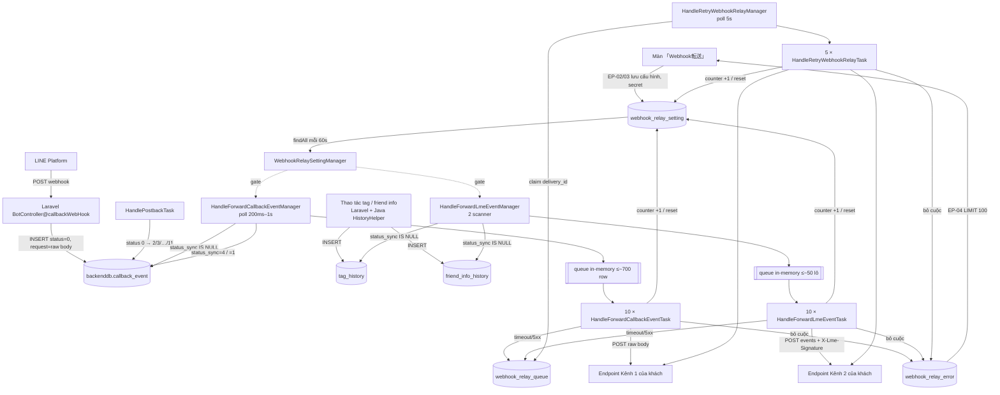
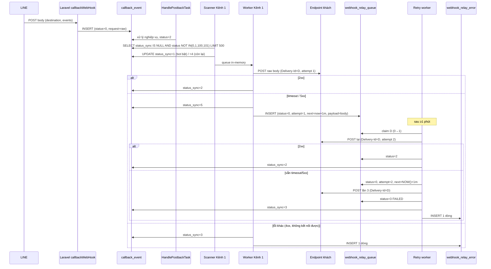
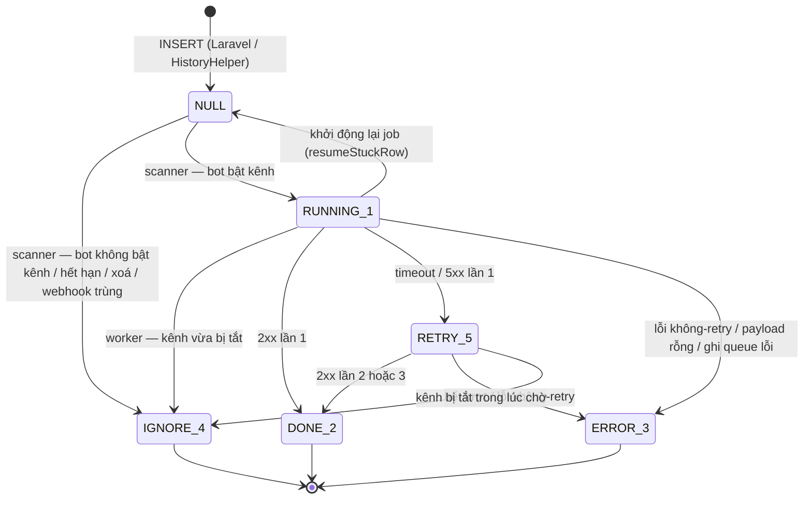
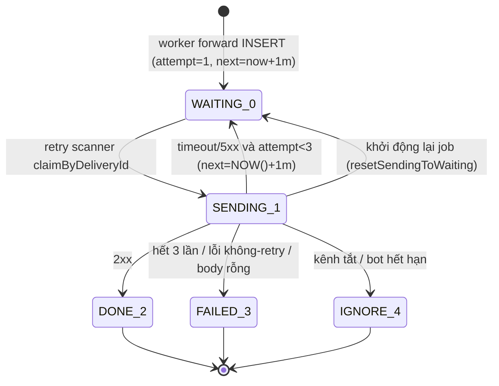

# Job Spec — Chuyển tiếp Webhook 「Webhook転送」 (FA-047)

| Mục | Giá trị |
|-----|---------|
| Tính năng | FA-047 — Chuyển tiếp Webhook 「Webhook転送」 (task web #40044, task job #40475) |
| Nguồn worker | `src/job/linect-service` @ nhánh `release-t09-2026`, commit `be6ef546` (2026-10-21) |
| Nguồn web đối chiếu | `src/web/sns-line` @ nhánh `release_step_20260930_v2`, commit `4d9d07d159` (2026-10-23) |
| Ngày cập nhật | 2026-10-23 |
| Độ tin cậy tổng thể | **Cao** — nội dung đọc trực tiếp từ source Java + native query của repository. Các điểm phụ thuộc hành vi thư viện (OkHttp) hoặc cấu hình runtime được đánh dấu riêng |
| Trạng thái | Code đã có trên nhánh release. **Chưa xác định** flag có đang bật trên production hay không (`config.properties` không nằm trong repo) |

---

## 1. Tổng quan

### 1.1 Tại sao tính năng này cần background job

「Webhook転送」 cho phép mỗi bot cấu hình **2 kênh chuyển tiếp độc lập** sang URL HTTPS của hệ thống bên thứ 3:

| | Kênh 1 — 「LINE公式アカウントデータ転送」 | Kênh 2 — 「L Messageデータ転送」 |
|---|---|---|
| Giá trị `channel` | `1` | `2` |
| Nội dung chuyển tiếp | Webhook LINE gửi tới LME, **nguyên trạng** | Sự kiện nội bộ LME: thay đổi **tag** và **friend info** |
| Bảng nguồn | `callback_event` (backenddb) | `tag_history`, `friend_info_history` (linedb) |
| URL đích | `webhook_relay_setting.endpoint_url` | `webhook_relay_setting.notify_endpoint_url` |
| Công tắc | `is_enabled` | `notify_is_enabled` |
| Bộ đếm lỗi liên tiếp | `consecutive_failure_count` | `notify_consecutive_failure_count` |
| Header xác thực | **Không** | `X-Lme-Signature` (secret thô `whsec_…`) |
| Body | `callback_event.request` nguyên văn | `{"events":[…]}` do job dựng, gom lô |
| Task Manager | `HandleForwardCallbackEventManager` | `HandleForwardLmeEventManager` |

Việc gọi HTTP sang bên thứ 3 (timeout 10 giây mỗi pha, tối đa **3 lần gửi tổng cộng** = 1 lần đầu + 2 lần thử lại cách nhau 1 phút — §8.3) **không thể** chạy trong request PHP nhận webhook LINE (LINE yêu cầu trả 200 nhanh) hay trong request thao tác tag của người dùng. Vì vậy toàn bộ việc chuyển tiếp do Spring Boot worker đảm nhận. **Tin cậy: Cao.**

### 1.2 Kiểu giao tiếp — Database Polling (biến thể "quét bảng nguồn")

Khác các tính năng khác trong hệ thống, **Laravel KHÔNG ghi bất kỳ hàng đợi nào cho tính năng này**:

- Nhánh web INSERT `webhook_relay_queue` đã bị gỡ ở #40763 (`src/web/sns-line/database/migrations/2026_09_03_100100_create_webhook_relay_queue_table.php:10-24`, `src/web/sns-line/config/sns-line.php:1284-1285`, `src/web/sns-line/app/Providers/RepositoryServiceProvider.php:559`).
- Job quét **trực tiếp bảng nguồn** đã có sẵn trong hệ thống, dùng cột mới `status_sync` làm cờ "đã chuyển tiếp chưa".
- `webhook_relay_queue` **chỉ chứa sự kiện đã gửi hỏng lần đầu** — do **chính job** ghi để hẹn lần thử 2 và 3 (`src/job/linect-service/src/main/java/sns/line/models/linedb/entities/WebhookRelayQueue.java:13-15`).

```
LINE ──POST──▶ Laravel BotController@callbackWebHook ──INSERT──▶ callback_event (status=0, status_sync=NULL)
                                                                  │ HandlePostbackTask xử lý nghiệp vụ → status=2/3/4…/11
Thao tác tag / friend info (UI, API, scenario, CSV…) ──INSERT──▶ tag_history / friend_info_history (status_sync=NULL)
                                                                  │
                     Spring Boot: 3 scanner while(true) quét status_sync IS NULL ──▶ queue in-memory ──▶ N worker ──POST──▶ URL bên thứ 3
                                                                  │ hỏng (timeout/5xx)
                                                                  ▼
                                    webhook_relay_queue (job tự ghi) ──▶ HandleRetryWebhookRelayManager ──POST lại (≤2 lần)──▶ URL bên thứ 3
                                                                  │ hỏng hẳn
                                                                  ▼
                                    webhook_relay_error (job ghi) ──▶ Laravel EP-04 đọc ──▶ bảng 「転送エラー」 trên màn hình
```

Không dùng message broker, không dùng scheduler annotation; điều phối hoàn toàn bằng vòng lặp `while(true)` + `Thread.sleep` theo khuôn `StoppableTask`.

### 1.3 Feature flag & cấu hình

Tất cả đọc từ `config.properties` (ngoài repo) qua `src/job/linect-service/src/main/java/sns/line/ConfigFile.java`.

| Khoá | Mặc định | Ý nghĩa | Nguồn |
|------|----------|---------|-------|
| `ENABLE_FORWARD_WEBHOOK_CALLBACK` | `0` (tắt) | Bật Kênh 1 | `ConfigFile.java:144`, đọc tại `:325` |
| `ENABLE_FORWARD_WEBHOOK_LME` | `0` (tắt) | Bật Kênh 2 | `ConfigFile.java:146`, đọc tại `:326` |
| `NUMBER_THREAD_FORWARD_WEBHOOK_CALLBACK` | `10` | Số worker Kênh 1 | `ConfigFile.java:147`, `:327` |
| `NUMBER_THREAD_FORWARD_WEBHOOK_LME` | `10` | Số worker Kênh 2 | `ConfigFile.java:148`, `:328` |
| `NUMBER_THREAD_RETRY_FORWARD_WEBHOOK` | `5` | Số worker job thử lại (dùng chung 2 kênh) | `ConfigFile.java:151`, `:329` |
| `LARAVEL_APP_KEY` | rỗng | `APP_KEY` của Laravel để giải mã `signing_secret` (nhận cả dạng `base64:…`) | `ConfigFile.java:52`, `:233` |

- Job thử lại **không có flag riêng**: tự bật khi **một trong hai** kênh bật (`AppMain.java:319-324`, chú thích `ConfigFile.java:149-150`).
- Log xác nhận khi khởi động: `Config enable: ENABLE_FORWARD_WEBHOOK_CALLBACK - thread N`, `… _LME …`, `Config enable: RETRY_FORWARD_WEBHOOK - thread N` (`ConfigFile.java:450-458`).
- Hằng số cứng (không cấu hình được) trong `src/job/linect-service/src/main/java/sns/line/values/Constants.java` lớp `WebhookRelay` (dòng 138-310): `MAX_ATTEMPT = 3` (`:223`), `RETRY_DELAY_MINUTES = 1` (`:236`), `TIMEOUT_SECONDS = 10` (`:239`), `MAX_EVENTS_PER_REQUEST = 1000` (`:309`).

---

## 2. Bảng dữ liệu (Web ↔ Job)

### 2.1 Bản đồ bảng

| Bảng | DB | Ai ghi | Job đọc/ghi gì | Entity JPA |
|------|----|--------|----------------|------------|
| `callback_event` | backenddb | Laravel `callbackWebHook` INSERT; `HandlePostbackTask` UPDATE `status` | Đọc `request`, `type`, `bot_id`, `status`; **chỉ ghi `status_sync`** | `models/backenddb/entities/CallbackEvent.java` |
| `tag_history` | linedb | Laravel (≈43 file controller/command) + Java `HistoryHelper.recordTagAdd/Remove` (`helper/HistoryHelper.java:171-191`) | Đọc toàn row; chỉ ghi `status_sync` | `models/linedb/entities/TagHistory.java` |
| `friend_info_history` | linedb | Laravel + Java `HistoryHelper.recordFriendInfo` (`helper/HistoryHelper.java:259-270`) | Đọc toàn row; chỉ ghi `status_sync` | `models/linedb/entities/FriendInfoHistory.java` |
| `line_user` | linedb | — | Đọc `line_id` theo lô để điền `line_friend_id` | `LineUser` |
| `bots` | linedb | — | Đọc `is_deleted`, hạn dùng (qua `BotManager`, cache 2 phút) | `Bot` |
| `webhook_relay_setting` | linedb | Laravel (màn 「Webhook転送」) | Đọc toàn bảng mỗi 60s; **chỉ ghi** 2 bộ đếm lỗi | `models/linedb/entities/WebhookRelaySetting.java` |
| `webhook_relay_queue` | linedb | **Chỉ job** | INSERT khi gửi lần 1 hỏng; UPDATE vòng đời thử lại | `models/linedb/entities/WebhookRelayQueue.java` |
| `webhook_relay_error` | linedb | **Chỉ job** (INSERT) | Ghi 1 dòng khi bỏ cuộc | `models/linedb/entities/WebhookRelayError.java` |

> Lưu ý xuyên DB: `callback_event` ở **backenddb**, còn `webhook_relay_queue`/`webhook_relay_error`/`webhook_relay_setting` ở **linedb** ⇒ không có transaction nào bao được cả "đánh dấu bảng nguồn" lẫn "ghi queue/lỗi" (hệ quả ở R-10).

### 2.2 Cột `status_sync` trên 3 bảng nguồn

- `tag_history.status_sync`, `friend_info_history.status_sync`: `TINYINT DEFAULT NULL` + index `idx_status_sync (status_sync, id)` — migration Laravel `src/web/sns-line/database/migrations/2026_09_10_000000_add_status_sync_to_history_tables.php:40-61` (online DDL `ALGORITHM=INPLACE, LOCK=NONE`).
- `callback_event.status_sync`: **không có migration Laravel** (backenddb) — tạo bằng script DBA `data/task_40475/migration_40475.sql` (gitignored, không kiểm chứng được — xem G-02). Repository dựa vào index `(status_sync, id)` (`models/backenddb/repository/CallbackEventRepository.java:36-40`).
- Cả 3 entity map `status_sync` với `insertable = false, updatable = false` để các chỗ `save()`/`saveAll()` sẵn có (HandlePostbackTask, HistoryHelper, ActionModel, HandleImportCsvTask) **không ghi đè** giá trị (`CallbackEvent.java:60-65`, `TagHistory.java:49-53`, `FriendInfoHistory.java:59-63`). Mọi thay đổi đi qua native `UPDATE … WHERE id IN (:ids)`.
- Laravel **không đọc/ghi** `status_sync` ở bất kỳ đâu (grep `app/`, `config/`, `routes/` không có kết quả).

| Giá trị | Hằng số Java | Ý nghĩa | Ai đặt |
|---------|--------------|---------|--------|
| `NULL` | (không có hằng) | Chưa xử lý | Mặc định khi Laravel/HistoryHelper INSERT; job reset `1 → NULL` lúc khởi động |
| `1` | `STATUS_SYNC_RUNNING` (`Constants.java:141`) | Đã nạp vào queue in-memory / đang gửi | Scanner |
| `2` | `STATUS_SYNC_DONE` (`:143`) | Bên thứ 3 trả 2xx | Worker / retry worker |
| `3` | `STATUS_SYNC_ERROR` (`:145`) | Hỏng hẳn, đã ghi `webhook_relay_error` | Worker / retry worker |
| `4` | `STATUS_SYNC_IGNORE` (`:148`) | Không chuyển tiếp: bot không bật kênh / bot hết hạn > 7 ngày / bot đã xoá / webhook LINE trùng | Scanner, worker, retry worker |
| `5` | `STATUS_SYNC_RETRY` (`:158`) | Gửi lần 1 hỏng, đang chờ trong `webhook_relay_queue` | Worker |

### 2.3 Queue table `webhook_relay_queue` (hàng đợi THỬ LẠI)

Schema: `src/web/sns-line/database/migrations/2026_09_03_100100_create_webhook_relay_queue_table.php:40-63` + `2026_09_16_000100_widen_callback_event_id_on_webhook_relay_queue.php` (nâng `callback_event_id` lên BIGINT UNSIGNED).

| Cột | Kiểu | Field entity (`WebhookRelayQueue.java`) | Ý nghĩa thực tế (theo code job) |
|-----|------|-----------------------------------------|---------------------------------|
| `id` | bigint AI | `id` (`:39-42`) | Khoá chính; thứ tự dựng lại `events[]` |
| `bot_id` | int | `botId` (`:44-45`) | Bot |
| `channel` | tinyint, default 1 | `channel` (`:47-48`) | 1 = LINE, 2 = LME |
| `callback_event_id` | bigint unsigned NULL | `callbackEventId` (`:50-52`) | **Id bảng nguồn** cho cả 3 bảng: `callback_event.id` (ch.1) / `tag_history.id` hoặc `friend_info_history.id` (ch.2) |
| `delivery_id` | char(36) | `deliveryId` (`:54-56`) | UUID của **một lần giao hàng**; mọi row trong cùng request mang cùng giá trị |
| `event_type` | varchar(255) | `eventType` (`:58-60`) | ch.1: `callback_event.type` (hoặc `unknown`); ch.2: `tag` / `friend_info` — dùng để suy ra bảng nguồn |
| `payload` | longtext NULL | `payload` (`:62-71`) | ch.1: **nguyên body đã gửi**; ch.2: JSON của **một** phần tử `events[]` |
| `status` | tinyint, default 0 | `status` (`:73-75`) | Xem bảng dưới |
| `attempt_count` | tinyint, default 0 | `attemptCount` (`:77-79`) | Số lần **đã** gửi (row mới luôn = 1) |
| `next_attempt_at` | datetime NULL | `nextAttemptAt` (`:81-82`) | Thời điểm được phép thử lại |
| `locked_by`, `locked_at` | — | **không map** (`:30-31`) | Không dùng — đã chốt chạy 1 instance |
| `created_at` | datetime NULL | `createdAt` (`:85-86`) | Giờ JVM lúc INSERT |
| `processed_at` | datetime NULL | `processedAt` (`:88-89`) | `NOW()` khi kết thúc (DONE/FAILED/IGNORE) |

Index (theo migration): `idx_webhook_relay_queue_poll (status, next_attempt_at, id)`, `idx_webhook_relay_queue_bot (bot_id, created_at)`.

**Hằng số status** (`Constants.java:165-173`):

| Giá trị | Hằng số | Ý nghĩa | Ai đặt |
|---------|---------|---------|--------|
| `0` | `QUEUE_STATUS_WAITING` | Chờ tới `next_attempt_at` | Worker forward (INSERT); retry worker (hẹn lại); khởi động (`SENDING → WAITING`) |
| `1` | `QUEUE_STATUS_SENDING` | Đã giành, đang gửi | Retry scanner (`claimByDeliveryId`) |
| `2` | `QUEUE_STATUS_DONE` | Gửi lại thành công | Retry worker |
| `3` | `QUEUE_STATUS_FAILED` | Bỏ cuộc (hết 3 lần hoặc lỗi không đáng thử lại) | Retry worker |
| `4` | `QUEUE_STATUS_IGNORE` | Kênh bị tắt / bot hết hạn trong lúc chờ — không gửi, **không** ghi lỗi | Retry worker |

- **Điều kiện poll**: `SELECT delivery_id FROM webhook_relay_queue WHERE status = 0 AND next_attempt_at <= NOW() GROUP BY delivery_id ORDER BY MIN(id) ASC LIMIT 50` (`models/linedb/repository/WebhookRelayQueueRepository.java:24-30`).
- **Tần suất**: 5 giây khi rảnh, 200ms khi vừa đẩy được việc (`threads/webhook/HandleRetryWebhookRelayManager.java:47`, `:108-113`).
- Laravel **không** ghi bảng này (chú thích migration `:23-24`); phần mô tả cũ trong migration (`payload` NULL với ch.1, `status` chỉ 0..3, job `WebhookRelayTask`) **đã lỗi thời** — xem D-01.

### 2.4 Bảng lỗi `webhook_relay_error`

Schema: `src/web/sns-line/database/migrations/2026_09_03_100200_create_webhook_relay_error_table.php:20-39`. Entity: `models/linedb/entities/WebhookRelayError.java`.

| Cột | Giá trị job ghi | Nguồn |
|-----|-----------------|-------|
| `bot_id` | bot của sự kiện | constructor `:61-72` |
| `channel` | 1 / 2 | |
| `queue_id` | **id bảng nguồn** (không phải `webhook_relay_queue.id`); Kênh 2 = id của **sự kiện đầu tiên** trong lô | `HandleForwardLmeEventTask.java:200-217` |
| `occurred_at` | `LocalDateTime.now()` của JVM lúc bỏ cuộc | `WebhookRelayError.java:63-70` |
| `event_type` | ch.1: `callback_event.type` (null → `unknown`); ch.2: `tag` / `friend_info` của sự kiện đầu | `Constants.java:265` |
| `error_code` | Mã nội bộ — xem mục 6.4 | |
| `http_status` | HTTP status nhận được; **NULL** khi không có response (kể cả timeout phía LME) | `WebhookRelayApiClient.java:128-136` |
| `created_at` | = `occurred_at` | |

- Ghi **1 dòng cho 1 request hỏng**: Kênh 1 = 1 sự kiện LINE (1 lần LINE gọi); Kênh 2 = **1 dòng cho cả lô ≤500 sự kiện** (`HandleForwardLmeEventTask.java:200-204`, `HandleRetryWebhookRelayTask.java:202-205`).
- Laravel EP-04 đọc: `WHERE bot_id = ? AND channel = ? ORDER BY occurred_at DESC, id DESC LIMIT 100` (`src/web/sns-line/app/Repositories/Eloquents/WebhookRelayErrorRepository.php:21-29`).
- Không có cơ chế dọn bảng (QA-008, Phase 1).

### 2.5 `webhook_relay_setting` — job đọc gì, ghi gì

Entity `models/linedb/entities/WebhookRelaySetting.java`; repository `models/linedb/repository/WebhookRelaySettingRepository.java`.

- **Đọc** (qua cache, mục 3.6): `bot_id`, `endpoint_url`, `is_enabled`, `notify_endpoint_url`, `notify_is_enabled`, `signing_secret`.
- Kênh "sẵn sàng" khi `is_enabled = 1 AND endpoint_url` không rỗng (`WebhookRelaySetting.java:143-145`), tương tự `notify_*` cho Kênh 2 (`:150-152`).
- **Ghi** (native query, ngoài cache):
  - `increaseCallbackFailureCount` / `increaseLmeFailureCount`: `+1` khi bỏ cuộc (`WebhookRelaySettingRepository.java:19-22`, `:30-33`).
  - `resetCallbackFailureCount` / `resetLmeFailureCount`: về `0` khi thành công, có guard `<> 0` để không ghi thừa (`:24-28`, `:35-38`).
- **Không** ghi `is_enabled`, `auto_disabled_at`, `notify_auto_disabled_at` — Phase 1 **không auto-disable** (BR-25; chú thích migration `2026_09_03_100000_create_webhook_relay_setting_table.php:18`). Bộ đếm chỉ để làm metric; web reset về 0 khi kênh chuyển TẮT → BẬT (`src/web/sns-line/app/Services/WebhookRelay/WebhookRelayService.php:147-152`).

### 2.6 Tổng hợp điều kiện poll và tần suất

| Scanner | Câu quét | Batch | Nhịp nghỉ | Nguồn |
|---------|----------|-------|-----------|-------|
| Kênh 1 | `SELECT * FROM callback_event WHERE status_sync IS NULL AND status NOT IN (0,1,100,101) ORDER BY id ASC LIMIT 500` | 500 | 200ms nếu đủ 500; 1000ms nếu ít hơn; 1s nếu cache chưa sẵn sàng hoặc queue > 200; 10s nếu exception | `CallbackEventRepository.java:43-48`; `HandleForwardCallbackEventManager.java:35-43`, `:76-123` |
| Kênh 2 — tag | `SELECT * FROM tag_history WHERE status_sync IS NULL ORDER BY id ASC LIMIT 500` | 500 | Như trên, ngưỡng queue > 50 **lô** | `models/linedb/repository/TagHistoryRepository.java:21-22`; `HandleForwardLmeEventManager.java:94-129` |
| Kênh 2 — friend info | `SELECT * FROM friend_info_history WHERE status_sync IS NULL ORDER BY id ASC LIMIT 500` | 500 | Như trên | `models/linedb/repository/FriendInfoHistoryRepository.java:21-22`; `HandleForwardLmeEventManager.java:131-165` |
| Retry | xem 2.3 | 50 delivery | 200ms nếu có việc; 5s nếu rảnh; 1s nếu queue > 50; 10s nếu exception | `HandleRetryWebhookRelayManager.java:86-125` |

- Kênh 1 cố ý loại `status` 0/1 (chưa/đang được `HandlePostbackTask` xử lý) và 100/101 (dải "mode BACKEND") — sự kiện chỉ được chuyển tiếp **sau khi** LME xử lý xong nghiệp vụ, bất kể kết quả (kể cả `ERROR`, `UNKNOWN_TYPE`, `IGNORE_GROUP_MESSAGE`…) (`Constants.java:175-216`). Sự kiện trùng do LINE gửi lại (`status` 11/111) được lấy ra để đánh `IGNORE` (`HandleForwardCallbackEventManager.java:151-153`).
- Thông lượng trần mỗi scanner ≈ 500 row / 200ms ≈ **2.500 row/giây** (`HandleForwardCallbackEventManager.java:111-113`).

---

## 3. Task Managers (Entry Points)

### 3.1 Khởi động trong `AppMain.run()`

`src/job/linect-service/src/main/java/sns/line/AppMain.java`:

| Dòng | Hành động |
|------|-----------|
| `:196-199` | Khởi tạo sẵn 3 manager làm field (để `requestStop`/`isStopped` an toàn kể cả khi flag tắt) |
| `:210` | `executorService = Executors.newCachedThreadPool()` — pool **không giới hạn**, dùng chung toàn app |
| `:214` | `BotManager.initBotManager(...)` (cache bot dùng cho gate vòng đời bot) |
| `:319-324` | Nếu bật Kênh 1 **hoặc** Kênh 2: `WebhookRelaySettingManager.init(...)` (load cache **đồng bộ** lần đầu) rồi `retryWebhookRelayManager.startTask()` |
| `:325-327` | `if (ENABLE_FORWARD_WEBHOOK_CALLBACK) forwardCallbackEventManager.startTask()` |
| `:328-330` | `if (ENABLE_FORWARD_WEBHOOK_LME) forwardLmeEventManager.startTask()` |

### 3.2 Bảng luồng (thread inventory)

| Thành phần | Số luồng | Nhiệm vụ |
|------------|----------|----------|
| `WebhookRelaySettingManager` reload | 1 | Nạp lại toàn bảng `webhook_relay_setting` mỗi 60s |
| `HandleForwardCallbackEventManager` | 1 scanner + `NUMBER_THREAD_FORWARD_WEBHOOK_CALLBACK` (10) worker | Kênh 1 |
| `HandleForwardLmeEventManager` | 2 scanner (tag, friend info) + `NUMBER_THREAD_FORWARD_WEBHOOK_LME` (10) worker | Kênh 2 |
| `HandleRetryWebhookRelayManager` | 1 scanner + `NUMBER_THREAD_RETRY_FORWARD_WEBHOOK` (5) worker | Thử lại cả 2 kênh |
| **Tổng mặc định** | **31 luồng** | Tất cả chạy trên `executorService` chung |

Queue giữa scanner và worker là `LinkedList` thường + `synchronized` (không phải `BlockingQueue`); worker rảnh thì `sleep(2000)`.

### 3.3 `HandleForwardCallbackEventManager` (Kênh 1)

- **File**: `src/job/linect-service/src/main/java/sns/line/threads/webhook/HandleForwardCallbackEventManager.java` (extends `StoppableTask`)
- **Feature flag**: `ConfigFile.ENABLE_FORWARD_WEBHOOK_CALLBACK`
- **`startTask()`** (`:55-65`): `setStatusRunning()` → khởi động scanner → tạo N worker `HandleForwardCallbackEventTask`.
- **Scanner** `startJobPushToQueue()` (`:67-130`):
  1. Một lần duy nhất: `resumeStuckRow()` — `UPDATE callback_event SET status_sync = NULL WHERE status_sync = 1` (`:135-144`, `CallbackEventRepository.java:53-56`).
  2. Vòng lặp: dừng nếu `isPrepareStop() || isNeedStop()` (`:76-79`); chờ cache sẵn sàng (`:81-85`); backpressure khi queue > 200 (`:91-98`); quét (`:106-107`); `addToQueue` (`:108-110`); nghỉ theo kích thước batch (`:114-118`).
- **`addToQueue()`** (`:146-183`) — phân loại từng row:
  - `status ∈ {11, 111}` (webhook trùng) → IGNORE (`:152-153`).
  - `WebhookRelaySettingManager.isCallbackChannelReady(botId)` → forward (`:154-156`).
  - Còn lại → IGNORE (`:157-159`).
  - Bulk `UPDATE status_sync = 4` cho nhóm IGNORE (`:162-164`); bulk `UPDATE status_sync = 1` cho nhóm forward **trước** rồi mới `addAll` vào queue (`:165-171`).
- **Log tổng kết** mỗi 60 giây (`:188-196`, `WebhookRelayStats`).

### 3.4 `HandleForwardLmeEventManager` (Kênh 2)

- **File**: `src/job/linect-service/src/main/java/sns/line/threads/webhook/HandleForwardLmeEventManager.java`
- **Feature flag**: `ConfigFile.ENABLE_FORWARD_WEBHOOK_LME`
- **`startTask()`** (`:54-75`): nếu `LARAVEL_APP_KEY` chưa cấu hình/hỏng → log error + Chatwork 「Kênh 2 forward không có chữ ký!」 nhưng **vẫn chạy** (`:61-67`); `resumeStuckRow()` reset `status_sync = 1 → NULL` trên **cả 2** bảng history (`:81-92`); khởi động 2 scanner + N worker.
- **Scanner tag / friend info** (`:94-165`): giống Kênh 1 nhưng **không có cột status nghiệp vụ để chờ** — row vừa INSERT là chuyển tiếp ngay; điều kiện chung `isReadyToScan()` (cache sẵn sàng + queue ≤ 50 lô) (`:170-189`).
- **`addTagHistoryToQueue` / `addFriendInfoHistoryToQueue`** (`:204-309`):
  1. Tách IGNORE / forward theo `isLmeChannelReady(botId)`; bulk `UPDATE status_sync = 4` cho IGNORE.
  2. Resolve `line_user.line_id` cho cả batch bằng **1 query** `findAllByIdIn(distinctIds)` (`loadMapLineId`, `:318-329`); không resolve được (line_user đã xoá) vẫn gửi với `line_friend_id = null` và log error (`:253-256`).
  3. Dựng `WebhookLmeEvent` từng row → bulk `UPDATE status_sync = 1` → `addBatchesToQueue`.
- **`addBatchesToQueue()`** (`:342-367`): gom theo `botId` (mỗi bot một URL), cắt theo `MAX_EVENTS_PER_REQUEST = 1000`; giữ thứ tự id tăng dần (`LinkedHashMap`). Một lô luôn thuộc **1 bot + 1 bảng nguồn** ⇒ tag và friend info **không bao giờ** đi chung một request; vì batch quét là 500 nên thực tế mỗi request ≤ 500 sự kiện.

### 3.5 `HandleRetryWebhookRelayManager` (thử lại, chung 2 kênh)

- **File**: `src/job/linect-service/src/main/java/sns/line/threads/webhook/HandleRetryWebhookRelayManager.java`
- **Bật khi**: một trong 2 flag kênh bật (`AppMain.java:319-324`).
- **`resumeStuckRow()`** (`:74-84`): `UPDATE webhook_relay_queue SET status = 0 WHERE status = 1` (`WebhookRelayQueueRepository.java:84-88`).
- **`scanAndPush()`** (`:136-172`): lấy ≤50 `delivery_id` tới hạn → với mỗi id, `claimByDeliveryId` (`UPDATE … SET status = 1 WHERE delivery_id = ? AND status = 0`, `WebhookRelayQueueRepository.java:36-43`); trả 0 thì bỏ qua (đã bị luồng khác giành) → đọc lại các row `SENDING` theo `id ASC` (`:46`) → đóng gói `WebhookRelayRetryBatch` → đẩy queue in-memory.
- Quét theo **delivery_id** (không theo row) để không cắt đôi một lô Kênh 2 vắt qua mép `LIMIT` (`WebhookRelayQueueRepository.java:14-23`).

### 3.6 `WebhookRelaySettingManager` (cache cấu hình)

- **File**: `src/job/linect-service/src/main/java/sns/line/helper/WebhookRelaySettingManager.java`
- Nạp **toàn bộ** bảng `webhook_relay_setting` vào `Map<botId, setting>` (`:120-150`); lần đầu đồng bộ trong `init()` (`:41-45`), sau đó 1 luồng nạp lại **mỗi 60 giây** (`RELOAD_INTERVAL_MILLIS = 60000`, `:28`, `:98-118`).
- Thay nguyên map (`volatile`) mỗi lần để reader thấy snapshot nhất quán (`:32-33`); nạp lỗi thì **giữ map cũ** + Chatwork (`:145-149`).
- `isReady()` chỉ `true` sau lần nạp thành công đầu tiên (`:35-36`, `:47-49`) — mọi scanner đều chờ cờ này để không đánh IGNORE oan.
- **Gate dùng chung** cho cả 2 kênh và retry (`:61-72`): setting tồn tại + kênh bật + URL không rỗng **và** `isBotForwardable(botId)` (`:85-96`): bot tồn tại, `is_deleted == 0` (loại cả bot tạm `is_deleted = 2` của luồng đổi bot) và `!bot.isExpiredOver7Day()` (QA-011). Kiểm setting **trước** để không gọi `BotManager.getBot` (static synchronized) cho hàng trăm row của bot không dùng tính năng.
- `Bot.isExpiredOver7Day()` (`models/linedb/entities/Bot.java:288-300`): thanh toán lỗi quá 7 ngày, hoặc gói trả phí có `expired_date` quá 7 ngày, hoặc hợp đồng đã huỷ (`bot_contracts.status = 3`).
- **Độ trễ áp dụng thay đổi từ web**: tối đa **60s** cho cấu hình kênh/URL/secret; tối đa **2 phút** cho trạng thái bot (`BotManager.VALID_TIME_LOAD_BOT = 2 * 60000`, `helper/BotManager.java:18`, `:33-41`). Không có cơ chế web chủ động xoá cache (chú thích `WebhookRelayService.php:195-197`).

### 3.7 Chống xử lý trùng (double-pick)

| Tầng | Cơ chế | Đủ cho đa instance? |
|------|--------|--------------------|
| Scanner Kênh 1/2 → worker (cùng instance) | Một scanner duy nhất mỗi bảng; row đánh `RUNNING` trước khi vào queue; câu quét chỉ lấy `status_sync IS NULL` | **Không** — `SELECT` rồi `UPDATE … WHERE id IN (…)` không kèm điều kiện `status_sync IS NULL`, 2 instance cùng quét sẽ cùng lấy một row |
| Retry | `claimByDeliveryId` nguyên tử (`WHERE status = 0`) | Có ở bước giành; nhưng `resetSendingToWaiting` lúc khởi động reset **mọi** row `SENDING`, kể cả của instance khác (`WebhookRelayQueueRepository.java:79-88`) |
| Khởi động | `resumeStuckRow` reset **toàn bộ** `RUNNING`/`SENDING` | Chỉ đúng khi 1 instance (đã chốt — `WebhookRelayQueue.java:30-31`) |

---

## 4. Processing Chain (Chuỗi xử lý)

### 4.1 Kênh 1 — chuyển tiếp webhook LINE

```
Laravel callbackWebHook INSERT callback_event (1 row = 1 lần LINE gọi, request = raw body)
  → HandlePostbackTask xử lý nghiệp vụ → status = 2 (hoặc 3/4/…/11)
  → HandleForwardCallbackEventManager quét (status_sync IS NULL, status NOT IN 0/1/100/101)
      ├─ status 11/111 hoặc bot không sẵn sàng → status_sync = 4 (bulk)
      └─ còn lại → status_sync = 1 (bulk) → queue in-memory
  → HandleForwardCallbackEventTask.actionForward()          (threads/webhook/HandleForwardCallbackEventTask.java:73-129)
      1. Gate lại isCallbackChannelReady (người dùng có thể vừa tắt)  → không: status_sync = 4 (:77-84)
      2. body = callback_event.request nguyên văn; rỗng → status_sync = 3 + error INVALID_PAYLOAD (:85-92, :185-191)
      3. deliveryId = UUID.randomUUID()  (:94)
      4. WebhookRelayApiClient.post(endpoint_url, body, signature = null, deliveryId, attempt 1)  (:97-98)
      5a. 2xx  → status_sync = 2; reset consecutive_failure_count (:100-111)
      5b. Timeout / ≥500 → enqueueRetry: status_sync = 5 TRƯỚC, rồi INSERT webhook_relay_queue
                           (channel 1, payload = body, attempt_count 1, next_attempt_at = now + 1 phút) (:147-173)
      5c. Lỗi khác → failWithoutRetry: status_sync = 3, INSERT webhook_relay_error, consecutive_failure_count + 1 (:134-138)
      5d. INSERT queue lỗi → quay về 5c (:166-172)
```

- **Body gửi đi** = chuỗi `callback_event.request` **không parse, không bọc thêm** (「加工せずそのまま」, `:175-184`). Từ #40888, Laravel lưu nguyên body thô LINE gửi — dạng `{"destination":"U…","events":[…]}`, **một row chứa đủ mọi sự kiện** của lần gọi (`src/web/sns-line/app/Http/Controllers/Admin/BotController.php:2075-2148`). Row ghi trước #40888 có thể là mảng sự kiện đã `json_encode` lại (ghi chú trong `src/job/linect-service/ai-plan_mode/task_40475_spec_job.md:199-201`).
- Request chỉ toàn sự kiện `delivery` thì Laravel **không lưu** ⇒ không bao giờ được chuyển tiếp (`BotController.php:2115-2127`).
- **Không ký, không chuyển tiếp `x-line-signature` gốc** (header không được lưu) — đã chốt BR-02 (`HandleForwardCallbackEventTask.java:25`).
- Bên nhận phân biệt bot qua **chính URL đích** (mỗi bot một URL), không có metadata trong body.
- Cột `type` của `callback_event` (= `event_type` trên bảng lỗi) chỉ là type của **sự kiện đầu tiên khác `delivery`** — request gộp nhiều loại sự kiện vẫn chỉ hiện một loại ở cột 「イベント種別」.

### 4.2 Kênh 2 — chuyển tiếp sự kiện tag / friend info

```
Bất kỳ thao tác tag / friend info nào (UI, API /do_action, scenario/action Java, import CSV…)
  → INSERT tag_history / friend_info_history (status_sync = NULL)
  → HandleForwardLmeEventManager: 2 scanner độc lập
      ├─ bot không sẵn sàng → status_sync = 4 (bulk)
      └─ còn lại: resolve line_id theo lô → WebhookLmeEvent → status_sync = 1 (bulk)
               → gom theo bot, ≤1000/lô → queue in-memory (WebhookLmeBatch)
  → HandleForwardLmeEventTask.actionForward()                 (threads/webhook/HandleForwardLmeEventTask.java:81-141)
      1. Gate isLmeChannelReady → không: status_sync = 4 cho cả lô (:85-92)
      2. payload = {"events":[…]} (WebhookLmeBatch.buildPayloadJson, Jackson); rỗng → status_sync = 3 + 1 dòng lỗi (:93-100)
      3. X-Lme-Signature = WebhookSignatureHelper.buildHeaderValue(setting); null → log error, VẪN gửi (:101-105)
      4. deliveryId = UUID chung cho cả lô (:108)
      5. POST notify_endpoint_url (:111-112)
      6a. 2xx → status_sync = 2 cho cả lô; reset notify_consecutive_failure_count (:114-125)
      6b. Timeout / ≥500 → status_sync = 5 cho cả lô, INSERT N row webhook_relay_queue cùng delivery_id,
                           payload = JSON từng phần tử (:161-185)
      6c. Lỗi khác → status_sync = 3, 1 dòng webhook_relay_error (sự kiện đầu làm đại diện), counter + 1 (:146-150, :205-222)
```

**Hợp đồng `events[]` thực tế job gửi** (`threads/webhook/WebhookLmeEvent.java:62-120`) — Jackson mặc định giữ cả giá trị `null`:

| Field | Kiểu | `type = tag` | `type = friend_info` | Nguồn dữ liệu |
|-------|------|--------------|----------------------|---------------|
| `lmessage_friend_id` | integer | Có | Có | `*.line_user_id` (PK nội bộ bảng `line_user`) |
| `line_friend_id` | string \| null | Có | Có | `line_user.line_id` (U…); `null` nếu line_user đã xoá |
| `type` | string | `"tag"` | `"friend_info"` | Hằng số |
| `action` | string | `remove` nếu `tag_history.action = 2`, ngược lại `add` | `clear` nếu `friend_info_history.action = 3`; `CREATE(1)`/`UPDATE(2)` → `set` | `:63-65`, `:114-120` |
| `tag_id` | integer | Có (1 sự kiện = đúng 1 tag) | — | `tag_history.tag_id` (`:75`) |
| `field_id` | integer | — | Có | `friend_info_history.friend_information_setting_id` (`:89`) |
| `value` | string \| null | — | Có, **trừ** khi `action = clear` | `friend_info_history.new_value` (`:90-93`) |
| `option_id` | — | — | **Không bao giờ có** (history không lưu) | `:36-37` |

Ví dụ body:
```json
{"events":[
  {"lmessage_friend_id":42,"line_friend_id":"U1a2b…","type":"tag","action":"add","tag_id":7},
  {"lmessage_friend_id":43,"line_friend_id":null,"type":"tag","action":"remove","tag_id":7}
]}
```
Không đưa vào payload: `bot_id`, `id`, `created_at`, `tag_name`, `old_value`, `trigger_type_start`, `trigger_from_id` (QA-014) — `WebhookLmeEvent.java:17-32`.

### 4.3 Thử lại (cả 2 kênh)

```
HandleRetryWebhookRelayManager quét delivery_id tới hạn → claim (0 → 1) → WebhookRelayRetryBatch
  → HandleRetryWebhookRelayTask.actionRetry()               (threads/webhook/HandleRetryWebhookRelayTask.java:78-134)
      1. Gate theo kênh của batch → không: queue = 4 IGNORE, status_sync nguồn = 4, KHÔNG ghi lỗi (:82-91)
      2. body = WebhookRelayRetryBatch.buildBody(): ch.1 trả payload; ch.2 nối chuỗi các payload thành {"events":[…]} (:92-98)
      3. Kênh 2 gắn X-Lme-Signature theo secret HIỆN TẠI; URL lấy theo setting HIỆN TẠI (:99-100)
      4. attemptNo = attempt_count + 1; POST với CHÍNH delivery_id cũ (:101-105)
      5a. 2xx → queue = 2 DONE (processed_at), status_sync nguồn = 2, reset counter (:108-119)
      5b. Retryable và attemptNo < 3 → queue = 0, attempt_count = attemptNo, next_attempt_at = NOW() + 1 phút (DB) (:121-128)
      5c. Còn lại → giveUp: queue = 3 FAILED, status_sync nguồn = 3, 1 dòng webhook_relay_error, counter + 1 (:129-146)
```

- Bảng nguồn suy ra từ `channel` + `event_type` của row đầu: ch.1 → `callback_event`; ch.2 `tag` → `tag_history`; ch.2 `friend_info` → `friend_info_history`; giá trị lạ → chỉ log, không đoán (`:177-200`).
- Body lần thử lại được dựng **bằng nối chuỗi** từ payload đã lưu để giữ nguyên từng byte so với lần 1 (`threads/webhook/WebhookRelayRetryBatch.java:72-105`).

### 4.4 Ma trận kết cục

| Kết quả gọi HTTP | `status_sync` nguồn | `webhook_relay_queue` | `webhook_relay_error` | Bộ đếm lỗi |
|------------------|---------------------|-----------------------|-----------------------|------------|
| 2xx ở lần 1 | `2` | — | — | reset 0 |
| Timeout/≥500 ở lần 1 | `5` | INSERT `status 0, attempt 1` | — | — |
| Lỗi khác ở lần 1 (CONNECT_FAILED, 4xx, 3xx không follow, INVALID_PAYLOAD) | `3` | — | 1 dòng | +1 |
| 2xx ở lần 2/3 | `2` | `2 DONE` | — | reset 0 |
| Timeout/≥500 ở lần 2 | `5` (giữ) | `0`, `attempt 2`, hẹn +1 phút | — | — |
| Bất kỳ lỗi ở lần 3, hoặc lỗi không-retry ở lần 2 | `3` | `3 FAILED` | 1 dòng | +1 |
| Kênh tắt / bot hết hạn trước khi gửi | `4` | `4 IGNORE` (nếu đang ở retry) | — | — |

Vòng đời tối đa một sự kiện hỏng ≈ **2 phút** + thời gian chờ timeout của 3 lần gọi + tối đa 5s trễ quét của retry.

---

## 5. Services & Helpers

### 5.1 `WebhookRelayApiClient`
- **File**: `src/job/linect-service/src/main/java/sns/line/threads/webhook/WebhookRelayApiClient.java`
- **Method** `post(url, jsonBody, signature, deliveryId, attemptNo, logPrefix)` (`:89-138`) → `WebhookRelayResult`. Gọi **đúng 1 lần**, không tự retry.
  1. `url`/`body` rỗng → `INVALID_PAYLOAD`, không gọi mạng (`:91-96`).
  2. Dựng request POST `application/json; charset=utf-8`, header `Accept`, `X-Lme-Timestamp` (epoch **mili giây**, lấy mới mỗi lần gửi), `X-Lme-Delivery-Id`, và `X-Lme-Signature` nếu có (`:99-112`).
  3. `response.isSuccessful()` (200–299) → success (`:116-120`); khác → map `error_code` theo HTTP status + đọc tối đa 500 ký tự body lỗi (`:121-127`, `:195-206`); exception → map theo loại exception (`:128-137`).
- **Client dùng chung** (`:63-68`): `connectTimeout = readTimeout = writeTimeout = 10s`, `retryOnConnectionFailure(false)`; **không** đặt `callTimeout`, **không** tắt `followRedirects`/`followSslRedirects` (mặc định OkHttp là bật — khác `RequestHelper.java:35-39` và `NotifyUtils.java:148-152` đều tắt redirect).
- **Không** có kiểm tra SSRF lúc gửi (không resolve IP, không chặn dải nội bộ, không giới hạn cổng).

### 5.2 `WebhookRelayResult`
- **File**: `threads/webhook/WebhookRelayResult.java`
- `isRetryable()` (`:53-61`): **chỉ** `error_code = TIMEOUT` hoặc `http_status ≥ 500`. Mọi lỗi khác bỏ cuộc ngay.

### 5.3 `WebhookSignatureHelper`
- **File**: `threads/webhook/WebhookSignatureHelper.java`
- `buildHeaderValue(setting)` (`:79-82`): trả **chính secret đã giải mã** (`whsec_…`) — **không phải HMAC** (Phương án A đã chốt, `:22-26`). Không phụ thuộc body.
- `resolveSecret()` (`:87-110`): cache theo **ciphertext** (`ConcurrentHashMap`, tối đa 10.000, vượt thì `clear()`); tái tạo secret ⇒ ciphertext đổi ⇒ tự miss cache. Log độ dài secret, **không log giá trị**.
- `decryptLaravel()` (`:115-146`): giải mã đúng định dạng `Crypt::encrypt()` của Laravel 5.5 — base64 → JSON `{iv, value, mac}` → kiểm `mac = hex(HMAC-SHA256(iv_b64 + value_b64, APP_KEY))` so sánh hằng thời gian → AES-256-CBC → bóc chuỗi PHP-serialized `s:N:"…";` theo **byte** (`:164-188`).
- `buildKey()` (`:193-214`): `LARAVEL_APP_KEY` dạng `base64:…` hoặc thô, bắt buộc 32 byte.

### 5.4 `WebhookLmeEvent`, `WebhookLmeBatch`, `WebhookRelayRetryBatch`
- `WebhookLmeEvent` (`threads/webhook/WebhookLmeEvent.java`): dựng **đúng** object hợp đồng từ 1 row history (mục 4.2); `getEvent()` trả map bất biến (`:145-147`).
- `WebhookLmeBatch` (`threads/webhook/WebhookLmeBatch.java`): 1 lô = 1 bot + 1 bảng nguồn; `buildPayloadJson()` (`:55-63`); `getSourceIdList()` cho bulk update (`:68-74`).
- `WebhookRelayRetryBatch` (`threads/webhook/WebhookRelayRetryBatch.java`): 1 lần giao hàng = mọi row cùng `delivery_id`; `channel` null mặc định LINE (`:32`); `buildBody()` (`:84-105`).

### 5.5 `WebhookRelayStats`
- **File**: `threads/webhook/WebhookRelayStats.java` — bộ đếm `AtomicLong` (scan, forward, ignore, success, error) + `shouldLogSummary()` để mỗi manager log 1 dòng `#summary` mỗi phút.

### 5.6 Repository dùng tới
| Repository | Method | Câu lệnh |
|------------|--------|----------|
| `CallbackEventRepository` (`models/backenddb/repository/CallbackEventRepository.java`) | `findNotForwardYet` `:43-48`, `resetStatusSyncRunning` `:53-56`, `updateStatusSyncByIds` `:58-61`, `updateStatusSyncById` `:63-66` | Native SQL |
| `TagHistoryRepository` / `FriendInfoHistoryRepository` | `findNotForwardYet` `:21-22`, `resetStatusSyncRunning` `:27-28`, `updateStatusSyncByIds` `:32-33` | Native SQL |
| `WebhookRelayQueueRepository` | `findDeliveryIdReadyToRetry` `:24-30`, `claimByDeliveryId` `:36-43`, `findAllByDeliveryIdAndStatusOrderByIdAsc` `:46`, `finishByDeliveryId` `:52-60`, `scheduleNextAttemptByDeliveryId` `:67-77`, `resetSendingToWaiting` `:84-88`; `save`/`saveAll` | Native SQL + JPA |
| `WebhookRelayErrorRepository` | `save` (chỉ INSERT) | JPA |
| `WebhookRelaySettingRepository` | `findAll` (cache), 4 method bộ đếm `:19-38` | JPA + native |
| `LineUserRepository` | `findAllByIdIn` | JPA |

Tất cả truy cập qua façade `AppMain.getShareRepository()` (`models/ShareDbRepository.java:953-966`, `:1147-1152`).

---

## 6. External Calls — HTTP tới URL bên thứ 3

### 6.1 Bảng tổng hợp

| API | Service Class | Endpoint/Method | Khi nào gọi | Retry? |
|-----|---------------|-----------------|-------------|--------|
| Endpoint Kênh 1 của khách | `WebhookRelayApiClient.post` | `POST {webhook_relay_setting.endpoint_url}` | Mỗi row `callback_event` đã xử lý của bot bật Kênh 1 | Có — tối đa 3 lần tổng, cách 1 phút, **chỉ** khi timeout/5xx |
| Endpoint Kênh 2 của khách | `WebhookRelayApiClient.post` | `POST {webhook_relay_setting.notify_endpoint_url}` | Mỗi lô sự kiện tag hoặc friend info của bot bật Kênh 2 | Như trên |
| Chatwork (nội bộ) | `NotifyUtils.sendReportChatwork` | — | Exception ở vòng lặp / thiếu `APP_KEY` | Không |

### 6.2 Header theo kênh

| Header | Kênh 1 | Kênh 2 | Ghi chú |
|--------|--------|--------|---------|
| `Content-Type: application/json; charset=utf-8` | Có | Có | |
| `Accept: application/json` | Có | Có | |
| `X-Lme-Timestamp` | Có | Có | Epoch ms **lúc gửi** (không phải lúc phát sinh sự kiện); không nằm trong chữ ký nào ⇒ không chống replay (`WebhookRelayApiClient.java:31-45`) |
| `X-Lme-Delivery-Id` | Có | Có | UUID giữ nguyên qua 3 lần thử ⇒ bên nhận dùng để chống trùng (`:47-59`) |
| `X-Lme-Signature` | **Không** | Có (nếu giải mã được secret) | Giá trị = secret thô `whsec_…` |
| `x-line-signature` gốc của LINE | **Không** | — | Không được lưu ở `callback_event` |

### 6.3 Timeout, redirect, SSRF, tiêu chí thành công

| Hạng mục | Hành vi thực tế | Nguồn | Tin cậy |
|----------|-----------------|-------|---------|
| Timeout | 10s cho **từng pha** connect / write / read; không có giới hạn tổng (`callTimeout`) | `WebhookRelayApiClient.java:63-68` | Cao |
| Thành công | HTTP 200–299; **không đọc** body phản hồi | `:116-120` | Cao |
| Redirect | OkHttp mặc định **đi theo** 301/302/303 (đổi POST → GET, bỏ body), **không** đi theo 307/308 với POST; header tuỳ biến (gồm `X-Lme-Signature`) được giữ khi đổi host | Mặc định thư viện OkHttp 3.x (kéo theo transitive, không khai báo version trong `build.gradle:87-90`) | Trung bình |
| SSRF lúc gửi | **Không kiểm** (chỉ web kiểm lúc lưu: HTTPS, cổng 443, resolve DNS ra IP public — `src/web/sns-line/app/Services/WebhookRelay/WebhookUrlValidator.php:35-116`). Chính web ghi chú job **bắt buộc** kiểm lại lúc gửi (`:21-22`) | `WebhookRelayApiClient.java:89-138` | Cao |
| Retry kết nối của OkHttp | Tắt (`retryOnConnectionFailure(false)`) | `:67` | Cao |

### 6.4 Bảng `error_code`

| Điều kiện | `error_code` | `http_status` ghi | Retry? | Chuỗi web hiển thị 「エラー内容」 |
|-----------|--------------|-------------------|--------|-----------------------------------|
| `SocketTimeoutException` / `InterruptedIOException` | `TIMEOUT` | NULL → 「—」 | Có | 「タイムアウト（10秒）」 |
| HTTP 408 / 504 | `TIMEOUT` | 408 / 504 | Có | 「タイムアウト（10秒）」 |
| `UnknownHostException`, `ConnectException`, `NoRouteToHostException`, `SSLException`, `IOException` khác | `CONNECT_FAILED` | NULL | **Không** | 「接続できませんでした」 |
| HTTP 401 / 403 | `UNAUTHORIZED` | 401 / 403 | Không | 「認証エラー」 |
| HTTP 404 | `NOT_FOUND` | 404 | Không | 「転送先が見つかりません」 |
| HTTP 503 | `UNAVAILABLE` | 503 | Có | 「転送先が一時的に応答できません」 |
| HTTP ≥ 500 khác | `SERVER_ERROR` | 5xx | Có | 「転送先でエラーが発生しました」 |
| HTTP khác (3xx không follow, 4xx khác) | `HTTP_ERROR` | mã thật | Không | 「その他のエラー」 (mã lạ rơi về `OTHER`) |
| Exception không phải IO | `UNKNOWN` | NULL | Không | 「その他のエラー」 |
| URL/body rỗng, payload hỏng | `INVALID_PAYLOAD` | NULL | Không | 「その他のエラー」 |

Nguồn: `WebhookRelayApiClient.java:150-190`, `Constants.java:272-290`, ánh xạ chuỗi phía web `src/web/sns-line/app/Models/WebhookRelayError.php:41-62`.

---

## 7. Data Flow Diagram

### 7.1 Tổng quan



### 7.2 Sequence — Kênh 1 (có thử lại)



### 7.3 State machine `status_sync` (3 bảng nguồn)



> Kênh 1: row có `status ∈ {0,1,100,101}` **ở nguyên `NULL`** cho tới khi `HandlePostbackTask` xử lý xong.

### 7.4 State machine `webhook_relay_queue.status`



---

## 8. Error Handling & Retry

### 8.1 Phân tầng try-catch

| Tình huống | Xử lý | File:Line |
|-----------|--------|-----------|
| Exception trong vòng quét (scanner Kênh 1) | Log error + Chatwork `[To:6395420]` + `sleep(10s)`, luồng không chết | `HandleForwardCallbackEventManager.java:119-123` |
| Exception trong 2 scanner Kênh 2 | Như trên | `HandleForwardLmeEventManager.java:118-122`, `:154-158` |
| Exception trong scanner retry | Như trên | `HandleRetryWebhookRelayManager.java:114-118` |
| Exception lọt ra khỏi `actionForward` / `actionRetry` (vd lỗi DB khi update) | Log + Chatwork + `sleep(60s)`; **sự kiện đang xử lý bị bỏ dở**, row giữ `RUNNING`/`SENDING` tới lần khởi động sau | `HandleForwardCallbackEventTask.java:62-66`, `HandleForwardLmeEventTask.java:70-74`, `HandleRetryWebhookRelayTask.java:67-71` |
| Ghi `webhook_relay_queue` thất bại | Log + Chatwork, chuyển sang `failWithoutRetry` (ghi lỗi luôn) | `HandleForwardCallbackEventTask.java:166-172`, `HandleForwardLmeEventTask.java:178-184` |
| Ghi `webhook_relay_error` thất bại | Chỉ log, nuốt exception | `HandleForwardCallbackEventTask.java:215-218`, `HandleForwardLmeEventTask.java:218-221`, `HandleRetryWebhookRelayTask.java:222-225` |
| `finishByDeliveryId` / `scheduleNextAttempt` / update `status_sync` trong retry thất bại | Chỉ log, nuốt exception | `HandleRetryWebhookRelayTask.java:148-168`, `:197-199` |
| Nạp cache setting thất bại | Giữ cache cũ, log + Chatwork | `WebhookRelaySettingManager.java:145-149` |
| `resumeStuckRow` thất bại | Log + Chatwork, vẫn tiếp tục khởi động | `HandleForwardCallbackEventManager.java:140-143`, `HandleForwardLmeEventManager.java:88-91`, `HandleRetryWebhookRelayManager.java:80-83` |
| Thiếu / sai `LARAVEL_APP_KEY` | Log error + Chatwork lúc khởi động; mỗi lô log error; **vẫn gửi không có header** | `HandleForwardLmeEventManager.java:61-67`, `HandleForwardLmeEventTask.java:101-105` |
| Lỗi HTTP / mạng | Không ném exception — trả `WebhookRelayResult.fail` | `WebhookRelayApiClient.java:128-137` |

> Hệ thống không có message broker; xử lý lỗi bằng try-catch + log + Chatwork + bảng `webhook_relay_error`.

### 8.2 Chatwork

`NotifyUtils.sendReportChatwork(clazz, message, throwable)` — `src/job/linect-service/src/main/java/sns/line/utils/NotifyUtils.java:70-75`; chỉ gửi khi `ENABLE_NOTIFY_CHATWORK`; phòng `ROOM_NOTIFY_CHATWORK_EXCEPTION` (`:22`). Không có giới hạn tần suất — DB sự cố kéo dài sẽ sinh 1 thông báo / 10s / scanner.

### 8.3 Chính sách thử lại

| Hạng mục | Giá trị | Nguồn |
|----------|---------|-------|
| Tổng số lần gửi | **3** (1 lần đầu + 2 lần thử lại) | `Constants.java:221-226` |
| Giãn cách | 1 phút cố định (không backoff luỹ tiến) | `Constants.java:228-236` |
| Lỗi được thử lại | Chỉ `TIMEOUT` và HTTP ≥ 500 | `WebhookRelayResult.java:53-61` |
| Giữ worker trong lúc chờ? | Không — chờ qua `next_attempt_at`, worker được giải phóng | `HandleRetryWebhookRelayManager.java:24-28` |
| `delivery_id` | Giữ nguyên qua cả 3 lần (at-least-once, bên nhận tự dedupe) | `WebhookRelayApiClient.java:47-59` |
| URL / secret dùng khi thử lại | Giá trị **hiện tại** trong cache, không phải giá trị lúc gửi lần 1 | `HandleRetryWebhookRelayTask.java:99-100` |
| Bỏ cuộc | Ghi 1 dòng lỗi + tăng counter đúng 1 lần cho cả lô | `HandleRetryWebhookRelayTask.java:136-146` |
| Tự động tắt kênh khi lỗi kéo dài | **Không** (BR-25) | `WebhookRelaySettingRepository.java:11-14` |
| Dọn queue / bảng lỗi cũ | **Không** (QA-008) | — |

### 8.4 Phục hồi khi khởi động và graceful shutdown

- **Khởi động**: mỗi manager chạy `resumeStuckRow()` **trước** khi bật worker: `status_sync 1 → NULL` (3 bảng nguồn), `queue status 1 → 0`. Không có phục hồi theo thời gian khi job đang chạy.
- **Dừng**: `AppMain.requestStopAllTask()` gọi `requestStop()` cho 3 manager (`AppMain.java:701-722`); `stopTaskForExit()` chờ tối đa 300s cho tới khi `isStopped()` (`:425-428`, `:482-493`). Scanner/worker kiểm `isPrepareStop() || isNeedStop()` ở **đầu mỗi vòng** ⇒ request HTTP đang chạy được làm xong và ghi kết quả. Phần tử còn trong queue in-memory bị bỏ lại ở `RUNNING`/`SENDING` và được trả về ở lần khởi động sau (gửi đúng 1 lần, không trùng). Luồng reload cache dừng theo `isPrepareStop()` và không được tính vào `isStopped()`.
- Bị kill cứng (`kill -9`, OOM) giữa lúc gọi HTTP ⇒ có thể gửi trùng (R-08).

### 8.5 Những gì được / không được log

| Được log | Không log |
|----------|-----------|
| id bảng nguồn, bot, delivery_id, attempt, HTTP status, thời gian, kích thước body | Body request (chứa tin nhắn bạn bè / friend info) — `HandleForwardCallbackEventTask.java:95`, `HandleForwardLmeEventTask.java:109` |
| **URL đích ở mọi request** (thành công và thất bại) — `WebhookRelayApiClient.java:117-118`, `:124-126` | Giá trị secret — `WebhookSignatureHelper.java:106-109` |
| ≤500 ký tự body phản hồi lỗi của bên nhận — `WebhookRelayApiClient.java:123-126` | |

---

## 9. Liên kết với Web App

| Action trên Web | Bảng (trường trigger) | Task Manager | Độ trễ | Kết quả người dùng thấy |
|-----------------|-----------------------|--------------|--------|--------------------------|
| Mở màn 「Webhook転送」 (EP-01 `GET /webhook-relay/config`) | `webhook_relay_setting`: tạo row + `signing_secret` nếu chưa có; ghi `errors_refreshed_at`, `notify_errors_refreshed_at` (`WebhookRelayService.php:83-108`, `:435-494`) | Cache nạp lại | ≤60s | Không đổi hành vi job (row mới mặc định cả 2 kênh TẮT) |
| Tab 1 bật + lưu URL (EP-02 `POST /save`, `channel=1`) | `is_enabled = 1`, `endpoint_url`; reset `consecutive_failure_count = 0` khi TẮT→BẬT (`:118-170`) | `HandleForwardCallbackEventManager` | ≤60s (cache) | Webhook LINE **mới** được chuyển tiếp; sự kiện phát sinh trong khoảng trễ bị đánh IGNORE, **không** gửi bù |
| Tab 2 bật + lưu URL (EP-02, `channel=2`) | `notify_is_enabled = 1`, `notify_endpoint_url` | `HandleForwardLmeEventManager` | ≤60s | Thay đổi tag / friend info được gửi theo lô kèm `X-Lme-Signature` |
| Tắt kênh | `is_enabled = 0` / `notify_is_enabled = 0` | Gate ở scanner, worker, retry | ≤60s | Ngừng gửi; sự kiện đang chờ thử lại → `IGNORE`, **không** hiện ở danh sách lỗi |
| Đổi URL | `endpoint_url` / `notify_endpoint_url` | Worker + retry đọc URL hiện tại | ≤60s | Lần thử lại của sự kiện cũ cũng đi tới URL mới |
| 「再生成」 secret (EP-03 `POST /regenerate-secret`) | `signing_secret`, `secret_generated_at` (`:217-251`) | `WebhookSignatureHelper` (cache theo ciphertext) | ≤60s | Web tuyên bố secret cũ hết hiệu lực ngay, nhưng job còn gửi secret cũ tới 60s (R-06) |
| Xem / copy secret (EP-05 `GET /secret`) | — | — | — | Không liên quan job |
| Thao tác tag / friend info ở bất kỳ đâu | INSERT `tag_history` / `friend_info_history` (`status_sync = NULL`) | `HandleForwardLmeEventManager` | ~1–3s | Bên thứ 3 nhận `{"events":[…]}` |
| LINE gửi webhook | INSERT `callback_event` → `HandlePostbackTask` đổi `status` | `HandleForwardCallbackEventManager` | Vài giây (sau khi LME xử lý xong) | Bên thứ 3 nhận nguyên body LINE |
| Xem 「転送エラー」 / bấm 「最新に更新」 (EP-04 `GET /errors?channel=`) | Đọc `webhook_relay_error` 100 dòng mới nhất theo kênh | — (dữ liệu do 3 task ghi) | Lỗi không-retry: ngay; lỗi retry: ~2 phút | Cột 「発生日時」= `occurred_at`, 「イベント種別」= `event_type`, 「エラー内容」= chuỗi JP theo `error_code`, 「エラーコード」= `http_status` hoặc 「—」 |

Route web: `src/web/sns-line/routes/web.php:660-670` (bot lấy từ session). Route nhận webhook LINE: `routes/web.php:2554` (`callback-web-hook`).

---

## 10. Bug & rủi ro

Mức độ: **Nghiêm trọng / Cao / Trung bình / Thấp**. Cột "Tin cậy" là độ chắc chắn của nhận định.

| ID | Mức độ | Mô tả | Vị trí | Tin cậy |
|----|--------|-------|--------|---------|
| R-01 | **Nghiêm trọng** (bảo mật) | **Không chặn SSRF lúc gửi.** Job không resolve/kiểm IP, không giới hạn cổng 443, và client OkHttp để mặc định **đi theo redirect**. Web chỉ kiểm lúc lưu (`WebhookUrlValidator.php:76-116`) và chính web ghi chú job "BẮT BUỘC kiểm lại lúc gửi" (`:21-22`). DNS rebinding hoặc endpoint trả 302 tới `169.254.169.254` / `10.x` ⇒ server job gửi request vào mạng nội bộ; HTTP status trả về hiện ở cột 「エラーコード」 ⇒ có thể dùng làm công cụ dò dịch vụ nội bộ. Tài liệu kế hoạch của job tự liệt kê là P0 còn mở (`src/job/linect-service/ai-plan_mode/task_40475_spec_job.md:213-215`) | `WebhookRelayApiClient.java:63-68`, `:89-138` | Cao (thiếu kiểm tra) / Trung bình (hành vi redirect của thư viện) |
| R-02 | **Cao** (bảo mật) | Redirect mang theo `X-Lme-Signature` (secret thô) sang host khác, kể cả hạ HTTPS → HTTP (OkHttp chỉ gỡ `Authorization` khi đổi host) ⇒ lộ secret cho đích redirect | `WebhookRelayApiClient.java:99-114` | Trung bình |
| R-03 | **Cao** (mất dữ liệu im lặng) | Endpoint trả 301/302/303 ⇒ OkHttp đổi thành GET **không body**; nếu đích cuối trả 2xx, job ghi `DONE` dù payload không tới đâu, không có dòng lỗi | `WebhookRelayApiClient.java:114-120` | Trung bình |
| R-04 | **Cao** (khả dụng) | **Nghẽn dây chuyền do một endpoint chết.** Mỗi lần timeout giữ 1 worker ≥10s (timeout từng pha, không có giới hạn tổng); 10 worker và queue FIFO dùng chung cho **mọi bot**; queue > 200 thì scanner dừng ⇒ một bot có lưu lượng cao trỏ tới URL treo có thể làm chậm chuyển tiếp của **tất cả** bot. Không cô lập theo bot, không circuit breaker, không auto-disable (BR-25); retry (5 worker) cũng bị nghẽn tương tự | `HandleForwardCallbackEventManager.java:48`, `:62-64`, `:91-98`; `WebhookRelayApiClient.java:63-68` | Cao |
| R-05 | **Cao** (bảo mật, liên đới web) | **Kênh 1 chuyển tiếp được cả sự kiện giả mạo.** Laravel `callbackWebHook` tự tính HMAC từ body rồi so với chính nó ⇒ luôn hợp lệ, **không đọc header `X-Line-Signature`**; `bot_type = 1` không kiểm gì. Job không ký và không có chữ ký gốc để chuyển tiếp ⇒ ai biết URL callback của bot có thể POST sự kiện giả, LME lưu và chuyển tiếp sang hệ thống khách như sự kiện LINE thật | `src/web/sns-line/app/Http/Controllers/Admin/BotController.php:2046-2072`; `HandleForwardCallbackEventTask.java:25` | Cao |
| R-06 | **Cao** (sai lệch dữ liệu) | **Cache cấu hình trễ 60s.** (a) Bật kênh: sự kiện trong ≤60s đầu bị đánh IGNORE vĩnh viễn; (b) tắt kênh: vẫn gửi thêm ≤60s; (c) đổi URL: gửi tới URL cũ ≤60s; (d) tái tạo secret: Kênh 2 vẫn gửi secret cũ ≤60s, trái cam kết 「secret cũ hết hiệu lực ngay」 (`WebhookRelayService.php:213-216`) ⇒ bên nhận đúng chuẩn trả 401 ⇒ `UNAUTHORIZED` không retry ⇒ mất lô. Trạng thái bot cache thêm 2 phút | `WebhookRelaySettingManager.java:28`, `:98-118`; `BotManager.java:18` | Cao |
| R-07 | Trung bình | **Lỗi mạng tạm thời không được thử lại**: mọi `IOException` (connection reset, keep-alive cũ trong pool bị server đóng, SSL handshake chập chờn, DNS lỗi tạm) ⇒ `CONNECT_FAILED` ⇒ bỏ cuộc sau 1 lần; `retryOnConnectionFailure(false)` khiến OkHttp cũng không tự thử lại kết nối pool đã chết | `WebhookRelayResult.java:53-61`; `WebhookRelayApiClient.java:67`, `:182-188` | Cao (logic) / Trung bình (tần suất) |
| R-08 | Trung bình | **Gửi trùng với `delivery_id` KHÁC nhau** (bên nhận không dedupe được): job bị kill giữa lúc gọi HTTP, hoặc gửi 2xx xong nhưng `UPDATE status_sync = 2` lỗi ⇒ row kẹt `RUNNING` ⇒ lần khởi động sau trả về `NULL` ⇒ gửi lại với UUID mới | `HandleForwardCallbackEventTask.java:94`, `:101`; `HandleForwardCallbackEventManager.java:135-144` | Cao |
| R-09 | Trung bình | **Row kẹt tới lần restart**: phục hồi chỉ chạy lúc khởi động. Exception trong `actionForward` để row ở `RUNNING`; lỗi nuốt trong `finishQueue`/`scheduleNextAttempt` để row queue ở `SENDING` — không ai xử lý cho tới khi job khởi động lại | `HandleForwardCallbackEventTask.java:62-66`; `HandleRetryWebhookRelayTask.java:148-168` | Cao |
| R-10 | Trung bình | **Mất sự kiện khi crash giữa "đánh RETRY" và "INSERT queue"**: hai bước ở 2 DB khác nhau, không transaction; `status_sync = 5` không có row queue và không bị `resumeStuckRow` đụng tới ⇒ treo vĩnh viễn, không có dòng lỗi. Thứ tự này là đánh đổi có chủ ý để tránh gửi trùng | `HandleForwardCallbackEventTask.java:152-165`; `HandleForwardLmeEventTask.java:163-177` | Cao (logic) / Thấp (xác suất) |
| R-11 | Trung bình | **Chỉ an toàn khi chạy 1 instance**: scanner không giành row nguyên tử; `resumeStuckRow`/`resetSendingToWaiting` reset mọi row `RUNNING`/`SENDING`. Hai tiến trình cùng bật flag (chồng lấn lúc deploy, hoặc tiến trình "mode BACKEND" mà `Constants.java:195-200` nhắc tới) ⇒ gửi trùng | `CallbackEventRepository.java:43-48`, `:58-61`; `WebhookRelayQueueRepository.java:79-88` | Cao (code) / Thấp (phụ thuộc deploy) |
| R-12 | Trung bình | **Body > 65.535 byte bị cắt cụt** khi Laravel lưu `callback_event.request` (TEXT, connection không strict — Laravel chỉ log); job không kiểm JSON hợp lệ ⇒ bên nhận nhận JSON hỏng | `BotController.php:2129-2138`; `HandleForwardCallbackEventTask.java:185-191` | Cao |
| R-13 | Trung bình | **Hợp đồng Kênh 2 chưa đủ**: friend info chỉ có `set`/`clear` (không dựng được `today`, `point_replace/plus/minus/clear`); `option_id` không bao giờ có; gửi `tag_id` đơn trong khi Technical Spec/plan ghi `tag_ids[]` mảng; `line_friend_id` có thể `null` dù hợp đồng bắt buộc; `field_id` gửi thẳng `friend_information_setting_id` (QA-015 về ID âm/dương chưa chốt) | `WebhookLmeEvent.java:36-37`, `:75`, `:114-120`; `HandleForwardLmeEventManager.java:229-234`; so với `ai-plan_mode/task_40475_spec_job.md:110`, `:172`, `:264` | Cao (code) / Trung bình (hợp đồng thật) |
| R-14 | Trung bình | **UI mô tả lệch hành vi job**: (a) 「X-Lme-Signature に署名を付与…この値を検証すると」 nhưng giá trị là secret thô, không phải chữ ký ⇒ khách tự verify HMAC sẽ từ chối mọi request; (b) 「最大3回まで再送…3回とも失敗したものだけを記録」 nhưng thực tế tổng 3 lần gửi (1 + 2), và lỗi không-retry được ghi ngay sau 1 lần; (c) Kênh 2 ghi **1 dòng cho cả lô ≤500 sự kiện**, `queue_id`/`event_type` chỉ của sự kiện đầu | `src/web/sns-line/resources/views/admin/webhook-relay/index.blade.php:107`, `:169`; `HandleForwardLmeEventTask.java:200-217` | Cao |
| R-15 | Trung bình (bảo mật) | Secret Kênh 2 đi dạng thô trong mọi request (Phương án A) ⇒ ai đọc được log/proxy phía nhận là giả mạo được; `X-Lme-Timestamp` không được ký nên không chống replay. Thêm: endpoint debug web `GET /api/webhook-decode/{secret}` **đang mở, không xác thực** (guard bị comment) ⇒ có secret là tra được `bot_id` + ciphertext | `WebhookSignatureHelper.java:22-26`; `WebhookRelayApiClient.java:41-44`; `src/web/sns-line/app/Http/Controllers/Api/WebhookRelayDebugController.php:49-51` | Cao |
| R-16 | Trung bình (hiệu năng) | **Khuếch đại đọc/ghi trên bảng nóng**: mọi row của **mọi** bot (đa số không dùng tính năng) bị `UPDATE status_sync = 4`; câu quét `SELECT *` kéo cả cột `request` (≤64KB) của 500 row kể cả row sẽ bị IGNORE; trần ≈2.500 row/s mỗi scanner — lưu lượng vượt trần thì độ trễ tăng không giới hạn. Hiệu năng phụ thuộc index `(status_sync, id)` trên `callback_event` (chưa kiểm chứng, G-02) | `HandleForwardCallbackEventManager.java:111-113`, `:162-164`; `HandleForwardLmeEventManager.java:214-217`, `:269-272`; `CallbackEventRepository.java:44` | Cao (code) / Trung bình (tác động) |
| R-17 | Trung bình | **Phát lại lịch sử (RR-06)**: job không có mốc bắt đầu, "cày qua toàn bộ lịch sử" lần chạy đầu. Nếu bước recover (đánh `status_sync = 4` cho dữ liệu cũ) không chạy trước khi bật flag, bot đã bật kênh sẽ nhận lại sự kiện cũ — dữ liệu gửi ra ngoài không thu hồi được. Script `data/task_40475/recover_40475.sql` gitignored | `HandleForwardCallbackEventManager.java:27-28`; `ai-plan_mode/task_40475_spec_job.md:275-284` | Trung bình |
| R-18 | Thấp | **Lệch múi giờ tiềm ẩn**: `next_attempt_at` lần đầu, `occurred_at`, `created_at` lấy giờ JVM; lần hẹn sau và điều kiện quét dùng `NOW()` của DB; repo không cấu hình TZ tường minh | `WebhookRelayQueue.java:107-108`; `WebhookRelayError.java:63-71`; `WebhookRelayQueueRepository.java:26`, `:72` | Trung bình |
| R-19 | Thấp | **Không dọn dữ liệu**: `webhook_relay_queue` (DONE/FAILED/IGNORE) và `webhook_relay_error` tăng mãi; endpoint chết lâu ⇒ mỗi sự kiện Kênh 1 sinh 1 row queue + 1 row lỗi, UI chỉ hiện 100 dòng | — (QA-008) | Cao |
| R-20 | Thấp | **Log URL đích ở mọi request**: URL của khách có thể chứa token trong query string ⇒ lộ qua log (dòng `#post OK`/`#post NG` của client và dòng `#actionForward FAIL`); ngoài ra mỗi request sinh ≥2 dòng log INFO (`#post OK` + `#actionForward DONE`) ⇒ khối lượng log lớn ở lưu lượng cao | `WebhookRelayApiClient.java:117-118`, `:124-126`; `HandleForwardCallbackEventTask.java:104-109`, `:122-128`; `HandleForwardLmeEventTask.java:135-140` | Cao |
| R-21 | Thấp | `getSetting()` đọc trước, gate đọc sau: nếu cache nạp lại chen giữa (setting vừa được tạo) ⇒ `setting = null` nhưng gate `true` ⇒ NPE ⇒ row kẹt (R-09) | `HandleForwardCallbackEventTask.java:77-78`; `HandleForwardLmeEventTask.java:85-86`; `HandleRetryWebhookRelayTask.java:81-84` | Cao (logic) / Thấp (xác suất) |
| R-22 | Thấp (đã chấp nhận) | **Không đảm bảo thứ tự** (QA-006): 10 worker song song, thử lại trễ 1–2 phút, callback chỉ sẵn sàng sau `HandlePostbackTask` ⇒ vd `unfollow` có thể tới trước `follow`. `X-Lme-Timestamp` là giờ gửi, không phải giờ phát sinh | `HandleForwardCallbackEventManager.java:62-64` | Cao |
| R-23 | Thấp (đã chấp nhận) | **Vòng phản hồi** (D-08): hệ thống ngoài gọi `/do_action` sẽ nhận lại notify của chính mình; payload không có field phân biệt nguồn ⇒ nguy cơ vòng lặp nếu bên nhận phản ứng lại | `WebhookLmeEvent.java:17-32` | Cao |

---

## 11. Lệch giữa tài liệu / chú thích và code

| ID | Tài liệu / chú thích nói | Code thực tế | Vị trí |
|----|--------------------------|--------------|--------|
| D-01 | Migration `webhook_relay_queue`: "Laravel CHỈ INSERT, job `WebhookRelayTask` poll; ch.1 `payload` NULL; `status` 0..3; `locked_by`/`locked_at` chống trùng" | Web không ghi; job tự INSERT khi lỗi lần 1; `payload` luôn có (cả ch.1); thêm `status = 4 IGNORE`; không dùng `locked_*`; không có class `WebhookRelayTask` | `2026_09_03_100100_create_webhook_relay_queue_table.php:26-35`, `:47-55` |
| D-02 | Migration `webhook_relay_queue`: `callback_event_id` NULL với ch.2 | Ch.2 ghi `tag_history.id` / `friend_info_history.id` | `HandleForwardLmeEventTask.java:167-175` |
| D-03 | Migration `webhook_relay_error`: "TIMEOUT = 408 do job tự điền" | Timeout phía LME ghi `http_status = NULL` (UI hiện 「—」); chỉ ghi 408/504 khi bên nhận **trả về** mã đó | `2026_09_03_100200_create_webhook_relay_error_table.php:31-34` vs `WebhookRelayApiClient.java:128-136` |
| D-04 | Entity: "Secret đã mã hoá — job chưa giải mã được, chờ chốt thuật toán" | Đã giải mã đầy đủ bằng `WebhookSignatureHelper` | `WebhookRelaySetting.java:60` |
| D-05 | Javadoc `WebhookRelayResult`: "đã gộp cả các lần retry" | Mỗi result = 1 lần gọi | `WebhookRelayResult.java:6` |
| D-06 | Plan job: poll 500ms (QA-003); quét `status IN (2,102)`; Kênh 2 ghi N dòng lỗi / lô; payload `tag_ids[]` | Nghỉ 200ms/1000ms; quét `status NOT IN (0,1,100,101)`; 1 dòng lỗi / lô; `tag_id` đơn | `ai-plan_mode/task_40475_spec_job.md:31`, `:133`, `:172`, `:179` |
| D-07 | `Constants.java` nói hằng số status của `CallbackEvent` "không còn `final`, bị `configStatusByMode()` gán lại" | Trên nhánh này `CallbackEvent.STATUS_*` vẫn `final` và không có `configStatusByMode` — dải 100/101/111 là chuẩn bị cho nhánh `release-callback-t08-2026` | `Constants.java:195-200` vs `CallbackEvent.java:9-24` |
| D-08 | Web `WebhookUrlValidator`: "job Java PHẢI kiểm lại lúc gửi (`WebhookRelayTask`)" | Không có kiểm tra nào ở job (R-01) | `WebhookUrlValidator.php:21-22`, `:121-122` |

---

## 12. Gaps — điểm còn chưa rõ

| # | Vấn đề | Vì sao chưa xác định | Đề xuất xác minh |
|---|--------|---------------------|------------------|
| G-01 | Giá trị thật của 2 flag, số luồng, `LARAVEL_APP_KEY` trên production | `config.properties` ngoài repo | Tìm log khởi động `Config enable: ENABLE_FORWARD_WEBHOOK_*` và `#startTask START … signature ON/OFF` |
| G-02 | `callback_event.status_sync` + index `(status_sync, id)` đã tạo chưa | Không có migration Laravel (backenddb), script DBA gitignored; DB dump hiện tại (`db/schema/tables/callback_event.sql`) chưa có cột này; `tag_history`, `friend_info_history`, 3 bảng `webhook_relay_*` chưa có trong dump | `SHOW CREATE TABLE callback_event` trên production; export lại dump |
| G-03 | Bước recover (đánh IGNORE dữ liệu cũ) đã chạy trước khi bật flag chưa | Script gitignored | Đếm `status_sync IS NULL` của dữ liệu cũ trước khi bật flag |
| G-04 | Có bao nhiêu tiến trình job cùng bật flag | Phụ thuộc cách deploy | Xác nhận với vận hành (R-11) |
| G-05 | Múi giờ JVM so với MySQL, `serverTimezone` của JDBC URL | Cấu hình ngoài repo | So `occurred_at` với log job |
| G-06 | Phiên bản OkHttp thực tế (kéo theo từ retrofit 2.3.0 / line-bot-api-client 4.3.0) — quyết định hành vi redirect | Không khai báo trực tiếp trong `build.gradle` | `./gradlew dependencies \| grep okhttp` |
| G-07 | Hợp đồng Kênh 2 chính thức (`tag_id` hay `tag_ids[]`, 7 action friend info, `field_id` âm/dương, `option_id`) | Tài liệu gửi khách không có trong repo; QA-015 còn mở | Đối chiếu tài liệu 1.0.0 gửi khách |
| G-08 | Mọi đường thay đổi tag / friend info có đều ghi `tag_history` / `friend_info_history` không | ≈43 file Laravel + `HistoryHelper` ghi; thao tác nào bỏ qua history sẽ **không** được chuyển tiếp | Rà soát các chỗ ghi `tags_users` / `friend_information_*` không kèm history |
| G-09 | `friend_info_history` chỉ ghi khi giá trị thay đổi (`HistoryHelper.isValueChanged`, `helper/HistoryHelper.java:291`) — gán lại cùng giá trị có được coi là sự kiện cần gửi không | Nghiệp vụ chưa nêu | Hỏi BA |
| G-10 | Không quan sát runtime | Phiên đăng nhập hết hạn; spec viết theo hướng code-first | Kiểm thử với endpoint nhận thử (request bin) khi có môi trường |
