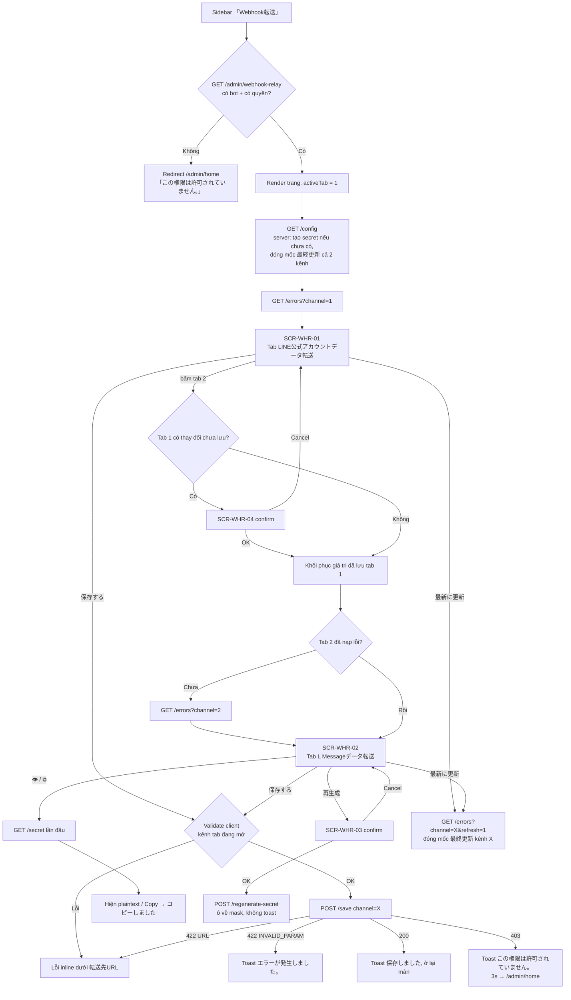

# [FA-047] Webhook転送 — UI Spec

| Thuộc tính | Giá trị |
|-----------|---------|
| Mã tính năng | **FA-047** |
| Tên | Chuyển tiếp Webhook ra công cụ bên ngoài |
| Tên JP | 「Webhook転送」 (tiêu đề trang, nhãn sidebar, nhãn quyền Staff) |
| Portal | Admin (LINE OA) — Staff dùng chung giao diện nếu được cấp quyền |
| Viết tắt màn hình | `WHR` |
| URL chính | `GET /admin/webhook-relay` (route name `webhookRelay`) — **1 route duy nhất, 2 tab = 2 kênh** |
| Controller | `Admin\WebhookRelayController@index` (`app/Http/Controllers/Admin/WebhookRelayController.php:36-67`) |
| View | `resources/views/admin/webhook-relay/index.blade.php` (197 dòng) |
| JS | `public/js/admin/webhook-relay/webhook-relay.js` (604 dòng, Vue 2, el `#webhook-relay-app`) |
| CSS | `public/css/admin/webhook-relay/webhook-relay.css` (148 dòng) |
| Layout kế thừa | `layout.admin.main` (`index.blade.php:17`) → include sidebar v2 (`layout/admin/main.blade.php:16`) |
| Design system | `lme-ui` (lme-tab-horizontal, lme-title, lme-input, lme-switch, lme-status, lme-table, lme-toast, lme-button-default, lme-button-flat, lme-icon) — `index.blade.php:20-32, 178-189` |
| Task nội bộ | #40044 (kèm các bug fix #40520, #40528–#40531, #40533, #40728, #40762, #40763, #40792, #41030) |
| Background job | **Có (ngoài phạm vi UI)** — job Spring Boot (repo `linect-service`): `HandleForwardCallbackEventManager` (kênh 1), `HandleForwardLmeEventManager` (kênh 2), `HandleRetryWebhookRelayManager` (thử lại) gửi dữ liệu và INSERT `webhook_relay_error`; màn hình chỉ đọc lỗi. (Tên `WebhookRelayTask` trong comment web là tên cũ, **không tồn tại** trong job — xem `job/job-spec.md` D-01) |

---

## Nguồn dữ liệu spec — CHẾ ĐỘ CODE-FIRST

> | Mục | Giá trị |
> |-----|--------|
> | Ngày dựng | 2026-10-23 |
> | Repo web | `src/web/sns-line` @ nhánh **`release_step_20260930_v2`**, commit **`4d9d07d159`** |
> | Phương pháp | **CODE-FIRST hoàn toàn** — session Playwright đã hết hạn, **KHÔNG có raw data, KHÔNG có screenshot, KHÔNG quan sát runtime**. Toàn bộ spec dựng từ Blade + JS + CSS + Controller + Service + FormRequest + Resource + Model + migration + command phân quyền + sidebar. |
> | Submodule `public/lme-ui` | **Chưa clone** (thư mục rỗng, khai báo ở `.gitmodules`) → **không đọc được source các component `lme-*`**. Hành vi nội bộ của component (dấu `*` bắt buộc, cách hiển thị lỗi, icon sort, toast tự ẩn...) chỉ suy luận từ prop truyền vào + đối chiếu spec các tính năng khác đã quét live (FA-044, FA-045). |
>
> **Mức độ tin cậy chung:**
> - Cấu trúc màn hình, nhãn tiếng Nhật, điều kiện `v-if`/`:disabled`, thông điệp lỗi/thành công, endpoint, luồng xử lý JS → **Cao** (đọc trực tiếp từ source) — *chưa quan sát runtime*.
> - Hình dạng render thực tế của component `lme-*` → **Trung bình** (submodule không có, suy luận từ prop).
> - Giá trị dữ liệu mẫu: **không có** — không có dữ liệu thật nào trong tài liệu này. Bảng `webhook_relay_*` **không có trong DB dump** của dự án (`db/schema/tables/`), chỉ có migration.
>
> ⚠ **CẢNH BÁO CHO LẦN QUÉT LIVE SAU**: chỉ cần **MỞ** trang `/admin/webhook-relay` là server đã **GHI DB** — tạo dòng `webhook_relay_setting` + sinh `signing_secret` nếu bot chưa có (`WebhookRelayService.php:435-494`), và cập nhật `errors_refreshed_at` + `notify_errors_refreshed_at` = giờ hiện tại ở **mọi lần mở trang** (`WebhookRelayService.php:83-92, 293-339`). Bấm 「最新に更新」 cũng ghi DB. Điều này mâu thuẫn với nguyên tắc "không thay đổi dữ liệu" của dự án (CLAUDE.md §14) → cần user cho phép trước khi quét live màn này.
>
> **Mã tham chiếu trong comment code**: source dùng hệ mã nội bộ của team dev (`SCR-01/02`, `EP-01…EP-05`, `BR-xx`, `QA-spec-xxx`, `QA-00x`, `D-0x`, `C-0x`, `R-003`, `W-011`, `L23/L25`, `JS-01/02`). Tài liệu này dùng hệ ID của dự án (`SCR-WHR-xx`); mã nội bộ chỉ được trích kèm chú thích "mã trong comment code" để truy vết. Bảng đối chiếu ở §Phụ lục.

---

## Tổng quan

- **Mã tính năng**: FA-047
- **Tên**: Chuyển tiếp Webhook (Webhook relay)
- **Tên JP**: 「Webhook転送」
- **Mô tả**: Cho phép Admin cấu hình **chuyển tiếp dữ liệu sự kiện của bot sang URL của công cụ bên ngoài** qua 2 kênh độc lập, mỗi kênh là 1 tab:
  1. **Kênh 1 — 「LINE公式アカウントデータ転送」**: chuyển tiếp **nguyên trạng** webhook mà LINE gửi tới LOA (mô tả UI: 「LINE公式アカウントが受信したイベントを、そのまま外部ツールへ転送します。」 — `webhook-relay.js:51`). **Không ký, không có secret**.
  2. **Kênh 2 — 「L Messageデータ転送」**: chuyển tiếp sự kiện **phát sinh trong エルメ** (gắn tag, thông tin bạn bè) (mô tả UI: 「エルメ内で発生したイベントを外部ツールへ転送します。」 — `webhook-relay.js:58`). Có **「署名シークレット」** — request gửi đi kèm header `X-Lme-Signature` (`index.blade.php:107`). ⚠ Giá trị header job gửi thực tế = **chính secret thô `whsec_…`**, không phải chữ ký HMAC (`linect-service/…/WebhookSignatureHelper.java:22-26, 79-82` — "Phương án A" đã chốt) — xem UI-22.
  - Mỗi tab gồm: card 「転送先設定」 (bật/tắt + URL đích; tab 2 thêm secret) và card 「転送エラー」 (tối đa 100 lỗi gần nhất **của chính kênh đó**).
  - Nút 「保存する」 **chỉ lưu kênh của tab đang mở**, kênh còn lại không bị đụng (`webhook-relay.js:8-9, 293-311`; `WebhookRelayService.php:141-145`).
- **Portal**: Admin
- **URL pattern**: `/admin/webhook-relay` (+ 5 endpoint AJAX dưới cùng prefix — xem §API được gọi)
- **Middleware**: `admin_access`, `https_protocol`, `check_remember_token` (group `/admin`, `routes/web.php:105`); riêng `GET /admin/webhook-relay/secret` có thêm `throttle:10,1` (`routes/web.php:668-669`).

---

## Đối tượng sử dụng (Actors)

| Actor | Vai trò | Quyền truy cập | Nguồn |
|-------|---------|----------------|-------|
| Admin (owner bot) | Chủ bot (`bots.admin_id = user`) | **Toàn quyền** mọi thao tác trên màn (xem/sửa cả 2 kênh, xem/copy/tái tạo secret, xem lỗi) | `WebhookRelayController.php:242-257`; `functions.php:198-227` (owner không có dòng `user_staff_bots` → `checkBotHasPermission` = true) |
| Staff `is_admin = 1` | Staff được đặt làm quản trị | `checkBotHasPermission` trả true → **toàn quyền** ở tầng controller. Vẫn phải qua whitelist route của middleware `AdminAccess` theo role (xem Điểm chưa rõ #6) | `functions.php:207-208` |
| Staff thường (`is_admin = 0`) | Staff do Admin mời (`user_staff_bots.status = 1`) | **Mặc định KHÔNG có quyền.** Admin phải tick mục 「Webhook転送」 (nhóm 「システム設定」) trong màn phân quyền Staff. Quyền ở **mức màn** — được cấp là làm được **mọi thao tác**, kể cả 「再生成」 secret (không có quyền theo action) | `AddAccessFeatureWebhookRelay.php:9-20, 37-42`; `WebhookRelayController.php:234-241` |
| LINE User | — | Không tương tác trực tiếp. Sự kiện của họ (webhook LINE, tag, thông tin bạn bè) là dữ liệu được chuyển tiếp | `create_webhook_relay_setting_table.php:10-15` |
| Công cụ bên ngoài | Hệ thống nhận | Nhận HTTP POST tới 「転送先URL」; kênh 2 xác thực bằng cách **so sánh chuỗi** header `X-Lme-Signature` với secret (header mang secret thô, không phải HMAC) | `index.blade.php:107`; `linect-service/…/WebhookSignatureHelper.java:79-82` |

**Cơ chế phân quyền Staff** (**Cao**):
- Command `php artisan access-feature:webhook-relay` tạo 1 dòng cha `access_feature` (`name='Webhook転送'`, `route='webhookRelay'`, `url='/admin/webhook-relay'`, `visible=1`, nhóm `menu_id=10` 「システム設定」, đặt **ngay sau** mục 「LINE公式アカウント入れ替え」) + **5 dòng con** `visible=0`, `menu_id=NULL` cho 5 route AJAX (`AddAccessFeatureWebhookRelay.php:58-64, 79-161`).
- Không tự cấp cho role nào (không tạo `bot_role_access`) → mặc định chỉ owner dùng được (`AddAccessFeatureWebhookRelay.php:19-20`).
- **Không có kiểm tra quyền ở sidebar**: mục menu hiển thị cho **mọi** user khi đã chọn bot (`sidebar.blade.php:79` chỉ kiểm `@if($bot)`). Staff không có quyền vẫn thấy menu → bấm vào sẽ bị chặn (xem §Trạng thái — Từ chối truy cập).

---

## Đường vào tính năng

| Vị trí | Mô tả | Nguồn |
|--------|-------|-------|
| Sidebar Admin v2 → section 「機能関連」 | Mục 「Webhook転送」 (icon SVG inline hình 3 nút nối nhau). Thứ tự trong section: … 「接続設定」 → 「API連携」 → **「Webhook転送」**. Comment code ghi "CHỐT QA-spec-001: mục nằm NGAY DƯỚI 「接続設定」" nhưng thực tế giữa hai mục có 「API連携」 (task #40041 thêm sau) | `sidebar.blade.php:177-187` (接続設定), `189-207` (API連携), `209-245` (Webhook転送) |
| Sidebar thu gọn | Hiển thị icon + tooltip 「Webhook転送」 bên phải | `sidebar.blade.php:212` |
| Trạng thái active | Class `active` khi `$routeCurrent == 'webhookRelay'` | `sidebar.blade.php:213, 230` |
| Điều kiện hiển thị | Chỉ khi đã chọn bot (`@if($bot)`) — không lọc theo quyền | `sidebar.blade.php:79, 247` |
| Màn phân quyền Staff (tính năng khác) | Mục tick 「Webhook転送」 trong nhóm 「システム設定」 | `AddAccessFeatureWebhookRelay.php:34-42` |

---

## Bảng tổng hợp màn hình

| Mã | Tên màn hình | Loại | Điều kiện hiển thị | Mã trong comment code |
|----|-------------|------|--------------------|----------------------|
| **SCR-WHR-01** | Tab 「LINE公式アカウントデータ転送」 (kênh 1) | Trang / tab — **mặc định** | `activeTab === 1` (luôn = 1 khi vào/F5) | SCR-01 |
| **SCR-WHR-02** | Tab 「L Messageデータ転送」 (kênh 2) | Trang / tab | `activeTab === 2` | SCR-02 |
| **SCR-WHR-03** | Hộp xác nhận tái tạo 「署名シークレット」 | Dialog native `window.confirm` | Bấm 「再生成」 ở SCR-WHR-02 | BR-03 |
| **SCR-WHR-04** | Hộp xác nhận rời tab khi chưa lưu | Dialog native `window.confirm` | Đổi tab khi tab đang rời có thay đổi chưa lưu | BR-22 |

> Hai tab nằm trên **cùng 1 trang, cùng 1 Vue instance**, cùng dùng chung khung layout, nút 「保存する」 và **cùng 1 instance `lme-table`** (chỉ đổi `data-source`) — `index.blade.php:1-13, 142-152`; `webhook-relay.js:4-5`. Trạng thái tab **không lưu** vào query string/storage (`index.blade.php:12-13`; `webhook-relay.js:14`).

---

## Các màn hình

### Khung trang chung (áp dụng cho SCR-WHR-01 và SCR-WHR-02)

- **URL**: `/admin/webhook-relay`
- **Tiêu đề trang (browser title)**: 「Webhook転送」 (`index.blade.php:18`)
- **Screenshot**: không có (code-first)

#### Layout tổng thể (wireframe suy luận từ Blade + CSS — tin cậy Trung bình)

```
┌ Sidebar v2 ─┐ ┌──────────────────────────────────────────────────────────────┐
│ ...         │ │ Webhook転送   [📖 使い方を見る]                              │ ← .wh-header
│ 接続設定    │ ├──────────────────────────────────────────────────────────────┤
│ API連携     │ │ ┌ card 1 ─────────────────────────────────────────────────┐ │
│▶Webhook転送 │ │ │ [LINE公式アカウントデータ転送] [L Messageデータ転送]   │ │ ← lme-tab-horizontal
│ ...         │ │ │ 転送先設定                                             │ │ ← lme-title h1 gray
│             │ │ │ {mô tả kênh}                                           │ │
│             │ │ │ 転送の状態                                             │ │
│             │ │ │ (○ switch) ● 転送中 / ● 停止中                         │ │
│             │ │ │ 転送先URL *                                            │ │
│             │ │ │ [https://example.com/webhook______________] (520px)    │ │
│             │ │ │ (chỉ tab 2) 署名シークレット                           │ │
│             │ │ │ [whsec_••••••••••••••••] [👁] [⧉] [⟳ 再生成]          │ │
│             │ │ │ ⓘ リクエストヘッダー X-Lme-Signature に署名を…         │ │
│             │ │ ├─────────────────────────────────────────────────────────┤ │
│             │ │ │                 [   保存する   ] (160px, căn giữa)      │ │ ← .wh-footer (NGOÀI tabpanel)
│             │ │ └─────────────────────────────────────────────────────────┘ │
│             │ │ ┌ card 2 ─────────────────────────────────────────────────┐ │
│             │ │ │ 転送エラー                                             │ │
│             │ │ │ 「{tên tab}」で転送に失敗したデータを新しい順に…       │ │
│             │ │ │ 最終更新: 2026/10/23 10:32            [⟳ 最新に更新]  │ │ ← .wh-toolbar
│             │ │ │ ┌ 発生日時 ⇅ │ イベント種別 │ エラー内容 │ エラーコード ┐│ │ ← lme-table max-height 560px
│             │ │ │ │ ...        │ ...          │ (badge đỏ) │ 404 / —     ││ │
│             │ │ │ └──────────────────────────────────────────────────────┘│ │
│             │ │ │ ⓘ 転送に失敗した場合は自動で最大3回まで再送を…         │ │
│             │ │ └─────────────────────────────────────────────────────────┘ │
└─────────────┘ └──────────────────────────────────────────────────────────────┘
```

- `.wh-page` flex dọc, khoảng cách `--lme-m-l` (`webhook-relay.css:8-12`). Card nền trắng bo góc (`webhook-relay.css:35-42`).
- Footer card 1: căn giữa, có đường kẻ trên (`webhook-relay.css:90-97`).
- Toàn bộ chuỗi tiếng Nhật được ghi chú là "lấy NGUYÊN VĂN từ design revision 2" (`index.blade.php:15`; `webhook-relay.js:19`).

#### Thanh công cụ / Header actions

| Vị trí | Element | Text JP | Loại | Hành vi | Nguồn |
|--------|---------|---------|------|---------|-------|
| Trái | Tiêu đề trang | 「Webhook転送」 | Text (`.wh-title`, font xl bold) | — | `index.blade.php:42` |
| Cạnh tiêu đề | Nút trợ giúp | 「使い方を見る」 + icon `book1` | `lme-button-flat size=md` | Mở `WEBHOOK_RELAY_CONFIG.docsUrl` ở tab mới (`window.open(..., '_blank')`). **Nếu env `WEBHOOK_RELAY_DOCS_URL` rỗng → bấm không có tác dụng gì** (nút vẫn hiển thị, không disabled). Comment: TODO QA-spec-002 "URL trang 使い方を見る chưa được cấp" | `index.blade.php:43-46`; `webhook-relay.js:595-602`; `WebhookRelayController.php:61` |

#### Tabs

| Tab | Text JP | Nội dung | Mặc định? | Nguồn |
|-----|---------|---------|----------|-------|
| Tab 1 (`id=1`, kênh LINE) | 「LINE公式アカウントデータ転送」 | SCR-WHR-01 | **Có** — luôn mở tab 1 khi vào/F5 | `webhook-relay.js:35, 42-45` |
| Tab 2 (`id=2`, kênh LME) | 「L Messageデータ転送」 | SCR-WHR-02 | Không | `webhook-relay.js:44` |

- Component `lme-tab-horizontal v-model="activeTab" :tabs="tabs" @select="onSelectTab"` (`index.blade.php:53`). Theo comment, component emit `input` (đổi `activeTab`) **trước** `select` (`webhook-relay.js:228-229`).
- **Không có badge số lỗi trên tab** (thiết kế v2 đã bỏ — `WebhookRelayService.php:76`).
- Hành vi đổi tab (`webhook-relay.js:204-233`):
  1. Nếu tab đang rời **có thay đổi chưa lưu** (`isDirty`: switch khác giá trị đã lưu, hoặc URL sau `trim()` khác URL đã lưu — `webhook-relay.js:193-198`) → hiện **SCR-WHR-04**. Huỷ → quay lại tab cũ.
  2. Đồng ý (hoặc không có thay đổi) → **khôi phục giá trị đã lưu** cho tab vừa rời (thay đổi chưa lưu bị huỷ, lỗi inline bị xoá).
  3. Lần đầu mở tab đó → nạp danh sách lỗi của kênh (không đóng mốc 「最終更新」).
  4. Đưa vùng cuộn bảng lỗi về đầu (cả dọc lẫn ngang) — fix bug #40792 (`webhook-relay.js:248-266`).

#### Card 「転送エラー」 (dùng chung cấu trúc, dữ liệu theo kênh của tab đang mở)

| Thành phần | Text JP | Loại | Hành vi / ghi chú | Nguồn |
|-----------|---------|------|-------------------|-------|
| Tiêu đề | 「転送エラー」 | `lme-title h1 gray` | — | `index.blade.php:124` |
| Mô tả | 「「{tên tab}」で転送に失敗したデータを新しい順に最大100件まで表示します。」 | Text | `{tên tab}` = `current.label` (「LINE公式アカウントデータ転送」 hoặc 「L Messageデータ転送」) | `index.blade.php:126-128` |
| Mốc cập nhật | 「最終更新: {Y/m/d H:i}」 hoặc 「最終更新: —」 | Text nhỏ màu phụ | Mốc **do server giữ, tách theo kênh**; định dạng `Y/m/d H:i` (vd `2026/08/12 10:32`). Chỉ đổi khi: **vào màn** (đóng mốc cả 2 kênh) hoặc **bấm 「最新に更新」** (đóng mốc kênh của tab đang mở). **Đổi tab KHÔNG đổi mốc.** Ý nghĩa = "lần gần nhất có người xem/làm mới", **không phải** thời điểm có lỗi mới | `index.blade.php:131-135`; `webhook-relay.js:15-18, 497-505`; `WebhookRelayService.php:52, 293-350` |
| Nút làm mới | 「最新に更新」 + icon `reload-outlined` | `lme-button-flat size=md` | Nạp lại lỗi kênh hiện tại kèm `refresh=1`; `:disabled="isLoadingErrors"` | `index.blade.php:136-139`; `webhook-relay.js:492-494` |
| Bảng lỗi | (xem bảng dưới) | `lme-table`, `row-key="id"`, `max-height="560px"` | Sort client-side cột 「発生日時」 | `index.blade.php:142-165` |
| Trạng thái rỗng | 「転送エラーはありません」 | `empty-text` của lme-table | — | `index.blade.php:151` |
| Ghi chú cuối | 「転送に失敗した場合は自動で最大3回まで再送を試みます。3回とも失敗したものだけをここに記録します。表示は直近100件までです。これより古いエラーは表示されません。成功した送信は記録していません。」 | Text + icon `info-circle-filled` 14px | ⚠ Lệch hành vi job — xem UI-21 | `index.blade.php:167-170` |

**Bảng dữ liệu 「転送エラー」** (`webhook-relay.js:92-98`; `WebhookRelayErrorResource.php:17-31`):

| # | Cột (key) | Text JP | Kiểu dữ liệu | Sortable? | Rộng | Ghi chú |
|---|-----------|---------|-------------|----------|------|---------|
| 1 | `occurred_at` | 「発生日時」 | Datetime chuỗi `Y/m/d H:i:s` (không kèm thứ — CHỐT QA-spec-012) | **Có** (client-side) | 200px | Mặc định server trả **mới → cũ** |
| 2 | `event_type` | 「イベント種別」 | Text font monospace (`.wh-mono`) | Không | 180px | Kênh 1: `type` nguyên văn LINE gửi (vd `message`, `follow`…); kênh 2: `tag` \| `friend_info`. **Không dịch sang tiếng Nhật** |
| 3 | `reason` | 「エラー内容」 | Badge `lme-status` màu đỏ `#FF4D4F`, size sm | Không | 280px | Chuỗi JP do server ánh xạ từ `error_code` (7 giá trị — xem §Thông điệp) |
| 4 | `http_status` | 「エラーコード」 | Text số | Không | 140px | `null`/rỗng → hiển thị 「—」 (không nhận được response). Thiết kế v2 đổi tên cột từ 「応答」 → 「エラーコード」 |

- **Không có action trên dòng**, không có phân trang, không có bộ lọc/tìm kiếm. Giới hạn cứng **100 dòng/kênh** (`WebhookRelayError.php:29`).
- Sắp xếp (`webhook-relay.js:559-578`): chỉ phản hồi `sort-change` của cột `occurred_at`; so sánh **chuỗi** `occurred_at` (đúng thứ tự vì định dạng `Y/m/d H:i:s`); sắp xếp **trên ≤100 dòng đã tải**, không gọi lại server. `order` thiếu → coi là `desc`.

---

### SCR-WHR-01: Tab 「LINE公式アカウントデータ転送」 (kênh 1 — mặc định)

- **URL**: `/admin/webhook-relay` (tab mặc định)
- **Tiêu đề card**: 「転送先設定」
- **Mô tả kênh**: 「LINE公式アカウントが受信したイベントを、そのまま外部ツールへ転送します。」 (`webhook-relay.js:51`)
- **Screenshot**: không có (code-first)

#### Form fields

| # | Label JP | Loại input | Bắt buộc? | Placeholder | Giá trị mặc định | Validation / Ghi chú | Nguồn |
|---|---------|-----------|----------|-------------|-----------------|---------------------|-------|
| 1 | 「転送の状態」 | Switch (`lme-switch v-model="current.enabled"`) + badge trạng thái bên cạnh | Có (luôn có giá trị) | — | **Tắt** (`false`) khi bot chưa cấu hình | Badge: bật → 「転送中」 xanh `#52C41A`; tắt → 「停止中」 xám `#D9D9D9`. Badge đổi **ngay khi gạt switch** (trước khi lưu). Gạt switch **không tự lưu** | `index.blade.php:61-70`; `webhook-relay.js:52` |
| 2 | 「転送先URL」 | Text (`lme-input`, size md, rộng 520px) | **Có điều kiện** — chỉ bắt buộc khi switch **bật** (CHỐT QA-spec-026). Prop `required` luôn bật → nhãn có dấu `*` (suy luận từ FA-044, tin cậy Trung bình) | 「https://example.com/webhook」 | Rỗng | **Client** (`webhook-relay.js:273-291`, trim trước khi kiểm): (a) rỗng + bật → 「転送先URLを入力してください。」; (b) không bắt đầu bằng `https://` (phân biệt hoa thường) → 「httpsで始まるURLを入力してください。」. **Server** (`WebhookUrlValidator.php:35-116`): (a), (b) như trên + (c) dài > 1024 ký tự → 「転送先URLは1024文字以内で入力してください。」; (d) chứa khoảng trắng (kể cả full-width U+3000), URL sai cấu trúc, host có ký tự ngoài RFC 1123, cổng ≠ 443, host **không phân giải DNS được**, hoặc phân giải ra IP nội bộ/reserved → **cùng 1 câu** 「このURLは転送先に指定できません。」. Không có `maxlength` trên input. Hai kênh được phép trùng URL | `index.blade.php:72-80`; `WebhookRelayService.php:34-43, 124-129` |

- Không có trường 「署名シークレット」 ở tab này (`v-if="activeTab === channels.lme"` — `index.blade.php:83`). Kênh LINE **không ký, không secret** (BR-02 / QA-spec-028 trong comment code).
- Lỗi inline hiển thị qua prop `:error-message="current.urlError"` của `lme-input` (`index.blade.php:79`). Lỗi **không tự xoá khi người dùng sửa URL** — chỉ xoá ở lần bấm 「保存する」 kế tiếp hoặc khi đổi tab.

#### Nút hành động

| Vị trí | Element | Text JP | Loại | Hành vi | Nguồn |
|--------|---------|---------|------|---------|-------|
| Footer card 1 (căn giữa) | Nút lưu | 「保存する」 | `lme-button-default size=lg`, rộng 160px | Validate client cho **kênh của tab đang mở** → `POST /admin/webhook-relay/save` body `{channel: 1, endpoint_url: <trim>, is_enabled: 0|1}`. `:disabled="isSaving"` + chặn double-submit. Thành công → toast 「保存しました」 (tự ẩn ~3s, **ở lại màn**, không điều hướng — CHỐT QA-spec-014), cập nhật giá trị đã lưu. Lỗi → xem §Thông điệp. **Không disabled khi không có thay đổi**, **không bị chặn trong lúc đang nạp cấu hình** | `index.blade.php:114-117`; `webhook-relay.js:293-340` |

#### Trạng thái màn hình

| Trạng thái | Biểu hiện | Nguồn |
|-----------|-----------|-------|
| Đang nạp cấu hình (EP-01) | **Không có loading indicator** — `isLoadingConfig` được set nhưng không bind vào template. Form hiển thị giá trị mặc định (tắt / URL rỗng / 「停止中」) cho tới khi API trả về | `webhook-relay.js:87, 143-176`; blade không dùng biến này |
| Bot chưa từng cấu hình | Switch tắt, 「停止中」, URL rỗng. (Server vẫn tự tạo dòng cấu hình + secret khi mở màn) | `WebhookRelayService.php:83-108, 435-494` |
| Đang nạp lỗi | Nút 「最新に更新」 disabled. Bảng không có trạng thái loading riêng (không bind prop loading) | `index.blade.php:136`; `webhook-relay.js:526` |
| Không có lỗi | Bảng hiển thị 「転送エラーはありません」 | `index.blade.php:151` |
| Đang lưu | Nút 「保存する」 disabled | `index.blade.php:116` |

#### Observations

- Card 「転送エラー」 của tab này liệt kê lỗi `channel = 1` (`WebhookRelayErrorRepository.php:21-29`). Cột 「イベント種別」 là `type` của webhook LINE.
- Bộ đếm lỗi liên tiếp của kênh được reset khi chuyển **TẮT → BẬT** và lưu (ẩn với UI) (`WebhookRelayService.php:147-152`). Hệ thống **không tự tắt** kênh dù lỗi kéo dài (`create_webhook_relay_setting_table.php:18`).

---

### SCR-WHR-02: Tab 「L Messageデータ転送」 (kênh 2)

- **URL**: `/admin/webhook-relay` (sau khi bấm tab 2)
- **Tiêu đề card**: 「転送先設定」
- **Mô tả kênh**: 「エルメ内で発生したイベントを外部ツールへ転送します。」 (`webhook-relay.js:58`)
- **Screenshot**: không có (code-first)

#### Form fields

| # | Label JP | Loại input | Bắt buộc? | Placeholder | Giá trị mặc định | Validation / Ghi chú | Nguồn |
|---|---------|-----------|----------|-------------|-----------------|---------------------|-------|
| 1 | 「転送の状態」 | Switch + badge 「転送中」/「停止中」 | Có | — | Tắt | Như SCR-WHR-01 nhưng là switch **riêng** của kênh 2 | `index.blade.php:61-70`; `webhook-relay.js:59` |
| 2 | 「転送先URL」 | Text 520px | Có điều kiện (khi bật) | 「https://example.com/webhook」 | Rỗng | **Cùng bộ luật và cùng chuỗi lỗi** với SCR-WHR-01 (W-011 trong comment code — 2 ô cùng nhãn, phân biệt bằng tab) | `index.blade.php:72-80`; `WebhookUrlValidator.php:8-9` |
| 3 | 「署名シークレット」 | Text **read-only** (`lme-input disabled`, 520px) + 3 nút | — (không nhập) | — | Bản **mask**: `whsec_` + 32 ký tự `•` | Giá trị: mask khi ẩn; plaintext `whsec_` + 32 ký tự base62 khi bấm xem. Secret **được sinh tự động ngay lần đầu mở màn** (không cần lưu) | `index.blade.php:83-109`; `webhook-relay.js:123-128`; `WebhookRelayService.php:45-49, 496-527` |

**Các nút của 「署名シークレット」** (`index.blade.php:94-103`):

| # | Element | Text/Icon | Loại | Disabled khi | Hành vi | Nguồn |
|---|---------|-----------|------|-------------|---------|-------|
| 1 | Hiện/ẩn | Icon `eye-outlined` (đang ẩn) / `eye-close-outlined` (đang hiện) — **không có text, không tooltip, không aria-label** | `lme-button-flat size=md icon` | `!hasSecret` | Lần đầu bấm → `GET /admin/webhook-relay/secret` lấy plaintext (server ghi audit log mỗi lần) rồi hiện; các lần sau dùng giá trị đã cache trong bộ nhớ trang (không lưu storage) | `webhook-relay.js:365-385, 404-421` |
| 2 | Sao chép | Icon `file-copy-outlined` — không text/tooltip/aria-label | `lme-button-flat size=md icon` | `!hasSecret` | Copy **plaintext** (lấy từ server nếu chưa có) bằng `navigator.clipboard.writeText` → fallback `<textarea>` ẩn + `document.execCommand('copy')`. Thành công → toast 「コピーしました」; lỗi → 「コピーに失敗しました」 | `webhook-relay.js:387-402, 423-448` |
| 3 | Tái tạo | 「再生成」 + icon `reload-outlined` | `lme-button-flat size=md` | `!hasSecret \|\| isRegenerating` | Mở **SCR-WHR-03**; đồng ý → `POST /admin/webhook-relay/regenerate-secret`; thành công → cập nhật bản mask, xoá plaintext cache, chuyển về trạng thái ẩn. **Không có toast thành công** | `webhook-relay.js:450-485` |

- Ghi chú dưới ô secret (icon `info-circle-filled` 14px): 「リクエストヘッダー X-Lme-Signature に署名を付与して送信します。外部ツール側でこの値を検証すると、エルメからの送信であることを確認できます。」 (`X-Lme-Signature` hiển thị font monospace) — `index.blade.php:105-108`. ⚠ Wording 「署名を付与」 lệch hành vi job: giá trị header là secret thô (UI-22).

#### Nút hành động

Như SCR-WHR-01 — 「保存する」 gửi `channel: 2` và chỉ lưu kênh 2 (`webhook-relay.js:300-311`). Lưu thành công cũng đặt lại trạng thái secret về ẩn + xoá plaintext cache (`webhook-relay.js:322-328`).

#### Trạng thái màn hình

| Trạng thái | Biểu hiện | Nguồn |
|-----------|-----------|-------|
| Có secret (thông thường) | Ô hiển thị `whsec_••••…` (32 dấu `•`), 3 nút enabled | `WebhookRelayService.php:499-511` |
| Đang hiện plaintext | Ô hiển thị secret thật; icon đổi sang `eye-close-outlined` | `webhook-relay.js:123-128` |
| Không có secret (`has_secret=false`) | Ô rỗng, 3 nút disabled. Thực tế gần như không xảy ra vì EP-01 tự sinh secret | `webhook-relay.js:72, 124-126` |
| Secret không giải mã được (đổi APP_KEY…) | `has_secret=true` nhưng `secret_masked=null` → ô **rỗng** nhưng 3 nút **enabled** | `WebhookRelayService.php:86, 103, 532-547` |
| Đang tái tạo | Nút 「再生成」 disabled | `index.blade.php:100` |

#### Observations

- Card 「転送エラー」 liệt kê lỗi `channel = 2`; cột 「イベント種別」 chỉ có `tag` hoặc `friend_info` (`WebhookRelayErrorResource.php:25`).
- **Bản mask luôn giống hệt nhau**: tiền tố `whsec_` dài đúng 6 ký tự = số ký tự được giữ khi mask (`WebhookRelaySetting.php:49, 52`) → mọi secret đều hiển thị `whsec_` + 32 `•`. Sau 「再生成」 người dùng **không thấy thay đổi nào** trên ô (trừ khi đang ở chế độ hiện plaintext thì bị chuyển về mask).
- Trạng thái hiện plaintext (`secretVisible`) **không bị reset khi đổi tab** → quay lại tab 2 vẫn thấy plaintext.
- Endpoint lấy plaintext bị giới hạn 10 request/phút (`routes/web.php:668-669`); vượt → toast 「エラーが発生しました。」.

---

### SCR-WHR-03: Hộp xác nhận tái tạo 「署名シークレット」

- **Loại**: dialog native của trình duyệt (`window.confirm`) — **không phải** `lme-modal` (`webhook-relay.js:460`)
- **Kích hoạt**: bấm 「再生成」 ở SCR-WHR-02 (chỉ khi `hasSecret` và không đang tái tạo)
- **Nội dung** (nguyên văn, comment yêu cầu ĐÚNG design/spec — BR-03): 「署名シークレットを再生成します。外部ツール側の設定も更新が必要です。よろしいですか？」 (`webhook-relay.js:100-101`)
- **Nút**: OK / Cancel mặc định của trình duyệt (text phụ thuộc ngôn ngữ trình duyệt — **Thấp**)

| Lựa chọn | Kết quả | Nguồn |
|---------|---------|-------|
| OK | Gọi API tái tạo. Theo web: secret cũ **hết hiệu lực ngay**, không thời gian ân hạn (CHỐT QA-spec-017). ⚠ Thực tế job cache cấu hình **60 giây** nên kênh 2 còn gửi secret cũ tối đa ~60s sau khi tái tạo (`linect-service/…/WebhookRelaySettingManager.java:28`; job-spec R-06). Thành công: ô secret về mask, không toast. Lỗi: toast 「エラーが発生しました。」 (hoặc xử lý 403) | `webhook-relay.js:464-484`; `WebhookRelayService.php:213-251` |
| Cancel | Không thay đổi gì | `webhook-relay.js:460-462` |

---

### SCR-WHR-04: Hộp xác nhận rời tab khi chưa lưu

- **Loại**: dialog native `window.confirm` (`webhook-relay.js:208`)
- **Kích hoạt**: đổi tab khi tab đang rời có thay đổi chưa lưu (switch hoặc URL khác giá trị đã lưu)
- **Nội dung**: 「保存していない変更があります。タブを切り替えると変更内容は破棄されます。よろしいですか？」 (`webhook-relay.js:104`). ⚠ Comment code ghi: design/spec **chưa cấp wording** → dev dùng "câu chuẩn của hệ thống", **cần BA xác nhận** (`webhook-relay.js:102-103`).

| Lựa chọn | Kết quả | Nguồn |
|---------|---------|-------|
| OK | Chuyển sang tab mới; thay đổi chưa lưu của tab cũ bị huỷ (khôi phục giá trị đã lưu) | `webhook-relay.js:215-219` |
| Cancel | `activeTab` được đặt lại về tab cũ ở `$nextTick`; giữ nguyên thay đổi đang sửa | `webhook-relay.js:208-213` |

- Chỉ bảo vệ khi **đổi tab**. Rời trang (bấm sidebar, F5, đóng tab) **không có cảnh báo** (không có `beforeunload`).

---

## Thông điệp (catalog)

### Toast (`vm.$toast(message, type)` — component `lme-toast`)

| Thông điệp JP | Loại | Khi nào | Nguồn |
|--------------|------|---------|-------|
| 「保存しました」 | success | Lưu cấu hình thành công | `webhook-relay.js:331` |
| 「コピーしました」 | success | Copy secret thành công | `webhook-relay.js:425` |
| 「コピーに失敗しました」 | error | Clipboard API/`execCommand` thất bại | `webhook-relay.js:426` |
| 「エラーが発生しました。」 | error | Nạp cấu hình lỗi; nạp lỗi thất bại (giữ dữ liệu cũ); lấy secret lỗi; tái tạo lỗi; lưu bị từ chối do tham số sai (`INVALID_PARAM`) | `webhook-relay.js:150, 171, 358, 410, 419, 468, 480, 537, 549` |
| 「この権限は許可されていません。」 | error | Bất kỳ AJAX nào trả **HTTP 403** → sau **3 giây** chuyển hướng `/admin/home` | `webhook-relay.js:580-593`; `WebhookRelayController.php:224-228` |

### Lỗi inline dưới ô 「転送先URL」

| Mã lỗi (server) | Thông điệp JP | Client kiểm? | Nguồn |
|-----------------|--------------|-------------|-------|
| `URL_REQUIRED` | 「転送先URLを入力してください。」 | Có | `WebhookRelayService.php:35`; `webhook-relay.js:281` |
| `URL_NOT_HTTPS` | 「httpsで始まるURLを入力してください。」 | Có | `WebhookRelayService.php:36`; `webhook-relay.js:286` |
| `URL_TOO_LONG` | 「転送先URLは1024文字以内で入力してください。」 (TODO QA-001: chuỗi **chưa được khách chốt**) | Không | `WebhookRelayService.php:37-38` |
| `URL_NOT_ALLOWED` | 「このURLは転送先に指定できません。」 (TODO QA-001: chưa chốt) | Không | `WebhookRelayService.php:37, 39` |

> Server trả HTTP 422 `{success:false, errors:[{field, error_code, message}]}`. JS tô `message` vào ô URL của **tab đang mở**; riêng `error_code = INVALID_PARAM` hoặc `field = request` → toast (`webhook-relay.js:346-363`).

### Giá trị 「エラー内容」 trong bảng lỗi (`WebhookRelayError.php:41-62`)

| `error_code` (job ghi) | Hiển thị JP | 「エラーコード」 thực tế (theo code job) |
|-------------|------------|-----------------------------------------------|
| `CONNECT_FAILED` | 「接続できませんでした」 | 「—」 (NULL) |
| `NOT_FOUND` | 「転送先が見つかりません」 | 404 |
| `UNAUTHORIZED` | 「認証エラー」 | 401 / 403 |
| `TIMEOUT` | 「タイムアウト（10秒）」 — **khớp** timeout thật của job (10 giây mỗi pha connect/read/write — `Constants.java:239`, `WebhookRelayApiClient.java:63-68`) | 「—」 (NULL) khi job hết giờ chờ; 408 / 504 chỉ khi **bên nhận trả về** mã đó |
| `SERVER_ERROR` | 「転送先でエラーが発生しました」 | 5xx (trừ 503, 504) |
| `UNAVAILABLE` | 「転送先が一時的に応答できません」 | 503 |
| `HTTP_ERROR`, `UNKNOWN`, `INVALID_PAYLOAD` (và mọi mã lạ) → rơi về khoá `OTHER` | 「その他のエラー」 (TODO C-04: chuỗi tạm, chưa chốt) | mã thật (`HTTP_ERROR`) / 「—」 (`UNKNOWN`, `INVALID_PAYLOAD`). Khoá `OTHER` **không có writer** — job không bao giờ ghi `OTHER` |

> Cột 「エラーコード」 đối chiếu trực tiếp code job `linect-service/…/WebhookRelayApiClient.java:128-190` — **Cao**. Hợp đồng web `docs/api/webhook-relay-outbound-contract.md:231, 254, 264-275` (timeout 15s, TIMEOUT ghi 408) **lỗi thời / không được job hiện thực** (db-mapping X-01, X-02).

### Dialog xác nhận

Xem SCR-WHR-03, SCR-WHR-04.

### Trang khác

| Thông điệp | Khi nào | Nguồn |
|-----------|---------|-------|
| 「この権限は許可されていません。」 (hiển thị ở trang danh sách bot `/admin/home` qua `$errors`) | Mở `/admin/webhook-relay` khi chưa chọn bot / không có quyền | `WebhookRelayController.php:41-43`; `AdminAccess.php:68-72`; `index_v3.blade.php:487-490` |

---

## API được màn hình gọi

> Mã EP chính thức của dự án (`web/api-spec.md`) **trùng** mã trong comment code cho EP-01…EP-05; trang HTML (thứ tự 0) = **EP-06**; endpoint debug `GET /api/webhook-decode/{secret}` (không có UI) = **EP-07**.

| Thứ tự | Method + URI | Route name | Mã trong comment code | Gọi khi | Nguồn |
|-------|-------------|-----------|----------------------|--------|-------|
| 0 | `GET /admin/webhook-relay` | `webhookRelay` | — (EP-06 trong api-spec) | Mở trang (render Blade + `window.WEBHOOK_RELAY_CONFIG`) | `WebhookRelayController.php:36-67` |
| 1 | `GET /admin/webhook-relay/config` | `webhookRelay.config` | EP-01 | `mounted` (1 lần/lần mở trang) | `webhook-relay.js:131-176` |
| 2 | `POST /admin/webhook-relay/save` | `webhookRelay.save` | EP-02 | Bấm 「保存する」 | `webhook-relay.js:293-340` |
| 3 | `POST /admin/webhook-relay/regenerate-secret` | `webhookRelay.regenerateSecret` | EP-03 | OK ở SCR-WHR-03 | `webhook-relay.js:454-485` |
| 4 | `GET /admin/webhook-relay/errors?channel={1\|2}&refresh={0\|1}` | `webhookRelay.errors` | EP-04 | Sau EP-01 (tab 1); lần đầu mở tab 2; bấm 「最新に更新」 (`refresh=1`) | `webhook-relay.js:514-557` |
| 5 | `GET /admin/webhook-relay/secret` | `webhookRelay.secret` | EP-05 | Lần đầu bấm 👁 hoặc ⧉ (và sau mỗi lần tái tạo/lưu) | `webhook-relay.js:404-421` |

- Mọi AJAX gửi header `X-CSRF-TOKEN` từ `meta[name="csrf-token"]` (`webhook-relay.js:22-30`).
- `bot_id` **không bao giờ** gửi từ client — server lấy từ session (`WebhookRelayController.php:17-19`).
- Cấu hình truyền xuống JS (`WebhookRelayController.php:48-66`): `endpoints.{config,save,regenerateSecret,errors,secret}`, `channels.{line:1, lme:2}`, `docsUrl` (env `WEBHOOK_RELAY_DOCS_URL`).

---

## Trạng thái toàn trang

| Trạng thái | Biểu hiện | Tin cậy | Nguồn |
|-----------|-----------|---------|-------|
| Chưa chọn bot | Redirect `/admin/home` + lỗi 「この権限は許可されていません。」 | Cao | `WebhookRelayController.php:40-43` |
| Staff không được cấp quyền | Middleware `AdminAccess` chặn route (không nằm trong whitelist theo role) → **xoá `current_bot_id` + `is_bot_invite` khỏi session** rồi redirect `/admin/home` + lỗi 「この権限は許可されていません。」 → Staff **mất luôn bot đang chọn** | Cao | `AdminAccess.php:61-72` |
| Mất quyền khi đang ở màn (AJAX 403 từ controller) | Toast 「この権限は許可されていません。」 → 3 giây sau chuyển `/admin/home` | Cao | `webhook-relay.js:583-589` |
| Session hết hạn khi đang ở màn | AJAX có thể nhận 401 (JSON) từ `AdminAccess` → JS chỉ xử lý riêng 403 → toast chung 「エラーが発生しました。」 (hoặc **không có thông báo** với thao tác lưu), không chuyển về trang đăng nhập | Trung bình | `AdminAccess.php:91-106`; `webhook-relay.js:583-593` |
| Lỗi chặn toàn cục của layout | Layout admin chung có nhóm modal Webhook (`#modalWebhookOff`, `#modalWebhookONCallbackFail`…) có thể bung che trang khi kết nối LOA lỗi (đã ghi nhận ở FA-030/FA-044) | Trung bình | `layout/admin/header.blade.php:607-646`; `features/shared/pending-refs.md` |

---

## Luồng người dùng (User Flows)

### Luồng 1: Mở màn lần đầu (bot chưa cấu hình)
1. Admin bấm 「Webhook転送」 ở sidebar → `GET /admin/webhook-relay` (kiểm bot + quyền).
2. Trang render tab 1 với giá trị mặc định; JS gọi `GET /config`.
3. Server tạo dòng cấu hình + sinh secret `whsec_…`, đóng mốc 「最終更新」 cho cả 2 kênh, trả cấu hình (cả 2 kênh tắt, URL rỗng), `has_secret=true`, mask.
4. JS gọi `GET /errors?channel=1&refresh=0` → bảng hiển thị 「転送エラーはありません」; 「最終更新」 = giờ vừa mở.

### Luồng 2: Bật chuyển tiếp kênh LINE (happy path)
1. Ở SCR-WHR-01, gạt switch 「転送の状態」 → badge 「転送中」 (chưa lưu).
2. Nhập 「転送先URL」 `https://…` (cổng 443, host public, phân giải DNS được).
3. Bấm 「保存する」 → client validate OK → `POST /save {channel:1, endpoint_url, is_enabled:1}`.
4. Server validate (4 luật), lưu cột kênh 1, reset bộ đếm lỗi (vì TẮT→BẬT) → 200.
5. Toast 「保存しました」, ở lại màn; giá trị mới trở thành "đã lưu".

### Luồng 3: Lưu thất bại do validate client
1. Bật switch nhưng để URL rỗng (hoặc nhập `http://…`) → bấm 「保存する」.
2. Không gọi API; ô URL hiện 「転送先URLを入力してください。」 (hoặc 「httpsで始まるURLを入力してください。」).
3. Sửa URL → lỗi **vẫn còn** cho tới lần bấm lưu tiếp theo.

### Luồng 4: Lưu thất bại do validate server
1. Nhập URL hợp lệ về cú pháp nhưng trỏ IP nội bộ / cổng khác 443 / host không tồn tại / có khoảng trắng, hoặc dài > 1024 → bấm 「保存する」.
2. Server trả 422 → ô URL hiện 「このURLは転送先に指定できません。」 (hoặc 「転送先URLは1024文字以内で入力してください。」). Người dùng không biết lý do cụ thể trong 5 lý do gộp chung.

### Luồng 5: Tắt chuyển tiếp
1. Gạt switch về tắt (URL có thể để trống) → 「保存する」 → lưu `is_enabled=0`; URL rỗng được lưu thành NULL.

### Luồng 6: Xem / sao chép secret (kênh LME)
1. Chuyển sang tab 2 (SCR-WHR-02) → lần đầu: nạp lỗi kênh 2.
2. Bấm 👁 → `GET /secret` → ô hiển thị plaintext; bấm lại → về mask.
3. Bấm ⧉ → copy plaintext → toast 「コピーしました」.

### Luồng 7: Tái tạo secret
1. Ở tab 2 bấm 「再生成」 → SCR-WHR-03.
2. OK → `POST /regenerate-secret` → secret cũ mất hiệu lực ngay phía web (job còn gửi secret cũ tối đa ~60s do cache — R-06 job-spec); ô về mask (trông như cũ), không toast.
3. Người dùng phải bấm ⧉ để lấy secret mới và cập nhật bên công cụ ngoài.
4. Cancel → không đổi gì.

### Luồng 8: Đổi tab khi chưa lưu
1. Sửa URL ở tab 1 (chưa lưu) → bấm tab 2 → SCR-WHR-04.
2. OK → sang tab 2, thay đổi ở tab 1 bị huỷ. Cancel → ở lại tab 1 với thay đổi đang sửa.

### Luồng 9: Xem và làm mới lỗi chuyển tiếp
1. Card 「転送エラー」 hiển thị ≤100 lỗi gần nhất của kênh đang mở, mới → cũ.
2. Bấm tiêu đề 「発生日時」 → sắp xếp lại client-side.
3. Bấm 「最新に更新」 → `GET /errors?channel=X&refresh=1` → bảng nạp lại, 「最終更新」 = giờ server hiện tại (chỉ kênh đó).

### Luồng 10: Staff không có quyền
1. Staff thấy 「Webhook転送」 trong sidebar → bấm.
2. `AdminAccess` chặn → xoá bot đang chọn khỏi session → về `/admin/home` với lỗi 「この権限は許可されていません。」.

---

## Flow Diagram



---

## Bất thường / bug UI phát hiện từ code

| # | Mô tả | Mức ảnh hưởng | Tin cậy | Nguồn |
|---|-------|--------------|---------|-------|
| UI-01 | **Có thể ghi đè cấu hình thật bằng giá trị mặc định**: không có trạng thái loading/khoá form khi `GET /config` chưa trả về; nếu bấm 「保存する」 trước đó, request gửi `is_enabled=0`, URL rỗng cho kênh đang mở → tắt chuyển tiếp và xoá URL đã lưu. `isLoadingConfig` không được bind vào template | Cao (xác suất thấp) | Cao | `webhook-relay.js:87, 143-176, 294-311`; `index.blade.php:116` |
| UI-02 | **Lưu thất bại im lặng**: lỗi 5xx / mất mạng / 401 khi lưu → `applyServerErrors` không có `errors`, `handleAjaxFailure(xhr, null)` không có fallback → **không có thông báo nào**, nút chỉ bật lại | Trung bình | Cao | `webhook-relay.js:333-336, 346-351, 583-593` |
| UI-03 | **「再生成」 không có phản hồi thị giác**: không có toast thành công và bản mask trước/sau giống hệt (`whsec_` + 32 `•`, vì tiền tố dài đúng 6 = số ký tự giữ lại khi mask) | Trung bình | Cao | `webhook-relay.js:466-478`; `WebhookRelaySetting.php:49, 52`; `WebhookRelayService.php:499-511` |
| UI-04 | Lỗi inline ô URL **không tự xoá** khi người dùng sửa giá trị hoặc gạt switch (không có watcher) | Thấp | Cao | `webhook-relay.js:273-291` |
| UI-05 | Badge 「転送中」/「停止中」 phản ánh trạng thái **switch chưa lưu**, không phải trạng thái đang chạy thật | Thấp | Cao | `index.blade.php:65-68` |
| UI-06 | Không cảnh báo khi **rời trang** với thay đổi chưa lưu (chỉ cảnh báo khi đổi tab) | Thấp | Cao | `webhook-relay.js:204-213` (không có `beforeunload`) |
| UI-07 | 「使い方を見る」 **không làm gì** khi env `WEBHOOK_RELAY_DOCS_URL` rỗng (TODO QA-spec-002), nút vẫn hiện như hoạt động | Thấp | Cao (code) / Trung bình (giá trị env) | `webhook-relay.js:595-602`; `WebhookRelayController.php:61` |
| UI-08 | Bảng lỗi không có trạng thái loading → trong lúc tải (và khi lần tải đầu lỗi) hiển thị 「転送エラーはありません」, dễ hiểu nhầm là không có lỗi | Thấp | Trung bình (phụ thuộc mặc định `lme-table`) | `index.blade.php:142-152` |
| UI-09 | Cờ `isLoadingErrors` dùng chung 2 kênh → đổi tab khi tab kia đang tải, request xong trước sẽ bật lại nút 「最新に更新」 sớm | Thấp | Cao | `webhook-relay.js:521-556` |
| UI-10 | Sắp xếp chỉ trên ≤100 dòng đã tải; 2 tab dùng chung 1 instance `lme-table` nên **mũi tên sort có thể giữ trạng thái cũ** khi đổi tab / làm mới trong khi dữ liệu mới về theo thứ tự server (desc) | Thấp | Trung bình | `index.blade.php:143-145`; `webhook-relay.js:542, 559-578` |
| UI-11 | Chế độ hiện plaintext secret không reset khi đổi tab; plaintext nằm trong bộ nhớ trang tới khi reload | Thấp (bảo mật) | Cao | `webhook-relay.js:75, 204-233` |
| UI-12 | Nút icon-only (👁, ⧉) **không có tooltip/aria-label** — khác quy tắc NEW-698 mà FA-046 「API連携」 cùng đợt release áp dụng | Thấp (a11y) | Cao | `index.blade.php:94-99`; so sánh `basic/api_integration/index.blade.php:177-197` |
| UI-13 | Xác nhận dùng `window.confirm` native thay vì `lme-modal` (FA-046 dùng `lme-modal` cho thao tác nguy hiểm); wording SCR-WHR-04 chưa được BA chốt | Thấp (nhất quán UI) | Cao | `webhook-relay.js:100-104, 208, 460` |
| UI-14 | ~~「タイムアウト（10秒）」 lệch với timeout thật 15 giây~~ — **Đã phân xử: KHÔNG lệch.** Job dùng 10 giây mỗi pha (`linect-service/…/Constants.java:239`, `WebhookRelayApiClient.java:63-68`); "15 giây" chỉ có ở tài liệu hợp đồng lỗi thời (`docs/api/webhook-relay-outbound-contract.md:231`) và TODO C-05 (`WebhookRelayError.php:35-38`). Lưu ý phụ: không có `callTimeout` nên tổng thời gian chờ có thể > 10s | Thấp | Cao | `WebhookRelayError.php:35-45` |
| UI-15 | 「イベント種別」 hiển thị mã kỹ thuật tiếng Anh (`message`, `tag`, `friend_info`…) không dịch | Thấp | Cao | `WebhookRelayErrorResource.php:25`; `index.blade.php:154-156` |
| UI-16 | Kiểm `https://` phân biệt hoa thường → 「HTTPS://…」 bị báo 「httpsで始まるURLを入力してください。」 | Thấp | Cao | `webhook-relay.js:285`; `WebhookUrlValidator.php:43` |
| UI-17 | 5 lý do từ chối khác nhau (khoảng trắng, URL sai cấu trúc, cổng ≠ 443, IP nội bộ, DNS không phân giải) dùng chung 1 thông điệp 「このURLは転送先に指定できません。」; ô không có `maxlength` | Thấp | Cao | `WebhookUrlValidator.php:47-68`; `index.blade.php:72-80` |
| UI-18 | Sidebar hiện 「Webhook転送」 cho cả Staff không có quyền; bấm vào bị đẩy về danh sách bot **và mất bot đang chọn** | Trung bình | Cao | `sidebar.blade.php:79, 209-245`; `AdminAccess.php:68-71` |
| UI-19 | **Mở trang là ghi DB** (tạo secret, cập nhật 2 cột mốc 「最終更新」 mỗi lần mở) — GET có side-effect; 「最終更新」 chỉ là "lần xem gần nhất" | Trung bình (nghiệp vụ/dữ liệu) | Cao | `WebhookRelayService.php:83-92, 293-339, 435-494` |
| UI-20 | Secret không giải mã được → `GET /secret` trả `success:true, secret:null` → JS hiện ô rỗng và **copy chuỗi `"null"`** (Clipboard API chuyển `null` thành chuỗi) kèm toast 「コピーしました」 | Thấp (edge) | Trung bình | `WebhookRelayService.php:370-373, 532-547`; `webhook-relay.js:409-416, 429` |
| UI-21 | Ghi chú 「自動で最大3回まで再送…3回とも失敗したものだけをここに記録」 lệch hành vi job: tổng **3 lần gửi** (1 lần đầu + 2 lần thử lại, cách 1 phút), chỉ thử lại khi timeout / HTTP ≥ 500; lỗi không-retry (không kết nối được, 4xx, 3xx) được ghi **ngay sau lần 1** | Trung bình (hiểu nhầm nghiệp vụ) | Cao | `index.blade.php:169`; `linect-service/…/Constants.java:221-223`, `WebhookRelayResult.java:53-61`, `HandleForwardCallbackEventTask.java:115-119` (job-spec R-14b) |
| UI-22 | Ghi chú 「X-Lme-Signature に署名を付与…この値を検証すると」 gợi ý chữ ký (HMAC) nhưng job gửi **secret thô** ⇒ khách tự verify HMAC theo hợp đồng web (`docs/api/webhook-relay-outbound-contract.md:177-202`) sẽ từ chối mọi request | Trung bình | Cao | `index.blade.php:107`; `linect-service/…/WebhookSignatureHelper.java:22-26, 79-82` (job-spec R-14a) |

---

## Điểm chưa rõ / Cần xác minh

| # | Nội dung | Mức độ | Ghi chú |
|---|---------|--------|---------|
| 1 | Hình dạng render thật của các component `lme-*` (dấu `*` bắt buộc, vị trí lỗi inline, icon sort, toast tự ẩn sau bao lâu, nút tab active) | Trung bình | Submodule `public/lme-ui` chưa clone; chưa quét runtime |
| 2 | Giá trị env `WEBHOOK_RELAY_DOCS_URL` trên production (nút 「使い方を見る」 có hoạt động không) | Trung bình | TODO QA-spec-002 trong `webhook-relay.js:595-597` |
| 3 | Wording SCR-WHR-04 chưa được BA xác nhận | Thấp | `webhook-relay.js:102-103` |
| 4 | Chuỗi 「転送先URLは1024文字以内で入力してください。」 và 「このURLは転送先に指定できません。」 chưa được khách chốt (TODO QA-001); 「その他のエラー」 tạm (TODO C-04). (「タイムアウト（10秒）」: **đã phân xử — khớp code job 10s**, TODO C-05 dựa trên tài liệu lỗi thời — xem UI-14) | Trung bình | `WebhookRelayService.php:37-39`; `WebhookRelayError.php:35-45` |
| 5 | ~~Ghi chú 「自動で最大3回まで再送」: 3 lần tổng cộng hay 1 + 3?~~ — **Đã trả lời (job-spec §8.3)**: tổng **3 lần gửi** (1 lần đầu + 2 lần thử lại), `MAX_ATTEMPT = 3` đếm cả lần đầu (`linect-service/…/Constants.java:221-223`). Wording UI lệch — xem UI-21 | Đã đóng | `index.blade.php:169` |
| 6 | Staff `is_admin = 1` và whitelist route của `AdminAccess` — **Đã đọc code**: `getRouterBotInvite()` chỉ dựa vào `bot_role_access` theo `role_id`, **không xét `is_admin`** (`functions.php:5044-5070, 5086-5094`). Staff `is_admin = 1` vào bot qua đường chọn bot thông thường bị gắn `is_bot_invite = true` (mọi user không phải owner — `Basic/BasicController.php:246-250`) ⇒ nếu role của họ chưa được tick 「Webhook転送」 thì **bị middleware chặn** (302 + mất bot đang chọn) dù `checkBotHasPermission` = true. Riêng đường `StaffManagementController.php:1482-1487` chỉ gắn cờ khi `is_admin = 0` | Trung bình (phụ thuộc đường vào bot) | Code: Cao; hành vi thực tế theo đường vào: Trung bình |
| 7 | Session hết hạn: AJAX có được nhận diện là JSON request (`isJsonApiRequest`) để trả 401, hay bị redirect 302 → `/logout` (jQuery nhận HTML → parse lỗi)? | Thấp | `AdminAccess.php:91-109` |
| 8 | Sau `sort-change`, `lme-table` có tự giữ trạng thái sort khi `data-source` đổi (đổi tab / làm mới) không | Thấp | Phụ thuộc source `lme-table` |
| 9 | Đặt mục sidebar: comment nói "ngay dưới 「接続設定」" nhưng thực tế đứng sau 「API連携」 — có phải ý đồ thiết kế mới không | Thấp | `sidebar.blade.php:189-210` |
| 10 | ~~Kênh 2: `friend_info` chưa có call site phía web~~ — **Đã trả lời**: mục này của hợp đồng lỗi thời (thời emitter web). Nay job quét thẳng `friend_info_history` (`HandleForwardLmeEventManager.java:131-165`), bảng được web ghi ở `FriendDetailFriendInfoRepository.php:373` + `functions.php:12490` và job ghi qua `HistoryHelper.recordFriendInfo` ⇒ lỗi `friend_info` có thể xuất hiện | Đã đóng | job-spec §3.4, §2.1 |
| 11 | Route debug `GET /api/webhook-decode/{secret}` (EP-07) — ⚠ **KHÔNG chỉ sống khi `APP_DEBUG=true`**: guard `APP_DEBUG` đang **bị comment** (`WebhookRelayDebugController.php:49-51`, commit `3f3c7ddf95`) ⇒ endpoint mở ở **mọi môi trường**, không auth/session (nhóm `api` chỉ có `bindings`). Tra ngược plaintext secret → `bot_id` + ciphertext. Không thuộc UI — xem `logic-spec.md` SEC-01 | **Cao** (bảo mật) | `routes/api.php:440-446`; `WebhookRelayService.php:376-422` |

---

## Phụ lục — Đối chiếu mã tham chiếu trong comment code

| Mã nội bộ (comment code) | Ý nghĩa | Ánh xạ trong spec này |
|-------------------------|---------|----------------------|
| SCR-01 / SCR-02 | Tab kênh LINE / tab kênh LME | SCR-WHR-01 / SCR-WHR-02 |
| EP-01 … EP-05 | `config` / `save` / `regenerate-secret` / `errors` / `secret` | §API được màn hình gọi (thứ tự 1–5) |
| BR-02 / QA-spec-028 | Secret chỉ thuộc kênh LME | SCR-WHR-02 |
| BR-03 | Confirm khi tái tạo secret, đúng nguyên văn | SCR-WHR-03 |
| BR-05 | Hiển thị tối đa 100 lỗi | Card 「転送エラー」 |
| BR-07 | 「保存する」 luôn hiện ở cả 2 tab | Khung trang chung |
| BR-09 / QA-spec-005 / D-05 | Staff có thể được cấp quyền màn | §Actors |
| BR-19 | Lỗi tách theo kênh | Card 「転送エラー」 |
| BR-22 / QA-spec-030 | Chỉ lưu kênh của tab đang mở + cảnh báo khi rời tab | SCR-WHR-04, nút 「保存する」 |
| BR-25 / QA-spec-009 | Không tự tắt kênh khi lỗi | Observations SCR-WHR-01 |
| QA-spec-003 | Mặc định tắt / thời điểm sinh secret (code đã lệch: sinh ngay khi mở màn) | UI-19 |
| QA-spec-004 / D-03 | Secret xem lại được bất cứ lúc nào | SCR-WHR-02 nút 👁 |
| QA-spec-012 | Định dạng 「発生日時」, sắp xếp mới → cũ | Bảng lỗi |
| QA-spec-014 | Lưu xong ở lại màn, toast | Nút 「保存する」 |
| QA-spec-015 | Luôn mở tab 1 khi vào/F5 | §Tabs |
| QA-spec-017 | Secret cũ hết hiệu lực ngay khi tái tạo | SCR-WHR-03 |
| QA-spec-026 / QA-001 / RR-02 | URL bắt buộc khi bật; ≤1024; chống SSRF, cổng 443 | Form field 「転送先URL」 |
| R-003 | Quyền ở mức màn, không theo action | §Actors |
| #41030 | 「最終更新」 lưu server, tách theo kênh | Card 「転送エラー」 |
| #40792 | Reset cuộn bảng khi đổi tab | §Tabs |
